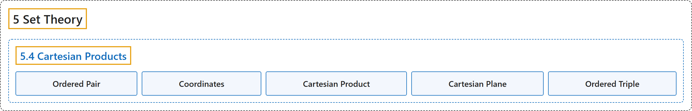

# 5.4 Cartesian Products

## Classification

## Glossary

| Term | Definition | 中文翻译 | Source |
|---|---|---|---|
| **5 Set Theory** 集合论 | (No definition) | （无定义） | [Sundstrom, 2022, chapter 5](https://gvsuoer.github.io/sundstrom-textbook/C_settheory.html) |
| **5.4 Cartesian Products** 笛卡尔积 | (No definition) | （无定义） | [Sundstrom, 2022, section 5.4](https://gvsuoer.github.io/sundstrom-textbook/S_cartesian.html) |
| **Ordered Pair** 有序对 | "An ordered pair (with first element from $A$ and second element from $B$) is **a single pair of objects**, denoted by $(a, b)$, with $a \in A$ and $b \in B$ **and an implied order**." | 有序对（第一个元素来自 $A$，第二个元素来自 $B$）是**单独的一对对象**，记作 $(a, b)$，其中 $a \in A$，$b \in B$，**并带有隐含的顺序**。 | [Sundstrom, 2022, section 5.4](https://gvsuoer.github.io/sundstrom-textbook/S_cartesian.html#orderedpair) |
| **Coordinates** 坐标 | "The objects in the ordered pair are called **the coordinates of the ordered pair**." | 有序对中的对象称为**该有序对的坐标**。 | [Sundstrom, 2022, section 5.4](https://gvsuoer.github.io/sundstrom-textbook/S_cartesian.html#orderedpair) |
| **Cartesian Product** 笛卡尔积 | "If $A$ and $B$ are sets, then the Cartesian product, $A \times B\text{,}$ of $A$ and $B$ is **the set of all ordered pairs** $\left( {x,y} \right)$ where $x \in A$ and $y \in B\text{.}$" | 如果 $A$ 和 $B$ 是集合，那么 $A$ 与 $B$ 的笛卡尔积 $A \times B$ 是满足 $x \in A$、$y \in B$ 的**所有有序对** $\left( {x,y} \right)$ 组成的集合。 | [Sundstrom, 2022, section 5.4](https://gvsuoer.github.io/sundstrom-textbook/S_cartesian.html#cartesianproduct) |
| **Cartesian Plane** 笛卡尔平面 | "This $xy$-plane, with which you are familiar, is **a representation of the set** $\mathbb{R} \times \mathbb{R}$ or $\mathbb{R}^2\text{.}$ This plane is called the Cartesian plane." | 你熟悉的这个 $xy$ 平面**表示的是集合** $\mathbb{R} \times \mathbb{R}$（即 $\mathbb{R}^2$）。这个平面称为笛卡尔平面。 | [Sundstrom, 2022, section 5.4](https://gvsuoer.github.io/sundstrom-textbook/S_cartesian.html#sym_cartplane) |
| **Ordered Triple** 有序三元组 | "An ordered triple can be thought of as **a single triple of objects**, denoted by $\left( {a,b,c} \right)\text{,}$ **with an implied order**." | 有序三元组可以看作**单独的三个对象**，记作 $\left( {a,b,c} \right)$，**并带有隐含的顺序**。 | [Sundstrom, 2022, section 5.4](https://gvsuoer.github.io/sundstrom-textbook/S_cartesian.html#exer_defoforderedpair) |

## References

Sundstrom, T. (2022). *Mathematical reasoning: Writing and proof* (Version 2.1; PreTeXt edition by Grand Valley State University). Retrieved October 30, 2026, from <https://gvsuoer.github.io/sundstrom-textbook/frontmatter.html>
