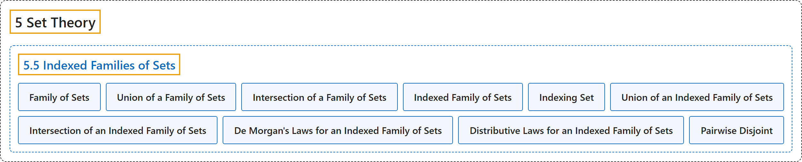

# 5.5 Indexed Families of Sets

## Classification

## Glossary

| Term | Definition | 中文翻译 | Source |
|---|---|---|---|
| **5 Set Theory** 集合论 | (No definition) | （无定义） | [Sundstrom, 2022, chapter 5](https://gvsuoer.github.io/sundstrom-textbook/C_settheory.html) |
| **5.5 Indexed Families of Sets** 加标集族 | (No definition) | （无定义） | [Sundstrom, 2022, section 5.5](https://gvsuoer.github.io/sundstrom-textbook/S_indexfamily.html) |
| **Family of Sets** 集族 | "The phrase, “a set of sets” sounds confusing, and so we often use the terms collection and family when we wish to **emphasize that the elements of a given set are themselves sets**." | “集合的集合”这种说法听起来容易混淆，所以当我们想**强调某个集合的元素本身也是集合**时，常用“族”（collection 或 family）这两个词。 | [Sundstrom, 2022, section 5.5](https://gvsuoer.github.io/sundstrom-textbook/S_indexfamily.html#p-3433) |
| **Union of a Family of Sets** 集族的并 | "Let $\mathcal{C}$ be a family of sets. The union of $\mathbf{\mathcal{C}}$ is defined as **the set of all elements that are in at least one of the sets** in $\mathcal{C}\text{.}$" | 设 $\mathcal{C}$ 是一个集族。$\mathbf{\mathcal{C}}$ 的并定义为**至少属于其中一个集合的所有元素组成的集合**（指 $\mathcal{C}$ 中的集合）。 | [Sundstrom, 2022, section 5.5](https://gvsuoer.github.io/sundstrom-textbook/S_indexfamily.html#D_familyoper) |
| **Intersection of a Family of Sets** 集族的交 | "The intersection of $\mathbf{\mathcal{C}}$ is defined as **the set of all elements that are in all of the sets** in $\mathcal{C}\text{.}$" | $\mathbf{\mathcal{C}}$ 的交定义为**属于所有这些集合的元素组成的集合**（指 $\mathcal{C}$ 中的集合）。 | [Sundstrom, 2022, section 5.5](https://gvsuoer.github.io/sundstrom-textbook/S_indexfamily.html#D_familyoper) |
| **Indexed Family of Sets** 加标集族 | "Let $\Lambda$ be a nonempty set and suppose that **for each** $\alpha \in \Lambda\text{,}$ **there is a corresponding set** $A_\alpha\text{.}$ The family of sets $\left\{ A_\alpha \mid \alpha \in \Lambda \right\}$ is called an indexed family of sets indexed by $\Lambda\text{.}$" | 设 $\Lambda$ 是非空集合，并假设**对每个** $\alpha \in \Lambda$，**都有一个对应的集合** $A_\alpha$。集族 $\left\{ A_\alpha \mid \alpha \in \Lambda \right\}$ 称为以 $\Lambda$ 为指标的加标集族。 | [Sundstrom, 2022, section 5.5](https://gvsuoer.github.io/sundstrom-textbook/S_indexfamily.html#D_indexfamily) |
| **Indexing Set** 指标集 | "Each $\alpha \in \Lambda$ is **called an index** and $\Lambda$ is called an indexing set." | 每个 $\alpha \in \Lambda$ **称为一个指标**，$\Lambda$ 称为指标集。 | [Sundstrom, 2022, section 5.5](https://gvsuoer.github.io/sundstrom-textbook/S_indexfamily.html#D_indexfamily) |
| **Union of an Indexed Family of Sets** 加标集族的并 | "The union over $\mathbf{\mathscr{A}}$ is defined as **the set of all elements that are in at least one of sets** $A_\alpha\text{,}$ where $\alpha \in \Lambda\text{.}$" | $\mathbf{\mathscr{A}}$ 上的并定义为由**至少属于其中一个集合的所有元素组成的集合**，这些集合是 $A_\alpha$（$\alpha \in \Lambda$）。 | [Sundstrom, 2022, section 5.5](https://gvsuoer.github.io/sundstrom-textbook/S_indexfamily.html#D_indexoper) |
| **Intersection of an Indexed Family of Sets** 加标集族的交 | "The intersection over $\mathbf{\mathscr{A}}$ is **the set of all elements that are in all of the sets** $A_\alpha$ for each $\alpha \in \Lambda\text{.}$" | $\mathbf{\mathscr{A}}$ 上的交是由**属于所有这些集合的元素组成的集合**，这些集合是 $A_\alpha$（对每个 $\alpha \in \Lambda$）。 | [Sundstrom, 2022, section 5.5](https://gvsuoer.github.io/sundstrom-textbook/S_indexfamily.html#D_indexoper) |
| **De Morgan's Laws for an Indexed Family of Sets** 加标集族的德摩根律 | "$\displaystyle \left(\:\bigcap\limits_{\alpha \in \Lambda}^{}A_\alpha \right)^c = \bigcup\limits_{\alpha \in \Lambda}^{}A_{\alpha}^c$ $\displaystyle \left(\:\bigcup\limits_{\alpha \in \Lambda}^{}A_\alpha \right)^c = \bigcap\limits_{\alpha \in \Lambda}^{}A_{\alpha}^c$" | $\displaystyle \left(\:\bigcap\limits_{\alpha \in \Lambda}^{}A_\alpha \right)^c = \bigcup\limits_{\alpha \in \Lambda}^{}A_{\alpha}^c$，$\displaystyle \left(\:\bigcup\limits_{\alpha \in \Lambda}^{}A_\alpha \right)^c = \bigcap\limits_{\alpha \in \Lambda}^{}A_{\alpha}^c$ | [Sundstrom, 2022, section 5.5](https://gvsuoer.github.io/sundstrom-textbook/S_indexfamily.html#T_indexproperties) |
| **Distributive Laws for an Indexed Family of Sets** 加标集族的分配律 | "Theorem 5.40 states the distributive laws for set operations. Theorem 5.40. Let $\Lambda$ be a nonempty indexing set, let $\mathscr{A} = \left\{ A_\alpha \mid \alpha \in \Lambda \right\}$ be an indexed family of sets, and let $B$ be a set. Then $B \cap \left(\:\bigcup\limits_{\alpha \in \Lambda}^{}A_{\alpha} \right) = \bigcup\limits_{\alpha \in \Lambda}^{} \left( B \cap A_{\alpha} \right)\text{,}$" | 定理 5.40 给出了集合运算的分配律。定理 5.40：设 $\Lambda$ 是非空指标集，$\mathscr{A} = \left\{ A_\alpha \mid \alpha \in \Lambda \right\}$ 是加标集族，$B$ 是集合，那么 $B \cap \left(\:\bigcup\limits_{\alpha \in \Lambda}^{}A_{\alpha} \right) = \bigcup\limits_{\alpha \in \Lambda}^{} \left( B \cap A_{\alpha} \right)$ | [Sundstrom, 2022, section 5.5](https://gvsuoer.github.io/sundstrom-textbook/S_indexfamily.html#p-3503) |
| **Pairwise Disjoint** 两两不相交 | "We say that $\mathscr{A}$ is pairwise disjoint provided that **for all** $\alpha$ and $\beta$ in $\Lambda\text{,}$ **if** $A_\alpha \ne A_\beta\text{,}$ **then** $A_\alpha \cap A_\beta = \emptyset\text{.}$" | 如果**对所有** $\Lambda$ 中的 $\alpha$ 和 $\beta$，**若** $A_\alpha \ne A_\beta$，**则** $A_\alpha \cap A_\beta = \emptyset$，就说 $\mathscr{A}$ 两两不相交。 | [Sundstrom, 2022, section 5.5](https://gvsuoer.github.io/sundstrom-textbook/S_indexfamily.html#D_disjointfamily) |

## References

Sundstrom, T. (2022). *Mathematical reasoning: Writing and proof* (Version 2.1; PreTeXt edition by Grand Valley State University). Retrieved October 30, 2026, from <https://gvsuoer.github.io/sundstrom-textbook/frontmatter.html>
