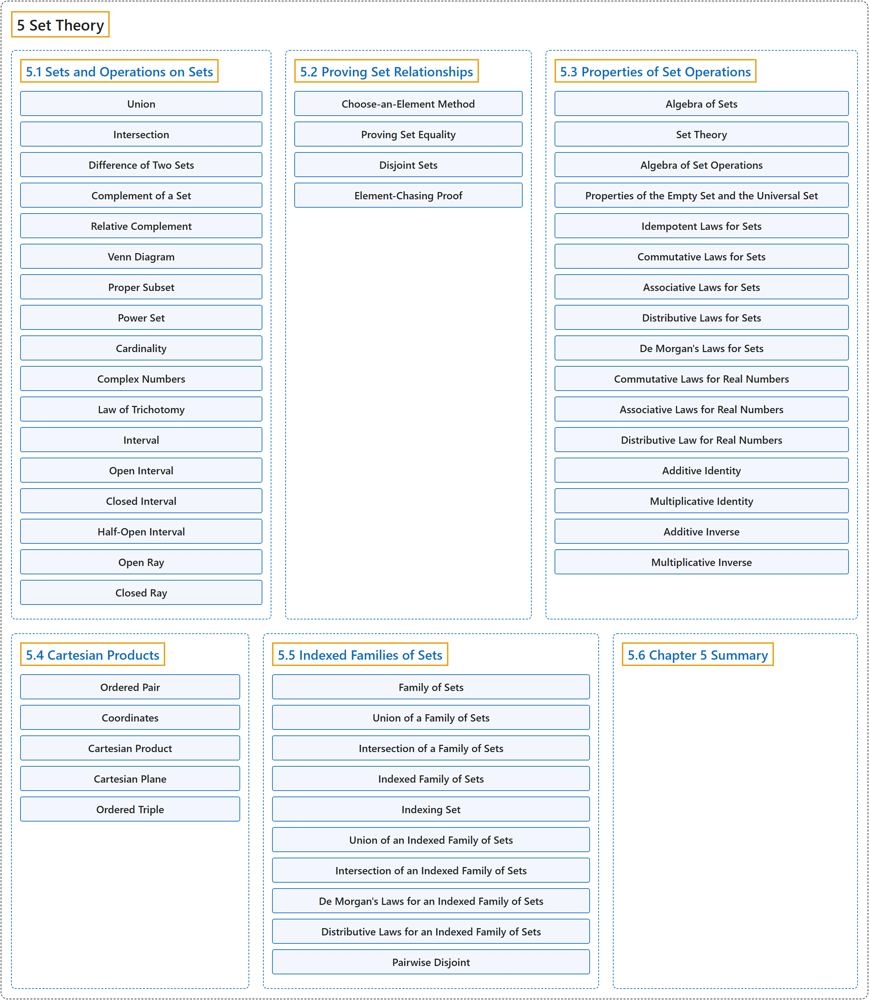

# 5 Set Theory

## Classification

## Glossary

| Term | Definition | 中文翻译 | Source |
|---|---|---|---|
| **5 Set Theory** 集合论 | (No definition) | （无定义） | [Sundstrom, 2022, chapter 5](https://gvsuoer.github.io/sundstrom-textbook/C_settheory.html) |
| **[5.1 Sets and Operations on Sets](5-1-sets-and-operations-on-sets.md)** 集合与集合运算 | (No definition) | （无定义） | [Sundstrom, 2022, section 5.1](https://gvsuoer.github.io/sundstrom-textbook/S_setoperations.html) |
| **[5.2 Proving Set Relationships](5-2-proving-set-relationships.md)** 证明集合关系 | (No definition) | （无定义） | [Sundstrom, 2022, section 5.2](https://gvsuoer.github.io/sundstrom-textbook/S_provingset.html) |
| **[5.3 Properties of Set Operations](5-3-properties-of-set-operations.md)** 集合运算的性质 | (No definition) | （无定义） | [Sundstrom, 2022, section 5.3](https://gvsuoer.github.io/sundstrom-textbook/S_setproperties.html) |
| **[5.4 Cartesian Products](5-4-cartesian-products.md)** 笛卡尔积 | (No definition) | （无定义） | [Sundstrom, 2022, section 5.4](https://gvsuoer.github.io/sundstrom-textbook/S_cartesian.html) |
| **[5.5 Indexed Families of Sets](5-5-indexed-families-of-sets.md)** 加标集族 | (No definition) | （无定义） | [Sundstrom, 2022, section 5.5](https://gvsuoer.github.io/sundstrom-textbook/S_indexfamily.html) |
| **[5.6 Chapter 5 Summary](5-6-chapter-5-summary.md)** 第 5 章小结 | (No definition) | （无定义） | [Sundstrom, 2022, section 5.6](https://gvsuoer.github.io/sundstrom-textbook/S_5summary.html) |

## References

Sundstrom, T. (2022). *Mathematical reasoning: Writing and proof* (Version 2.1; PreTeXt edition by Grand Valley State University). Retrieved October 30, 2026, from <https://gvsuoer.github.io/sundstrom-textbook/frontmatter.html>
