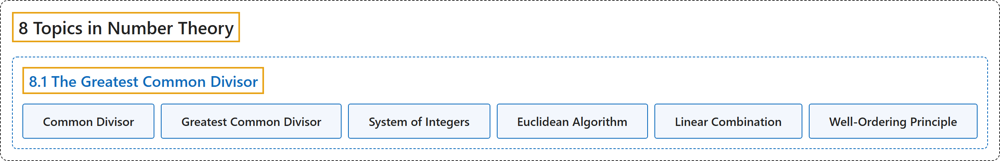

# 8.1 The Greatest Common Divisor

## Classification

## Glossary

| Term | Definition | 中文翻译 | Source |
|---|---|---|---|
| **8 Topics in Number Theory** 数论专题 | (No definition) | （无定义） | [Sundstrom, 2022, chapter 8](https://gvsuoer.github.io/sundstrom-textbook/C_numbertheory.html) |
| **8.1 The Greatest Common Divisor** 最大公因数 | (No definition) | （无定义） | [Sundstrom, 2022, section 8.1](https://gvsuoer.github.io/sundstrom-textbook/S_gcd.html) |
| **Common Divisor** 公因数 | "A common divisor of $a$ and $b$ is **any nonzero integer that divides both** $a$ **and** $b\text{.}$" | $a$ 与 $b$ 的公因数是**同时整除** $a$ **和** $b$ 的任意非零整数。 | [Sundstrom, 2022, section 8.1](https://gvsuoer.github.io/sundstrom-textbook/S_gcd.html#gcd) |
| **Greatest Common Divisor** 最大公因数 | "**The largest natural number that divides both** $a$ and $b$ is called the greatest common divisor of $a$ and $b\text{.}$" | 同时整除 $a$ 和 $b$ **的最大自然数**称为 $a$ 与 $b$ 的最大公因数。 | [Sundstrom, 2022, section 8.1](https://gvsuoer.github.io/sundstrom-textbook/S_gcd.html#gcd) |
| **System of Integers** 整数系 | "Number theory is a study of the system of integers, which **consists of the set of integers**, $\mathbb{Z} = \left\{ \ldots , - 3, - 2, - 1, 0, 1, 2, 3, \ldots \right\}$ **and the various properties of this set under the usual operations of addition and multiplication and under the usual ordering relation** of “less than.”" | 数论研究整数系，整数系**由整数集组成**，即 $\mathbb{Z} = \left\{ \ldots , - 3, - 2, - 1, 0, 1, 2, 3, \ldots \right\}$，**以及这个集合在通常的加法、乘法运算和通常的“小于”顺序关系下的各种性质**。 | [Sundstrom, 2022, section 8.1](https://gvsuoer.github.io/sundstrom-textbook/S_gcd.html#subsection-149) |
| **Euclidean Algorithm** 欧几里得算法 | "The example in Progress Check 8.4 illustrates the main idea of the Euclidean Algorithm **for finding** $\gcd( {a, b} )\text{,}$ which is explained in the proof of the following theorem." | 进度检查 8.4 中的例子说明了欧几里得算法的主要思想，该算法**用于求** $\gcd( {a, b} )$，具体在下面定理的证明中说明。 | [Sundstrom, 2022, section 8.1](https://gvsuoer.github.io/sundstrom-textbook/S_gcd.html#subsection-151) |
| **Linear Combination** 线性组合 | "A linear combination of $a$ and $b$ is **an integer of the form** $ax + by\text{,}$ where $x$ and $y$ are integers." | $a$ 与 $b$ 的线性组合是**形如** $ax + by$ 的整数，其中 $x$ 和 $y$ 是整数。 | [Sundstrom, 2022, section 8.1](https://gvsuoer.github.io/sundstrom-textbook/S_gcd.html#linearcombination) |
| **Well-Ordering Principle** 良序原理 | "The Well-Ordering Principle for the natural numbers states that **any nonempty set of natural numbers must contain a least element**." | 自然数的良序原理指出：**任何非空自然数集都必定含有最小元素**。 | [Sundstrom, 2022, section 8.1](https://gvsuoer.github.io/sundstrom-textbook/S_gcd.html#p-5267) |

## References

Sundstrom, T. (2022). *Mathematical reasoning: Writing and proof* (Version 2.1; PreTeXt edition by Grand Valley State University). Retrieved October 30, 2026, from <https://gvsuoer.github.io/sundstrom-textbook/frontmatter.html>
