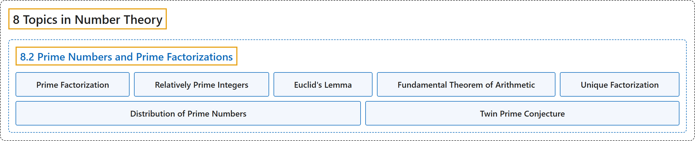

# 8.2 Prime Numbers and Prime Factorizations

## Classification

## Glossary

| Term | Definition | 中文翻译 | Source |
|---|---|---|---|
| **8 Topics in Number Theory** 数论专题 | (No definition) | （无定义） | [Sundstrom, 2022, chapter 8](https://gvsuoer.github.io/sundstrom-textbook/C_numbertheory.html) |
| **8.2 Prime Numbers and Prime Factorizations** 素数与素因数分解 | (No definition) | （无定义） | [Sundstrom, 2022, section 8.2](https://gvsuoer.github.io/sundstrom-textbook/S_primefactorizations.html) |
| **Prime Factorization** 素因数分解 | (context) "Recall that a natural number $p$ is a prime number provided that **it is greater than 1** and **the only natural numbers that divide** $p$ are 1 and $p\text{.}$" | （语境）回想一下，如果自然数 $p$ **大于 1**，并且**能整除** $p$ 的自然数只有 1 和 $p$，它就是素数。 | [Sundstrom, 2022, section 8.2](https://gvsuoer.github.io/sundstrom-textbook/S_primefactorizations.html#PA_primefactorization25) |
| **Relatively Prime Integers** 互素整数 | "Two nonzero integers $a$ and $b$ are relatively prime provided that $\gcd( {a, b} ) = 1\text{.}$" | 如果 $\gcd( {a, b} ) = 1$，两个非零整数 $a$ 和 $b$ 就是互素的。 | [Sundstrom, 2022, section 8.2](https://gvsuoer.github.io/sundstrom-textbook/S_primefactorizations.html#relativelyprime) |
| **Euclid's Lemma** 欧几里得引理 | "Item 1 of Corollary 8.16 is **known as Euclid's Lemma**." | 推论 8.16 的第 1 项**称为欧几里得引理**。 | [Sundstrom, 2022, section 8.2](https://gvsuoer.github.io/sundstrom-textbook/S_primefactorizations.html#subsection-156) |
| **Fundamental Theorem of Arithmetic** 算术基本定理 | "**Each natural number greater than 1 is either a prime number or is a product of prime numbers**." | **每个大于 1 的自然数要么是素数，要么是素数的乘积**。 | [Sundstrom, 2022, section 8.2](https://gvsuoer.github.io/sundstrom-textbook/S_primefactorizations.html#T_fundtheorem) |
| **Unique Factorization** 唯一分解 | "Note: We often shorten the result of the Fundamental Theorem of Arithmetic by simply saying that each natural number greater than one that is not a prime has a unique factorization **as a product of primes**. This simply means that if $n \in \mathbb{N}\text{,}$ $n > 1\text{,}$ and $n$ is not prime, then **no matter how we choose to factor** $n$ **into a product of primes, we will always have the same prime factors**." | 注：我们常把算术基本定理简述为：每个大于 1 且不是素数的自然数都有唯一的分解，**分解为素数的乘积**。这就是说，如果 $n \in \mathbb{N}$，$n > 1$，且 $n$ 不是素数，那么**无论怎样把** $n$ **分解为素数的乘积，得到的素因数总是相同的**。 | [Sundstrom, 2022, section 8.2](https://gvsuoer.github.io/sundstrom-textbook/S_primefactorizations.html#p-5394) |
| **Distribution of Prime Numbers** 素数分布 | "There are infinitely many primes, but when we write a list of the prime numbers, we can see **some long sequences of consecutive natural numbers that contain no prime numbers**." | 素数有无穷多个，但列出素数时，可以看到**一些很长的、不含素数的连续自然数序列**。 | [Sundstrom, 2022, section 8.2](https://gvsuoer.github.io/sundstrom-textbook/S_primefactorizations.html#dist-of-primes) |
| **Twin Prime Conjecture** 孪生素数猜想 | "The Twin Prime Conjecture states that **there are infinitely many twin primes**." | 孪生素数猜想指出：**孪生素数有无穷多对**。 | [Sundstrom, 2022, section 8.2](https://gvsuoer.github.io/sundstrom-textbook/S_primefactorizations.html#conj_twinprime) |

## References

Sundstrom, T. (2022). *Mathematical reasoning: Writing and proof* (Version 2.1; PreTeXt edition by Grand Valley State University). Retrieved October 30, 2026, from <https://gvsuoer.github.io/sundstrom-textbook/frontmatter.html>
