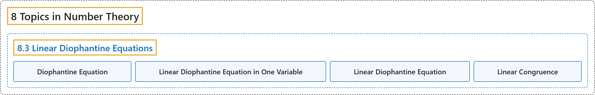

# 8.3 Linear Diophantine Equations

## Classification

## Glossary

| Term | Definition | 中文翻译 | Source |
|---|---|---|---|
| **8 Topics in Number Theory** 数论专题 | (No definition) | （无定义） | [Sundstrom, 2022, chapter 8](https://gvsuoer.github.io/sundstrom-textbook/C_numbertheory.html) |
| **8.3 Linear Diophantine Equations** 线性丢番图方程 | (No definition) | （无定义） | [Sundstrom, 2022, section 8.3](https://gvsuoer.github.io/sundstrom-textbook/S_diophantine.html) |
| **Diophantine Equation** 丢番图方程 | "An equation whose **solutions are required to be integers** is called a Diophantine equation." | **要求解为整数**的方程称为丢番图方程。 | [Sundstrom, 2022, section 8.3](https://gvsuoer.github.io/sundstrom-textbook/S_diophantine.html#diophantineequation) |
| **Linear Diophantine Equation in One Variable** 一元线性丢番图方程 | "If $a$ and $b$ are integers with $a \ne 0\text{,}$ then the equation $ax = b$ is a linear Diophantine equation in one variable." | 如果 $a$ 和 $b$ 是整数且 $a \ne 0$，那么方程 $ax = b$ 是一元线性丢番图方程。 | [Sundstrom, 2022, section 8.3](https://gvsuoer.github.io/sundstrom-textbook/S_diophantine.html#lineardiophantine-one) |
| **Linear Diophantine Equation** 线性丢番图方程 | "Let $a\text{,}$ $b\text{,}$ and $c$ be integers with $a \ne 0$ and $b \ne 0\text{.}$ The Diophantine equation $ax + by = c$ is called a linear Diophantine equation in two variables." | 设 $a$、$b$ 和 $c$ 是整数，且 $a \ne 0$，$b \ne 0$。丢番图方程 $ax + by = c$ 称为二元线性丢番图方程。 | [Sundstrom, 2022, section 8.3](https://gvsuoer.github.io/sundstrom-textbook/S_diophantine.html#lineardiophantine) |
| **Linear Congruence** 线性同余 | "Let $n$ be a natural number and let $a, b \in \mathbb{Z}$ with $a \ne 0\text{.}$ **A congruence of the form** $ax \equiv b \pmod n$ is called a linear congruence in one variable. This is called a linear congruence since **the variable** $x$ **occurs to the first power**." | 设 $n$ 是自然数，$a, b \in \mathbb{Z}$ 且 $a \ne 0$。形如 $ax \equiv b \pmod n$ **的同余式**称为一元线性同余式。之所以称为线性同余式，是因为**变量** $x$ **以一次幂出现**。 | [Sundstrom, 2022, section 8.3](https://gvsuoer.github.io/sundstrom-textbook/S_diophantine.html#A_lincongruence) |

## References

Sundstrom, T. (2022). *Mathematical reasoning: Writing and proof* (Version 2.1; PreTeXt edition by Grand Valley State University). Retrieved October 30, 2026, from <https://gvsuoer.github.io/sundstrom-textbook/frontmatter.html>
