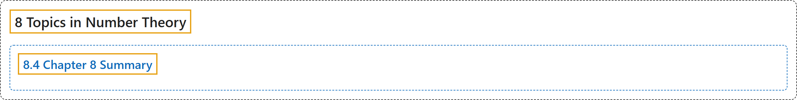

# 8.4 Chapter 8 Summary

## Classification

## Glossary

| Term | Definition | 中文翻译 | Source |
|---|---|---|---|
| **8 Topics in Number Theory** 数论专题 | (No definition) | （无定义） | [Sundstrom, 2022, chapter 8](https://gvsuoer.github.io/sundstrom-textbook/C_numbertheory.html) |
| **8.4 Chapter 8 Summary** 第 8 章小结 | (No definition) | （无定义） | [Sundstrom, 2022, section 8.4](https://gvsuoer.github.io/sundstrom-textbook/section-41.html) |

## References

Sundstrom, T. (2022). *Mathematical reasoning: Writing and proof* (Version 2.1; PreTeXt edition by Grand Valley State University). Retrieved October 30, 2026, from <https://gvsuoer.github.io/sundstrom-textbook/frontmatter.html>
