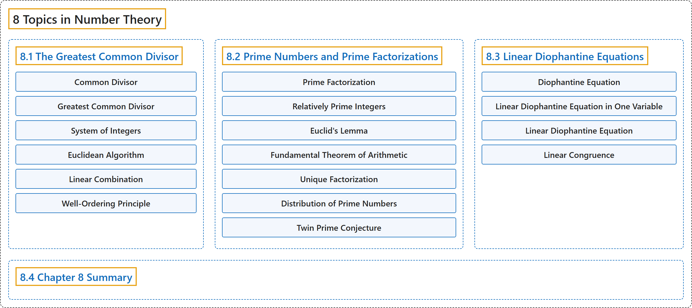

# 8 Topics in Number Theory

## Classification

## Glossary

| Term | Definition | 中文翻译 | Source |
|---|---|---|---|
| **8 Topics in Number Theory** 数论专题 | (No definition) | （无定义） | [Sundstrom, 2022, chapter 8](https://gvsuoer.github.io/sundstrom-textbook/C_numbertheory.html) |
| **[8.1 The Greatest Common Divisor](8-1-the-greatest-common-divisor.md)** 最大公因数 | (No definition) | （无定义） | [Sundstrom, 2022, section 8.1](https://gvsuoer.github.io/sundstrom-textbook/S_gcd.html) |
| **[8.2 Prime Numbers and Prime Factorizations](8-2-prime-numbers-and-prime-factorizations.md)** 素数与素因数分解 | (No definition) | （无定义） | [Sundstrom, 2022, section 8.2](https://gvsuoer.github.io/sundstrom-textbook/S_primefactorizations.html) |
| **[8.3 Linear Diophantine Equations](8-3-linear-diophantine-equations.md)** 线性丢番图方程 | (No definition) | （无定义） | [Sundstrom, 2022, section 8.3](https://gvsuoer.github.io/sundstrom-textbook/S_diophantine.html) |
| **[8.4 Chapter 8 Summary](8-4-chapter-8-summary.md)** 第 8 章小结 | (No definition) | （无定义） | [Sundstrom, 2022, section 8.4](https://gvsuoer.github.io/sundstrom-textbook/section-41.html) |

## References

Sundstrom, T. (2022). *Mathematical reasoning: Writing and proof* (Version 2.1; PreTeXt edition by Grand Valley State University). Retrieved October 30, 2026, from <https://gvsuoer.github.io/sundstrom-textbook/frontmatter.html>
