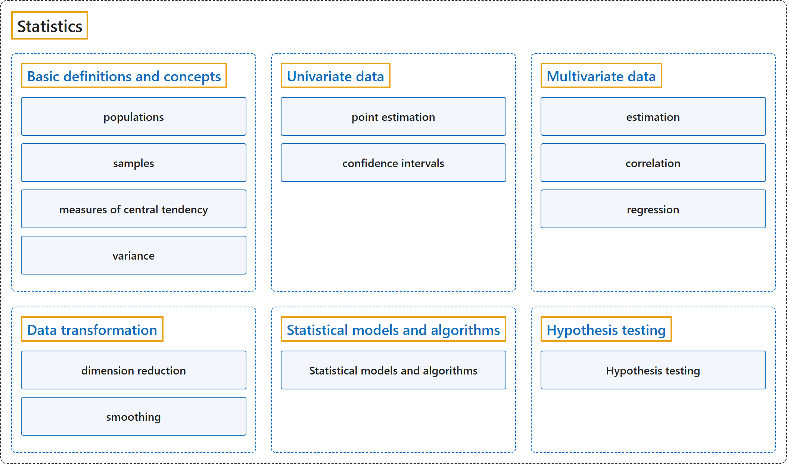

# Statistics

## Classification

## Glossary

| Term | Definition | 中文翻译 | Source |
|---|---|---|---|
| **Statistics** 统计 | "The mathematical study of the **likelihood and probability of events** occurring based on known information and inferred by **taking a limited number of samples**." | 对事件发生的**可能性和概率**所作的数学研究，依据已知信息，并通过**抽取有限数量的样本**来推断。 | [Weisstein, n.d.-f, "Statistics" entry, para. 1](https://mathworld.wolfram.com/Statistics.html#:~:text=The%20mathematical%20study%20of%20the%20likelihood%20and%20probability%20of%20events) |
| **[Basic definitions and concepts](basic-definitions-and-concepts.md)** 基本定义和概念 | (context) "A sample is a **subset of a population** that is obtained through some process, possibly random selection or selection based on a certain set of criteria, for the purposes of **investigating the properties of the underlying parent population**." | （语境）样本是通过某种过程（可能是随机选择，也可能是按一组标准选择）得到的**总体的子集**，目的是**研究其所属总体的性质**。 | [Weisstein, n.d.-d, "Sample" entry, para. 1](https://mathworld.wolfram.com/Sample.html#:~:text=A%20sample%20is%20a%20subset%20of%20a%20population) |
| **[Univariate data](univariate-data.md)** 单变量数据 | (context) "Univariate means **involving one variable**, as opposed to two (bivariate) or many (multivariate)." | （语境）单变量的意思是**只涉及一个变量**，与涉及两个变量（双变量）或多个变量（多变量）相对。 | [Weisstein, n.d.-g, "Univariate" entry, para. 1](https://mathworld.wolfram.com/Univariate.html#:~:text=Univariate%20means%20involving%20one%20variable) |
| **[Multivariate data](multivariate-data.md)** 多变量数据 | (context) "A multivariate is a **vector each of whose elements is a variate**." | （语境）多元变量是一个**每个元素都是变量的向量**。 | [Weisstein, n.d.-c, "Multivariate" entry, para. 1](https://mathworld.wolfram.com/Multivariate.html#:~:text=A%20multivariate%20is%20a%20vector%20each%20of%20whose%20elements%20is%20a%20variate) |
| **[Data transformation](data-transformation.md)** 数据变换 | (context) "Dimensionality reduction is the **representation of data using fewer coordinates** while **preserving selected features**, such as variation or distances ..." | （语境）降维是**用更少的坐标来表示数据**，同时**保留选定的特征**，例如变异或距离…… | [Weisstein, n.d.-a, "Dimensionality reduction" entry, para. 1](https://mathworld.wolfram.com/DimensionalityReduction.html#:~:text=Dimensionality%20reduction%20is%20the%20representation%20of%20data%20using%20fewer%20coordinates) |
| **[Statistical models and algorithms](statistical-models-and-algorithms.md)** 统计模型和算法 | "A statistical model is a **set of statistical distributions** proposed as possible distributions of **observed data**." | 统计模型是**一组统计分布**，被提出作为**观测数据**的可能分布。 | [Weisstein, n.d.-e, "Statistical model" entry, para. 1](https://mathworld.wolfram.com/StatisticalModel.html#:~:text=A%20statistical%20model%20is%20a%20set%20of%20statistical%20distributions) |
| **[Hypothesis testing](hypothesis-testing.md)** 假设检验 | "Hypothesis testing is the **use of statistics** to determine **the probability that a given hypothesis is true**." | 假设检验是**运用统计**来确定**某个给定假设为真的概率**。 | [Weisstein, n.d.-b, "Hypothesis testing" entry, para. 1](https://mathworld.wolfram.com/HypothesisTesting.html#:~:text=Hypothesis%20testing%20is%20the%20use%20of%20statistics) |

## References

- Joint Task Force on Computing Curricula. (2024). *Computer science curricula 2023*. Association for Computing Machinery. <https://doi.org/10.1145/3664191>
- Weisstein, E. W. (n.d.-a). *Dimensionality reduction*. MathWorld: A Wolfram Resource. Retrieved October 27, 2026, from <https://mathworld.wolfram.com/DimensionalityReduction.html>
- Weisstein, E. W. (n.d.-b). *Hypothesis testing*. MathWorld: A Wolfram Resource. Retrieved October 27, 2026, from <https://mathworld.wolfram.com/HypothesisTesting.html>
- Weisstein, E. W. (n.d.-c). *Multivariate*. MathWorld: A Wolfram Resource. Retrieved October 27, 2026, from <https://mathworld.wolfram.com/Multivariate.html>
- Weisstein, E. W. (n.d.-d). *Sample*. MathWorld: A Wolfram Resource. Retrieved October 27, 2026, from <https://mathworld.wolfram.com/Sample.html>
- Weisstein, E. W. (n.d.-e). *Statistical model*. MathWorld: A Wolfram Resource. Retrieved October 27, 2026, from <https://mathworld.wolfram.com/StatisticalModel.html>
- Weisstein, E. W. (n.d.-f). *Statistics*. MathWorld: A Wolfram Resource. Retrieved October 27, 2026, from <https://mathworld.wolfram.com/Statistics.html>
- Weisstein, E. W. (n.d.-g). *Univariate*. MathWorld: A Wolfram Resource. Retrieved October 27, 2026, from <https://mathworld.wolfram.com/Univariate.html>
