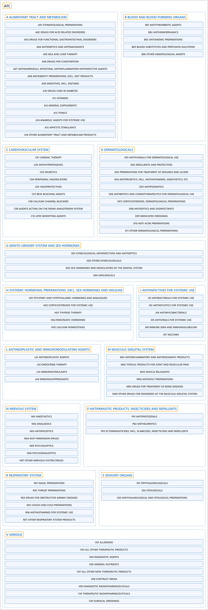

# ATC

## Classification

## Glossary

| Term | Definition | 中文翻译 | Source |
|---|---|---|---|
| **ATC** 解剖学治疗学及化学分类系统 | "In the ATC classification system, the **active substances** are classified in a **hierarchy with five different levels**. The system has **fourteen main anatomical/pharmacological groups** or 1st levels." | 在 ATC 分类系统中，**活性物质**按**五个层级的层次结构**分类。该系统有**十四个解剖学/药理学主组**，即第 1 层。 | [WHO Collaborating Centre for Drug Statistics Methodology, n.d., "Structure" section, para. 1](https://atcddd.fhi.no/atc/structure_and_principles/) |
| **[A ALIMENTARY TRACT AND METABOLISM](a-alimentary-tract-and-metabolism/index.md)** 消化道和代谢 | (No definition) | （无定义） | [WHO Collaborating Centre for Drug Statistics Methodology, 2026](https://atcddd.fhi.no/atc_ddd_index/?code=A&showdescription=no) |
| **[B BLOOD AND BLOOD FORMING ORGANS](b-blood-and-blood-forming-organs/index.md)** 血液和造血器官 | (No definition) | （无定义） | [WHO Collaborating Centre for Drug Statistics Methodology, 2026](https://atcddd.fhi.no/atc_ddd_index/?code=B&showdescription=no) |
| **[C CARDIOVASCULAR SYSTEM](c-cardiovascular-system/index.md)** 心血管系统 | (No definition) | （无定义） | [WHO Collaborating Centre for Drug Statistics Methodology, 2026](https://atcddd.fhi.no/atc_ddd_index/?code=C&showdescription=no) |
| **[D DERMATOLOGICALS](d-dermatologicals/index.md)** 皮肤病用药 | (No definition) | （无定义） | [WHO Collaborating Centre for Drug Statistics Methodology, 2026](https://atcddd.fhi.no/atc_ddd_index/?code=D&showdescription=no) |
| **[G GENITO URINARY SYSTEM AND SEX HORMONES](g-genito-urinary-system-and-sex-hormones/index.md)** 泌尿生殖系统和性激素 | (No definition) | （无定义） | [WHO Collaborating Centre for Drug Statistics Methodology, 2026](https://atcddd.fhi.no/atc_ddd_index/?code=G&showdescription=no) |
| **[H SYSTEMIC HORMONAL PREPARATIONS, EXCL. SEX HORMONES AND INSULINS](h-systemic-hormonal-preparations-excl-sex-hormones-and-insulins/index.md)** 全身用激素制剂，不含性激素和胰岛素 | (No definition) | （无定义） | [WHO Collaborating Centre for Drug Statistics Methodology, 2026](https://atcddd.fhi.no/atc_ddd_index/?code=H&showdescription=no) |
| **[J ANTIINFECTIVES FOR SYSTEMIC USE](j-antiinfectives-for-systemic-use/index.md)** 全身用抗感染药 | (No definition) | （无定义） | [WHO Collaborating Centre for Drug Statistics Methodology, 2026](https://atcddd.fhi.no/atc_ddd_index/?code=J&showdescription=no) |
| **[L ANTINEOPLASTIC AND IMMUNOMODULATING AGENTS](l-antineoplastic-and-immunomodulating-agents/index.md)** 抗肿瘤药和免疫调节剂 | (No definition) | （无定义） | [WHO Collaborating Centre for Drug Statistics Methodology, 2026](https://atcddd.fhi.no/atc_ddd_index/?code=L&showdescription=no) |
| **[M MUSCULO-SKELETAL SYSTEM](m-musculo-skeletal-system/index.md)** 肌肉骨骼系统 | (No definition) | （无定义） | [WHO Collaborating Centre for Drug Statistics Methodology, 2026](https://atcddd.fhi.no/atc_ddd_index/?code=M&showdescription=no) |
| **[N NERVOUS SYSTEM](n-nervous-system/index.md)** 神经系统 | (No definition) | （无定义） | [WHO Collaborating Centre for Drug Statistics Methodology, 2026](https://atcddd.fhi.no/atc_ddd_index/?code=N&showdescription=no) |
| **[P ANTIPARASITIC PRODUCTS, INSECTICIDES AND REPELLENTS](p-antiparasitic-products-insecticides-and-repellents/index.md)** 抗寄生虫药、杀虫剂和驱虫剂 | (No definition) | （无定义） | [WHO Collaborating Centre for Drug Statistics Methodology, 2026](https://atcddd.fhi.no/atc_ddd_index/?code=P&showdescription=no) |
| **[R RESPIRATORY SYSTEM](r-respiratory-system/index.md)** 呼吸系统 | (No definition) | （无定义） | [WHO Collaborating Centre for Drug Statistics Methodology, 2026](https://atcddd.fhi.no/atc_ddd_index/?code=R&showdescription=no) |
| **[S SENSORY ORGANS](s-sensory-organs/index.md)** 感觉器官 | (No definition) | （无定义） | [WHO Collaborating Centre for Drug Statistics Methodology, 2026](https://atcddd.fhi.no/atc_ddd_index/?code=S&showdescription=no) |
| **[V VARIOUS](v-various/index.md)** 其他 | (No definition) | （无定义） | [WHO Collaborating Centre for Drug Statistics Methodology, 2026](https://atcddd.fhi.no/atc_ddd_index/?code=V&showdescription=no) |

Codes and names are as the WHO Collaborating Centre for Drug Statistics Methodology writes them, unaltered ([copyright and disclaimer](https://atcddd.fhi.no/copyright_disclaimer/)); the Chinese names are this site's own translations.

## References

WHO Collaborating Centre for Drug Statistics Methodology. (2026). *ATC/DDD index 2026*. Retrieved October 28, 2026, from <https://atcddd.fhi.no/atc_ddd_index/>

WHO Collaborating Centre for Drug Statistics Methodology. (n.d.). *Structure and principles*. Retrieved October 28, 2026, from <https://atcddd.fhi.no/atc/structure_and_principles/>
