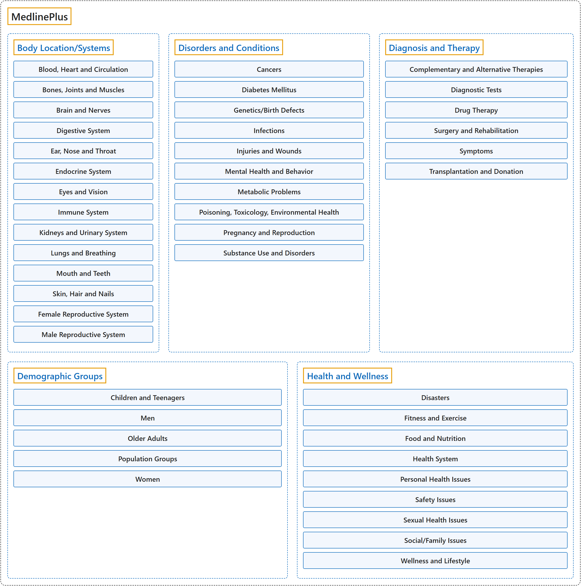

# MedlinePlus

## Classification

## Glossary

| Term | Definition | 中文翻译 | Source |
|---|---|---|---|
| **MedlinePlus** MedlinePlus 健康信息网 | "MedlinePlus is an **online health information resource** for **patients and their families and friends**." | MedlinePlus 是面向**患者及其家人和朋友**的**在线健康信息资源**。 | [National Library of Medicine, n.d., para. 1](https://medlineplus.gov/about/) |
| **[Body Location/Systems](body-location-systems/index.md)** 身体部位和系统 | (No definition) | （无定义） | [National Library of Medicine, n.d.](https://medlineplus.gov/healthtopics.html) |
| **[Disorders and Conditions](disorders-and-conditions/index.md)** 疾病和健康状况 | (No definition) | （无定义） | [National Library of Medicine, n.d.](https://medlineplus.gov/healthtopics.html) |
| **[Diagnosis and Therapy](diagnosis-and-therapy/index.md)** 诊断和治疗 | (No definition) | （无定义） | [National Library of Medicine, n.d.](https://medlineplus.gov/healthtopics.html) |
| **[Demographic Groups](demographic-groups/index.md)** 人群 | (No definition) | （无定义） | [National Library of Medicine, n.d.](https://medlineplus.gov/healthtopics.html) |
| **[Health and Wellness](health-and-wellness/index.md)** 健康和保健 | (No definition) | （无定义） | [National Library of Medicine, n.d.](https://medlineplus.gov/healthtopics.html) |

## References

National Library of Medicine. (n.d.). *About MedlinePlus*. Retrieved October 28, 2026, from <https://medlineplus.gov/about/>

National Library of Medicine. (n.d.). *Health topics*. MedlinePlus. Retrieved October 28, 2026, from <https://medlineplus.gov/healthtopics.html>
