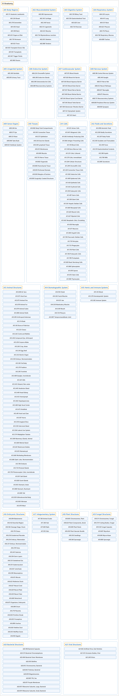

# A Anatomy

## Classification

## Glossary

| Term | Definition | 中文翻译 | Source |
|---|---|---|---|
| **A Anatomy** 解剖学 | (No definition) | （无定义） | [National Library of Medicine, 2026](https://meshb.nlm.nih.gov/treeView) |
| **[A01 Body Regions](a01-body-regions.md)** 身体部位 | "**Anatomical areas** of the body." | 身体的**解剖区域**。 | [National Library of Medicine, 2026, "Body Regions" scope note](https://meshb.nlm.nih.gov/record/ui?ui=D001829) |
| **[A02 Musculoskeletal System](a02-musculoskeletal-system.md)** 肌肉骨骼系统 | "The **MUSCLES, bones (BONE AND BONES), and CARTILAGE** of the body." | 身体的**肌肉（MUSCLES）、骨骼（BONE AND BONES）和软骨（CARTILAGE）**。 | [National Library of Medicine, 2026, "Musculoskeletal System" scope note](https://meshb.nlm.nih.gov/record/ui?ui=D009141) |
| **[A03 Digestive System](a03-digestive-system.md)** 消化系统 | "A group of organs stretching **from the MOUTH to the ANUS**, serving to **breakdown foods, assimilate nutrients, and eliminate waste**. In humans, the digestive system includes the GASTROINTESTINAL TRACT and the accessory glands (LIVER; BILIARY TRACT; PANCREAS)." | 一组**从口（MOUTH）延伸到肛门**（ANUS）的器官，用于**分解食物、吸收营养和排出废物**。在人体中，消化系统包括胃肠道（GASTROINTESTINAL TRACT）和附属腺体（肝脏 LIVER；胆道 BILIARY TRACT；胰腺 PANCREAS）。 | [National Library of Medicine, 2026, "Digestive System" scope note](https://meshb.nlm.nih.gov/record/ui?ui=D004064) |
| **[A04 Respiratory System](a04-respiratory-system.md)** 呼吸系统 | "The tubular and cavernous organs and structures, by means of which **pulmonary ventilation and gas exchange** between ambient air and the blood are brought about." | 管状和腔状的器官与结构，借助它们实现**肺通气以及环境空气与血液之间的气体交换**。 | [National Library of Medicine, 2026, "Respiratory System" scope note](https://meshb.nlm.nih.gov/record/ui?ui=D012137) |
| **[A05 Urogenital System](a05-urogenital-system.md)** 泌尿生殖系统 | "All the organs involved in **reproduction and the formation and release of URINE**." | 参与**生殖以及尿液（URINE）生成和排出**的全部器官。 | [National Library of Medicine, 2026, "Urogenital System" scope note](https://meshb.nlm.nih.gov/record/ui?ui=D014566) |
| **[A06 Endocrine System](a06-endocrine-system.md)** 内分泌系统 | "The system of glands that **release their secretions (hormones) directly into the circulatory system**. In addition to the ENDOCRINE GLANDS, included are the CHROMAFFIN SYSTEM and the NEUROSECRETORY SYSTEMS." | 由腺体组成的系统，这些腺体**把分泌物（激素）直接释放进循环系统**。除内分泌腺（ENDOCRINE GLANDS）外，还包括嗜铬系统（CHROMAFFIN SYSTEM）和神经分泌系统（NEUROSECRETORY SYSTEMS）。 | [National Library of Medicine, 2026, "Endocrine System" scope note](https://meshb.nlm.nih.gov/record/ui?ui=D004703) |
| **[A07 Cardiovascular System](a07-cardiovascular-system.md)** 心血管系统 | "The **HEART and the BLOOD VESSELS** by which BLOOD is **pumped and circulated through the body**." | **心脏（HEART）和血管（BLOOD VESSELS）**，血液（BLOOD）借助它们被**泵出并在全身循环**。 | [National Library of Medicine, 2026, "Cardiovascular System" scope note](https://meshb.nlm.nih.gov/record/ui?ui=D002319) |
| **[A08 Nervous System](a08-nervous-system.md)** 神经系统 | "The **entire nerve apparatus**, composed of a **central part**, the brain and spinal cord, and a **peripheral part**, the cranial and spinal nerves, autonomic ganglia, and plexuses. (Stedman, 26th ed)" | **整个神经装置**，由**中枢部分**（脑和脊髓）和**周围部分**（脑神经和脊神经、自主神经节和神经丛）组成。（Stedman，第 26 版） | [National Library of Medicine, 2026, "Nervous System" scope note](https://meshb.nlm.nih.gov/record/ui?ui=D009420) |
| **[A09 Sense Organs](a09-sense-organs.md)** 感觉器官 | "Specialized organs adapted for the **reception of stimuli** by the NERVOUS SYSTEM." | 为神经系统（NERVOUS SYSTEM）**接收刺激**而特化的器官。 | [National Library of Medicine, 2026, "Sense Organs" scope note](https://meshb.nlm.nih.gov/record/ui?ui=D012679) |
| **[A10 Tissues](a10-tissues.md)** 组织 | "**Collections of differentiated CELLS**, such as EPITHELIUM; CONNECTIVE TISSUE; MUSCLES; and NERVE TISSUE. Tissues are cooperatively arranged to **form organs with specialized functions** such as RESPIRATION; DIGESTION; REPRODUCTION; MOVEMENT; and others." | **分化细胞（CELLS）的集合**，如上皮（EPITHELIUM）、结缔组织（CONNECTIVE TISSUE）、肌肉（MUSCLES）和神经组织（NERVE TISSUE）。组织协同排列，**构成具有特定功能的器官**，如呼吸（RESPIRATION）、消化（DIGESTION）、生殖（REPRODUCTION）、运动（MOVEMENT）等。 | [National Library of Medicine, 2026, "Tissues" scope note](https://meshb.nlm.nih.gov/record/ui?ui=D014024) |
| **[A11 Cells](a11-cells.md)** 细胞 | "The **fundamental, structural, and functional units** or subunits of living organisms. They are composed of CYTOPLASM containing various ORGANELLES and a CELL MEMBRANE boundary." | 生物体的**基本结构和功能单位**或亚单位。它们由含有各种细胞器（ORGANELLES）的细胞质（CYTOPLASM）和作为边界的细胞膜（CELL MEMBRANE）组成。 | [National Library of Medicine, 2026, "Cells" scope note](https://meshb.nlm.nih.gov/record/ui?ui=D002477) |
| **[A12 Fluids and Secretions](a12-fluids-and-secretions.md)** 体液和分泌物 | "**Liquid substances produced by living organisms** to fulfill specific functions or excreted as waste." | **由生物体产生的液态物质**，用于完成特定功能或作为废物排出。 | [National Library of Medicine, 2026, "Fluids and Secretions" scope note](https://meshb.nlm.nih.gov/record/ui?ui=D005441) |
| **[A13 Animal Structures](a13-animal-structures.md)** 动物结构 | "Organs and other anatomical structures of **non-human vertebrate and invertebrate animals**." | **非人类脊椎动物和无脊椎动物**的器官及其他解剖结构。 | [National Library of Medicine, 2026, "Animal Structures" scope note](https://meshb.nlm.nih.gov/record/ui?ui=D000825) |
| **[A14 Stomatognathic System](a14-stomatognathic-system.md)** 口颌系统 | "The mouth, teeth, jaws, pharynx, and related structures as they relate to **mastication, deglutition, and speech**." | 口、牙、颌、咽及相关结构，就其与**咀嚼、吞咽和言语**的关系而言。 | [National Library of Medicine, 2026, "Stomatognathic System" scope note](https://meshb.nlm.nih.gov/record/ui?ui=D013284) |
| **[A15 Hemic and Immune Systems](a15-hemic-and-immune-systems.md)** 血液和免疫系统 | "Organs involved in the **production of BLOOD**, including the cellular and the molecular components essential in providing **defense against foreign organisms or substances**." | 参与**血液（BLOOD）生成**的器官，包括在**抵御外来生物或物质**中必不可少的细胞成分和分子成分。 | [National Library of Medicine, 2026, "Hemic and Immune Systems" scope note](https://meshb.nlm.nih.gov/record/ui?ui=D006424) |
| **[A16 Embryonic Structures](a16-embryonic-structures.md)** 胚胎结构 | "The anatomical parts that make up an organism in the **early stages of development**." | 生物体在**发育早期阶段**的各个解剖部分。 | [National Library of Medicine, 2026, "Embryonic Structures" scope note](https://meshb.nlm.nih.gov/record/ui?ui=D004628) |
| **[A17 Integumentary System](a17-integumentary-system.md)** 皮肤系统 | "The **outer covering of the body** composed of the **SKIN and the skin appendages**, which are the HAIR, the NAILS; and the SEBACEOUS GLANDS and the SWEAT GLANDS and their ducts." | **身体的外层覆盖物**，由**皮肤（SKIN）及皮肤附属器**组成，附属器即毛发（HAIR）、指（趾）甲（NAILS），以及皮脂腺（SEBACEOUS GLANDS）、汗腺（SWEAT GLANDS）和它们的导管。 | [National Library of Medicine, 2026, "Integumentary System" scope note](https://meshb.nlm.nih.gov/record/ui?ui=D034582) |
| **[A18 Plant Structures](a18-plant-structures.md)** 植物结构 | "The **parts of plants**, including SEEDS." | **植物的各部分**，包括种子（SEEDS）。 | [National Library of Medicine, 2026, "Plant Structures" scope note](https://meshb.nlm.nih.gov/record/ui?ui=D018514) |
| **[A19 Fungal Structures](a19-fungal-structures.md)** 真菌结构 | "The **parts of fungi**." | **真菌的各部分**。 | [National Library of Medicine, 2026, "Fungal Structures" scope note](https://meshb.nlm.nih.gov/record/ui?ui=D056229) |
| **[A20 Bacterial Structures](a20-bacterial-structures.md)** 细菌结构 | "The **parts of bacteria**." | **细菌的各部分**。 | [National Library of Medicine, 2026, "Bacterial Structures" scope note](https://meshb.nlm.nih.gov/record/ui?ui=D056226) |
| **[A21 Viral Structures](a21-viral-structures.md)** 病毒结构 | "The **structural parts of the VIRION**." | **病毒体（VIRION）的结构部分**。 | [National Library of Medicine, 2026, "Viral Structures" scope note](https://meshb.nlm.nih.gov/record/ui?ui=D056224) |

## References

National Library of Medicine. (2026). *MeSH 2026 descriptor records* [Data set]. Retrieved October 28, 2026, from <https://www.nlm.nih.gov/databases/download/mesh.html>
