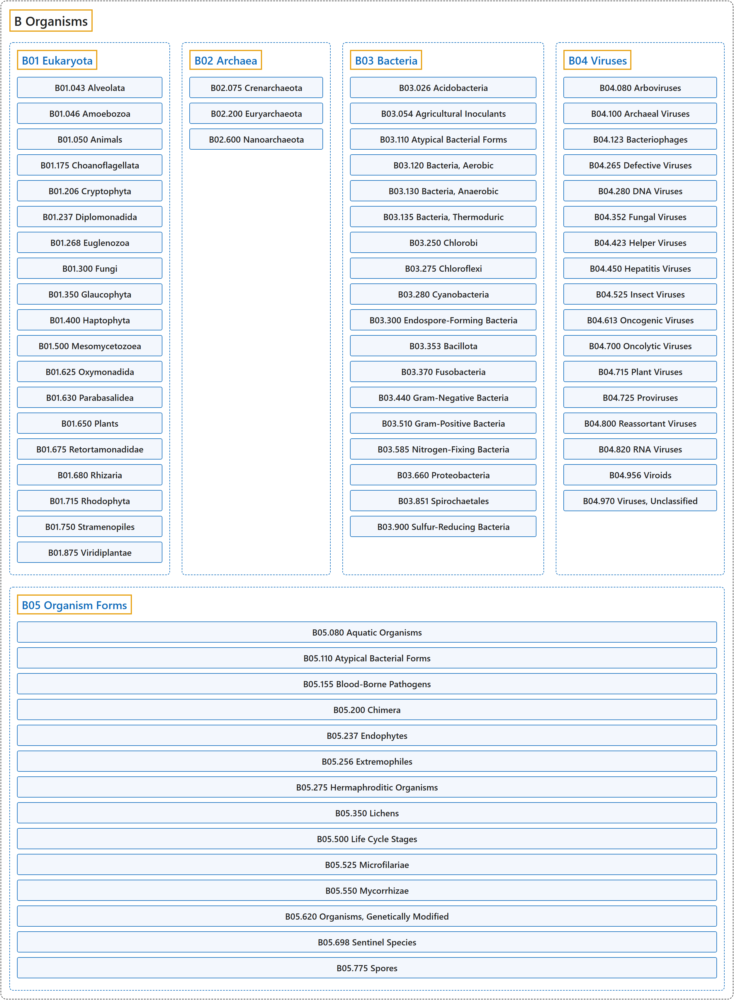

# B Organisms

## Classification

## Glossary

| Term | Definition | 中文翻译 | Source |
|---|---|---|---|
| **B Organisms** 生物体 | (No definition) | （无定义） | [National Library of Medicine, 2026](https://meshb.nlm.nih.gov/treeView) |
| **[B01 Eukaryota](b01-eukaryota.md)** 真核生物 | "One of the **three domains of life** (the others being BACTERIA and ARCHAEA), also called Eukarya. These are organisms whose cells are **enclosed in membranes and possess a nucleus**." | **生命三域**之一（另两个是细菌 BACTERIA 和古菌 ARCHAEA），也称真核域（Eukarya）。这类生物的细胞**由膜包裹并具有细胞核**。 | [National Library of Medicine, 2026, "Eukaryota" scope note](https://meshb.nlm.nih.gov/record/ui?ui=D056890) |
| **[B02 Archaea](b02-archaea.md)** 古菌 | "One of the **three domains of life** (the others being BACTERIA and Eukarya), formerly called Archaebacteria under the taxon Bacteria, but now considered **separate and distinct**." | **生命三域**之一（另两个是细菌 BACTERIA 和真核域 Eukarya），过去在细菌分类单元下称为古细菌（Archaebacteria），现在被认为是**独立且不同的**一类。 | [National Library of Medicine, 2026, "Archaea" scope note](https://meshb.nlm.nih.gov/record/ui?ui=D001105) |
| **[B03 Bacteria](b03-bacteria.md)** 细菌 | "One of the **three domains of life** (the others being Eukarya and ARCHAEA), also called Eubacteria. They are **unicellular prokaryotic microorganisms** which generally possess rigid cell walls, multiply by cell division, and exhibit three principal forms: round or coccal, rodlike or bacillary, and spiral or spirochetal." | **生命三域**之一（另两个是真核域 Eukarya 和古菌 ARCHAEA），也称真细菌（Eubacteria）。它们是**单细胞原核微生物**，通常具有坚硬的细胞壁，以细胞分裂方式繁殖，呈现三种主要形态：圆形或球状、杆状或杆菌状、螺旋形或螺旋体状。 | [National Library of Medicine, 2026, "Bacteria" scope note](https://meshb.nlm.nih.gov/record/ui?ui=D001419) |
| **[B04 Viruses](b04-viruses.md)** 病毒 | "**Minute infectious agents** whose genomes are composed of DNA or RNA, but not both. They are characterized by a lack of independent metabolism and the **inability to replicate outside living host cells**." | **微小的感染因子**，其基因组由 DNA 或 RNA 构成，但不会两者兼有。它们的特征是没有独立的代谢，并且**不能在活宿主细胞之外复制**。 | [National Library of Medicine, 2026, "Viruses" scope note](https://meshb.nlm.nih.gov/record/ui?ui=D014780) |
| **[B05 Organism Forms](b05-organism-forms.md)** 生物体形态 | "Specific **states or life cycle stages of organisms**. These include post-embryonic stages of insects, symbiotic relationships between organisms, and reproductive elements such as spores." | **生物体的特定状态或生命周期阶段**。包括昆虫的胚后阶段、生物之间的共生关系，以及孢子等生殖要素。 | [National Library of Medicine, 2026, "Organism Forms" scope note](https://meshb.nlm.nih.gov/record/ui?ui=D056891) |

## References

National Library of Medicine. (2026). *MeSH 2026 descriptor records* [Data set]. Retrieved October 28, 2026, from <https://www.nlm.nih.gov/databases/download/mesh.html>
