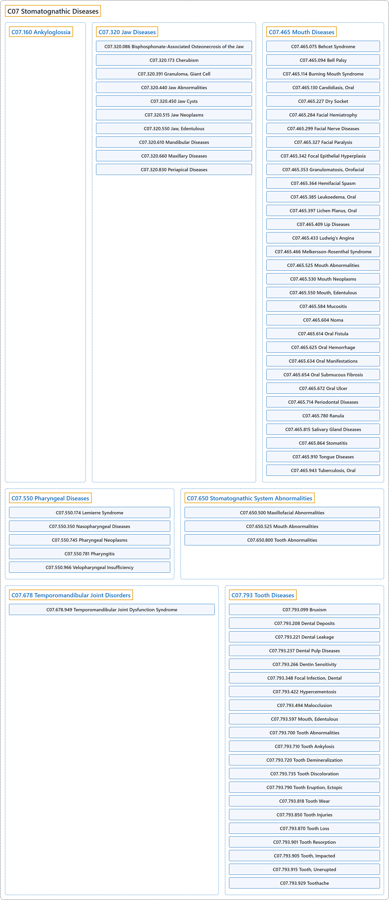

# C07 Stomatognathic Diseases

## Classification

## Glossary

| Term | Definition | 中文翻译 | Source |
|---|---|---|---|
| **C07 Stomatognathic Diseases** 口颌系统疾病 | "General or unspecified **diseases of the stomatognathic system**, comprising the mouth, teeth, jaws, and pharynx." | 一般性或未特指的**口颌系统疾病**，口颌系统包括口、牙、颌骨和咽。 | [National Library of Medicine, 2026, "Stomatognathic Diseases" scope note](https://meshb.nlm.nih.gov/record/ui?ui=D009057) |
| **C07.160 Ankyloglossia** 舌系带短缩 | "A **severe congenital restriction of TONGUE movement**, resulting from fusion or adherence of the tongue to the floor of the mouth. In partial ankyloglossia (tongue-tie) the LINGUAL FRENUM is abnormally short, or is attached too close to the tip of the tongue. OMIM: 106280" | 由舌与口底融合或粘连所致的一种**严重的先天性舌**（TONGUE）**运动受限**。在部分性舌系带短缩（舌系带过短）中，舌系带（LINGUAL FRENUM）异常短小，或附着处过于靠近舌尖。OMIM：106280 | [National Library of Medicine, 2026, "Ankyloglossia" scope note](https://meshb.nlm.nih.gov/record/ui?ui=D000072676) |
| **C07.320 Jaw Diseases** 颌疾病 | "**Diseases involving the JAW**." | **累及颌**（JAW）**的疾病**。 | [National Library of Medicine, 2026, "Jaw Diseases" scope note](https://meshb.nlm.nih.gov/record/ui?ui=D007571) |
| **C07.320.086 Bisphosphonate-Associated Osteonecrosis of the Jaw** 双膦酸盐相关性颌骨坏死 | "**Necrotic jaws** or other maxillofacial skeleton necrosis **associated with bisphosphonate use** (see BISPHOSPHONATES). Injury, dental procedures, and trauma can trigger the necrotic process." | **颌骨坏死**或其他颌面骨骼坏死，**与双膦酸盐使用相关**（见双膦酸盐（BISPHOSPHONATES））。损伤、牙科操作和创伤可触发坏死过程。 | [National Library of Medicine, 2026, "Bisphosphonate-Associated Osteonecrosis of the Jaw" scope note](https://meshb.nlm.nih.gov/record/ui?ui=D059266) |
| **C07.320.173 Cherubism** 巨颌症 | "A **fibro-osseous hereditary disease of the jaws**. The swollen jaws and raised eyes give a cherubic appearance; multiple radiolucencies are evident upon radiographic examination." | 一种**颌骨的纤维骨性遗传病**。肿大的颌骨与上抬的眼部使患者呈小天使样面容；放射学检查可见多发性透射区。 | [National Library of Medicine, 2026, "Cherubism" scope note](https://meshb.nlm.nih.gov/record/ui?ui=D002636) |
| **C07.320.391 Granuloma, Giant Cell** 巨细胞肉芽肿 | "A **non-neoplastic inflammatory lesion**, usually of the jaw or gingiva, containing **large, multinucleated cells**. It includes reparative giant cell granuloma. Peripheral giant cell granuloma refers to the gingiva (giant cell epulis); central refers to the jaw." | 一种**非肿瘤性炎性病变**，通常见于颌骨或牙龈，含有**大的多核细胞**。包括修复性巨细胞肉芽肿。周围性巨细胞肉芽肿指发生于牙龈者（巨细胞龈瘤）；中央性指发生于颌骨者。 | [National Library of Medicine, 2026, "Granuloma, Giant Cell" scope note](https://meshb.nlm.nih.gov/record/ui?ui=D006101) |
| **C07.320.440 Jaw Abnormalities** 颌骨畸形 | "**Congenital absence of or defects in structures of the jaw**." | **颌骨结构的先天性缺失或缺陷**。 | [National Library of Medicine, 2026, "Jaw Abnormalities" scope note](https://meshb.nlm.nih.gov/record/ui?ui=D007569) |
| **C07.320.440.185 Cleft Palate** 腭裂 | "**Congenital fissure of the soft and/or hard palate**, due to faulty fusion." | 因融合异常所致的**软腭和/或硬腭先天性裂隙**。 | [National Library of Medicine, 2026, "Cleft Palate" scope note](https://meshb.nlm.nih.gov/record/ui?ui=D002972) |
| **C07.320.440.457 Micrognathism** 小颌畸形 | "**Abnormally small jaw**." | **颌骨异常短小**。 | [National Library of Medicine, 2026, "Micrognathism" scope note](https://meshb.nlm.nih.gov/record/ui?ui=D008844) |
| **C07.320.440.606 Pierre Robin Syndrome** 皮埃尔罗班综合征 | "**Congenital malformation** characterized by MICROGNATHIA or RETROGNATHIA; GLOSSOPTOSIS and CLEFT PALATE. The mandibular abnormalities often result in difficulties in sucking and swallowing. The syndrome may be isolated or associated with other syndromes (e.g., ANDERSEN SYNDROME; CAMPOMELIC DYSPLASIA). Developmental mis-expression of SOX9 TRANSCRIPTION FACTOR gene on chromosome 17q and its surrounding region is associated with the syndrome." | 一种**先天性畸形**，特征为小颌畸形（MICROGNATHIA）或下颌后缩（RETROGNATHIA）；舌后坠（GLOSSOPTOSIS）和腭裂（CLEFT PALATE）。下颌异常常导致吮吸和吞咽困难。该综合征可单独出现，或与其他综合征相关（如安德森综合征（ANDERSEN SYNDROME）；弯肢发育不良（CAMPOMELIC DYSPLASIA））。染色体 17q 上 SOX9 转录因子（SOX9 TRANSCRIPTION FACTOR）基因及其周围区域的发育性错误表达与该综合征相关。 | [National Library of Medicine, 2026, "Pierre Robin Syndrome" scope note](https://meshb.nlm.nih.gov/record/ui?ui=D010855) |
| **C07.320.440.655 Prognathism** 下颌前突 | "A condition marked by **abnormal protrusion of the mandible**. (Dorland, 27th ed)" | 以**下颌骨异常前突**为特征的一种状况。（Dorland，第 27 版） | [National Library of Medicine, 2026, "Prognathism" scope note](https://meshb.nlm.nih.gov/record/ui?ui=D011378) |
| **C07.320.440.827 Retrognathia** 颌后缩 | "A **physical misalignment** of the upper (maxilla) and lower (mandibular) jaw bones in which either or both **recede relative to the frontal plane of the forehead**." | 上颌骨（maxilla）与下颌骨（mandibular）的一种**形态错位**，其中一者或两者**相对于前额额状面后缩**。 | [National Library of Medicine, 2026, "Retrognathia" scope note](https://meshb.nlm.nih.gov/record/ui?ui=D063173) |
| **C07.320.450 Jaw Cysts** 颌骨囊肿 | "**Saccular lesions lined with epithelium** and contained **within pathologically formed cavities in the jaw**; also nonepithelial cysts (pseudocysts) as they apply to the jaw, e.g., traumatic or solitary cyst, static bone cavity, and aneurysmal bone cyst. True jaw cysts are classified as odontogenic or nonodontogenic." | **内衬上皮的囊状病变**，位于**颌骨内病理性形成的腔中**；也包括适用于颌骨的非上皮性囊肿（假性囊肿），如外伤性或孤立性囊肿、静止性骨腔和动脉瘤样骨囊肿。真性颌骨囊肿分为牙源性和非牙源性。 | [National Library of Medicine, 2026, "Jaw Cysts" scope note](https://meshb.nlm.nih.gov/record/ui?ui=D007570) |
| **C07.320.450.640 Nonodontogenic Cysts** 非牙源性囊肿 | "Cysts formed from **epithelial inclusions in the lines of fusion of the embryonic processes which form the jaws**. They include nasopalatine or incisive canal cyst, incisive papilla cyst, globulomaxillary cyst, median palatal cyst, median alveolar cyst, median mandibular cyst, and nasoalveolar cyst." | 由**构成颌骨的胚胎突融合线中的上皮包涵物**形成的囊肿。包括鼻腭管囊肿或切牙管囊肿、切牙乳头囊肿、球上颌囊肿、腭正中囊肿、牙槽正中囊肿、下颌正中囊肿和鼻牙槽囊肿。 | [National Library of Medicine, 2026, "Nonodontogenic Cysts" scope note](https://meshb.nlm.nih.gov/record/ui?ui=D009631) |
| **C07.320.450.670 Odontogenic Cysts** 牙源性囊肿 | "**Cysts found in the jaws** and arising from **epithelium involved in tooth formation**. They include follicular cysts (e.g., primordial cyst, dentigerous cyst, multilocular cyst), lateral periodontal cysts, and radicular cysts. They may become keratinized (odontogenic keratocysts). Follicular cysts may give rise to ameloblastomas and, in rare cases, undergo malignant transformation." | **发生于颌骨的囊肿**，源自**参与牙齿形成的上皮**。包括滤泡囊肿（如始基囊肿、含牙囊肿、多房囊肿）、侧方牙周囊肿和根尖周囊肿。它们可发生角化（牙源性角化囊肿）。滤泡囊肿可发展为成釉细胞瘤，罕见情况下可发生恶变。 | [National Library of Medicine, 2026, "Odontogenic Cysts" scope note](https://meshb.nlm.nih.gov/record/ui?ui=D009807) |
| **C07.320.450.670.130 Basal Cell Nevus Syndrome** 基底细胞痣综合征 | "Hereditary disorder consisting of **multiple basal cell carcinomas, odontogenic keratocysts, and multiple skeletal defects**, e.g., frontal and temporoparietal bossing, bifurcated and splayed ribs, kyphoscoliosis, fusion of vertebrae, and cervicothoracic spina bifida. Genetic transmission is autosomal dominant." | 遗传性疾病，由**多发性基底细胞癌、牙源性角化囊肿和多种骨骼缺陷**组成，如额部和颞顶部隆起、分叉和张开的肋骨、脊柱后侧凸、椎骨融合及颈胸段脊柱裂。遗传方式为常染色体显性。 | [National Library of Medicine, 2026, "Basal Cell Nevus Syndrome" scope note](https://meshb.nlm.nih.gov/record/ui?ui=D001478) |
| **C07.320.450.670.275 Dentigerous Cyst** 含牙囊肿 | "**Most common follicular odontogenic cyst**. Occurs in relation to a partially erupted or unerupted tooth with at least the crown of the tooth to which the cyst is attached protruding into the cystic cavity. May give rise to an ameloblastoma and, in rare instances, undergo malignant transformation." | **最常见的滤泡性牙源性囊肿**。发生于部分萌出或未萌出的牙齿，囊肿所附着牙齿至少牙冠突入囊腔。可发展为成釉细胞瘤，罕见情况下发生恶变。 | [National Library of Medicine, 2026, "Dentigerous Cyst" scope note](https://meshb.nlm.nih.gov/record/ui?ui=D003803) |
| **C07.320.450.670.495 Odontogenic Cyst, Calcifying** 牙源性钙化囊肿 | "A **mixed radiolucent-radiopaque lesion of the jaws** with features of both a cyst and a solid neoplasm. It is characterized microscopically by an epithelial lining showing a palisaded layer of columnar basal cells, presence of **ghost cell keratinization**, dentinoid, and calcification. (Stedman, 25th ed)" | 一种兼具囊肿与实体肿瘤特征的**颌骨透射与阻射混合性病变**。镜下特征为上皮衬里含栅栏状排列的柱状基底细胞层，并有**影细胞角化**、牙本质样物和钙化。（Stedman，第 25 版） | [National Library of Medicine, 2026, "Odontogenic Cyst, Calcifying" scope note](https://meshb.nlm.nih.gov/record/ui?ui=D018333) |
| **C07.320.450.670.513 Periodontal Cyst** 牙周囊肿 | "An **epithelium-lined sac containing fluid**; usually found at the **apex of a pulp-involved tooth**. The lateral type occurs less frequently along the side of the root." | 一种**内衬上皮、含有液体的囊**；通常见于**牙髓受累牙齿的根尖**。侧方型较少见，发生于牙根侧面。 | [National Library of Medicine, 2026, "Periodontal Cyst" scope note](https://meshb.nlm.nih.gov/record/ui?ui=D010509) |
| **C07.320.450.670.513.811 Radicular Cyst** 根尖周囊肿 | "Slow-growing **fluid-filled epithelial sac at the apex of a tooth** with a nonvital pulp or defective root canal filling." | 生长缓慢的、**位于牙根尖的充满液体的上皮囊**，该牙牙髓无活力或根管充填有缺陷。 | [National Library of Medicine, 2026, "Radicular Cyst" scope note](https://meshb.nlm.nih.gov/record/ui?ui=D011842) |
| **C07.320.515 Jaw Neoplasms** 颌骨肿瘤 | "**Cancers or tumors of the MAXILLA or MANDIBLE unspecified**. For neoplasms of the maxilla, MAXILLARY NEOPLASMS is available and of the mandible, MANDIBULAR NEOPLASMS is available." | **未指明部位的上颌骨**（MAXILLA）**或下颌骨**（MANDIBLE）**的癌或肿瘤**。上颌骨肿瘤可用上颌骨肿瘤（MAXILLARY NEOPLASMS），下颌骨肿瘤可用下颌骨肿瘤（MANDIBULAR NEOPLASMS）。 | [National Library of Medicine, 2026, "Jaw Neoplasms" scope note](https://meshb.nlm.nih.gov/record/ui?ui=D007573) |
| **C07.320.515.583 Mandibular Neoplasms** 下颌肿瘤 | "**Tumors or cancer of the MANDIBLE**." | **下颌骨的肿瘤或癌**（MANDIBLE）。 | [National Library of Medicine, 2026, "Mandibular Neoplasms" scope note](https://meshb.nlm.nih.gov/record/ui?ui=D008339) |
| **C07.320.515.601 Maxillary Neoplasms** 上颌骨肿瘤 | "**Cancer or tumors** of the MAXILLA or upper jaw." | 上颌骨（MAXILLA）即上颌的**癌或肿瘤**。 | [National Library of Medicine, 2026, "Maxillary Neoplasms" scope note](https://meshb.nlm.nih.gov/record/ui?ui=D008441) |
| **C07.320.515.692 Palatal Neoplasms** 腭肿瘤 | "**Tumors or cancer of the PALATE**, including those of the hard palate, soft palate and UVULA." | **腭**（PALATE）**的肿瘤或癌**，包括硬腭、软腭和悬雍垂（UVULA）的肿瘤或癌。 | [National Library of Medicine, 2026, "Palatal Neoplasms" scope note](https://meshb.nlm.nih.gov/record/ui?ui=D010157) |
| **C07.320.550 Jaw, Edentulous** 无牙颌 | "The **total absence of teeth from either the mandible or the maxilla**, but not both. Total absence of teeth from both is MOUTH, EDENTULOUS. Partial absence of teeth in either is JAW, EDENTULOUS, PARTIALLY." | **下颌或上颌之一的牙齿全部缺失**，但非两者同时缺失。两者牙齿均全部缺失为无牙口（MOUTH, EDENTULOUS）。任一颌牙齿部分缺失为部分无牙颌（JAW, EDENTULOUS, PARTIALLY）。 | [National Library of Medicine, 2026, "Jaw, Edentulous" scope note](https://meshb.nlm.nih.gov/record/ui?ui=D007575) |
| **C07.320.550.450 Jaw, Edentulous, Partially** 部分无牙颌 | "**Absence of teeth from a portion of the mandible and/or maxilla**." | **下颌骨和/或上颌骨部分区域的牙齿缺失**。 | [National Library of Medicine, 2026, "Jaw, Edentulous, Partially" scope note](https://meshb.nlm.nih.gov/record/ui?ui=D007576) |
| **C07.320.610 Mandibular Diseases** 下颌骨疾病 | "**Diseases involving the MANDIBLE**." | **累及下颌骨**（MANDIBLE）**的疾病**。 | [National Library of Medicine, 2026, "Mandibular Diseases" scope note](https://meshb.nlm.nih.gov/record/ui?ui=D008336) |
| **C07.320.610.291 Craniomandibular Disorders** 颅下颌疾病 | "Diseases or disorders of the **muscles of the head and neck**, with special reference to the **masticatory muscles**. The most notable examples are TEMPOROMANDIBULAR JOINT DISORDERS and TEMPOROMANDIBULAR JOINT DYSFUNCTION SYNDROME." | **头颈部肌肉**的疾病或障碍，尤指**咀嚼肌**。最显著的例子是颞下颌关节疾病（TEMPOROMANDIBULAR JOINT DISORDERS）和颞下颌关节功能紊乱综合征（TEMPOROMANDIBULAR JOINT DYSFUNCTION SYNDROME）。 | [National Library of Medicine, 2026, "Craniomandibular Disorders" scope note](https://meshb.nlm.nih.gov/record/ui?ui=D017271) |
| **C07.320.610.291.897 Temporomandibular Joint Disorders** 颞下颌关节紊乱病 | "A variety of **conditions affecting the anatomic and functional characteristics of the temporomandibular joint**. Factors contributing to the complexity of temporomandibular diseases are its relation to dentition and mastication and the symptomatic effects in other areas which account for referred pain to the joint and the difficulties in applying traditional diagnostic procedures to temporomandibular joint pathology where tissue is rarely obtained and x-rays are often inadequate or nonspecific. Common diseases are developmental abnormalities, trauma, subluxation, luxation, arthritis, and neoplasia. (From Thoma's Oral Pathology, 6th ed, pp577-600)" | 多种**影响颞下颌关节解剖和功能特征的病症**。颞下颌疾病的复杂性来自其与牙列和咀嚼的关系、在其他部位引起症状（表现为关节牵涉痛），以及在颞下颌关节病理中难以应用传统诊断手段（很少能获取组织，X 线常不充分或无特异性）。常见疾病有发育异常、创伤、半脱位、脱位、关节炎和肿瘤。（引自 Thoma's Oral Pathology，第 6 版，第 577-600 页） | [National Library of Medicine, 2026, "Temporomandibular Joint Disorders" scope note](https://meshb.nlm.nih.gov/record/ui?ui=D013705) |
| **C07.320.610.291.897.897 Temporomandibular Joint Dysfunction Syndrome** 颞下颌关节紊乱综合征 | "A **symptom complex** consisting of pain, muscle tenderness, clicking in the joint, and **limitation or alteration of mandibular movement**. The symptoms are subjective and manifested primarily in the masticatory muscles rather than the temporomandibular joint itself. Etiologic factors are uncertain but include occlusal dysharmony and psychophysiologic factors." | 一种**症状复合体**，包括疼痛、肌肉压痛、关节弹响以及**下颌运动受限或改变**。症状为主观性，主要表现于咀嚼肌而非颞下颌关节本身。病因尚不明确，但包括咬合不协调和心理生理因素。 | [National Library of Medicine, 2026, "Temporomandibular Joint Dysfunction Syndrome" scope note](https://meshb.nlm.nih.gov/record/ui?ui=D013706) |
| **C07.320.610.583 Mandibular Neoplasms** 下颌肿瘤 | "**Tumors or cancer of the MANDIBLE**." | **下颌骨的肿瘤或癌**（MANDIBLE）。 | [National Library of Medicine, 2026, "Mandibular Neoplasms" scope note](https://meshb.nlm.nih.gov/record/ui?ui=D008339) |
| **C07.320.610.655 Prognathism** 下颌前突 | "A condition marked by **abnormal protrusion of the mandible**. (Dorland, 27th ed)" | 以**下颌骨异常前突**为特征的一种状况。（Dorland，第 27 版） | [National Library of Medicine, 2026, "Prognathism" scope note](https://meshb.nlm.nih.gov/record/ui?ui=D011378) |
| **C07.320.610.827 Retrognathia** 颌后缩 | "A **physical misalignment** of the upper (maxilla) and lower (mandibular) jaw bones in which either or both **recede relative to the frontal plane of the forehead**." | 上颌骨（maxilla）与下颌骨（mandibular）的一种**形态错位**，其中一者或两者**相对于前额额状面后缩**。 | [National Library of Medicine, 2026, "Retrognathia" scope note](https://meshb.nlm.nih.gov/record/ui?ui=D063173) |
| **C07.320.660 Maxillary Diseases** 上颌疾病 | "**Diseases involving the MAXILLA**." | **累及上颌骨**（MAXILLA）**的疾病**。 | [National Library of Medicine, 2026, "Maxillary Diseases" scope note](https://meshb.nlm.nih.gov/record/ui?ui=D008439) |
| **C07.320.660.001 Atrophic Maxilla** 萎缩性上颌骨 | "**Loss of the MAXILLA bone mass and/or height** due to natural edentulous maxilla (JAW, EDENTULOUS) or previous dental extractions. It may require a reconstruction via BONE TRANSPLANTATION and/or ALVEOLOPLASTY prior to a DENTAL IMPLANTATION." | **上颌骨**（MAXILLA）**骨量和/或高度的丧失**，由天然无牙上颌（无牙颌（JAW, EDENTULOUS））或既往拔牙导致。在牙种植（DENTAL IMPLANTATION）之前可能需要通过骨移植（BONE TRANSPLANTATION）和/或牙槽成形术（ALVEOLOPLASTY）进行重建。 | [National Library of Medicine, 2026, "Atrophic Maxilla" scope note](https://meshb.nlm.nih.gov/record/ui?ui=D000099066) |
| **C07.320.660.601 Maxillary Neoplasms** 上颌骨肿瘤 | "**Cancer or tumors** of the MAXILLA or upper jaw." | 上颌骨（MAXILLA）即上颌的**癌或肿瘤**。 | [National Library of Medicine, 2026, "Maxillary Neoplasms" scope note](https://meshb.nlm.nih.gov/record/ui?ui=D008441) |
| **C07.320.830 Periapical Diseases** 根尖周疾病 | "**Diseases of the PERIAPICAL TISSUE surrounding the root of the tooth**, which is distinguished from DENTAL PULP DISEASES inside the TOOTH ROOT." | **牙根周围的根尖周组织**（PERIAPICAL TISSUE）**的疾病**，区别于牙根（TOOTH ROOT）内部的牙髓疾病（DENTAL PULP DISEASES）。 | [National Library of Medicine, 2026, "Periapical Diseases" scope note](https://meshb.nlm.nih.gov/record/ui?ui=D010483) |
| **C07.320.830.700 Periapical Periodontitis** 根尖周炎 | "**Inflammation of the PERIAPICAL TISSUE**. It includes general, unspecified, or acute nonsuppurative inflammation. Chronic nonsuppurative inflammation is PERIAPICAL GRANULOMA. Suppurative inflammation is PERIAPICAL ABSCESS." | **根尖周组织**（PERIAPICAL TISSUE）**的炎症**。包括一般性、未特指或急性非化脓性炎症。慢性非化脓性炎症为根尖周肉芽肿（PERIAPICAL GRANULOMA）。化脓性炎症为根尖周脓肿（PERIAPICAL ABSCESS）。 | [National Library of Medicine, 2026, "Periapical Periodontitis" scope note](https://meshb.nlm.nih.gov/record/ui?ui=D010485) |
| **C07.320.830.700.700 Periapical Abscess** 根尖周脓肿 | "Acute or chronic **inflammation of tissues surrounding the apical portion of a tooth**, associated with the **collection of pus**, resulting from infection following pulp infection through a carious lesion or as a result of an injury causing pulp necrosis. (Dorland, 27th ed)" | **牙根尖部周围组织的**急性或慢性**炎症**，伴有**脓液积聚**，由龋损导致牙髓感染后的感染引起，或由造成牙髓坏死的损伤引起。（Dorland，第 27 版） | [National Library of Medicine, 2026, "Periapical Abscess" scope note](https://meshb.nlm.nih.gov/record/ui?ui=D010482) |
| **C07.320.830.700.740 Periapical Granuloma** 根尖周肉芽肿 | "**Chronic nonsuppurative inflammation of periapical tissue** resulting from irritation following pulp disease or endodontic treatment." | 牙髓病或牙髓治疗后受刺激所致的**根尖周组织慢性非化脓性炎症**。 | [National Library of Medicine, 2026, "Periapical Granuloma" scope note](https://meshb.nlm.nih.gov/record/ui?ui=D010484) |
| **C07.320.830.820 Radicular Cyst** 根尖周囊肿 | "Slow-growing **fluid-filled epithelial sac at the apex of a tooth** with a nonvital pulp or defective root canal filling." | 生长缓慢的、**位于牙根尖的充满液体的上皮囊**，该牙牙髓无活力或根管充填有缺陷。 | [National Library of Medicine, 2026, "Radicular Cyst" scope note](https://meshb.nlm.nih.gov/record/ui?ui=D011842) |
| **C07.465 Mouth Diseases** 口腔疾病 | "**Diseases involving the MOUTH**." | **累及口腔**（MOUTH）**的疾病**。 | [National Library of Medicine, 2026, "Mouth Diseases" scope note](https://meshb.nlm.nih.gov/record/ui?ui=D009059) |
| **C07.465.075 Behcet Syndrome** 白塞综合征 | "Rare **chronic inflammatory disease involving the small blood vessels**. It is of unknown etiology and characterized by **mucocutaneous ulceration in the mouth and genital region** and uveitis with hypopyon. The neuro-ocular form may cause blindness and death. SYNOVITIS; THROMBOPHLEBITIS; gastrointestinal ulcerations; RETINAL VASCULITIS; and OPTIC ATROPHY may occur as well." | 一种罕见的**累及小血管的慢性炎症性疾病**。其病因不明，特征为**口腔和生殖器区域的皮肤黏膜溃疡**以及伴前房积脓的葡萄膜炎。神经眼型可导致失明和死亡。也可发生滑膜炎（SYNOVITIS）、血栓性静脉炎（THROMBOPHLEBITIS）、胃肠道溃疡、视网膜血管炎（RETINAL VASCULITIS）和视神经萎缩（OPTIC ATROPHY）。 | [National Library of Medicine, 2026, "Behcet Syndrome" scope note](https://meshb.nlm.nih.gov/record/ui?ui=D001528) |
| **C07.465.094 Bell Palsy** 贝尔麻痹 | "A syndrome characterized by the **acute onset of unilateral FACIAL PARALYSIS** which progresses over a 2-5 day period. Weakness of the orbicularis oculi muscle and resulting incomplete eye closure may be associated with corneal injury. Pain behind the ear often precedes the onset of paralysis. This condition may be associated with HERPESVIRUS 1, HUMAN infection of the facial nerve. (Adams et al., Principles of Neurology, 6th ed, p1376)" | 一种综合征，特征为**急性起病的单侧面瘫**（FACIAL PARALYSIS），在 2-5 天内进展。眼轮匝肌无力及由此导致的眼睑闭合不全可伴发角膜损伤。耳后疼痛常先于麻痹出现。该病可能与面神经的人类疱疹病毒 1 型（HERPESVIRUS 1, HUMAN）感染相关。（Adams 等，Principles of Neurology，第 6 版，第 1376 页） | [National Library of Medicine, 2026, "Bell Palsy" scope note](https://meshb.nlm.nih.gov/record/ui?ui=D020330) |
| **C07.465.114 Burning Mouth Syndrome** 灼口综合征 | "A group of **painful oral symptoms associated with a burning or similar sensation**. There is usually a significant organic component with a degree of functional overlay; it is not limited to the psychophysiologic group of disorders." | 一组**伴有烧灼感或类似感觉的口腔疼痛症状**。通常有显著的器质性成分并叠加一定程度的功能性因素；它不限于心理生理性疾病类别。 | [National Library of Medicine, 2026, "Burning Mouth Syndrome" scope note](https://meshb.nlm.nih.gov/record/ui?ui=D002054) |
| **C07.465.130 Candidiasis, Oral** 口腔念珠菌病 | "**Infection of the mucous membranes of the mouth** by a fungus of the genus CANDIDA. (Dorland, 27th ed)" | 念珠菌属（CANDIDA）真菌引起的**口腔黏膜感染**。（Dorland，第 27 版） | [National Library of Medicine, 2026, "Candidiasis, Oral" scope note](https://meshb.nlm.nih.gov/record/ui?ui=D002180) |
| **C07.465.227 Dry Socket** 干槽症 | "A condition sometimes occurring **after tooth extraction**, particularly after traumatic extraction, resulting in a **dry appearance of the exposed bone in the socket**, due to disintegration or loss of the blood clot. It is basically a focal osteomyelitis without suppuration and is accompanied by severe pain (alveolalgia) and foul odor. (Dorland, 28th ed)" | 一种有时发生于**拔牙后**的病症，尤其是创伤性拔牙后，由于血凝块崩解或丢失，导致**牙槽窝内暴露的骨面呈干燥外观**。它本质上是一种无化脓的局灶性骨髓炎，伴有剧烈疼痛（牙槽痛）和恶臭。（Dorland，第 28 版） | [National Library of Medicine, 2026, "Dry Socket" scope note](https://meshb.nlm.nih.gov/record/ui?ui=D004368) |
| **C07.465.284 Facial Hemiatrophy** 进行性面偏侧萎缩 | "A syndrome characterized by **slowly progressive unilateral atrophy** of facial subcutaneous fat, muscle tissue, skin, cartilage, and bone. The condition typically progresses over a period of 2-10 years and then stabilizes." | 一种综合征，特征为面部皮下脂肪、肌肉组织、皮肤、软骨和骨的**缓慢进行性单侧萎缩**。病情通常在 2 至 10 年内进展，随后趋于稳定。 | [National Library of Medicine, 2026, "Facial Hemiatrophy" scope note](https://meshb.nlm.nih.gov/record/ui?ui=D005150) |
| **C07.465.299 Facial Nerve Diseases** 面神经疾病 | "**Diseases of the facial nerve or nuclei**. Pontine disorders may affect the facial nuclei or nerve fascicle. The nerve may be involved intracranially, along its course through the petrous portion of the temporal bone, or along its extracranial course. Clinical manifestations include facial muscle weakness, loss of taste from the anterior tongue, hyperacusis, and decreased lacrimation." | **面神经或其神经核的疾病**。脑桥病变可累及面神经核或神经束。神经可在颅内、经颞骨岩部的走行段或颅外走行段受累。临床表现包括面肌无力、舌前部味觉丧失、听觉过敏和泪液分泌减少。 | [National Library of Medicine, 2026, "Facial Nerve Diseases" scope note](https://meshb.nlm.nih.gov/record/ui?ui=D005155) |
| **C07.465.299.250 Bell Palsy** 贝尔麻痹 | "A syndrome characterized by the **acute onset of unilateral FACIAL PARALYSIS** which progresses over a 2-5 day period. Weakness of the orbicularis oculi muscle and resulting incomplete eye closure may be associated with corneal injury. Pain behind the ear often precedes the onset of paralysis. This condition may be associated with HERPESVIRUS 1, HUMAN infection of the facial nerve. (Adams et al., Principles of Neurology, 6th ed, p1376)" | 一种综合征，特征为**急性起病的单侧面瘫**（FACIAL PARALYSIS），在 2-5 天内进展。眼轮匝肌无力及由此导致的眼睑闭合不全可伴发角膜损伤。耳后疼痛常先于麻痹出现。该病可能与面神经的人类疱疹病毒 1 型（HERPESVIRUS 1, HUMAN）感染相关。（Adams 等，Principles of Neurology，第 6 版，第 1376 页） | [National Library of Medicine, 2026, "Bell Palsy" scope note](https://meshb.nlm.nih.gov/record/ui?ui=D020330) |
| **C07.465.299.375 Facial Hemiatrophy** 进行性面偏侧萎缩 | "A syndrome characterized by **slowly progressive unilateral atrophy** of facial subcutaneous fat, muscle tissue, skin, cartilage, and bone. The condition typically progresses over a period of 2-10 years and then stabilizes." | 一种综合征，特征为面部皮下脂肪、肌肉组织、皮肤、软骨和骨的**缓慢进行性单侧萎缩**。病情通常在 2 至 10 年内进展，随后趋于稳定。 | [National Library of Medicine, 2026, "Facial Hemiatrophy" scope note](https://meshb.nlm.nih.gov/record/ui?ui=D005150) |
| **C07.465.299.500 Facial Nerve Injuries** 面神经损伤 | "**Traumatic injuries to the facial nerve**. This may result in FACIAL PARALYSIS, decreased lacrimation and salivation, and loss of taste sensation in the anterior tongue. The nerve may regenerate and reform its original pattern of innervation, or regenerate aberrantly, resulting in inappropriate lacrimation in response to gustatory stimuli (e.g., crocodile tears) and other syndromes." | **面神经的创伤性损伤**。可导致面瘫（FACIAL PARALYSIS）、泪液和唾液分泌减少，以及舌前部味觉丧失。神经可再生并恢复原有支配模式，或异常再生，导致对味觉刺激的不当流泪（如鳄鱼泪）及其他综合征。 | [National Library of Medicine, 2026, "Facial Nerve Injuries" scope note](https://meshb.nlm.nih.gov/record/ui?ui=D020220) |
| **C07.465.299.625 Facial Neuralgia** 面部神经痛 | "Neuralgic syndromes which feature **chronic or recurrent FACIAL PAIN as the primary manifestation** of disease. Disorders of the trigeminal and facial nerves are frequently associated with these conditions." | 以**慢性或复发性面痛**（FACIAL PAIN）**为主要疾病表现**的神经痛综合征。三叉神经和面神经的疾病常与这些病症相关。 | [National Library of Medicine, 2026, "Facial Neuralgia" scope note](https://meshb.nlm.nih.gov/record/ui?ui=D005156) |
| **C07.465.299.625.500 Trigeminal Nerve Diseases** 三叉神经疾病 | "**Diseases of the trigeminal nerve or its nuclei**, which are located in the pons and medulla. The nerve is composed of three divisions: ophthalmic, maxillary, and mandibular, which provide sensory innervation to structures of the face, sinuses, and portions of the cranial vault. The mandibular nerve also innervates muscles of mastication. Clinical features include loss of facial and intra-oral sensation and weakness of jaw closure. Common conditions affecting the nerve include brain stem ischemia, INFRATENTORIAL NEOPLASMS, and TRIGEMINAL NEURALGIA." | **三叉神经或其神经核的疾病**，其神经核位于脑桥和延髓。该神经由三支组成：眼支、上颌支和下颌支，为面部、鼻窦和部分颅顶结构提供感觉神经支配。下颌神经还支配咀嚼肌。临床特征包括面部及口内感觉丧失和闭颌无力。累及该神经的常见疾病包括脑干缺血、幕下肿瘤（INFRATENTORIAL NEOPLASMS）和三叉神经痛（TRIGEMINAL NEURALGIA）。 | [National Library of Medicine, 2026, "Trigeminal Nerve Diseases" scope note](https://meshb.nlm.nih.gov/record/ui?ui=D020433) |
| **C07.465.299.625.500.349 Trigeminal Nerve Injuries** 三叉神经损伤 | "**Traumatic injuries to the TRIGEMINAL NERVE**. It may result in extreme pain, abnormal sensation in the areas the nerve innervates on face, jaw, gums and tongue and can cause difficulties with speech and chewing. It is sometimes associated with various dental treatments." | **三叉神经的创伤性损伤**（TRIGEMINAL NERVE）。可导致剧烈疼痛、面部、颌部、牙龈和舌等神经支配区感觉异常，并可造成言语和咀嚼困难。有时与各种牙科治疗相关。 | [National Library of Medicine, 2026, "Trigeminal Nerve Injuries" scope note](https://meshb.nlm.nih.gov/record/ui?ui=D061221) |
| **C07.465.299.625.500.349.500 Lingual Nerve Injuries** 舌神经损伤 | "**Traumatic injuries to the LINGUAL NERVE**. It may be a complication following dental treatments." | **舌神经**（LINGUAL NERVE）**的创伤性损伤**。可为牙科治疗后的并发症。 | [National Library of Medicine, 2026, "Lingual Nerve Injuries" scope note](https://meshb.nlm.nih.gov/record/ui?ui=D061222) |
| **C07.465.299.625.500.349.750 Mandibular Nerve Injuries** 下颌神经损伤 | "**Traumatic injuries to the MANDIBULAR NERVE** and its branches. Note that marginal mandibular nerve injury is a type of FACIAL NERVE INJURIES. Injuries to LINGUAL NERVE branch of mandibular nerve is LINGUAL NERVE INJURIES." | **下颌神经**（MANDIBULAR NERVE）及其分支**的创伤性损伤**。注意下颌缘神经损伤属于面神经损伤（FACIAL NERVE INJURIES）。下颌神经的舌神经（LINGUAL NERVE）分支损伤为舌神经损伤（LINGUAL NERVE INJURIES）。 | [National Library of Medicine, 2026, "Mandibular Nerve Injuries" scope note](https://meshb.nlm.nih.gov/record/ui?ui=D000080902) |
| **C07.465.299.625.500.700 Trigeminal Neuralgia** 三叉神经痛 | "A syndrome characterized by **recurrent episodes of excruciating pain** lasting several seconds or longer in the **sensory distribution of the TRIGEMINAL NERVE**. Pain may be initiated by stimulation of trigger points on the face, lips, or gums or by movement of facial muscles or chewing. Associated conditions include MULTIPLE SCLEROSIS, vascular anomalies, ANEURYSMS, and neoplasms. (Adams et al., Principles of Neurology, 6th ed, p187)" | 一种综合征，特征为在**三叉神经**（TRIGEMINAL NERVE）**感觉分布区**内**反复发作的剧痛**，持续数秒或更长。疼痛可由刺激面部、唇或牙龈上的触发点，或面肌运动或咀嚼诱发。相关病症包括多发性硬化（MULTIPLE SCLEROSIS）、血管异常、动脉瘤（ANEURYSMS）和肿瘤。（Adams 等，Principles of Neurology，第 6 版，第 187 页） | [National Library of Medicine, 2026, "Trigeminal Neuralgia" scope note](https://meshb.nlm.nih.gov/record/ui?ui=D014277) |
| **C07.465.299.750 Herpes Zoster Oticus** 耳带状疱疹 | "A syndrome characterized by **facial palsy in association with a herpetic eruption of the external auditory meatus**. This may occasionally be associated with tinnitus, vertigo, deafness, severe otalgia, and inflammation of the pinna. The condition is caused by reactivation of a latent HERPESVIRUS 3, HUMAN infection which causes inflammation of the facial and vestibular nerves, and may occasionally involve additional cranial nerves. (From Adams et al., Principles of Neurology, 6th ed, p757)" | 一种综合征，特征为**面瘫伴外耳道疱疹样皮疹**。偶可伴耳鸣、眩晕、耳聋、剧烈耳痛及耳廓炎症。该病由潜伏的人类疱疹病毒 3 型（HERPESVIRUS 3, HUMAN）感染再激活引起，导致面神经和前庭神经炎症，偶可累及其他脑神经。（引自 Adams 等，Principles of Neurology，第 6 版，第 757 页） | [National Library of Medicine, 2026, "Herpes Zoster Oticus" scope note](https://meshb.nlm.nih.gov/record/ui?ui=D016697) |
| **C07.465.299.800 Melkersson-Rosenthal Syndrome** 梅尔克松-罗森塔尔综合征 | "An **idiopathic syndrome** characterized by one or more of the following; **recurrent orofacial swelling, relapsing facial paralysis, and fissured tongue** (lingua plicata). The onset is usually in childhood and relapses are common. Cheilitis granulomatosa is a monosymptomatic variant of this condition. (Dermatol Clin 1996 Apr;14(2):371-9; Magalini & Magalini, Dictionary of Medical Syndromes, 4th ed, p531)" | 一种**特发性综合征**，以下列一项或多项为特征：**复发性口面部肿胀、复发性面瘫和裂纹舌**（lingua plicata）。通常于儿童期起病，复发常见。肉芽肿性唇炎是本病的单症状变异型。（Dermatol Clin 1996 Apr;14(2):371-9；Magalini & Magalini，Dictionary of Medical Syndromes，第 4 版，p531） | [National Library of Medicine, 2026, "Melkersson-Rosenthal Syndrome" scope note](https://meshb.nlm.nih.gov/record/ui?ui=D008556) |
| **C07.465.299.825 Mobius Syndrome** 默比乌斯综合征 | "A syndrome of **congenital facial paralysis**, frequently associated with abducens palsy and other congenital abnormalities including lingual palsy, clubfeet, brachial disorders, cognitive deficits, and pectoral muscle defects. Pathologic findings are variable and include brain stem nuclear aplasia, facial nerve aplasia, and facial muscle aplasia, consistent with a multifactorial etiology. (Adams et al., Principles of Neurology, 6th ed, p1020)" | 一种**先天性面瘫**综合征，常伴外展神经麻痹及其他先天性异常，包括舌麻痹、马蹄足、臂部病变、认知缺陷和胸肌缺陷。病理所见不一，包括脑干核团发育不全、面神经发育不全和面肌发育不全，与多因素病因相符。（Adams 等，Principles of Neurology，第 6 版，第 1020 页） | [National Library of Medicine, 2026, "Mobius Syndrome" scope note](https://meshb.nlm.nih.gov/record/ui?ui=D020331) |
| **C07.465.327 Facial Paralysis** 面瘫 | "**Severe or complete loss of facial muscle motor function**. This condition may result from central or peripheral lesions. Damage to CNS motor pathways from the cerebral cortex to the facial nuclei in the pons leads to facial weakness that generally spares the forehead muscles. FACIAL NERVE DISEASES generally results in generalized hemifacial weakness. NEUROMUSCULAR JUNCTION DISEASES and MUSCULAR DISEASES may also cause facial paralysis or paresis." | **面部肌肉运动功能的严重或完全丧失**。该病症可由中枢或周围病变引起。从大脑皮质至脑桥面神经核的中枢神经系统（CNS）运动通路受损，导致通常不累及额肌的面部无力。面神经疾病（FACIAL NERVE DISEASES）通常导致整个半侧面部无力。神经肌肉接头疾病（NEUROMUSCULAR JUNCTION DISEASES）和肌肉疾病（MUSCULAR DISEASES）也可引起面瘫或面部轻瘫。 | [National Library of Medicine, 2026, "Facial Paralysis" scope note](https://meshb.nlm.nih.gov/record/ui?ui=D005158) |
| **C07.465.342 Focal Epithelial Hyperplasia** 局灶性上皮增生 | "**Hyperplasia of the mucous membrane** of the lips, tongue, and less commonly, the buccal mucosa, floor of the mouth, and palate, presenting soft, painless, round to oval sessile papules about 1 to 4 mm in diameter. The condition usually occurs in children and young adults and has familial predilection, lasting for several months, sometimes years, before running its course. A viral etiology is suspected, the isolated organism being usually the **human papillomavirus**. (Jablonski, Illustrated Dictionary of Dentistry; Belshe, Textbook of Human Virology, 2d ed, p954)" | 唇、舌**黏膜的增生**，较少见于颊黏膜、口底和腭，表现为直径约 1 至 4 mm 的柔软、无痛、圆形至卵圆形无蒂丘疹。本病通常发生于儿童和青年，有家族倾向，持续数月，有时数年，然后自愈。疑为病毒病因，分离出的病原体通常为**人乳头瘤病毒**。（Jablonski，Illustrated Dictionary of Dentistry；Belshe，Textbook of Human Virology，第 2 版，p954） | [National Library of Medicine, 2026, "Focal Epithelial Hyperplasia" scope note](https://meshb.nlm.nih.gov/record/ui?ui=D017573) |
| **C07.465.353 Granulomatosis, Orofacial** 口面部肉芽肿病 | "A condition characterized by **persistent or recurrent labial enlargement**, ORAL ULCER, and other orofacial manifestations in the absence of identifiable CROHN DISEASE; or SARCOIDOSIS. Among experts there is disagreement on whether orofacial granulomatosis is a distinct clinical disorder or an initial presentation of Crohn disease." | 一种病症，特征为**持续性或复发性唇肿大**、口腔溃疡（ORAL ULCER）及其他口面部表现，且无可确认的克罗恩病（CROHN DISEASE）；或结节病（SARCOIDOSIS）。专家对于口面部肉芽肿病是一种独立的临床疾病还是克罗恩病的初始表现存在分歧。 | [National Library of Medicine, 2026, "Granulomatosis, Orofacial" scope note](https://meshb.nlm.nih.gov/record/ui?ui=D051261) |
| **C07.465.364 Hemifacial Spasm** 偏侧面肌痉挛 | "**Recurrent clonic contraction of facial muscles, restricted to one side**. It may occur as a manifestation of compressive lesions involving the seventh cranial nerve (FACIAL NERVE DISEASES), during recovery from BELL PALSY, or in association with other disorders. (From Adams et al., Principles of Neurology, 6th ed, p1378)" | **局限于一侧的面部肌肉复发性阵挛性收缩**。可作为累及第七对脑神经的压迫性病变（FACIAL NERVE DISEASES）的表现出现，也可见于贝尔麻痹（BELL PALSY）恢复期，或与其他疾病相关。（引自 Adams 等，Principles of Neurology，第 6 版，第 1378 页） | [National Library of Medicine, 2026, "Hemifacial Spasm" scope note](https://meshb.nlm.nih.gov/record/ui?ui=D019569) |
| **C07.465.385 Leukoedema, Oral** 口腔白色水肿 | "A **disorder of the buccal mucosa** resembling early leukoplakia, characterized by the presence of filmy opalescence of the mucosa in the early stages to a whitish gray cast with a coarsely wrinkled surface in the later stages, associated with **intracellular edema of the spinous or malpighian layer**. (Dorland, 27th ed)" | 一种类似早期白斑的**颊黏膜疾病**，早期表现为黏膜呈薄膜状乳白色，后期呈白灰色、表面粗糙起皱，伴有**棘层或马尔皮基层的细胞内水肿**。（Dorland，第 27 版） | [National Library of Medicine, 2026, "Leukoedema, Oral" scope note](https://meshb.nlm.nih.gov/record/ui?ui=D007967) |
| **C07.465.397 Lichen Planus, Oral** 口腔扁平苔藓 | "**Oral lesions accompanying cutaneous lichen planus** or often occurring alone. The buccal mucosa, lips, gingivae, floor of the mouth, and palate are usually affected (in a descending order of frequency). Typically, oral lesions consist of radiating white or gray, velvety, threadlike lines, arranged in a reticular pattern, at the intersection of which there may be minute, white, elevated dots or streaks (**Wickham's striae**). (Jablonski, Illustrated Dictionary of Dentistry)" | **伴随皮肤扁平苔藓**或常单独发生**的口腔病变**。通常累及颊黏膜、唇、牙龈、口底和腭（按发生频率递减排列）。典型的口腔病变由放射状的白色或灰色、天鹅绒样、丝线状线条组成，呈网状排列，其交叉处可有微小的白色隆起小点或条纹（**威克姆纹**）。（Jablonski，Illustrated Dictionary of Dentistry） | [National Library of Medicine, 2026, "Lichen Planus, Oral" scope note](https://meshb.nlm.nih.gov/record/ui?ui=D017676) |
| **C07.465.409 Lip Diseases** 唇疾病 | "**Diseases involving the LIP**." | **累及唇的疾病**（LIP）。 | [National Library of Medicine, 2026, "Lip Diseases" scope note](https://meshb.nlm.nih.gov/record/ui?ui=D008047) |
| **C07.465.409.215 Cheilitis** 唇炎 | "**Inflammation of the lips**. It is of various etiologies and degrees of pathology." | **唇部炎症**。其病因多样，病理程度不一。 | [National Library of Medicine, 2026, "Cheilitis" scope note](https://meshb.nlm.nih.gov/record/ui?ui=D002613) |
| **C07.465.409.225 Cleft Lip** 唇裂 | "**Congenital defect in the upper lip** where the **maxillary prominence fails to merge** with the merged medial nasal prominences. It is thought to be caused by faulty migration of the mesoderm in the head region." | **上唇的先天性缺陷**，其中**上颌突未能与**已融合的内侧鼻突**融合**。认为是头部区域中胚层迁移异常所致。 | [National Library of Medicine, 2026, "Cleft Lip" scope note](https://meshb.nlm.nih.gov/record/ui?ui=D002971) |
| **C07.465.409.466 Herpes Labialis** 唇疱疹 | "**Herpes simplex, caused by type 1 virus**, primarily spread by oral secretions and usually occurring as a concomitant of fever. It may also develop in the absence of fever or prior illness. It commonly involves the facial region, especially the lips and the nares. (Dorland, 27th ed.)" | **由 1 型病毒引起的单纯疱疹**，主要通过口腔分泌物传播，通常伴随发热出现。也可在无发热或既往疾病的情况下发生。常累及面部，尤其是唇部和鼻孔。（Dorland，第 27 版） | [National Library of Medicine, 2026, "Herpes Labialis" scope note](https://meshb.nlm.nih.gov/record/ui?ui=D006560) |
| **C07.465.409.640 Lip Neoplasms** 唇肿瘤 | "**Tumors or cancer** of the LIP." | 唇（LIP）的**肿瘤或癌**。 | [National Library of Medicine, 2026, "Lip Neoplasms" scope note](https://meshb.nlm.nih.gov/record/ui?ui=D008048) |
| **C07.465.433 Ludwig's Angina** 路德维希咽峡炎 | "**Severe cellulitis of the submaxillary space** with secondary involvement of the perimandibular spaces. It usually results from infection in the lower molar area or from an infection following a penetrating injury to the MOUTH FLOOR." | **颌下间隙的严重蜂窝织炎**，继而累及下颌周围间隙。通常源于下磨牙区感染，或口底（MOUTH FLOOR）穿通伤后的感染。 | [National Library of Medicine, 2026, "Ludwig's Angina" scope note](https://meshb.nlm.nih.gov/record/ui?ui=D008158) |
| **C07.465.466 Melkersson-Rosenthal Syndrome** 梅尔克松-罗森塔尔综合征 | "An **idiopathic syndrome** characterized by one or more of the following; **recurrent orofacial swelling, relapsing facial paralysis, and fissured tongue** (lingua plicata). The onset is usually in childhood and relapses are common. Cheilitis granulomatosa is a monosymptomatic variant of this condition. (Dermatol Clin 1996 Apr;14(2):371-9; Magalini & Magalini, Dictionary of Medical Syndromes, 4th ed, p531)" | 一种**特发性综合征**，以下列一项或多项为特征：**复发性口面部肿胀、复发性面瘫和裂纹舌**（lingua plicata）。通常于儿童期起病，复发常见。肉芽肿性唇炎是本病的单症状变异型。（Dermatol Clin 1996 Apr;14(2):371-9；Magalini & Magalini，Dictionary of Medical Syndromes，第 4 版，p531） | [National Library of Medicine, 2026, "Melkersson-Rosenthal Syndrome" scope note](https://meshb.nlm.nih.gov/record/ui?ui=D008556) |
| **C07.465.525 Mouth Abnormalities** 口腔畸形 | "**Congenital absence of or defects in structures of the mouth**." | **口腔结构的先天性缺失或缺陷**。 | [National Library of Medicine, 2026, "Mouth Abnormalities" scope note](https://meshb.nlm.nih.gov/record/ui?ui=D009056) |
| **C07.465.525.164 Cleft Lip** 唇裂 | "**Congenital defect in the upper lip** where the **maxillary prominence fails to merge** with the merged medial nasal prominences. It is thought to be caused by faulty migration of the mesoderm in the head region." | **上唇的先天性缺陷**，其中**上颌突未能与**已融合的内侧鼻突**融合**。认为是头部区域中胚层迁移异常所致。 | [National Library of Medicine, 2026, "Cleft Lip" scope note](https://meshb.nlm.nih.gov/record/ui?ui=D002971) |
| **C07.465.525.185 Cleft Palate** 腭裂 | "**Congenital fissure of the soft and/or hard palate**, due to faulty fusion." | 因融合异常所致的**软腭和/或硬腭先天性裂隙**。 | [National Library of Medicine, 2026, "Cleft Palate" scope note](https://meshb.nlm.nih.gov/record/ui?ui=D002972) |
| **C07.465.525.304 Fibromatosis, Gingival** 牙龈纤维瘤病 | "Generalized or localized **diffuse fibrous overgrowth of the gingival tissue**, usually transmitted as an autosomal dominant trait, but some cases are idiopathic and others produced by drugs. The enlarged gingiva is pink, firm, and has a leather-like consistency with a minutely pebbled surface and in severe cases the teeth are almost completely covered and the enlargement projects into the oral vestibule. (Dorland, 28th ed)" | 全身性或局限性的**牙龈组织弥漫性纤维增生**，通常以常染色体显性性状遗传，但部分病例为特发性，另一些由药物引起。增大的牙龈呈粉红色、质硬，具皮革样质地，表面呈细小卵石状；严重时牙齿几乎被完全覆盖，增生突入口腔前庭。（Dorland，第 28 版） | [National Library of Medicine, 2026, "Fibromatosis, Gingival" scope note](https://meshb.nlm.nih.gov/record/ui?ui=D005351) |
| **C07.465.525.480 Macrostomia** 巨口症 | "**Greatly exaggerated width of the mouth**, resulting from **failure of union of the maxillary and mandibular processes**, with extension of the oral orifice toward the ear. The defect may be unilateral or bilateral. (Dorland, 27th ed)" | **口裂宽度极度增大**，因**上颌突与下颌突未能联合**所致，口裂向耳部延伸。该缺陷可为单侧或双侧。（Dorland，第 27 版） | [National Library of Medicine, 2026, "Macrostomia" scope note](https://meshb.nlm.nih.gov/record/ui?ui=D008265) |
| **C07.465.525.520 Microstomia** 小口畸形 | "A congenital defect in which the **mouth is unusually small**. (Dorland, 27th ed)" | 一种先天性缺陷，其中**口异常小**。（Dorland，第 27 版） | [National Library of Medicine, 2026, "Microstomia" scope note](https://meshb.nlm.nih.gov/record/ui?ui=D008865) |
| **C07.465.525.955 Velopharyngeal Insufficiency** 腭咽闭合不全 | "**Failure of the SOFT PALATE to reach the posterior pharyngeal wall** to close the opening between the oral and nasal cavities. Incomplete velopharyngeal closure is primarily related to surgeries (ADENOIDECTOMY; CLEFT PALATE) or an incompetent PALATOPHARYNGEAL SPHINCTER. It is characterized by hypernasal speech." | **软腭**（SOFT PALATE）**未能抵达咽后壁**，从而无法关闭口腔与鼻腔之间的通道。腭咽闭合不全主要与手术（腺样体切除术（ADENOIDECTOMY）；腭裂（CLEFT PALATE））或腭咽括约肌（PALATOPHARYNGEAL SPHINCTER）功能不全有关。其特征为高鼻音言语。 | [National Library of Medicine, 2026, "Velopharyngeal Insufficiency" scope note](https://meshb.nlm.nih.gov/record/ui?ui=D014681) |
| **C07.465.530 Mouth Neoplasms** 口腔肿瘤 | "**Tumors or cancer of the MOUTH**." | **口腔**（MOUTH）**的肿瘤或癌**。 | [National Library of Medicine, 2026, "Mouth Neoplasms" scope note](https://meshb.nlm.nih.gov/record/ui?ui=D009062) |
| **C07.465.530.402 Gingival Neoplasms** 牙龈肿瘤 | "**New abnormal growth of tissue in the GINGIVA**." | **牙龈**（GINGIVA）**组织的新生异常生长**。 | [National Library of Medicine, 2026, "Gingival Neoplasms" scope note](https://meshb.nlm.nih.gov/record/ui?ui=D005887) |
| **C07.465.530.545 Leukoplakia, Oral** 口腔白斑 | "**A white patch seen on the oral mucosa**. It is considered a **premalignant condition** and is often tobacco-induced. When evidence of Epstein-Barr virus is present, the condition is called hairy leukoplakia (LEUKOPLAKIA, HAIRY)." | **见于口腔黏膜的白色斑块**。被视为一种**癌前病变**，常由烟草引起。当存在 EB 病毒证据时，称为毛状白斑（LEUKOPLAKIA, HAIRY）。 | [National Library of Medicine, 2026, "Leukoplakia, Oral" scope note](https://meshb.nlm.nih.gov/record/ui?ui=D007972) |
| **C07.465.530.545.500 Leukoplakia, Hairy** 毛状白斑 | "**Epithelial hyperplasia of the oral mucosa** associated with Epstein-Barr virus (HERPESVIRUS 4, HUMAN) and found almost exclusively in persons with HIV infection. The lesion consists of a **white patch** that is often corrugated or hairy." | 与 EB 病毒（HERPESVIRUS 4, HUMAN）相关的**口腔黏膜上皮增生**，几乎只见于 HIV 感染者。病损为一块常呈皱褶状或毛状的**白斑**。 | [National Library of Medicine, 2026, "Leukoplakia, Hairy" scope note](https://meshb.nlm.nih.gov/record/ui?ui=D017733) |
| **C07.465.530.550 Lip Neoplasms** 唇肿瘤 | "**Tumors or cancer** of the LIP." | 唇（LIP）的**肿瘤或癌**。 | [National Library of Medicine, 2026, "Lip Neoplasms" scope note](https://meshb.nlm.nih.gov/record/ui?ui=D008048) |
| **C07.465.530.692 Palatal Neoplasms** 腭肿瘤 | "**Tumors or cancer of the PALATE**, including those of the hard palate, soft palate and UVULA." | **腭**（PALATE）**的肿瘤或癌**，包括硬腭、软腭和悬雍垂（UVULA）的肿瘤或癌。 | [National Library of Medicine, 2026, "Palatal Neoplasms" scope note](https://meshb.nlm.nih.gov/record/ui?ui=D010157) |
| **C07.465.530.824 Salivary Gland Neoplasms** 涎腺肿瘤 | "**Tumors or cancer of the SALIVARY GLANDS**." | **涎腺的肿瘤或癌**（SALIVARY GLANDS）。 | [National Library of Medicine, 2026, "Salivary Gland Neoplasms" scope note](https://meshb.nlm.nih.gov/record/ui?ui=D012468) |
| **C07.465.530.824.695 Parotid Neoplasms** 腮腺肿瘤 | "**Tumors or cancer** of the PAROTID GLAND." | 腮腺（PAROTID GLAND）的**肿瘤或癌**。 | [National Library of Medicine, 2026, "Parotid Neoplasms" scope note](https://meshb.nlm.nih.gov/record/ui?ui=D010307) |
| **C07.465.530.824.882 Sublingual Gland Neoplasms** 舌下腺肿瘤 | "**Neoplasms of the sublingual glands**." | **舌下腺的肿瘤**。 | [National Library of Medicine, 2026, "Sublingual Gland Neoplasms" scope note](https://meshb.nlm.nih.gov/record/ui?ui=D013362) |
| **C07.465.530.824.885 Submandibular Gland Neoplasms** 下颌下腺肿瘤 | "**New abnormal growth of tissue in the SUBMANDIBULAR GLAND**." | **下颌下腺**（SUBMANDIBULAR GLAND）**组织的新生异常生长**。 | [National Library of Medicine, 2026, "Submandibular Gland Neoplasms" scope note](https://meshb.nlm.nih.gov/record/ui?ui=D013365) |
| **C07.465.530.925 Tongue Neoplasms** 舌肿瘤 | "**Tumors or cancer** of the TONGUE." | 舌（TONGUE）的**肿瘤或癌**。 | [National Library of Medicine, 2026, "Tongue Neoplasms" scope note](https://meshb.nlm.nih.gov/record/ui?ui=D014062) |
| **C07.465.550 Mouth, Edentulous** 无牙颌 | "**Total lack of teeth** through disease or extraction." | 因疾病或拔除导致的**牙齿完全缺失**。 | [National Library of Medicine, 2026, "Mouth, Edentulous" scope note](https://meshb.nlm.nih.gov/record/ui?ui=D009066) |
| **C07.465.550.425 Jaw, Edentulous** 无牙颌 | "The **total absence of teeth from either the mandible or the maxilla**, but not both. Total absence of teeth from both is MOUTH, EDENTULOUS. Partial absence of teeth in either is JAW, EDENTULOUS, PARTIALLY." | **下颌或上颌之一的牙齿全部缺失**，但非两者同时缺失。两者牙齿均全部缺失为无牙口（MOUTH, EDENTULOUS）。任一颌牙齿部分缺失为部分无牙颌（JAW, EDENTULOUS, PARTIALLY）。 | [National Library of Medicine, 2026, "Jaw, Edentulous" scope note](https://meshb.nlm.nih.gov/record/ui?ui=D007575) |
| **C07.465.550.425.450 Jaw, Edentulous, Partially** 部分无牙颌 | "**Absence of teeth from a portion of the mandible and/or maxilla**." | **下颌骨和/或上颌骨部分区域的牙齿缺失**。 | [National Library of Medicine, 2026, "Jaw, Edentulous, Partially" scope note](https://meshb.nlm.nih.gov/record/ui?ui=D007576) |
| **C07.465.584 Mucositis** 黏膜炎 | "An **INFLAMMATION of the MUCOSA** with burning or tingling sensation. It is characterized by atrophy of the squamous EPITHELIUM, vascular damage, inflammatory infiltration, and ulceration. It usually occurs at the mucous lining of the MOUTH, the GASTROINTESTINAL TRACT or the airway due to chemical irritations, CHEMOTHERAPY, or radiation therapy (RADIOTHERAPY)." | 伴有烧灼或刺痛感的**黏膜**（MUCOSA）**炎症**（INFLAMMATION）。其特征为鳞状上皮（EPITHELIUM）萎缩、血管损伤、炎性浸润和溃疡。通常发生于口腔（MOUTH）、胃肠道（GASTROINTESTINAL TRACT）或气道的黏膜衬里，由化学刺激、化疗（CHEMOTHERAPY）或放射治疗（RADIOTHERAPY）引起。 | [National Library of Medicine, 2026, "Mucositis" scope note](https://meshb.nlm.nih.gov/record/ui?ui=D052016) |
| **C07.465.604 Noma** 走马疳 | "A **severe gangrenous process** occurring predominantly in **debilitated and malnourished children**, especially in underdeveloped countries. It typically begins as a small vesicle or ulcer on the gingiva that rapidly becomes necrotic and spreads to produce extensive destruction of the buccal and labial mucosa and tissues of the face, which may result in severe disfigurement and even death. Various bacteria have been implicated in the etiology. (Dorland, 27th ed)" | 一种**严重的坏疽过程**，主要发生于**体弱和营养不良的儿童**，尤其在欠发达国家。通常始于牙龈上的小水疱或溃疡，迅速坏死并扩散，广泛破坏颊、唇黏膜及面部组织，可导致严重毁容甚至死亡。多种细菌被认为与病因有关。（Dorland，第 27 版） | [National Library of Medicine, 2026, "Noma" scope note](https://meshb.nlm.nih.gov/record/ui?ui=D009625) |
| **C07.465.614 Oral Fistula** 口腔瘘 | "An **abnormal passage** within the mouth communicating between two or more anatomical structures." | 口腔内连通两个或多个解剖结构的**异常通道**。 | [National Library of Medicine, 2026, "Oral Fistula" scope note](https://meshb.nlm.nih.gov/record/ui?ui=D016155) |
| **C07.465.614.187 Dental Fistula** 牙瘘 | "An **abnormal passage in the oral cavity** on the gingiva." | **口腔内**位于牙龈上的**异常通道**。 | [National Library of Medicine, 2026, "Dental Fistula" scope note](https://meshb.nlm.nih.gov/record/ui?ui=D003751) |
| **C07.465.614.421 Oroantral Fistula** 口腔上颌窦瘘 | "**A fistula between the maxillary sinus and the oral cavity**." | **上颌窦与口腔之间的瘘**。 | [National Library of Medicine, 2026, "Oroantral Fistula" scope note](https://meshb.nlm.nih.gov/record/ui?ui=D009957) |
| **C07.465.614.655 Salivary Gland Fistula** 涎腺瘘 | "A **fistula between a salivary duct or gland and the cutaneous surface of the oral cavity**." | **涎腺导管或腺体与口腔皮肤表面之间的瘘**。 | [National Library of Medicine, 2026, "Salivary Gland Fistula" scope note](https://meshb.nlm.nih.gov/record/ui?ui=D012467) |
| **C07.465.625 Oral Hemorrhage** 口腔出血 | "**Bleeding from the blood vessels of the mouth**, which may occur as a result of injuries to the mouth, accidents in oral surgery, or diseases of the gums." | **口腔血管出血**，可由口腔损伤、口腔手术意外或牙龈疾病引起。 | [National Library of Medicine, 2026, "Oral Hemorrhage" scope note](https://meshb.nlm.nih.gov/record/ui?ui=D006472) |
| **C07.465.625.446 Gingival Hemorrhage** 牙龈出血 | "The **flowing of blood from the marginal gingival area**, particularly the sulcus, seen in such conditions as GINGIVITIS, marginal PERIODONTITIS, injury, and ASCORBIC ACID DEFICIENCY." | **从边缘龈区域流出血液**，尤其是龈沟，见于牙龈炎（GINGIVITIS）、边缘性牙周炎（PERIODONTITIS）、损伤和抗坏血酸缺乏（ASCORBIC ACID DEFICIENCY）等病症。 | [National Library of Medicine, 2026, "Gingival Hemorrhage" scope note](https://meshb.nlm.nih.gov/record/ui?ui=D005884) |
| **C07.465.634 Oral Manifestations** 口腔表现 | "**Disorders of the mouth attendant upon non-oral disease or injury**." | **伴随非口腔疾病或损伤出现的口腔病变**。 | [National Library of Medicine, 2026, "Oral Manifestations" scope note](https://meshb.nlm.nih.gov/record/ui?ui=D009912) |
| **C07.465.654 Oral Submucous Fibrosis** 口腔黏膜下纤维化 | "**Irreversible FIBROSIS of the submucosal tissue** of the MOUTH." | 口腔（MOUTH）**黏膜下组织的不可逆纤维化**（FIBROSIS）。 | [National Library of Medicine, 2026, "Oral Submucous Fibrosis" scope note](https://meshb.nlm.nih.gov/record/ui?ui=D009914) |
| **C07.465.672 Oral Ulcer** 口腔溃疡 | "A **loss of mucous substance of the mouth** showing **local excavation of the surface**, resulting from the sloughing of inflammatory necrotic tissue. It is the result of a variety of causes, e.g., denture irritation, aphthous stomatitis (STOMATITIS, APHTHOUS); NOMA; necrotizing gingivitis (GINGIVITIS, NECROTIZING ULCERATIVE); TOOTHBRUSHING; and various irritants. (From Jablonski, Dictionary of Dentistry, 1992, p842)" | **口腔黏膜物质的缺损**，表现为**表面局部凹陷**，由炎性坏死组织脱落所致。其病因多样，如义齿刺激、阿弗他口炎（STOMATITIS, APHTHOUS）；走马疳（NOMA）；坏死性龈炎（GINGIVITIS, NECROTIZING ULCERATIVE）；刷牙（TOOTHBRUSHING）；以及各种刺激物。（引自 Jablonski，Dictionary of Dentistry，1992，第 842 页） | [National Library of Medicine, 2026, "Oral Ulcer" scope note](https://meshb.nlm.nih.gov/record/ui?ui=D019226) |
| **C07.465.714 Periodontal Diseases** 牙周疾病 | "**Pathological processes involving the PERIODONTIUM** including the gum (GINGIVA), the alveolar bone (ALVEOLAR PROCESS), the DENTAL CEMENTUM, and the PERIODONTAL LIGAMENT." | **累及牙周组织**（PERIODONTIUM）**的病理过程**，包括牙龈（GINGIVA）、牙槽骨（ALVEOLAR PROCESS）、牙骨质（DENTAL CEMENTUM）和牙周韧带（PERIODONTAL LIGAMENT）。 | [National Library of Medicine, 2026, "Periodontal Diseases" scope note](https://meshb.nlm.nih.gov/record/ui?ui=D010510) |
| **C07.465.714.204 Furcation Defects** 根分叉病变 | "Conditions in which a **bifurcation or trifurcation of the molar tooth root becomes denuded** as a result of periodontal disease. It may be followed by tooth mobility, temperature sensitivity, pain, and alveolar bone resorption." | **磨牙牙根的二分叉或三分叉**因牙周病而**暴露**的情况。其后可出现牙齿松动、温度敏感、疼痛和牙槽骨吸收。 | [National Library of Medicine, 2026, "Furcation Defects" scope note](https://meshb.nlm.nih.gov/record/ui?ui=D017823) |
| **C07.465.714.258 Gingival Diseases** 牙龈疾病 | "**Diseases involving the GINGIVA**." | **累及牙龈的疾病**（GINGIVA）。 | [National Library of Medicine, 2026, "Gingival Diseases" scope note](https://meshb.nlm.nih.gov/record/ui?ui=D005882) |
| **C07.465.714.258.250 Gingival Hemorrhage** 牙龈出血 | "The **flowing of blood from the marginal gingival area**, particularly the sulcus, seen in such conditions as GINGIVITIS, marginal PERIODONTITIS, injury, and ASCORBIC ACID DEFICIENCY." | **从边缘龈区域流出血液**，尤其是龈沟，见于牙龈炎（GINGIVITIS）、边缘性牙周炎（PERIODONTITIS）、损伤和抗坏血酸缺乏（ASCORBIC ACID DEFICIENCY）等病症。 | [National Library of Medicine, 2026, "Gingival Hemorrhage" scope note](https://meshb.nlm.nih.gov/record/ui?ui=D005884) |
| **C07.465.714.258.409 Gingival Neoplasms** 牙龈肿瘤 | "**New abnormal growth of tissue in the GINGIVA**." | **牙龈**（GINGIVA）**组织的新生异常生长**。 | [National Library of Medicine, 2026, "Gingival Neoplasms" scope note](https://meshb.nlm.nih.gov/record/ui?ui=D005887) |
| **C07.465.714.258.428 Gingival Overgrowth** 牙龈增生 | "**Excessive growth of the gingiva** either by an increase in the size of the constituent cells (GINGIVAL HYPERTROPHY) or by an increase in their number (GINGIVAL HYPERPLASIA). (From Jablonski's Dictionary of Dentistry, 1992, p574)" | **牙龈的过度生长**，可因组成细胞体积增大（GINGIVAL HYPERTROPHY），或因其数量增多（GINGIVAL HYPERPLASIA）所致。（引自 Jablonski's Dictionary of Dentistry，1992，第 574 页） | [National Library of Medicine, 2026, "Gingival Overgrowth" scope note](https://meshb.nlm.nih.gov/record/ui?ui=D019214) |
| **C07.465.714.258.428.200 Fibromatosis, Gingival** 牙龈纤维瘤病 | "Generalized or localized **diffuse fibrous overgrowth of the gingival tissue**, usually transmitted as an autosomal dominant trait, but some cases are idiopathic and others produced by drugs. The enlarged gingiva is pink, firm, and has a leather-like consistency with a minutely pebbled surface and in severe cases the teeth are almost completely covered and the enlargement projects into the oral vestibule. (Dorland, 28th ed)" | 全身性或局限性的**牙龈组织弥漫性纤维增生**，通常以常染色体显性性状遗传，但部分病例为特发性，另一些由药物引起。增大的牙龈呈粉红色、质硬，具皮革样质地，表面呈细小卵石状；严重时牙齿几乎被完全覆盖，增生突入口腔前庭。（Dorland，第 28 版） | [National Library of Medicine, 2026, "Fibromatosis, Gingival" scope note](https://meshb.nlm.nih.gov/record/ui?ui=D005351) |
| **C07.465.714.258.428.250 Gingival Hyperplasia** 牙龈增生 | "**Non-inflammatory enlargement of the gingivae** produced by factors other than local irritation. It is characteristically due to an **increase in the number of cells**. (From Jablonski's Dictionary of Dentistry, 1992, p400)" | 由局部刺激以外的因素引起的**非炎性牙龈肿大**。其特征性原因是**细胞数量增加**。（引自 Jablonski's Dictionary of Dentistry，1992，p400） | [National Library of Medicine, 2026, "Gingival Hyperplasia" scope note](https://meshb.nlm.nih.gov/record/ui?ui=D005885) |
| **C07.465.714.258.428.260 Gingival Hypertrophy** 牙龈肥大 | "**Abnormal enlargement or overgrowth of the gingivae** brought about by enlargement of existing cells." | **牙龈的异常增大或过度生长**，由现有细胞增大引起。 | [National Library of Medicine, 2026, "Gingival Hypertrophy" scope note](https://meshb.nlm.nih.gov/record/ui?ui=D005886) |
| **C07.465.714.258.447 Gingival Recession** 牙龈退缩 | "**Exposure of the root surface** when the edge of the gum (GINGIVA) moves apically away from the crown of the tooth. This is common with advancing age, vigorous tooth brushing, diseases, or tissue loss of the gingiva, the PERIODONTAL LIGAMENT and the supporting bone (ALVEOLAR PROCESS)." | 当牙龈（GINGIVA）边缘向根方远离牙冠移动时出现的**根面暴露**。常见于年龄增长、用力刷牙、疾病，或牙龈、牙周韧带（PERIODONTAL LIGAMENT）及支持骨（ALVEOLAR PROCESS）的组织丧失。 | [National Library of Medicine, 2026, "Gingival Recession" scope note](https://meshb.nlm.nih.gov/record/ui?ui=D005889) |
| **C07.465.714.258.480 Gingivitis** 牙龈炎 | "**Inflammation of gum tissue** (GINGIVA) **without loss of connective tissue**." | **牙龈组织的炎症**（GINGIVA），**不伴结缔组织丧失**。 | [National Library of Medicine, 2026, "Gingivitis" scope note](https://meshb.nlm.nih.gov/record/ui?ui=D005891) |
| **C07.465.714.258.480.360 Gingival Pocket** 龈袋 | "An **abnormal extension of a gingival sulcus** not accompanied by the apical migration of the epithelial attachment." | **龈沟的异常加深**，不伴有上皮附着的根向迁移。 | [National Library of Medicine, 2026, "Gingival Pocket" scope note](https://meshb.nlm.nih.gov/record/ui?ui=D005888) |
| **C07.465.714.258.480.446 Gingivitis, Necrotizing Ulcerative** 坏死性溃疡性龈炎 | "An acute or chronic GINGIVITIS characterized by redness and swelling, **NECROSIS extending from the interdental papillae along the gingival margins**, PAIN; HEMORRHAGE, necrotic odor, and often a pseudomembrane. The condition may extend to the ORAL MUCOSA; TONGUE; PALATE; or PHARYNX. The etiology is somewhat unclear, but may involve a complex of FUSOBACTERIUM NUCLEATUM along with spirochetes BORRELIA or TREPONEMA." | 一种急性或慢性龈炎（GINGIVITIS），特征为红肿、**从龈乳头沿龈缘扩展的坏死**（NECROSIS），以及疼痛（PAIN）、出血（HEMORRHAGE）、坏死性气味，常伴假膜。病变可扩展至口腔黏膜（ORAL MUCOSA）、舌（TONGUE）、腭（PALATE）或咽（PHARYNX）。病因尚不完全明确，但可能涉及具核梭杆菌（FUSOBACTERIUM NUCLEATUM）与疏螺旋体属（BORRELIA）或密螺旋体属（TREPONEMA）螺旋体的复合感染。 | [National Library of Medicine, 2026, "Gingivitis, Necrotizing Ulcerative" scope note](https://meshb.nlm.nih.gov/record/ui?ui=D005892) |
| **C07.465.714.258.557 Granuloma, Giant Cell** 巨细胞肉芽肿 | "A **non-neoplastic inflammatory lesion**, usually of the jaw or gingiva, containing **large, multinucleated cells**. It includes reparative giant cell granuloma. Peripheral giant cell granuloma refers to the gingiva (giant cell epulis); central refers to the jaw." | 一种**非肿瘤性炎性病变**，通常见于颌骨或牙龈，含有**大的多核细胞**。包括修复性巨细胞肉芽肿。周围性巨细胞肉芽肿指发生于牙龈者（巨细胞龈瘤）；中央性指发生于颌骨者。 | [National Library of Medicine, 2026, "Granuloma, Giant Cell" scope note](https://meshb.nlm.nih.gov/record/ui?ui=D006101) |
| **C07.465.714.258.771 Pericoronitis** 冠周炎 | "**Inflammation of the gingiva surrounding the crown of a tooth**." | **牙冠周围牙龈的炎症**。 | [National Library of Medicine, 2026, "Pericoronitis" scope note](https://meshb.nlm.nih.gov/record/ui?ui=D010497) |
| **C07.465.714.282 Peri-Implantitis** 种植体周围炎 | "An **inflammatory process with loss of supporting bone** in the tissues surrounding functioning DENTAL IMPLANTS." | 在行使功能的牙种植体（DENTAL IMPLANTS）周围组织中发生的**伴支持骨丧失的炎症过程**。 | [National Library of Medicine, 2026, "Peri-Implantitis" scope note](https://meshb.nlm.nih.gov/record/ui?ui=D057873) |
| **C07.465.714.306 Periapical Diseases** 根尖周疾病 | "**Diseases of the PERIAPICAL TISSUE surrounding the root of the tooth**, which is distinguished from DENTAL PULP DISEASES inside the TOOTH ROOT." | **牙根周围的根尖周组织**（PERIAPICAL TISSUE）**的疾病**，区别于牙根（TOOTH ROOT）内部的牙髓疾病（DENTAL PULP DISEASES）。 | [National Library of Medicine, 2026, "Periapical Diseases" scope note](https://meshb.nlm.nih.gov/record/ui?ui=D010483) |
| **C07.465.714.306.700 Periapical Periodontitis** 根尖周炎 | "**Inflammation of the PERIAPICAL TISSUE**. It includes general, unspecified, or acute nonsuppurative inflammation. Chronic nonsuppurative inflammation is PERIAPICAL GRANULOMA. Suppurative inflammation is PERIAPICAL ABSCESS." | **根尖周组织**（PERIAPICAL TISSUE）**的炎症**。包括一般性、未特指或急性非化脓性炎症。慢性非化脓性炎症为根尖周肉芽肿（PERIAPICAL GRANULOMA）。化脓性炎症为根尖周脓肿（PERIAPICAL ABSCESS）。 | [National Library of Medicine, 2026, "Periapical Periodontitis" scope note](https://meshb.nlm.nih.gov/record/ui?ui=D010485) |
| **C07.465.714.306.700.700 Periapical Abscess** 根尖周脓肿 | "Acute or chronic **inflammation of tissues surrounding the apical portion of a tooth**, associated with the **collection of pus**, resulting from infection following pulp infection through a carious lesion or as a result of an injury causing pulp necrosis. (Dorland, 27th ed)" | **牙根尖部周围组织的**急性或慢性**炎症**，伴有**脓液积聚**，由龋损导致牙髓感染后的感染引起，或由造成牙髓坏死的损伤引起。（Dorland，第 27 版） | [National Library of Medicine, 2026, "Periapical Abscess" scope note](https://meshb.nlm.nih.gov/record/ui?ui=D010482) |
| **C07.465.714.306.700.740 Periapical Granuloma** 根尖周肉芽肿 | "**Chronic nonsuppurative inflammation of periapical tissue** resulting from irritation following pulp disease or endodontic treatment." | 牙髓病或牙髓治疗后受刺激所致的**根尖周组织慢性非化脓性炎症**。 | [National Library of Medicine, 2026, "Periapical Granuloma" scope note](https://meshb.nlm.nih.gov/record/ui?ui=D010484) |
| **C07.465.714.306.820 Radicular Cyst** 根尖周囊肿 | "Slow-growing **fluid-filled epithelial sac at the apex of a tooth** with a nonvital pulp or defective root canal filling." | 生长缓慢的、**位于牙根尖的充满液体的上皮囊**，该牙牙髓无活力或根管充填有缺陷。 | [National Library of Medicine, 2026, "Radicular Cyst" scope note](https://meshb.nlm.nih.gov/record/ui?ui=D011842) |
| **C07.465.714.354 Periodontal Atrophy** 牙周萎缩 | "**Degradation or wasting of the PERIODONTIUM tissues** that may involve the gum (GINGIVA), the alveolar bone (ALVEOLAR PROCESS), the DENTAL CEMENTUM, or the PERIODONTAL LIGAMENT." | **牙周组织**（PERIODONTIUM）**的退化或消耗**，可累及牙龈（GINGIVA）、牙槽骨（ALVEOLAR PROCESS）、牙骨质（DENTAL CEMENTUM）或牙周韧带（PERIODONTAL LIGAMENT）。 | [National Library of Medicine, 2026, "Periodontal Atrophy" scope note](https://meshb.nlm.nih.gov/record/ui?ui=D055093) |
| **C07.465.714.354.500 Alveolar Bone Loss** 牙槽骨丢失 | "**Resorption or wasting of the tooth-supporting bone** (ALVEOLAR PROCESS) in the MAXILLA or MANDIBLE." | 上颌骨（MAXILLA）或下颌骨（MANDIBLE）中**牙齿支持骨**（ALVEOLAR PROCESS）**的吸收或损耗**。 | [National Library of Medicine, 2026, "Alveolar Bone Loss" scope note](https://meshb.nlm.nih.gov/record/ui?ui=D016301) |
| **C07.465.714.354.625 Gingival Recession** 牙龈退缩 | "**Exposure of the root surface** when the edge of the gum (GINGIVA) moves apically away from the crown of the tooth. This is common with advancing age, vigorous tooth brushing, diseases, or tissue loss of the gingiva, the PERIODONTAL LIGAMENT and the supporting bone (ALVEOLAR PROCESS)." | 当牙龈（GINGIVA）边缘向根方远离牙冠移动时出现的**根面暴露**。常见于年龄增长、用力刷牙、疾病，或牙龈、牙周韧带（PERIODONTAL LIGAMENT）及支持骨（ALVEOLAR PROCESS）的组织丧失。 | [National Library of Medicine, 2026, "Gingival Recession" scope note](https://meshb.nlm.nih.gov/record/ui?ui=D005889) |
| **C07.465.714.354.750 Periodontal Attachment Loss** 牙周附着丧失 | "**Loss or destruction of periodontal tissue** caused by periodontitis or other destructive periodontal diseases or by injury during instrumentation. Attachment refers to the periodontal ligament which attaches to the alveolar bone. It has been hypothesized that treatment of the underlying periodontal disease and the seeding of periodontal ligament cells enable the creating of new attachment." | **牙周组织的丧失或破坏**，由牙周炎或其他破坏性牙周疾病或器械操作损伤引起。附着指附着于牙槽骨的牙周膜。有假说认为，治疗基础牙周疾病并植入牙周膜细胞可形成新附着。 | [National Library of Medicine, 2026, "Periodontal Attachment Loss" scope note](https://meshb.nlm.nih.gov/record/ui?ui=D017622) |
| **C07.465.714.470 Periodontal Cyst** 牙周囊肿 | "An **epithelium-lined sac containing fluid**; usually found at the **apex of a pulp-involved tooth**. The lateral type occurs less frequently along the side of the root." | 一种**内衬上皮、含有液体的囊**；通常见于**牙髓受累牙齿的根尖**。侧方型较少见，发生于牙根侧面。 | [National Library of Medicine, 2026, "Periodontal Cyst" scope note](https://meshb.nlm.nih.gov/record/ui?ui=D010509) |
| **C07.465.714.533 Periodontitis** 牙周炎 | "**Inflammation and loss of connective tissues supporting or surrounding the teeth**. This may involve any part of the PERIODONTIUM. Periodontitis is currently classified by disease progression (CHRONIC PERIODONTITIS; AGGRESSIVE PERIODONTITIS) instead of age of onset. (From 1999 International Workshop for a Classification of Periodontal Diseases and Conditions, American Academy of Periodontology)" | **支持或环绕牙齿的结缔组织的炎症和丧失**。可累及牙周组织（PERIODONTIUM）的任何部分。牙周炎目前按疾病进展而非发病年龄分类（CHRONIC PERIODONTITIS；AGGRESSIVE PERIODONTITIS）。（引自 1999 International Workshop for a Classification of Periodontal Diseases and Conditions，American Academy of Periodontology） | [National Library of Medicine, 2026, "Periodontitis" scope note](https://meshb.nlm.nih.gov/record/ui?ui=D010518) |
| **C07.465.714.533.161 Aggressive Periodontitis** 侵袭性牙周炎 | "**Inflammation and loss of PERIODONTIUM** that is characterized by **rapid attachment loss and bone destruction** in the presence of little local factors such as DENTAL PLAQUE and DENTAL CALCULUS. This highly destructive form of periodontitis often occurs in young people and was called early-onset periodontitis, but this disease also appears in old people." | **牙周组织**（PERIODONTIUM）**的炎症和丧失**，其特征为在牙菌斑（DENTAL PLAQUE）和牙石（DENTAL CALCULUS）等局部因素很少的情况下出现**快速的附着丧失和骨破坏**。这种高度破坏性的牙周炎常见于年轻人，曾称早发性牙周炎，但该病也见于老年人。 | [National Library of Medicine, 2026, "Aggressive Periodontitis" scope note](https://meshb.nlm.nih.gov/record/ui?ui=D010520) |
| **C07.465.714.533.324 Chronic Periodontitis** 慢性牙周炎 | "**Chronic inflammation and loss of PERIODONTIUM** that is associated with the amount of DENTAL PLAQUE or DENTAL CALCULUS present. Chronic periodontitis occurs mostly in adults and was called adult periodontitis, but this disease can appear in young people." | **牙周组织**（PERIODONTIUM）**的慢性炎症和丧失**，与牙菌斑（DENTAL PLAQUE）或牙石（DENTAL CALCULUS）的量相关。慢性牙周炎多发于成人，曾称成人牙周炎，但该病也可见于年轻人。 | [National Library of Medicine, 2026, "Chronic Periodontitis" scope note](https://meshb.nlm.nih.gov/record/ui?ui=D055113) |
| **C07.465.714.533.487 Periapical Periodontitis** 根尖周炎 | "**Inflammation of the PERIAPICAL TISSUE**. It includes general, unspecified, or acute nonsuppurative inflammation. Chronic nonsuppurative inflammation is PERIAPICAL GRANULOMA. Suppurative inflammation is PERIAPICAL ABSCESS." | **根尖周组织**（PERIAPICAL TISSUE）**的炎症**。包括一般性、未特指或急性非化脓性炎症。慢性非化脓性炎症为根尖周肉芽肿（PERIAPICAL GRANULOMA）。化脓性炎症为根尖周脓肿（PERIAPICAL ABSCESS）。 | [National Library of Medicine, 2026, "Periapical Periodontitis" scope note](https://meshb.nlm.nih.gov/record/ui?ui=D010485) |
| **C07.465.714.533.487.700 Periapical Abscess** 根尖周脓肿 | "Acute or chronic **inflammation of tissues surrounding the apical portion of a tooth**, associated with the **collection of pus**, resulting from infection following pulp infection through a carious lesion or as a result of an injury causing pulp necrosis. (Dorland, 27th ed)" | **牙根尖部周围组织的**急性或慢性**炎症**，伴有**脓液积聚**，由龋损导致牙髓感染后的感染引起，或由造成牙髓坏死的损伤引起。（Dorland，第 27 版） | [National Library of Medicine, 2026, "Periapical Abscess" scope note](https://meshb.nlm.nih.gov/record/ui?ui=D010482) |
| **C07.465.714.533.487.740 Periapical Granuloma** 根尖周肉芽肿 | "**Chronic nonsuppurative inflammation of periapical tissue** resulting from irritation following pulp disease or endodontic treatment." | 牙髓病或牙髓治疗后受刺激所致的**根尖周组织慢性非化脓性炎症**。 | [National Library of Medicine, 2026, "Periapical Granuloma" scope note](https://meshb.nlm.nih.gov/record/ui?ui=D010484) |
| **C07.465.714.533.650 Periodontal Abscess** 牙周脓肿 | "**Localized circumscribed purulent area of inflammation in the periodontal tissue**. It is a derivative of marginal periodontitis and commonly associated with suprabony and infrabony pockets and interradicular involvements, in contrast to periapical abscess which is attributable to pulp necrosis." | **牙周组织中局限性、界限清楚的化脓性炎症区**。它由边缘性牙周炎衍生，常与骨上袋、骨下袋及根分叉病变相关，而根尖周脓肿则归因于牙髓坏死。 | [National Library of Medicine, 2026, "Periodontal Abscess" scope note](https://meshb.nlm.nih.gov/record/ui?ui=D010508) |
| **C07.465.714.533.750 Periodontal Pocket** 牙周袋 | "An **abnormal extension of a gingival sulcus** accompanied by the apical migration of the epithelial attachment and bone resorption." | **龈沟的异常加深**，伴有上皮附着向根方迁移和骨吸收。 | [National Library of Medicine, 2026, "Periodontal Pocket" scope note](https://meshb.nlm.nih.gov/record/ui?ui=D010514) |
| **C07.465.714.804 Tooth Loss** 牙缺失 | "The **failure to retain teeth** as a result of disease or injury." | 由于疾病或损伤而**未能保留牙齿**。 | [National Library of Medicine, 2026, "Tooth Loss" scope note](https://meshb.nlm.nih.gov/record/ui?ui=D016388) |
| **C07.465.714.836 Tooth Migration** 牙移位 | "The **movement of teeth into altered positions** in relationship to the basal bone of the ALVEOLAR PROCESS and to adjoining and opposing teeth as a result of loss of approximating or opposing teeth, occlusal interferences, habits, inflammatory and dystrophic disease of the attaching and supporting structures of the teeth. (From Boucher's Clinical Dental Terminology, 4th ed)" | **牙齿移动至改变了的位置**，即相对于牙槽突（ALVEOLAR PROCESS）基骨及邻牙和对颌牙的位置改变，原因包括邻牙或对颌牙缺失、咬合干扰、不良习惯，以及牙齿附着和支持结构的炎症性和营养不良性疾病。（引自 Boucher's Clinical Dental Terminology，第 4 版） | [National Library of Medicine, 2026, "Tooth Migration" scope note](https://meshb.nlm.nih.gov/record/ui?ui=D014085) |
| **C07.465.714.836.535 Mesial Movement of Teeth** 牙齿近中移动 | "**Migration of the teeth toward the midline or forward** in the DENTAL ARCH. (From Boucher's Clinical Dental Terminology, 4th ed)" | 牙弓（DENTAL ARCH）中**牙齿向中线或向前的移动**。（引自 Boucher's Clinical Dental Terminology，第 4 版） | [National Library of Medicine, 2026, "Mesial Movement of Teeth" scope note](https://meshb.nlm.nih.gov/record/ui?ui=D008644) |
| **C07.465.714.898 Tooth Mobility** 牙松动 | "Horizontal and, to a lesser degree, axial **movement of a tooth in response to normal forces**, as in occlusion. It refers also to the movability of a tooth resulting from loss of all or a portion of its attachment and supportive apparatus, as seen in periodontitis, occlusal trauma, and periodontosis. (From Jablonski, Dictionary of Dentistry, 1992, p507 & Boucher's Clinical Dental Terminology, 4th ed, p313)" | 牙齿在正常力作用下（如咬合时）的水平向以及程度较轻的轴向**移动**。它也指牙齿因其附着和支持装置全部或部分丧失而产生的可动性，见于牙周炎、咬合创伤和牙周变性。（引自 Jablonski，Dictionary of Dentistry，1992，第 507 页 & Boucher's Clinical Dental Terminology，第 4 版，第 313 页） | [National Library of Medicine, 2026, "Tooth Mobility" scope note](https://meshb.nlm.nih.gov/record/ui?ui=D014086) |
| **C07.465.780 Ranula** 舌下囊肿 | "A form of **retention cyst of the floor of the mouth**, usually due to obstruction of the ducts of the submaxillary or sublingual glands, presenting a slowly enlarging painless deep burrowing mucocele of one side of the mouth. It is also called sublingual cyst and sublingual ptyalocele." | 一种**口底潴留囊肿**，通常因颌下腺或舌下腺导管阻塞所致，表现为口腔一侧缓慢增大、无痛、深在潜行的黏液囊肿。也称舌下囊肿和舌下涎囊肿。 | [National Library of Medicine, 2026, "Ranula" scope note](https://meshb.nlm.nih.gov/record/ui?ui=D011900) |
| **C07.465.815 Salivary Gland Diseases** 涎腺疾病 | "**Diseases involving the SALIVARY GLANDS**." | **累及涎腺**（SALIVARY GLANDS）**的疾病**。 | [National Library of Medicine, 2026, "Salivary Gland Diseases" scope note](https://meshb.nlm.nih.gov/record/ui?ui=D012466) |
| **C07.465.815.178 Kimura Disease** 木村病 | "A **chronic inflammatory disease** characterized by **benign enlargement of cervical LYMPH NODE and SALIVARY GLANDS** with increased levels of IMMUNOGLOBULIN E. Unlike ANGIOLYMPHOID HYPERPLASIA WITH EOSINOPHILIA it involves eosinophil infiltrates in lymph node and salivary glands and mostly found in Asian males." | 一种**慢性炎症性疾病**，特征为**颈部淋巴结**（LYMPH NODE）**和唾液腺**（SALIVARY GLANDS）**良性肿大**，伴免疫球蛋白 E（IMMUNOGLOBULIN E）水平升高。与血管淋巴样增生伴嗜酸性粒细胞增多（ANGIOLYMPHOID HYPERPLASIA WITH EOSINOPHILIA）不同，它在淋巴结和唾液腺中有嗜酸性粒细胞浸润，且多见于亚洲男性。 | [National Library of Medicine, 2026, "Kimura Disease" scope note](https://meshb.nlm.nih.gov/record/ui?ui=D000082242) |
| **C07.465.815.355 Mikulicz' Disease** 米库利奇病 | "A chronic, benign, and usually painless **inflammatory swelling of the lacrimal and salivary glands**. It is considered by some to include the glandular enlargement associated with other diseases, such as Sjogren's syndrome, sarcoidosis, lupus erythematosus, etc." | 一种慢性、良性、通常无痛的**泪腺和涎腺炎性肿大**。有人认为它包括与其他疾病相关的腺体肿大，如干燥综合征、结节病、红斑狼疮等。 | [National Library of Medicine, 2026, "Mikulicz' Disease" scope note](https://meshb.nlm.nih.gov/record/ui?ui=D008882) |
| **C07.465.815.470 Parotid Diseases** 腮腺疾病 | "**Diseases involving the PAROTID GLAND**." | **累及腮腺**（PAROTID GLAND）**的疾病**。 | [National Library of Medicine, 2026, "Parotid Diseases" scope note](https://meshb.nlm.nih.gov/record/ui?ui=D010305) |
| **C07.465.815.470.770 Parotid Neoplasms** 腮腺肿瘤 | "**Tumors or cancer** of the PAROTID GLAND." | 腮腺（PAROTID GLAND）的**肿瘤或癌**。 | [National Library of Medicine, 2026, "Parotid Neoplasms" scope note](https://meshb.nlm.nih.gov/record/ui?ui=D010307) |
| **C07.465.815.470.800 Parotitis** 腮腺炎 | "**INFLAMMATION of the PAROTID GLAND**." | **腮腺的炎症**（INFLAMMATION；PAROTID GLAND）。 | [National Library of Medicine, 2026, "Parotitis" scope note](https://meshb.nlm.nih.gov/record/ui?ui=D010309) |
| **C07.465.815.470.800.630 Mumps** 流行性腮腺炎 | "An **acute infectious disease caused by RUBULAVIRUS**, spread by direct contact, airborne droplet nuclei, fomites contaminated by infectious saliva, and perhaps urine, and usually seen in children under the age of 15, although adults may also be affected. (From Dorland, 28th ed)" | 一种**由腮腺炎病毒属**（RUBULAVIRUS）**引起的急性传染病**，通过直接接触、空气飞沫核、被感染性唾液污染的污染物，或可能经尿液传播，通常见于 15 岁以下儿童，但成人也可罹患。（引自 Dorland，第 28 版） | [National Library of Medicine, 2026, "Mumps" scope note](https://meshb.nlm.nih.gov/record/ui?ui=D009107) |
| **C07.465.815.497 Salivary Calculi** 涎石病 | "The **presence of calculi in a salivary duct or gland**." | **涎腺导管或腺体内存在结石**。 | [National Library of Medicine, 2026, "Salivary Calculi" scope note](https://meshb.nlm.nih.gov/record/ui?ui=D020792) |
| **C07.465.815.497.325 Salivary Duct Calculi** 涎石病 | "Presence of **small calculi in the terminal salivary ducts** (salivary sand), or **stones** (larger calculi) found in the larger ducts." | 存在于**终末唾液导管中的小结石**（涎砂），或见于较大导管中的**结石**（较大的结石）。 | [National Library of Medicine, 2026, "Salivary Duct Calculi" scope note](https://meshb.nlm.nih.gov/record/ui?ui=D012465) |
| **C07.465.815.497.500 Salivary Gland Calculi** 涎石病 | "**Calculi occurring in a salivary gland**. Most salivary gland calculi occur in the submandibular gland, but can also occur in the parotid gland and in the sublingual and minor salivary glands." | **发生于涎腺内的结石**。大多数涎腺结石发生于下颌下腺，但也可发生于腮腺、舌下腺和小涎腺。 | [National Library of Medicine, 2026, "Salivary Gland Calculi" scope note](https://meshb.nlm.nih.gov/record/ui?ui=D015494) |
| **C07.465.815.655 Salivary Gland Fistula** 涎腺瘘 | "A **fistula between a salivary duct or gland and the cutaneous surface of the oral cavity**." | **涎腺导管或腺体与口腔皮肤表面之间的瘘**。 | [National Library of Medicine, 2026, "Salivary Gland Fistula" scope note](https://meshb.nlm.nih.gov/record/ui?ui=D012467) |
| **C07.465.815.718 Salivary Gland Neoplasms** 涎腺肿瘤 | "**Tumors or cancer of the SALIVARY GLANDS**." | **涎腺的肿瘤或癌**（SALIVARY GLANDS）。 | [National Library of Medicine, 2026, "Salivary Gland Neoplasms" scope note](https://meshb.nlm.nih.gov/record/ui?ui=D012468) |
| **C07.465.815.718.589 Parotid Neoplasms** 腮腺肿瘤 | "**Tumors or cancer** of the PAROTID GLAND." | 腮腺（PAROTID GLAND）的**肿瘤或癌**。 | [National Library of Medicine, 2026, "Parotid Neoplasms" scope note](https://meshb.nlm.nih.gov/record/ui?ui=D010307) |
| **C07.465.815.718.870 Sublingual Gland Neoplasms** 舌下腺肿瘤 | "**Neoplasms of the sublingual glands**." | **舌下腺的肿瘤**。 | [National Library of Medicine, 2026, "Sublingual Gland Neoplasms" scope note](https://meshb.nlm.nih.gov/record/ui?ui=D013362) |
| **C07.465.815.718.885 Submandibular Gland Neoplasms** 下颌下腺肿瘤 | "**New abnormal growth of tissue in the SUBMANDIBULAR GLAND**." | **下颌下腺**（SUBMANDIBULAR GLAND）**组织的新生异常生长**。 | [National Library of Medicine, 2026, "Submandibular Gland Neoplasms" scope note](https://meshb.nlm.nih.gov/record/ui?ui=D013365) |
| **C07.465.815.793 Sialadenitis** 涎腺炎 | "**INFLAMMATION of salivary tissue** (SALIVARY GLANDS), usually due to INFECTION or injuries." | **涎腺组织的炎症**（INFLAMMATION）（涎腺，SALIVARY GLANDS），通常由感染（INFECTION）或损伤引起。 | [National Library of Medicine, 2026, "Sialadenitis" scope note](https://meshb.nlm.nih.gov/record/ui?ui=D012793) |
| **C07.465.815.793.500 Parotitis** 腮腺炎 | "**INFLAMMATION of the PAROTID GLAND**." | **腮腺的炎症**（INFLAMMATION；PAROTID GLAND）。 | [National Library of Medicine, 2026, "Parotitis" scope note](https://meshb.nlm.nih.gov/record/ui?ui=D010309) |
| **C07.465.815.802 Sialometaplasia, Necrotizing** 坏死性涎腺化生 | "A benign, inflammatory, variably ulcerated, occasionally bilateral, **self-healing lesion of the minor salivary glands** that is often confused clinically and histologically with carcinoma." | 一种良性、炎症性、不同程度溃疡、偶为双侧的**小唾液腺自愈性病变**，在临床和组织学上常与癌混淆。 | [National Library of Medicine, 2026, "Sialometaplasia, Necrotizing" scope note](https://meshb.nlm.nih.gov/record/ui?ui=D012797) |
| **C07.465.815.815 Sialorrhea** 流涎症 | "**Increased salivary flow**." | **唾液分泌增多**。 | [National Library of Medicine, 2026, "Sialorrhea" scope note](https://meshb.nlm.nih.gov/record/ui?ui=D012798) |
| **C07.465.815.882 Submandibular Gland Diseases** 下颌下腺疾病 | "**Diseases involving the SUBMANDIBULAR GLAND**." | **累及下颌下腺**（SUBMANDIBULAR GLAND）**的疾病**。 | [National Library of Medicine, 2026, "Submandibular Gland Diseases" scope note](https://meshb.nlm.nih.gov/record/ui?ui=D013364) |
| **C07.465.815.882.500 Submandibular Gland Neoplasms** 下颌下腺肿瘤 | "**New abnormal growth of tissue in the SUBMANDIBULAR GLAND**." | **下颌下腺**（SUBMANDIBULAR GLAND）**组织的新生异常生长**。 | [National Library of Medicine, 2026, "Submandibular Gland Neoplasms" scope note](https://meshb.nlm.nih.gov/record/ui?ui=D013365) |
| **C07.465.815.929 Xerostomia** 口干症 | "**Decreased salivary flow**." | **唾液流量减少**。 | [National Library of Medicine, 2026, "Xerostomia" scope note](https://meshb.nlm.nih.gov/record/ui?ui=D014987) |
| **C07.465.815.929.669 Sjogren's Syndrome** 干燥综合征 | "Chronic inflammatory and autoimmune disease in which the **salivary and lacrimal glands undergo progressive destruction** by lymphocytes and plasma cells resulting in **decreased production of saliva and tears**. The primary form, often called sicca syndrome, involves both KERATOCONJUNCTIVITIS SICCA and XEROSTOMIA. The secondary form includes, in addition, the presence of a connective tissue disease, usually rheumatoid arthritis." | 一种慢性炎症性自身免疫病，其中**唾液腺和泪腺**被淋巴细胞和浆细胞**进行性破坏**，导致**唾液和泪液分泌减少**。原发型常称为干燥症候群，同时累及干燥性角结膜炎（KERATOCONJUNCTIVITIS SICCA）和口干症（XEROSTOMIA）。继发型除此之外还伴有一种结缔组织病，通常为类风湿关节炎。 | [National Library of Medicine, 2026, "Sjogren's Syndrome" scope note](https://meshb.nlm.nih.gov/record/ui?ui=D012859) |
| **C07.465.864 Stomatitis** 口炎 | "**INFLAMMATION of the soft tissues of the MOUTH**, such as MUCOSA; PALATE; GINGIVA; and LIP." | **口腔**（MOUTH）**软组织的炎症**（INFLAMMATION），如黏膜（MUCOSA）、腭（PALATE）、牙龈（GINGIVA）和唇（LIP）。 | [National Library of Medicine, 2026, "Stomatitis" scope note](https://meshb.nlm.nih.gov/record/ui?ui=D013280) |
| **C07.465.864.500 Stevens-Johnson Syndrome** 史蒂文斯-约翰逊综合征 | "Rare cutaneous eruption characterized by **extensive KERATINOCYTE apoptosis resulting in skin detachment with mucosal involvement**. It is often provoked by the use of drugs (e.g., antibiotics and anticonvulsants) or associated with PNEUMONIA, MYCOPLASMA. It is considered a continuum of Toxic Epidermal Necrolysis." | 一种罕见的皮疹，特征为**广泛的角质形成细胞**（KERATINOCYTE）**凋亡，导致皮肤剥脱并累及黏膜**。常由药物（如抗生素和抗惊厥药）诱发，或与支原体肺炎（PNEUMONIA, MYCOPLASMA）相关。它被视为与中毒性表皮坏死松解症构成同一连续谱。 | [National Library of Medicine, 2026, "Stevens-Johnson Syndrome" scope note](https://meshb.nlm.nih.gov/record/ui?ui=D013262) |
| **C07.465.864.750 Stomatitis, Aphthous** 阿弗他口炎 | "A **recurrent disease of the oral mucosa** of unknown etiology. It is characterized by **small white ulcerative lesions**, single or multiple, round or oval. Two to eight crops of lesions occur per year, lasting for 7 to 14 days and then heal without scarring. (From Jablonski's Dictionary of Dentistry, 1992, p742)" | 一种病因不明的**口腔黏膜复发性疾病**。其特征为单发或多发、圆形或卵圆形的**白色小溃疡性病变**。每年发作二至八批，每次持续 7 至 14 天，愈合后不留瘢痕。（引自 Jablonski's Dictionary of Dentistry，1992，p742） | [National Library of Medicine, 2026, "Stomatitis, Aphthous" scope note](https://meshb.nlm.nih.gov/record/ui?ui=D013281) |
| **C07.465.864.875 Stomatitis, Denture** 义齿性口炎 | "**Inflammation of the mouth due to denture irritation**." | **由义齿刺激引起的口腔炎症**。 | [National Library of Medicine, 2026, "Stomatitis, Denture" scope note](https://meshb.nlm.nih.gov/record/ui?ui=D013282) |
| **C07.465.864.937 Stomatitis, Herpetic** 疱疹性口炎 | "**Stomatitis caused by Herpesvirus hominis**. It usually occurs as acute herpetic stomatitis (or gingivostomatitis), an oral manifestation of primary herpes simplex seen primarily in children and adolescents." | **由人疱疹病毒引起的口炎**。通常表现为急性疱疹性口炎（或龈口炎），是原发性单纯疱疹的口腔表现，主要见于儿童和青少年。 | [National Library of Medicine, 2026, "Stomatitis, Herpetic" scope note](https://meshb.nlm.nih.gov/record/ui?ui=D013283) |
| **C07.465.864.968 Vesicular Stomatitis** 水疱性口炎 | "A **viral disease** caused by at least two distinct species (serotypes) in the VESICULOVIRUS genus: VESICULAR STOMATITIS INDIANA VIRUS and VESICULAR STOMATITIS NEW JERSEY VIRUS. It is characterized by **vesicular eruptions on the ORAL MUCOSA** in cattle, horses, pigs, and other animals. In humans, vesicular stomatitis causes an acute influenza-like illness." | 一种由水疱病毒属（VESICULOVIRUS）中至少两个不同种（血清型）引起的**病毒性疾病**：印第安纳水疱性口炎病毒（VESICULAR STOMATITIS INDIANA VIRUS）和新泽西水疱性口炎病毒（VESICULAR STOMATITIS NEW JERSEY VIRUS）。其特征为牛、马、猪及其他动物**口腔黏膜上的水疱疹**（ORAL MUCOSA）。在人类，水疱性口炎引起急性流感样疾病。 | [National Library of Medicine, 2026, "Vesicular Stomatitis" scope note](https://meshb.nlm.nih.gov/record/ui?ui=D054243) |
| **C07.465.910 Tongue Diseases** 舌疾病 | "**Diseases involving the TONGUE**." | **累及舌的疾病**（TONGUE）。 | [National Library of Medicine, 2026, "Tongue Diseases" scope note](https://meshb.nlm.nih.gov/record/ui?ui=D014060) |
| **C07.465.910.280 Glossalgia** 舌痛 | "**Painful sensations in the tongue**, including a sensation of burning." | **舌部疼痛感**，包括烧灼感。 | [National Library of Medicine, 2026, "Glossalgia" scope note](https://meshb.nlm.nih.gov/record/ui?ui=D005926) |
| **C07.465.910.363 Glossitis** 舌炎 | "**Inflammation of the tongue**." | **舌的炎症**。 | [National Library of Medicine, 2026, "Glossitis" scope note](https://meshb.nlm.nih.gov/record/ui?ui=D005928) |
| **C07.465.910.363.447 Glossitis, Benign Migratory** 良性游走性舌炎 | "An idiopathic disorder of the tongue characterized by the **loss of filiform papillae** leaving reddened areas of circinate macules bound by a white band. The lesions heal, then others erupt." | 一种特发性舌部疾病，特征为**丝状乳头缺失**，留下由白色带环绕的环形斑状红区。病损愈合后，其他病损又出现。 | [National Library of Medicine, 2026, "Glossitis, Benign Migratory" scope note](https://meshb.nlm.nih.gov/record/ui?ui=D005929) |
| **C07.465.910.411 Glossoptosis** 舌后坠 | "**Posterior displacement of the TONGUE toward the PHARYNX**. It is often a feature in syndromes such as in PIERRE ROBIN SYNDROME and DOWN SYNDROME and associated with AIRWAY OBSTRUCTION during sleep (OBSTRUCTIVE SLEEP APNEAS)." | **舌**（TONGUE）**向咽部**（PHARYNX）**的后移**。常见于皮埃尔罗宾综合征（PIERRE ROBIN SYNDROME）和唐氏综合征（DOWN SYNDROME）等综合征，并与睡眠中的气道阻塞（AIRWAY OBSTRUCTION）相关（OBSTRUCTIVE SLEEP APNEAS）。 | [National Library of Medicine, 2026, "Glossoptosis" scope note](https://meshb.nlm.nih.gov/record/ui?ui=D065710) |
| **C07.465.910.460 Macroglossia** 巨舌 | "The presence of an **excessively large tongue**, which may be congenital or may develop as a result of a tumor or edema due to obstruction of lymphatic vessels, or it may occur in association with hyperpituitarism or acromegaly. It also may be associated with malocclusion because of pressure of the tongue on the teeth. (From Jablonski, Dictionary of Dentistry, 1992)" | 存在**过大的舌**，可为先天性，也可因肿瘤或淋巴管阻塞所致水肿而发生，或与垂体功能亢进或肢端肥大症相关。也可因舌对牙齿的压力而伴发错颌。（引自 Jablonski，Dictionary of Dentistry，1992） | [National Library of Medicine, 2026, "Macroglossia" scope note](https://meshb.nlm.nih.gov/record/ui?ui=D008260) |
| **C07.465.910.470 Tongue Neoplasms** 舌肿瘤 | "**Tumors or cancer** of the TONGUE." | 舌（TONGUE）的**肿瘤或癌**。 | [National Library of Medicine, 2026, "Tongue Neoplasms" scope note](https://meshb.nlm.nih.gov/record/ui?ui=D014062) |
| **C07.465.910.708 Tongue, Fissured** 沟纹舌 | "The occurrence of of **breaks or slits in the tissue of the dorsal surface of the TONGUE**." | 舌（TONGUE）**背面组织出现裂隙或沟裂**。 | [National Library of Medicine, 2026, "Tongue, Fissured" scope note](https://meshb.nlm.nih.gov/record/ui?ui=D014063) |
| **C07.465.910.791 Tongue, Hairy** 毛舌 | "A benign condition of the tongue characterized by **hypertrophy of the filiform papillae** that give the dorsum of the tongue a furry appearance. The color of the elongated papillae varies from yellowish white to brown or black, depending upon staining by substances such as tobacco, food, or drugs. (Dorland, 27th ed)" | 一种舌的良性病症，特征为**丝状乳头肥大**，使舌背呈毛皮样外观。伸长乳头的颜色从黄白色至棕色或黑色不等，取决于烟草、食物或药物等物质的着色。（Dorland，第 27 版） | [National Library of Medicine, 2026, "Tongue, Hairy" scope note](https://meshb.nlm.nih.gov/record/ui?ui=D014064) |
| **C07.465.943 Tuberculosis, Oral** 口腔结核 | "**Tuberculosis of the mouth, tongue, and salivary glands**." | **口腔、舌和涎腺的结核**。 | [National Library of Medicine, 2026, "Tuberculosis, Oral" scope note](https://meshb.nlm.nih.gov/record/ui?ui=D014393) |
| **C07.550 Pharyngeal Diseases** 咽疾病 | "**Pathological processes involving the PHARYNX**." | **累及咽的病理过程**（PHARYNX）。 | [National Library of Medicine, 2026, "Pharyngeal Diseases" scope note](https://meshb.nlm.nih.gov/record/ui?ui=D010608) |
| **C07.550.174 Lemierre Syndrome** 勒米埃综合征 | "A **superinfection of the damaged oropharyngeal mucosa** by FUSOBACTERIUM NECROPHORUM leading to the secondary **septic THROMBOPHLEBITIS of the internal jugular vein**." | 坏死梭杆菌（FUSOBACTERIUM NECROPHORUM）对**受损口咽黏膜的二重感染**，导致继发性**颈内静脉脓毒性血栓性静脉炎**（THROMBOPHLEBITIS）。 | [National Library of Medicine, 2026, "Lemierre Syndrome" scope note](https://meshb.nlm.nih.gov/record/ui?ui=D057831) |
| **C07.550.350 Nasopharyngeal Diseases** 鼻咽疾病 | "**Pathological processes involving the NASOPHARYNX**." | **累及鼻咽**（NASOPHARYNX）**的病理过程**。 | [National Library of Medicine, 2026, "Nasopharyngeal Diseases" scope note](https://meshb.nlm.nih.gov/record/ui?ui=D009302) |
| **C07.550.350.650 Nasopharyngeal Neoplasms** 鼻咽肿瘤 | "**Tumors or cancer** of the NASOPHARYNX." | 鼻咽（NASOPHARYNX）的**肿瘤或癌**。 | [National Library of Medicine, 2026, "Nasopharyngeal Neoplasms" scope note](https://meshb.nlm.nih.gov/record/ui?ui=D009303) |
| **C07.550.350.650.500 Nasopharyngeal Carcinoma** 鼻咽癌 | "A **carcinoma that originates in the EPITHELIUM of the NASOPHARYNX** and includes four subtypes: keratinizing squamous cell, non-keratinizing, basaloid squamous cell, and PAPILLARY ADENOCARCINOMA. It is most prevalent in Southeast Asian populations and is associated with EPSTEIN-BARR VIRUS INFECTIONS. Somatic mutations associated with this cancer have been identified in NPCR, BAP1, UBAP1, ERBB2, ERBB3, MLL2, PIK3CA, KRAS, NRAS, and ARID1A genes." | 一种**起源于鼻咽**（NASOPHARYNX）**上皮**（EPITHELIUM）**的癌**，包括四种亚型：角化型鳞状细胞癌、非角化型癌、基底样鳞状细胞癌和乳头状腺癌（PAPILLARY ADENOCARCINOMA）。该病在东南亚人群中最为多见，并与 EB 病毒感染（EPSTEIN-BARR VIRUS INFECTIONS）相关。已在 NPCR、BAP1、UBAP1、ERBB2、ERBB3、MLL2、PIK3CA、KRAS、NRAS 和 ARID1A 基因中发现与该癌相关的体细胞突变。 | [National Library of Medicine, 2026, "Nasopharyngeal Carcinoma" scope note](https://meshb.nlm.nih.gov/record/ui?ui=D000077274) |
| **C07.550.350.700 Nasopharyngitis** 鼻咽炎 | "**Inflammation of the NASOPHARYNX**, usually including its mucosa, related lymphoid structure, and glands." | **鼻咽**（NASOPHARYNX）**的炎症**，通常包括其黏膜、相关淋巴结构和腺体。 | [National Library of Medicine, 2026, "Nasopharyngitis" scope note](https://meshb.nlm.nih.gov/record/ui?ui=D009304) |
| **C07.550.745 Pharyngeal Neoplasms** 咽肿瘤 | "**Tumors or cancer** of the PHARYNX." | 咽（PHARYNX）的**肿瘤或癌**。 | [National Library of Medicine, 2026, "Pharyngeal Neoplasms" scope note](https://meshb.nlm.nih.gov/record/ui?ui=D010610) |
| **C07.550.745.436 Hypopharyngeal Neoplasms** 下咽肿瘤 | "**Tumors or cancer of the HYPOPHARYNX**." | **下咽**（HYPOPHARYNX）**的肿瘤或癌**。 | [National Library of Medicine, 2026, "Hypopharyngeal Neoplasms" scope note](https://meshb.nlm.nih.gov/record/ui?ui=D007012) |
| **C07.550.745.650 Nasopharyngeal Neoplasms** 鼻咽肿瘤 | "**Tumors or cancer** of the NASOPHARYNX." | 鼻咽（NASOPHARYNX）的**肿瘤或癌**。 | [National Library of Medicine, 2026, "Nasopharyngeal Neoplasms" scope note](https://meshb.nlm.nih.gov/record/ui?ui=D009303) |
| **C07.550.745.650.500 Nasopharyngeal Carcinoma** 鼻咽癌 | "A **carcinoma that originates in the EPITHELIUM of the NASOPHARYNX** and includes four subtypes: keratinizing squamous cell, non-keratinizing, basaloid squamous cell, and PAPILLARY ADENOCARCINOMA. It is most prevalent in Southeast Asian populations and is associated with EPSTEIN-BARR VIRUS INFECTIONS. Somatic mutations associated with this cancer have been identified in NPCR, BAP1, UBAP1, ERBB2, ERBB3, MLL2, PIK3CA, KRAS, NRAS, and ARID1A genes." | 一种**起源于鼻咽**（NASOPHARYNX）**上皮**（EPITHELIUM）**的癌**，包括四种亚型：角化型鳞状细胞癌、非角化型癌、基底样鳞状细胞癌和乳头状腺癌（PAPILLARY ADENOCARCINOMA）。该病在东南亚人群中最为多见，并与 EB 病毒感染（EPSTEIN-BARR VIRUS INFECTIONS）相关。已在 NPCR、BAP1、UBAP1、ERBB2、ERBB3、MLL2、PIK3CA、KRAS、NRAS 和 ARID1A 基因中发现与该癌相关的体细胞突变。 | [National Library of Medicine, 2026, "Nasopharyngeal Carcinoma" scope note](https://meshb.nlm.nih.gov/record/ui?ui=D000077274) |
| **C07.550.745.671 Oropharyngeal Neoplasms** 口咽肿瘤 | "**Tumors or cancer of the OROPHARYNX**." | **口咽的肿瘤或癌**（OROPHARYNX）。 | [National Library of Medicine, 2026, "Oropharyngeal Neoplasms" scope note](https://meshb.nlm.nih.gov/record/ui?ui=D009959) |
| **C07.550.745.671.800 Tonsillar Neoplasms** 扁桃体肿瘤 | "**Tumors or cancer** of the PALATINE TONSIL." | 腭扁桃体（PALATINE TONSIL）的**肿瘤或癌**。 | [National Library of Medicine, 2026, "Tonsillar Neoplasms" scope note](https://meshb.nlm.nih.gov/record/ui?ui=D014067) |
| **C07.550.781 Pharyngitis** 咽炎 | "**Inflammation of the throat** (PHARYNX)." | **咽喉**（PHARYNX）**的炎症**。 | [National Library of Medicine, 2026, "Pharyngitis" scope note](https://meshb.nlm.nih.gov/record/ui?ui=D010612) |
| **C07.550.781.500 Nasopharyngitis** 鼻咽炎 | "**Inflammation of the NASOPHARYNX**, usually including its mucosa, related lymphoid structure, and glands." | **鼻咽**（NASOPHARYNX）**的炎症**，通常包括其黏膜、相关淋巴结构和腺体。 | [National Library of Medicine, 2026, "Nasopharyngitis" scope note](https://meshb.nlm.nih.gov/record/ui?ui=D009304) |
| **C07.550.781.625 Retropharyngeal Abscess** 咽后脓肿 | "An **accumulation of purulent material** in the **space between the PHARYNX and the CERVICAL VERTEBRAE**. This usually results from SUPPURATION of retropharyngeal LYMPH NODES in patients with UPPER RESPIRATORY TRACT INFECTIONS, perforation of the pharynx, or head and neck injuries." | **脓性物质积聚**于**咽**（PHARYNX）**与颈椎**（CERVICAL VERTEBRAE）**之间的间隙**。通常由上呼吸道感染（UPPER RESPIRATORY TRACT INFECTIONS）患者咽后淋巴结（LYMPH NODES）化脓（SUPPURATION）、咽穿孔或头颈部损伤引起。 | [National Library of Medicine, 2026, "Retropharyngeal Abscess" scope note](https://meshb.nlm.nih.gov/record/ui?ui=D017703) |
| **C07.550.781.750 Tonsillitis** 扁桃体炎 | "**Inflammation of the tonsils**, especially the PALATINE TONSILS but the ADENOIDS (pharyngeal tonsils) and lingual tonsils may also be involved. Tonsillitis usually is caused by bacterial infection. Tonsillitis may be acute, chronic, or recurrent." | **扁桃体的炎症**，尤其是腭扁桃体（PALATINE TONSILS），但腺样体（ADENOIDS）（咽扁桃体）和舌扁桃体也可受累。扁桃体炎通常由细菌感染引起。扁桃体炎可为急性、慢性或复发性。 | [National Library of Medicine, 2026, "Tonsillitis" scope note](https://meshb.nlm.nih.gov/record/ui?ui=D014069) |
| **C07.550.781.750.500 Peritonsillar Abscess** 扁桃体周脓肿 | "An **accumulation of purulent material** in the area between the PALATINE TONSIL and its capsule." | 腭扁桃体（PALATINE TONSIL）与其被膜之间区域的**脓性物质积聚**。 | [National Library of Medicine, 2026, "Peritonsillar Abscess" scope note](https://meshb.nlm.nih.gov/record/ui?ui=D000039) |
| **C07.550.966 Velopharyngeal Insufficiency** 腭咽闭合不全 | "**Failure of the SOFT PALATE to reach the posterior pharyngeal wall** to close the opening between the oral and nasal cavities. Incomplete velopharyngeal closure is primarily related to surgeries (ADENOIDECTOMY; CLEFT PALATE) or an incompetent PALATOPHARYNGEAL SPHINCTER. It is characterized by hypernasal speech." | **软腭**（SOFT PALATE）**未能抵达咽后壁**，从而无法关闭口腔与鼻腔之间的通道。腭咽闭合不全主要与手术（腺样体切除术（ADENOIDECTOMY）；腭裂（CLEFT PALATE））或腭咽括约肌（PALATOPHARYNGEAL SPHINCTER）功能不全有关。其特征为高鼻音言语。 | [National Library of Medicine, 2026, "Velopharyngeal Insufficiency" scope note](https://meshb.nlm.nih.gov/record/ui?ui=D014681) |
| **C07.650 Stomatognathic System Abnormalities** 口颌系统畸形 | "**Congenital structural abnormalities of the mouth and jaws**, including the dentition." | **口和颌的先天性结构异常**，包括牙列。 | [National Library of Medicine, 2026, "Stomatognathic System Abnormalities" scope note](https://meshb.nlm.nih.gov/record/ui?ui=D018640) |
| **C07.650.500 Maxillofacial Abnormalities** 颌面部畸形 | "**Congenital structural deformities, malformations, or other abnormalities** of the maxilla and face or facial bones." | 上颌骨与面部或面骨的**先天性结构变形、畸形或其他异常**。 | [National Library of Medicine, 2026, "Maxillofacial Abnormalities" scope note](https://meshb.nlm.nih.gov/record/ui?ui=D019767) |
| **C07.650.500.229 Dentofacial Deformities** 牙颌面畸形 | "An **abnormality of the jaws or teeth affecting the contour of the face**. Such abnormality could be acquired or congenital." | 一种**影响面部轮廓的颌骨或牙齿异常**。此类异常可为后天性或先天性。 | [National Library of Medicine, 2026, "Dentofacial Deformities" scope note](https://meshb.nlm.nih.gov/record/ui?ui=D063169) |
| **C07.650.500.460 Jaw Abnormalities** 颌骨畸形 | "**Congenital absence of or defects in structures of the jaw**." | **颌骨结构的先天性缺失或缺陷**。 | [National Library of Medicine, 2026, "Jaw Abnormalities" scope note](https://meshb.nlm.nih.gov/record/ui?ui=D007569) |
| **C07.650.500.460.185 Cleft Palate** 腭裂 | "**Congenital fissure of the soft and/or hard palate**, due to faulty fusion." | 因融合异常所致的**软腭和/或硬腭先天性裂隙**。 | [National Library of Medicine, 2026, "Cleft Palate" scope note](https://meshb.nlm.nih.gov/record/ui?ui=D002972) |
| **C07.650.500.460.457 Micrognathism** 小颌畸形 | "**Abnormally small jaw**." | **颌骨异常短小**。 | [National Library of Medicine, 2026, "Micrognathism" scope note](https://meshb.nlm.nih.gov/record/ui?ui=D008844) |
| **C07.650.500.460.606 Pierre Robin Syndrome** 皮埃尔罗班综合征 | "**Congenital malformation** characterized by MICROGNATHIA or RETROGNATHIA; GLOSSOPTOSIS and CLEFT PALATE. The mandibular abnormalities often result in difficulties in sucking and swallowing. The syndrome may be isolated or associated with other syndromes (e.g., ANDERSEN SYNDROME; CAMPOMELIC DYSPLASIA). Developmental mis-expression of SOX9 TRANSCRIPTION FACTOR gene on chromosome 17q and its surrounding region is associated with the syndrome." | 一种**先天性畸形**，特征为小颌畸形（MICROGNATHIA）或下颌后缩（RETROGNATHIA）；舌后坠（GLOSSOPTOSIS）和腭裂（CLEFT PALATE）。下颌异常常导致吮吸和吞咽困难。该综合征可单独出现，或与其他综合征相关（如安德森综合征（ANDERSEN SYNDROME）；弯肢发育不良（CAMPOMELIC DYSPLASIA））。染色体 17q 上 SOX9 转录因子（SOX9 TRANSCRIPTION FACTOR）基因及其周围区域的发育性错误表达与该综合征相关。 | [National Library of Medicine, 2026, "Pierre Robin Syndrome" scope note](https://meshb.nlm.nih.gov/record/ui?ui=D010855) |
| **C07.650.500.460.655 Prognathism** 下颌前突 | "A condition marked by **abnormal protrusion of the mandible**. (Dorland, 27th ed)" | 以**下颌骨异常前突**为特征的一种状况。（Dorland，第 27 版） | [National Library of Medicine, 2026, "Prognathism" scope note](https://meshb.nlm.nih.gov/record/ui?ui=D011378) |
| **C07.650.500.460.827 Retrognathia** 颌后缩 | "A **physical misalignment** of the upper (maxilla) and lower (mandibular) jaw bones in which either or both **recede relative to the frontal plane of the forehead**." | 上颌骨（maxilla）与下颌骨（mandibular）的一种**形态错位**，其中一者或两者**相对于前额额状面后缩**。 | [National Library of Medicine, 2026, "Retrognathia" scope note](https://meshb.nlm.nih.gov/record/ui?ui=D063173) |
| **C07.650.525 Mouth Abnormalities** 口腔畸形 | "**Congenital absence of or defects in structures of the mouth**." | **口腔结构的先天性缺失或缺陷**。 | [National Library of Medicine, 2026, "Mouth Abnormalities" scope note](https://meshb.nlm.nih.gov/record/ui?ui=D009056) |
| **C07.650.525.164 Cleft Lip** 唇裂 | "**Congenital defect in the upper lip** where the **maxillary prominence fails to merge** with the merged medial nasal prominences. It is thought to be caused by faulty migration of the mesoderm in the head region." | **上唇的先天性缺陷**，其中**上颌突未能与**已融合的内侧鼻突**融合**。认为是头部区域中胚层迁移异常所致。 | [National Library of Medicine, 2026, "Cleft Lip" scope note](https://meshb.nlm.nih.gov/record/ui?ui=D002971) |
| **C07.650.525.185 Cleft Palate** 腭裂 | "**Congenital fissure of the soft and/or hard palate**, due to faulty fusion." | 因融合异常所致的**软腭和/或硬腭先天性裂隙**。 | [National Library of Medicine, 2026, "Cleft Palate" scope note](https://meshb.nlm.nih.gov/record/ui?ui=D002972) |
| **C07.650.525.304 Fibromatosis, Gingival** 牙龈纤维瘤病 | "Generalized or localized **diffuse fibrous overgrowth of the gingival tissue**, usually transmitted as an autosomal dominant trait, but some cases are idiopathic and others produced by drugs. The enlarged gingiva is pink, firm, and has a leather-like consistency with a minutely pebbled surface and in severe cases the teeth are almost completely covered and the enlargement projects into the oral vestibule. (Dorland, 28th ed)" | 全身性或局限性的**牙龈组织弥漫性纤维增生**，通常以常染色体显性性状遗传，但部分病例为特发性，另一些由药物引起。增大的牙龈呈粉红色、质硬，具皮革样质地，表面呈细小卵石状；严重时牙齿几乎被完全覆盖，增生突入口腔前庭。（Dorland，第 28 版） | [National Library of Medicine, 2026, "Fibromatosis, Gingival" scope note](https://meshb.nlm.nih.gov/record/ui?ui=D005351) |
| **C07.650.525.480 Macrostomia** 巨口症 | "**Greatly exaggerated width of the mouth**, resulting from **failure of union of the maxillary and mandibular processes**, with extension of the oral orifice toward the ear. The defect may be unilateral or bilateral. (Dorland, 27th ed)" | **口裂宽度极度增大**，因**上颌突与下颌突未能联合**所致，口裂向耳部延伸。该缺陷可为单侧或双侧。（Dorland，第 27 版） | [National Library of Medicine, 2026, "Macrostomia" scope note](https://meshb.nlm.nih.gov/record/ui?ui=D008265) |
| **C07.650.525.520 Microstomia** 小口畸形 | "A congenital defect in which the **mouth is unusually small**. (Dorland, 27th ed)" | 一种先天性缺陷，其中**口异常小**。（Dorland，第 27 版） | [National Library of Medicine, 2026, "Microstomia" scope note](https://meshb.nlm.nih.gov/record/ui?ui=D008865) |
| **C07.650.525.955 Velopharyngeal Insufficiency** 腭咽闭合不全 | "**Failure of the SOFT PALATE to reach the posterior pharyngeal wall** to close the opening between the oral and nasal cavities. Incomplete velopharyngeal closure is primarily related to surgeries (ADENOIDECTOMY; CLEFT PALATE) or an incompetent PALATOPHARYNGEAL SPHINCTER. It is characterized by hypernasal speech." | **软腭**（SOFT PALATE）**未能抵达咽后壁**，从而无法关闭口腔与鼻腔之间的通道。腭咽闭合不全主要与手术（腺样体切除术（ADENOIDECTOMY）；腭裂（CLEFT PALATE））或腭咽括约肌（PALATOPHARYNGEAL SPHINCTER）功能不全有关。其特征为高鼻音言语。 | [National Library of Medicine, 2026, "Velopharyngeal Insufficiency" scope note](https://meshb.nlm.nih.gov/record/ui?ui=D014681) |
| **C07.650.800 Tooth Abnormalities** 牙齿畸形 | "**Congenital absence of or defects in structures of the teeth**." | **牙齿结构的先天性缺失或缺陷**。 | [National Library of Medicine, 2026, "Tooth Abnormalities" scope note](https://meshb.nlm.nih.gov/record/ui?ui=D014071) |
| **C07.650.800.100 Anodontia** 先天性无牙症 | "**Congenital absence of the teeth**. It may involve all (total anodontia) or only some of the teeth (partial anodontia, hypodontia), or six or more of the teeth (oligodontia) and both the deciduous and the permanent dentition, or only teeth of the permanent dentition." | **先天性牙齿缺失**。可累及全部牙齿（完全无牙症）或仅部分牙齿（部分无牙症，牙齿发育不全），或六颗及以上牙齿（少牙症），可同时累及乳牙列和恒牙列，或仅累及恒牙列。 | [National Library of Medicine, 2026, "Anodontia" scope note](https://meshb.nlm.nih.gov/record/ui?ui=D000848) |
| **C07.650.800.250 Dens in Dente** 牙内陷 | "Anomaly of the tooth, found chiefly in upper lateral incisors. It is characterized by **invagination of the enamel at the incisal edge**." | 一种牙齿畸形，主要见于上颌侧切牙。其特征为**切缘处釉质内陷**。 | [National Library of Medicine, 2026, "Dens in Dente" scope note](https://meshb.nlm.nih.gov/record/ui?ui=D003719) |
| **C07.650.800.260 Dentin Dysplasia** 牙本质发育不良 | "An apparently **hereditary disorder of dentin formation**, marked by a normal appearance of coronal dentin associated with pulpal obliteration, faulty root formation, and a tendency for peripheral lesions without obvious cause. (From Dorland, 27th ed)" | 一种明显的**遗传性牙本质形成障碍**，表现为冠部牙本质外观正常，伴有髓腔闭塞、牙根形成不良，以及无明显原因的根尖周病变倾向。（引自 Dorland，第 27 版） | [National Library of Medicine, 2026, "Dentin Dysplasia" scope note](https://meshb.nlm.nih.gov/record/ui?ui=D003805) |
| **C07.650.800.270 Dentinogenesis Imperfecta** 牙本质发育不全 | "An **autosomal dominant disorder of tooth development** characterized by **opalescent dentin** resulting in discoloration of the teeth. The dentin develops poorly with low mineral content while the pulp canal is obliterated." | 一种**常染色体显性遗传的牙齿发育疾病**，特征为**乳光牙本质**，导致牙齿变色。牙本质发育不良、矿物质含量低，同时髓腔闭塞。 | [National Library of Medicine, 2026, "Dentinogenesis Imperfecta" scope note](https://meshb.nlm.nih.gov/record/ui?ui=D003811) |
| **C07.650.800.295 Developmental Defects of Enamel** 釉质发育缺陷 | "**Defects in normal AMELOGENESIS** caused by any local, systemic, environmental, or genetic factors. Enamel defects resulting from demineralization of normally developed DENTAL ENAMEL is referred to as TOOTH DEMINERALIZATION." | 由任何局部、全身、环境或遗传因素引起的**正常釉质发生**（AMELOGENESIS）**缺陷**。正常发育的牙釉质（DENTAL ENAMEL）因脱矿而产生的釉质缺陷称为牙脱矿（TOOTH DEMINERALIZATION）。 | [National Library of Medicine, 2026, "Developmental Defects of Enamel" scope note](https://meshb.nlm.nih.gov/record/ui?ui=D000094602) |
| **C07.650.800.295.250 Amelogenesis Imperfecta** 釉质发育不全 | "A clinically and genetically heterogeneous group of **hereditary conditions** characterized by **malformed DENTAL ENAMEL**, usually involving DENTAL ENAMEL HYPOPLASIA and/or TOOTH HYPOMINERALIZATION." | 一组临床和遗传异质性的**遗传性疾病**，其特征为**牙釉质畸形**（DENTAL ENAMEL），通常涉及牙釉质发育不良（DENTAL ENAMEL HYPOPLASIA）和/或牙齿矿化不全（TOOTH HYPOMINERALIZATION）。 | [National Library of Medicine, 2026, "Amelogenesis Imperfecta" scope note](https://meshb.nlm.nih.gov/record/ui?ui=D000567) |
| **C07.650.800.295.500 Dental Enamel Hypomineralization** 牙釉质矿化不全 | "**Reduced mineralization disorder of the DENTAL ENAMEL** during development resulting in qualitative defects, e.g., discolored or chalky (soft) enamel." | 发育期间**牙釉质**（DENTAL ENAMEL）**矿化降低的疾病**，导致质的缺陷，如变色或白垩色（软）的釉质。 | [National Library of Medicine, 2026, "Dental Enamel Hypomineralization" scope note](https://meshb.nlm.nih.gov/record/ui?ui=D000094603) |
| **C07.650.800.295.500.500 Fluorosis, Dental** 氟牙症 | "A **chronic endemic form of ENAMEL HYPOMINERALIZATION** caused by **drinking water with a high fluorine content** during the time of tooth formation, and characterized by defective calcification that gives a white chalky appearance to the enamel, which gradually undergoes brown discoloration. (Jablonski's Dictionary of Dentistry, 1992, p286)" | 一种**慢性地方性釉质矿化不全**（ENAMEL HYPOMINERALIZATION），由牙齿形成期间**饮用高氟饮水**引起，特征为钙化缺陷，使釉质呈白垩色外观，并逐渐变为棕色。（Jablonski's Dictionary of Dentistry，1992，第 286 页） | [National Library of Medicine, 2026, "Fluorosis, Dental" scope note](https://meshb.nlm.nih.gov/record/ui?ui=D009050) |
| **C07.650.800.295.500.750 Molar Hypomineralization** 磨牙矿化不全 | "A type of **developmental disturbance of AMELOGENESIS** involving MOLARS of any type (obligatory) plus other teeth sometimes. It is characterized by **demarcated enamel opacities** with unknown systemic causation (idiopathic)." | 一种累及任何类型磨牙（MOLARS）（必然）并有时累及其他牙齿的**釉质形成**（AMELOGENESIS）**发育障碍**。其特征为全身病因不明（特发性）的**界限清楚的釉质混浊**。 | [National Library of Medicine, 2026, "Molar Hypomineralization" scope note](https://meshb.nlm.nih.gov/record/ui?ui=D000094604) |
| **C07.650.800.295.625 Dental Enamel Hypoplasia** 牙釉质发育不全 | "An acquired or hereditary condition due to **deficiency in the formation of tooth enamel** (AMELOGENESIS). It is usually characterized by defective, thin, or malformed DENTAL ENAMEL. Risk factors for enamel hypoplasia include gene mutations, nutritional deficiencies, diseases, and environmental factors." | 一种获得性或遗传性病症，由**牙釉质形成缺陷**（釉质发生（AMELOGENESIS））所致。其特征通常为牙釉质（DENTAL ENAMEL）缺损、变薄或形态异常。釉质发育不全的危险因素包括基因突变、营养缺乏、疾病和环境因素。 | [National Library of Medicine, 2026, "Dental Enamel Hypoplasia" scope note](https://meshb.nlm.nih.gov/record/ui?ui=D003744) |
| **C07.650.800.320 Diastema** 牙间隙 | "An **abnormal opening or fissure between two adjacent teeth**." | **两颗相邻牙齿之间的异常间隙或裂隙**。 | [National Library of Medicine, 2026, "Diastema" scope note](https://meshb.nlm.nih.gov/record/ui?ui=D003970) |
| **C07.650.800.370 Fused Teeth** 融合牙 | "**Two teeth united during development** by the **union of their tooth germs**; the teeth may be joined by the enamel of their crowns, by their root dentin, or by both." | **两颗牙齿在发育过程中**因**牙胚融合**而**相连**；牙齿可通过牙冠的釉质、牙根的牙本质或两者相连。 | [National Library of Medicine, 2026, "Fused Teeth" scope note](https://meshb.nlm.nih.gov/record/ui?ui=D005671) |
| **C07.650.800.600 Odontodysplasia** 牙发育异常 | "A **localized arrested tooth development** which appears to involve most commonly the anterior teeth, usually on one side of the midline, most often the maxillary central and lateral incisors. Roentgenographically, the teeth have a ghostlike appearance. Calcification and bits of prismatic enamel may be found in the pulp and the enamel is thin and absent in part. (Jablonski, Illustrated Dictionary of Dentistry, 1982)" | 一种**局限性牙齿发育停滞**，最常累及前牙，通常在中线一侧，最多见于上颌中切牙和侧切牙。X 线片上牙齿呈幽灵样外观。牙髓中可见钙化及少量釉柱样釉质，釉质薄且部分缺失。（Jablonski，Illustrated Dictionary of Dentistry，1982） | [National Library of Medicine, 2026, "Odontodysplasia" scope note](https://meshb.nlm.nih.gov/record/ui?ui=D018126) |
| **C07.650.800.850 Tooth, Supernumerary** 多生牙 | "**An extra tooth**, erupted or unerupted, resembling or unlike the other teeth in the group to which it belongs. Its presence may cause malposition of adjacent teeth or prevent their eruption." | **一颗额外的牙齿**，可已萌出或未萌出，与其所属牙组中的其他牙齿相似或不同。它的存在可导致邻牙错位或阻碍其萌出。 | [National Library of Medicine, 2026, "Tooth, Supernumerary" scope note](https://meshb.nlm.nih.gov/record/ui?ui=D014096) |
| **C07.678 Temporomandibular Joint Disorders** 颞下颌关节紊乱病 | "A variety of **conditions affecting the anatomic and functional characteristics of the temporomandibular joint**. Factors contributing to the complexity of temporomandibular diseases are its relation to dentition and mastication and the symptomatic effects in other areas which account for referred pain to the joint and the difficulties in applying traditional diagnostic procedures to temporomandibular joint pathology where tissue is rarely obtained and x-rays are often inadequate or nonspecific. Common diseases are developmental abnormalities, trauma, subluxation, luxation, arthritis, and neoplasia. (From Thoma's Oral Pathology, 6th ed, pp577-600)" | 多种**影响颞下颌关节解剖和功能特征的病症**。颞下颌疾病的复杂性来自其与牙列和咀嚼的关系、在其他部位引起症状（表现为关节牵涉痛），以及在颞下颌关节病理中难以应用传统诊断手段（很少能获取组织，X 线常不充分或无特异性）。常见疾病有发育异常、创伤、半脱位、脱位、关节炎和肿瘤。（引自 Thoma's Oral Pathology，第 6 版，第 577-600 页） | [National Library of Medicine, 2026, "Temporomandibular Joint Disorders" scope note](https://meshb.nlm.nih.gov/record/ui?ui=D013705) |
| **C07.678.949 Temporomandibular Joint Dysfunction Syndrome** 颞下颌关节紊乱综合征 | "A **symptom complex** consisting of pain, muscle tenderness, clicking in the joint, and **limitation or alteration of mandibular movement**. The symptoms are subjective and manifested primarily in the masticatory muscles rather than the temporomandibular joint itself. Etiologic factors are uncertain but include occlusal dysharmony and psychophysiologic factors." | 一种**症状复合体**，包括疼痛、肌肉压痛、关节弹响以及**下颌运动受限或改变**。症状为主观性，主要表现于咀嚼肌而非颞下颌关节本身。病因尚不明确，但包括咬合不协调和心理生理因素。 | [National Library of Medicine, 2026, "Temporomandibular Joint Dysfunction Syndrome" scope note](https://meshb.nlm.nih.gov/record/ui?ui=D013706) |
| **C07.793 Tooth Diseases** 牙齿疾病 | "**Diseases involving the TEETH**." | **累及牙齿**（TEETH）**的疾病**。 | [National Library of Medicine, 2026, "Tooth Diseases" scope note](https://meshb.nlm.nih.gov/record/ui?ui=D014076) |
| **C07.793.099 Bruxism** 磨牙症 | "A disorder characterized by **grinding and clenching of the teeth**." | 一种以**磨牙和紧咬牙**为特征的疾病。 | [National Library of Medicine, 2026, "Bruxism" scope note](https://meshb.nlm.nih.gov/record/ui?ui=D002012) |
| **C07.793.099.500 Sleep Bruxism** 睡眠磨牙症 | "A sleep disorder characterized by **grinding and clenching of the teeth** and forceful lateral or protrusive jaw movements. Sleep bruxism may be associated with TOOTH INJURIES; TEMPOROMANDIBULAR JOINT DISORDERS; sleep disturbances; and other conditions." | 一种睡眠障碍，特征为**磨牙和紧咬牙**以及有力的颌骨侧向或前伸运动。睡眠磨牙症可与牙损伤（TOOTH INJURIES）、颞下颌关节紊乱（TEMPOROMANDIBULAR JOINT DISORDERS）、睡眠障碍及其他病症相关。 | [National Library of Medicine, 2026, "Sleep Bruxism" scope note](https://meshb.nlm.nih.gov/record/ui?ui=D020186) |
| **C07.793.208 Dental Deposits** 牙沉积物 | "**Accumulations of microflora** that lead to **pathological plaque and calculus** which cause PERIODONTAL DISEASES. It can be considered a type of BIOFILMS. It is subtly distinguished from the protective DENTAL PELLICLE." | 导致引起牙周病（PERIODONTAL DISEASES）的**病理性菌斑和牙石**的**微生物群积聚**。可视为一种生物膜（BIOFILMS）。它与具有保护作用的获得性膜（DENTAL PELLICLE）有细微区别。 | [National Library of Medicine, 2026, "Dental Deposits" scope note](https://meshb.nlm.nih.gov/record/ui?ui=D003741) |
| **C07.793.208.250 Dental Calculus** 牙石 | "**Abnormal concretion or calcified deposit** that forms around the teeth or dental prostheses." | 在牙齿或牙科修复体周围形成的**异常凝结物或钙化沉积物**。 | [National Library of Medicine, 2026, "Dental Calculus" scope note](https://meshb.nlm.nih.gov/record/ui?ui=D003728) |
| **C07.793.208.377 Dental Plaque** 牙菌斑 | "A **film that attaches to teeth**, often causing DENTAL CARIES and GINGIVITIS. It is composed of MUCINS, secreted from salivary glands, and microorganisms." | 一种**附着于牙齿的膜**，常导致龋病（DENTAL CARIES）和龈炎（GINGIVITIS）。它由涎腺分泌的黏蛋白（MUCINS）和微生物组成。 | [National Library of Medicine, 2026, "Dental Plaque" scope note](https://meshb.nlm.nih.gov/record/ui?ui=D003773) |
| **C07.793.208.688 Smear Layer** 玷污层 | "**Adherent debris** produced when **cutting the enamel or dentin in cavity preparation**. It is about 1 micron thick and its composition reflects the underlying dentin, although different quantities and qualities of smear layer can be produced by the various instrumentation techniques. Its function is presumed to be protective, as it lowers dentin permeability. However, it masks the underlying dentin and interferes with attempts to bond dental material to the dentin." | 窝洞制备中**切削釉质或牙本质时**产生的**黏附碎屑**。其厚约 1 微米，成分反映下方牙本质，但不同器械技术可产生数量和性质不同的玷污层。推测其功能为保护性的，因为它降低牙本质通透性。然而，它掩盖下方牙本质，并妨碍将牙科材料粘接到牙本质上。 | [National Library of Medicine, 2026, "Smear Layer" scope note](https://meshb.nlm.nih.gov/record/ui?ui=D016369) |
| **C07.793.221 Dental Leakage** 微渗漏 | "The **seepage of fluids, debris, and micro-organisms** between the walls of a prepared dental cavity and the restoration." | **液体、碎屑和微生物**在预备牙洞洞壁与修复体之间的**渗漏**。 | [National Library of Medicine, 2026, "Dental Leakage" scope note](https://meshb.nlm.nih.gov/record/ui?ui=D003763) |
| **C07.793.237 Dental Pulp Diseases** 牙髓疾病 | "**Endodontic diseases of the DENTAL PULP inside the tooth**, which is distinguished from PERIAPICAL DISEASES of the tissue surrounding the root." | **牙齿内部牙髓**（DENTAL PULP）**的牙髓病**，区别于牙根周围组织的根尖周疾病（PERIAPICAL DISEASES）。 | [National Library of Medicine, 2026, "Dental Pulp Diseases" scope note](https://meshb.nlm.nih.gov/record/ui?ui=D003788) |
| **C07.793.237.252 Dental Pulp Calcification** 牙髓钙化 | "**CALCINOSIS of the DENTAL PULP** or ROOT CANAL." | **牙髓**（DENTAL PULP）或根管（ROOT CANAL）**的钙质沉着**（CALCINOSIS）。 | [National Library of Medicine, 2026, "Dental Pulp Calcification" scope note](https://meshb.nlm.nih.gov/record/ui?ui=D003784) |
| **C07.793.237.283 Dental Pulp Exposure** 牙髓暴露 | "The result of pathological changes in the hard tissue of a tooth caused by carious lesions, mechanical factors, or trauma, which **render the pulp susceptible to bacterial invasion** from the external environment." | 由龋损、机械因素或创伤引起牙齿硬组织病理改变的结果，这些改变**使牙髓易受**来自外部环境的**细菌侵袭**。 | [National Library of Medicine, 2026, "Dental Pulp Exposure" scope note](https://meshb.nlm.nih.gov/record/ui?ui=D003789) |
| **C07.793.237.315 Dental Pulp Necrosis** 牙髓坏死 | "**Death of pulp tissue** with or without bacterial invasion. When the necrosis is due to ischemia with superimposed bacterial infection, it is referred to as pulp gangrene. When the necrosis is non-bacterial in origin, it is called pulp mummification." | 伴或不伴细菌侵入的**牙髓组织死亡**。坏死因缺血并叠加细菌感染所致时，称为牙髓坏疽。坏死为非细菌性来源时，称为牙髓干尸化。 | [National Library of Medicine, 2026, "Dental Pulp Necrosis" scope note](https://meshb.nlm.nih.gov/record/ui?ui=D003790) |
| **C07.793.237.378 Dentin, Secondary** 继发性牙本质 | "**Dentin formed by normal pulp after completion of root end formation**." | **根尖形成完成后由正常牙髓形成的牙本质**。 | [National Library of Medicine, 2026, "Dentin, Secondary" scope note](https://meshb.nlm.nih.gov/record/ui?ui=D003809) |
| **C07.793.237.820 Pulpitis** 牙髓炎 | "**Inflammation of the DENTAL PULP**, usually due to bacterial infection in dental caries, tooth fracture, or other conditions causing exposure of the pulp to bacterial invasion. Chemical irritants, thermal factors, hyperemic changes, and other factors may also cause pulpitis." | **牙髓**（DENTAL PULP）**的炎症**，通常由龋病、牙折或其他导致牙髓暴露于细菌侵袭的情况中的细菌感染引起。化学刺激物、温度因素、充血改变及其他因素也可引起牙髓炎。 | [National Library of Medicine, 2026, "Pulpitis" scope note](https://meshb.nlm.nih.gov/record/ui?ui=D011671) |
| **C07.793.237.910 Tooth, Nonvital** 死髓牙 | "A **tooth from which the dental pulp has been removed or is necrotic**. (Boucher, Clinical Dental Terminology, 4th ed)" | **牙髓已被去除或已坏死的牙齿**。（Boucher，Clinical Dental Terminology，第 4 版） | [National Library of Medicine, 2026, "Tooth, Nonvital" scope note](https://meshb.nlm.nih.gov/record/ui?ui=D019553) |
| **C07.793.266 Dentin Sensitivity** 牙本质敏感 | "**Pain associated with exposed DENTIN surfaces** of the teeth." | 与牙齿**暴露的牙本质**（DENTIN）**表面相关的疼痛**。 | [National Library of Medicine, 2026, "Dentin Sensitivity" scope note](https://meshb.nlm.nih.gov/record/ui?ui=D003807) |
| **C07.793.348 Focal Infection, Dental** 牙源性病灶感染 | "**Secondary or systemic infections** due to dissemination throughout the body of microorganisms whose **primary focus of infection lies in the periodontal tissues**." | **继发性或全身性感染**，由**原发感染灶位于牙周组织**的微生物在全身播散所致。 | [National Library of Medicine, 2026, "Focal Infection, Dental" scope note](https://meshb.nlm.nih.gov/record/ui?ui=D005491) |
| **C07.793.422 Hypercementosis** 牙骨质增生 | "A regressive change of teeth characterized by **excessive development of secondary cementum on the tooth surface**. It may occur on any part of the root, but the apical two-thirds are most commonly affected. (Dorland, 27th ed)" | 一种牙齿退行性改变，特征为**牙面继发性牙骨质过度形成**。可发生于牙根任何部位，但最常累及根尖三分之二。（Dorland，第 27 版） | [National Library of Medicine, 2026, "Hypercementosis" scope note](https://meshb.nlm.nih.gov/record/ui?ui=D006936) |
| **C07.793.494 Malocclusion** 错颌 | "Such **malposition and contact of the maxillary and mandibular teeth** as to interfere with the highest efficiency during the excursive movements of the jaw that are essential for mastication. (Jablonski, Illustrated Dictionary of Dentistry, 1982)" | **上下颌牙齿的位置和接触异常**，以致妨碍咀嚼所必需的颌偏移运动的最高效率。（Jablonski，Illustrated Dictionary of Dentistry，1982） | [National Library of Medicine, 2026, "Malocclusion" scope note](https://meshb.nlm.nih.gov/record/ui?ui=D008310) |
| **C07.793.494.293 Dental Occlusion, Traumatic** 创伤性咬合 | "An **occlusion resulting in overstrain and injury** to teeth, periodontal tissue, or other oral structures." | 一种**导致**牙齿、牙周组织或其他口腔结构**过度受力和损伤的咬合**。 | [National Library of Medicine, 2026, "Dental Occlusion, Traumatic" scope note](https://meshb.nlm.nih.gov/record/ui?ui=D003769) |
| **C07.793.494.610 Malocclusion, Angle Class I** 安氏 I 类错牙合 | "Malocclusion in which the mandible and maxilla are anteroposteriorly normal as reflected by the relationship of the first permanent molar (i.e., in neutroclusion), but in which **individual teeth are abnormally related to each other**." | 一种错牙合，其下颌骨与上颌骨在前后向上正常（由第一恒磨牙关系反映，即中性牙合），但**个别牙齿之间的关系异常**。 | [National Library of Medicine, 2026, "Malocclusion, Angle Class I" scope note](https://meshb.nlm.nih.gov/record/ui?ui=D008311) |
| **C07.793.494.630 Malocclusion, Angle Class II** 安氏 II 类错颌 | "Malocclusion in which the **mandible is posterior to the maxilla** as reflected by the relationship of the first permanent molar (distoclusion)." | 一种错颌，其中**下颌位于上颌之后**，表现在第一恒磨牙的关系上（远中颌）。 | [National Library of Medicine, 2026, "Malocclusion, Angle Class II" scope note](https://meshb.nlm.nih.gov/record/ui?ui=D008312) |
| **C07.793.494.630.500 Overbite** 深覆合 | "A malocclusion in which **maxillary incisor and canine teeth project over the mandibular teeth excessively**. The overlap is measured perpendicular to the occlusal plane and is also called vertical overlap. When the overlap is measured parallel to the occlusal plane it is referred to as overjet." | 一种错颌畸形，其中**上颌切牙和尖牙过度覆盖于下颌牙之上**。覆盖量垂直于咬合平面测量，也称垂直覆盖。若平行于咬合平面测量，则称为覆盖（overjet）。 | [National Library of Medicine, 2026, "Overbite" scope note](https://meshb.nlm.nih.gov/record/ui?ui=D057887) |
| **C07.793.494.650 Malocclusion, Angle Class III** 安氏 III 类错牙合 | "Malocclusion in which the **mandible is anterior to the maxilla** as reflected by the first relationship of the first permanent molar (mesioclusion)." | 一种错牙合，其**下颌骨位于上颌骨前方**，由第一恒磨牙的首要关系反映（近中牙合）。 | [National Library of Medicine, 2026, "Malocclusion, Angle Class III" scope note](https://meshb.nlm.nih.gov/record/ui?ui=D008313) |
| **C07.793.494.825 Open Bite** 开颌 | "A condition in which certain opposing teeth **fail to establish occlusal contact when the jaws are closed**." | 某些对颌牙齿在**闭颌时未能建立咬合接触**的情况。 | [National Library of Medicine, 2026, "Open Bite" scope note](https://meshb.nlm.nih.gov/record/ui?ui=D024343) |
| **C07.793.597 Mouth, Edentulous** 无牙颌 | "**Total lack of teeth** through disease or extraction." | 因疾病或拔除导致的**牙齿完全缺失**。 | [National Library of Medicine, 2026, "Mouth, Edentulous" scope note](https://meshb.nlm.nih.gov/record/ui?ui=D009066) |
| **C07.793.597.425 Jaw, Edentulous** 无牙颌 | "The **total absence of teeth from either the mandible or the maxilla**, but not both. Total absence of teeth from both is MOUTH, EDENTULOUS. Partial absence of teeth in either is JAW, EDENTULOUS, PARTIALLY." | **下颌或上颌之一的牙齿全部缺失**，但非两者同时缺失。两者牙齿均全部缺失为无牙口（MOUTH, EDENTULOUS）。任一颌牙齿部分缺失为部分无牙颌（JAW, EDENTULOUS, PARTIALLY）。 | [National Library of Medicine, 2026, "Jaw, Edentulous" scope note](https://meshb.nlm.nih.gov/record/ui?ui=D007575) |
| **C07.793.597.425.450 Jaw, Edentulous, Partially** 部分无牙颌 | "**Absence of teeth from a portion of the mandible and/or maxilla**." | **下颌骨和/或上颌骨部分区域的牙齿缺失**。 | [National Library of Medicine, 2026, "Jaw, Edentulous, Partially" scope note](https://meshb.nlm.nih.gov/record/ui?ui=D007576) |
| **C07.793.700 Tooth Abnormalities** 牙齿畸形 | "**Congenital absence of or defects in structures of the teeth**." | **牙齿结构的先天性缺失或缺陷**。 | [National Library of Medicine, 2026, "Tooth Abnormalities" scope note](https://meshb.nlm.nih.gov/record/ui?ui=D014071) |
| **C07.793.700.100 Anodontia** 先天性无牙症 | "**Congenital absence of the teeth**. It may involve all (total anodontia) or only some of the teeth (partial anodontia, hypodontia), or six or more of the teeth (oligodontia) and both the deciduous and the permanent dentition, or only teeth of the permanent dentition." | **先天性牙齿缺失**。可累及全部牙齿（完全无牙症）或仅部分牙齿（部分无牙症，牙齿发育不全），或六颗及以上牙齿（少牙症），可同时累及乳牙列和恒牙列，或仅累及恒牙列。 | [National Library of Medicine, 2026, "Anodontia" scope note](https://meshb.nlm.nih.gov/record/ui?ui=D000848) |
| **C07.793.700.250 Dens in Dente** 牙内陷 | "Anomaly of the tooth, found chiefly in upper lateral incisors. It is characterized by **invagination of the enamel at the incisal edge**." | 一种牙齿畸形，主要见于上颌侧切牙。其特征为**切缘处釉质内陷**。 | [National Library of Medicine, 2026, "Dens in Dente" scope note](https://meshb.nlm.nih.gov/record/ui?ui=D003719) |
| **C07.793.700.255 Dental Fissures** 牙窝沟 | "**Naturally occurring deep grooves or clefts in the surface of teeth** equivalent to class 1 cavities in Black's classification of dental caries." | **牙齿表面天然存在的深沟或裂隙**，相当于 Black 龋病分类中的 I 类洞。 | [National Library of Medicine, 2026, "Dental Fissures" scope note](https://meshb.nlm.nih.gov/record/ui?ui=D003750) |
| **C07.793.700.260 Dentin Dysplasia** 牙本质发育不良 | "An apparently **hereditary disorder of dentin formation**, marked by a normal appearance of coronal dentin associated with pulpal obliteration, faulty root formation, and a tendency for peripheral lesions without obvious cause. (From Dorland, 27th ed)" | 一种明显的**遗传性牙本质形成障碍**，表现为冠部牙本质外观正常，伴有髓腔闭塞、牙根形成不良，以及无明显原因的根尖周病变倾向。（引自 Dorland，第 27 版） | [National Library of Medicine, 2026, "Dentin Dysplasia" scope note](https://meshb.nlm.nih.gov/record/ui?ui=D003805) |
| **C07.793.700.270 Dentinogenesis Imperfecta** 牙本质发育不全 | "An **autosomal dominant disorder of tooth development** characterized by **opalescent dentin** resulting in discoloration of the teeth. The dentin develops poorly with low mineral content while the pulp canal is obliterated." | 一种**常染色体显性遗传的牙齿发育疾病**，特征为**乳光牙本质**，导致牙齿变色。牙本质发育不良、矿物质含量低，同时髓腔闭塞。 | [National Library of Medicine, 2026, "Dentinogenesis Imperfecta" scope note](https://meshb.nlm.nih.gov/record/ui?ui=D003811) |
| **C07.793.700.295 Developmental Defects of Enamel** 釉质发育缺陷 | "**Defects in normal AMELOGENESIS** caused by any local, systemic, environmental, or genetic factors. Enamel defects resulting from demineralization of normally developed DENTAL ENAMEL is referred to as TOOTH DEMINERALIZATION." | 由任何局部、全身、环境或遗传因素引起的**正常釉质发生**（AMELOGENESIS）**缺陷**。正常发育的牙釉质（DENTAL ENAMEL）因脱矿而产生的釉质缺陷称为牙脱矿（TOOTH DEMINERALIZATION）。 | [National Library of Medicine, 2026, "Developmental Defects of Enamel" scope note](https://meshb.nlm.nih.gov/record/ui?ui=D000094602) |
| **C07.793.700.295.250 Amelogenesis Imperfecta** 釉质发育不全 | "A clinically and genetically heterogeneous group of **hereditary conditions** characterized by **malformed DENTAL ENAMEL**, usually involving DENTAL ENAMEL HYPOPLASIA and/or TOOTH HYPOMINERALIZATION." | 一组临床和遗传异质性的**遗传性疾病**，其特征为**牙釉质畸形**（DENTAL ENAMEL），通常涉及牙釉质发育不良（DENTAL ENAMEL HYPOPLASIA）和/或牙齿矿化不全（TOOTH HYPOMINERALIZATION）。 | [National Library of Medicine, 2026, "Amelogenesis Imperfecta" scope note](https://meshb.nlm.nih.gov/record/ui?ui=D000567) |
| **C07.793.700.295.500 Dental Enamel Hypomineralization** 牙釉质矿化不全 | "**Reduced mineralization disorder of the DENTAL ENAMEL** during development resulting in qualitative defects, e.g., discolored or chalky (soft) enamel." | 发育期间**牙釉质**（DENTAL ENAMEL）**矿化降低的疾病**，导致质的缺陷，如变色或白垩色（软）的釉质。 | [National Library of Medicine, 2026, "Dental Enamel Hypomineralization" scope note](https://meshb.nlm.nih.gov/record/ui?ui=D000094603) |
| **C07.793.700.295.500.500 Fluorosis, Dental** 氟牙症 | "A **chronic endemic form of ENAMEL HYPOMINERALIZATION** caused by **drinking water with a high fluorine content** during the time of tooth formation, and characterized by defective calcification that gives a white chalky appearance to the enamel, which gradually undergoes brown discoloration. (Jablonski's Dictionary of Dentistry, 1992, p286)" | 一种**慢性地方性釉质矿化不全**（ENAMEL HYPOMINERALIZATION），由牙齿形成期间**饮用高氟饮水**引起，特征为钙化缺陷，使釉质呈白垩色外观，并逐渐变为棕色。（Jablonski's Dictionary of Dentistry，1992，第 286 页） | [National Library of Medicine, 2026, "Fluorosis, Dental" scope note](https://meshb.nlm.nih.gov/record/ui?ui=D009050) |
| **C07.793.700.295.500.750 Molar Hypomineralization** 磨牙矿化不全 | "A type of **developmental disturbance of AMELOGENESIS** involving MOLARS of any type (obligatory) plus other teeth sometimes. It is characterized by **demarcated enamel opacities** with unknown systemic causation (idiopathic)." | 一种累及任何类型磨牙（MOLARS）（必然）并有时累及其他牙齿的**釉质形成**（AMELOGENESIS）**发育障碍**。其特征为全身病因不明（特发性）的**界限清楚的釉质混浊**。 | [National Library of Medicine, 2026, "Molar Hypomineralization" scope note](https://meshb.nlm.nih.gov/record/ui?ui=D000094604) |
| **C07.793.700.295.625 Dental Enamel Hypoplasia** 牙釉质发育不全 | "An acquired or hereditary condition due to **deficiency in the formation of tooth enamel** (AMELOGENESIS). It is usually characterized by defective, thin, or malformed DENTAL ENAMEL. Risk factors for enamel hypoplasia include gene mutations, nutritional deficiencies, diseases, and environmental factors." | 一种获得性或遗传性病症，由**牙釉质形成缺陷**（釉质发生（AMELOGENESIS））所致。其特征通常为牙釉质（DENTAL ENAMEL）缺损、变薄或形态异常。釉质发育不全的危险因素包括基因突变、营养缺乏、疾病和环境因素。 | [National Library of Medicine, 2026, "Dental Enamel Hypoplasia" scope note](https://meshb.nlm.nih.gov/record/ui?ui=D003744) |
| **C07.793.700.320 Diastema** 牙间隙 | "An **abnormal opening or fissure between two adjacent teeth**." | **两颗相邻牙齿之间的异常间隙或裂隙**。 | [National Library of Medicine, 2026, "Diastema" scope note](https://meshb.nlm.nih.gov/record/ui?ui=D003970) |
| **C07.793.700.370 Fused Teeth** 融合牙 | "**Two teeth united during development** by the **union of their tooth germs**; the teeth may be joined by the enamel of their crowns, by their root dentin, or by both." | **两颗牙齿在发育过程中**因**牙胚融合**而**相连**；牙齿可通过牙冠的釉质、牙根的牙本质或两者相连。 | [National Library of Medicine, 2026, "Fused Teeth" scope note](https://meshb.nlm.nih.gov/record/ui?ui=D005671) |
| **C07.793.700.600 Odontodysplasia** 牙发育异常 | "A **localized arrested tooth development** which appears to involve most commonly the anterior teeth, usually on one side of the midline, most often the maxillary central and lateral incisors. Roentgenographically, the teeth have a ghostlike appearance. Calcification and bits of prismatic enamel may be found in the pulp and the enamel is thin and absent in part. (Jablonski, Illustrated Dictionary of Dentistry, 1982)" | 一种**局限性牙齿发育停滞**，最常累及前牙，通常在中线一侧，最多见于上颌中切牙和侧切牙。X 线片上牙齿呈幽灵样外观。牙髓中可见钙化及少量釉柱样釉质，釉质薄且部分缺失。（Jablonski，Illustrated Dictionary of Dentistry，1982） | [National Library of Medicine, 2026, "Odontodysplasia" scope note](https://meshb.nlm.nih.gov/record/ui?ui=D018126) |
| **C07.793.700.850 Tooth, Supernumerary** 多生牙 | "**An extra tooth**, erupted or unerupted, resembling or unlike the other teeth in the group to which it belongs. Its presence may cause malposition of adjacent teeth or prevent their eruption." | **一颗额外的牙齿**，可已萌出或未萌出，与其所属牙组中的其他牙齿相似或不同。它的存在可导致邻牙错位或阻碍其萌出。 | [National Library of Medicine, 2026, "Tooth, Supernumerary" scope note](https://meshb.nlm.nih.gov/record/ui?ui=D014096) |
| **C07.793.710 Tooth Ankylosis** 牙固连 | "**Solid fixation of a tooth resulting from fusion of the cementum and alveolar bone**, with obliteration of the periodontal ligament. It is uncommon in the deciduous dentition and very rare in permanent teeth. (Jablonski's Dictionary of Dentistry, 1992)" | **牙骨质与牙槽骨融合导致的牙齿牢固固定**，伴牙周韧带消失。在乳牙列中少见，在恒牙中极为罕见。（Jablonski's Dictionary of Dentistry，1992） | [National Library of Medicine, 2026, "Tooth Ankylosis" scope note](https://meshb.nlm.nih.gov/record/ui?ui=D020254) |
| **C07.793.720 Tooth Demineralization** 牙齿脱矿 | "A tooth's **loss of minerals**, such as calcium in hydroxyapatite from the tooth matrix, **caused by acidic exposure**. An example of the occurrence of demineralization is in the formation of dental caries." | 牙齿**矿物质的丧失**，如牙基质中羟基磷灰石的钙，**由酸性暴露引起**。脱矿的一个例子是龋齿的形成。 | [National Library of Medicine, 2026, "Tooth Demineralization" scope note](https://meshb.nlm.nih.gov/record/ui?ui=D017001) |
| **C07.793.720.210 Dental Caries** 龋病 | "**Localized destruction of the tooth surface** initiated by **decalcification of the enamel** followed by enzymatic lysis of organic structures and leading to cavity formation. If left unchecked, the cavity may penetrate the enamel and dentin and reach the pulp." | **牙齿表面的局部破坏**，始于**釉质脱钙**，随后有机结构被酶解，导致龋洞形成。若不加控制，龋洞可穿透釉质和牙本质并到达牙髓。 | [National Library of Medicine, 2026, "Dental Caries" scope note](https://meshb.nlm.nih.gov/record/ui?ui=D003731) |
| **C07.793.720.210.650 Root Caries** 根面龋 | "**Dental caries involving the tooth root**, cementum, or cervical area of the tooth." | **累及牙根的龋病**，也可累及牙骨质或牙颈部。 | [National Library of Medicine, 2026, "Root Caries" scope note](https://meshb.nlm.nih.gov/record/ui?ui=D017213) |
| **C07.793.720.605 Tooth Erosion** 牙侵蚀症 | "**Progressive loss of the hard substance of a tooth** by chemical processes that **do not involve bacterial action**. (Jablonski, Dictionary of Dentistry, 1992, p296)" | 由**不涉及细菌作用**的化学过程导致的**牙齿硬组织进行性丧失**。（Jablonski，Dictionary of Dentistry，1992，p296） | [National Library of Medicine, 2026, "Tooth Erosion" scope note](https://meshb.nlm.nih.gov/record/ui?ui=D014077) |
| **C07.793.735 Tooth Discoloration** 牙变色 | "Any **change in the hue, color, or translucency of a tooth** due to any cause. Restorative filling materials, drugs (both topical and systemic), pulpal necrosis, or hemorrhage may be responsible. (Jablonski, Dictionary of Dentistry, 1992, p253)" | 任何原因引起的**牙齿色调、颜色或透明度的改变**。修复充填材料、药物（局部和全身）、牙髓坏死或出血均可能是原因。（Jablonski，Dictionary of Dentistry，1992，第 253 页） | [National Library of Medicine, 2026, "Tooth Discoloration" scope note](https://meshb.nlm.nih.gov/record/ui?ui=D014075) |
| **C07.793.790 Tooth Eruption, Ectopic** 异位萌出 | "An **abnormality in the direction of a TOOTH ERUPTION**." | **牙萌出**（TOOTH ERUPTION）**方向的异常**。 | [National Library of Medicine, 2026, "Tooth Eruption, Ectopic" scope note](https://meshb.nlm.nih.gov/record/ui?ui=D014079) |
| **C07.793.818 Tooth Wear** 牙齿磨损 | "**Loss of the tooth substance** by chemical or mechanical processes" | 化学或机械过程导致的**牙体组织丧失** | [National Library of Medicine, 2026, "Tooth Wear" scope note](https://meshb.nlm.nih.gov/record/ui?ui=D057085) |
| **C07.793.818.124 Tooth Abrasion** 牙磨损 | "The **pathologic wearing away of the tooth substance** by brushing, bruxism, clenching, and other **mechanical causes**. It is differentiated from TOOTH ATTRITION in that this type of wearing away is the result of tooth-to-tooth contact, as in mastication, occurring only on the occlusal, incisal, and proximal surfaces. It differs also from TOOTH EROSION, the progressive loss of the hard substance of a tooth by chemical processes not involving bacterial action. (From Jablonski, Dictionary of Dentistry, 1992, p2)" | 由刷牙、磨牙症、紧咬牙及其他**机械原因**导致的**牙体组织病理性磨耗**。它不同于牙磨耗（TOOTH ATTRITION），后者由牙与牙接触所致，如咀嚼时，仅发生于咬合面、切缘和邻面。它也不同于牙侵蚀（TOOTH EROSION），即不涉及细菌作用的化学过程造成的牙齿硬组织进行性丧失。（引自 Jablonski，Dictionary of Dentistry，1992，第 2 页） | [National Library of Medicine, 2026, "Tooth Abrasion" scope note](https://meshb.nlm.nih.gov/record/ui?ui=D014072) |
| **C07.793.818.249 Tooth Attrition** 牙磨耗 | "The **wearing away of a tooth as a result of tooth-to-tooth contact**, as in mastication, occurring only on the occlusal, incisal, and proximal surfaces. It is chiefly associated with aging. It is differentiated from TOOTH ABRASION (the pathologic wearing away of the tooth substance by friction, as brushing, bruxism, clenching, and other mechanical causes) and from TOOTH EROSION (the loss of substance caused by chemical action without bacterial action). (Jablonski, Dictionary of Dentistry, 1992, p86)" | **因牙与牙接触而导致的牙齿磨损**，如咀嚼时，仅发生于咬合面、切缘和邻面。主要与衰老相关。它区别于牙磨损（TOOTH ABRASION，因刷牙、磨牙症、紧咬牙等摩擦性机械原因造成的牙体组织病理性磨损）和牙酸蚀（TOOTH EROSION，无细菌作用的化学作用导致的牙体组织丧失）。（Jablonski，Dictionary of Dentistry，1992，第 86 页） | [National Library of Medicine, 2026, "Tooth Attrition" scope note](https://meshb.nlm.nih.gov/record/ui?ui=D019217) |
| **C07.793.818.500 Tooth Erosion** 牙侵蚀症 | "**Progressive loss of the hard substance of a tooth** by chemical processes that **do not involve bacterial action**. (Jablonski, Dictionary of Dentistry, 1992, p296)" | 由**不涉及细菌作用**的化学过程导致的**牙齿硬组织进行性丧失**。（Jablonski，Dictionary of Dentistry，1992，p296） | [National Library of Medicine, 2026, "Tooth Erosion" scope note](https://meshb.nlm.nih.gov/record/ui?ui=D014077) |
| **C07.793.850 Tooth Injuries** 牙齿损伤 | "**Traumatic or other damage to teeth** including fractures (TOOTH FRACTURES) or displacements (TOOTH LUXATION)." | **牙齿的创伤性或其他损伤**，包括折断（牙折，TOOTH FRACTURES）或移位（牙脱位，TOOTH LUXATION）。 | [National Library of Medicine, 2026, "Tooth Injuries" scope note](https://meshb.nlm.nih.gov/record/ui?ui=D018677) |
| **C07.793.850.725 Tooth Avulsion** 牙脱位 | "**Partial or complete displacement of a tooth from its alveolar support**. It is commonly the result of trauma. (From Boucher's Clinical Dental Terminology, 4th ed, p312)" | **牙齿从其牙槽支持结构中部分或完全移位**。通常由创伤所致。（引自 Boucher's Clinical Dental Terminology，第 4 版，第 312 页） | [National Library of Medicine, 2026, "Tooth Avulsion" scope note](https://meshb.nlm.nih.gov/record/ui?ui=D014084) |
| **C07.793.850.750 Tooth Fractures** 牙折 | "**Break or rupture of a tooth or tooth root**." | **牙齿或牙根的折断或破裂**。 | [National Library of Medicine, 2026, "Tooth Fractures" scope note](https://meshb.nlm.nih.gov/record/ui?ui=D014082) |
| **C07.793.850.750.300 Cracked Tooth Syndrome** 牙隐裂综合征 | "**Incomplete fracture of any part of a tooth**, characterized by **pain during mastication** and sensitivity to heat, cold, sweet or sour tastes, and alcohol; it is often undiagnosed because the tooth is usually X-ray negative and normal to pulp vitality tests." | **牙齿任何部位的不完全折裂**，其特征为**咀嚼时疼痛**以及对冷热、甜酸味和酒精敏感；由于牙齿通常 X 线阴性且牙髓活力测试正常，常被漏诊。 | [National Library of Medicine, 2026, "Cracked Tooth Syndrome" scope note](https://meshb.nlm.nih.gov/record/ui?ui=D003387) |
| **C07.793.870 Tooth Loss** 牙缺失 | "The **failure to retain teeth** as a result of disease or injury." | 由于疾病或损伤而**未能保留牙齿**。 | [National Library of Medicine, 2026, "Tooth Loss" scope note](https://meshb.nlm.nih.gov/record/ui?ui=D016388) |
| **C07.793.901 Tooth Resorption** 牙吸收 | "**Resorption of calcified dental tissue**, involving demineralization due to reversal of the cation exchange and lacunar resorption by osteoclasts. There are two types: external (as a result of tooth pathology) and internal (apparently initiated by a peculiar inflammatory hyperplasia of the pulp). (From Jablonski, Dictionary of Dentistry, 1992, p676)" | **钙化牙组织的吸收**，涉及因阳离子交换逆转而发生的脱矿以及破骨细胞的陷窝性吸收。分两型：外吸收（由牙齿病变引起）和内吸收（显然由牙髓的一种特殊炎性增生引发）。（引自 Jablonski，Dictionary of Dentistry，1992，第 676 页） | [National Library of Medicine, 2026, "Tooth Resorption" scope note](https://meshb.nlm.nih.gov/record/ui?ui=D014091) |
| **C07.793.901.653 Root Resorption** 牙根吸收 | "Resorption in which **cementum or dentin is lost from the root of a tooth** owing to cementoclastic or osteoclastic activity in conditions such as trauma of occlusion or neoplasms. (Dorland, 27th ed)" | 一种吸收，其中在咬合创伤或肿瘤等情况下，由于破牙骨质细胞或破骨细胞活动，**牙骨质或牙本质从牙根丢失**。（Dorland，第 27 版） | [National Library of Medicine, 2026, "Root Resorption" scope note](https://meshb.nlm.nih.gov/record/ui?ui=D012391) |
| **C07.793.905 Tooth, Impacted** 阻生牙 | "A tooth that is **prevented from erupting by a physical barrier**, usually other teeth. Impaction may also result from orientation of the tooth in an other than vertical position in the periodontal structures." | **因物理障碍**（通常为其他牙齿）**而不能萌出**的牙齿。阻生也可由于牙齿在牙周结构中呈非垂直方向排列所致。 | [National Library of Medicine, 2026, "Tooth, Impacted" scope note](https://meshb.nlm.nih.gov/record/ui?ui=D014095) |
| **C07.793.915 Tooth, Unerupted** 未萌出牙 | "A normal developing tooth which **has not yet perforated the oral mucosa** or one that **fails to erupt** in the normal sequence or time interval expected for the type of tooth in a given gender, age, or population group." | 一颗正常发育但**尚未穿破口腔黏膜**的牙齿，或在特定性别、年龄或人群中，**未能**按该类牙齿预期的正常顺序或时间间隔**萌出**的牙齿。 | [National Library of Medicine, 2026, "Tooth, Unerupted" scope note](https://meshb.nlm.nih.gov/record/ui?ui=D014097) |
| **C07.793.929 Toothache** 牙痛 | "**Pain in the adjacent areas of the teeth**." | **牙齿邻近区域的疼痛**。 | [National Library of Medicine, 2026, "Toothache" scope note](https://meshb.nlm.nih.gov/record/ui?ui=D014098) |

## References

National Library of Medicine. (2026). *MeSH 2026 descriptor records* [Data set]. Retrieved October 28, 2026, from <https://www.nlm.nih.gov/databases/download/mesh.html>
