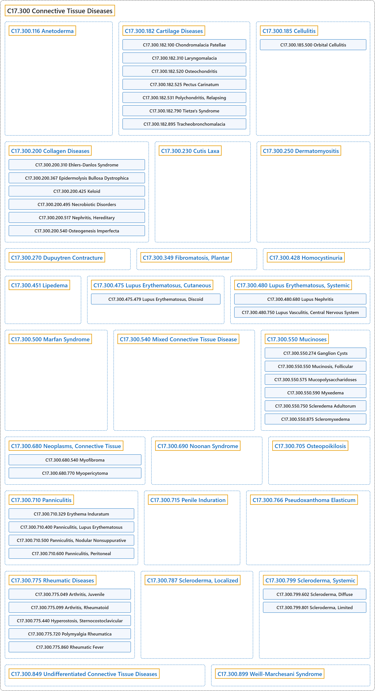

# C17.300 Connective Tissue Diseases

## Classification

## Glossary

| Term | Definition | 中文翻译 | Source |
|---|---|---|---|
| **C17.300 Connective Tissue Diseases** 结缔组织疾病 | "A heterogeneous group of disorders, some hereditary, others acquired, characterized by **abnormal structure or function of one or more of the elements of connective tissue**, i.e., collagen, elastin, or the mucopolysaccharides." | 一组异质性疾病，有些为遗传性，另一些为获得性，其特征是**结缔组织一种或多种成分的结构或功能异常**，这些成分即胶原、弹性蛋白或黏多糖。 | [National Library of Medicine, 2026, "Connective Tissue Diseases" scope note](https://meshb.nlm.nih.gov/record/ui?ui=D003240) |
| **C17.300.116 Anetoderma** 皮肤松弛症（斑状萎缩） | "Benign DERMATOSIS caused by a **loss of dermal ELASTIC TISSUE** resulting in **localized sac-like areas of flaccid skin**. It can be either primary (idiopathic) or secondary to other skin conditions, PENICILLAMINE use, or premature birth." | 一种良性皮肤病（DERMATOSIS），由**真皮弹性组织**（ELASTIC TISSUE）**缺失**引起，导致**局部出现囊袋状的松弛皮肤区域**。它可以是原发性（特发性）的，也可以继发于其他皮肤病、青霉胺（PENICILLAMINE）的使用或早产。 | [National Library of Medicine, 2026, "Anetoderma" scope note](https://meshb.nlm.nih.gov/record/ui?ui=D057088) |
| **C17.300.182 Cartilage Diseases** 软骨疾病 | "**Pathological processes involving the chondral tissue** (CARTILAGE)." | **累及软骨组织的病理过程**（CARTILAGE）。 | [National Library of Medicine, 2026, "Cartilage Diseases" scope note](https://meshb.nlm.nih.gov/record/ui?ui=D002357) |
| **C17.300.182.100 Chondromalacia Patellae** 髌骨软化症 | "A **degeneration of the ARTICULAR CARTILAGE of the PATELLA**, caused by a decrease in sulfated MUCOPOLYSACCHARIDES in the ground substance. When accompanied by pain, it is sometimes considered part of or confused with PATELLOFEMORAL PAIN SYNDROME." | **髌骨**（PATELLA）**关节软骨**（ARTICULAR CARTILAGE）**的退变**，由基质中硫酸化黏多糖（MUCOPOLYSACCHARIDES）减少所致。伴有疼痛时，有时被视为髌股疼痛综合征（PATELLOFEMORAL PAIN SYNDROME）的一部分或与之混淆。 | [National Library of Medicine, 2026, "Chondromalacia Patellae" scope note](https://meshb.nlm.nih.gov/record/ui?ui=D046789) |
| **C17.300.182.310 Laryngomalacia** 喉软化 | "A congenital or acquired condition of **underdeveloped or degeneration of CARTILAGE in the LARYNX**. This results in a floppy laryngeal wall making patency difficult to maintain." | 一种先天性或后天性病症，**喉**（LARYNX）**内软骨**（CARTILAGE）**发育不全或退化**。其结果是喉壁松软，难以维持通畅。 | [National Library of Medicine, 2026, "Laryngomalacia" scope note](https://meshb.nlm.nih.gov/record/ui?ui=D055092) |
| **C17.300.182.520 Osteochondritis** 骨软骨炎 | "**Inflammation of a bone and its overlaying CARTILAGE**." | **骨及其覆盖的软骨**（CARTILAGE）**的炎症**。 | [National Library of Medicine, 2026, "Osteochondritis" scope note](https://meshb.nlm.nih.gov/record/ui?ui=D010007) |
| **C17.300.182.525 Pectus Carinatum** 鸡胸 | "A developmental anomaly characterized by **abnormal anterior protrusion of the STERNUM** and adjacent COSTAL CARTILAGE." | 一种发育异常，特征为**胸骨**（STERNUM）**异常向前突出**及相邻的肋软骨（COSTAL CARTILAGE）异常前突。 | [National Library of Medicine, 2026, "Pectus Carinatum" scope note](https://meshb.nlm.nih.gov/record/ui?ui=D066166) |
| **C17.300.182.531 Polychondritis, Relapsing** 复发性多软骨炎 | "An acquired disease of unknown etiology, chronic course, and tendency to recur. It is characterized by **inflammation and degeneration of cartilage** and can result in deformities such as floppy ear and saddle nose. Loss of cartilage in the respiratory tract can lead to respiratory obstruction." | 一种病因不明、病程慢性、有复发倾向的获得性疾病。其特征为**软骨的炎症和变性**，可导致松软耳、鞍鼻等畸形。呼吸道软骨丧失可导致呼吸道阻塞。 | [National Library of Medicine, 2026, "Polychondritis, Relapsing" scope note](https://meshb.nlm.nih.gov/record/ui?ui=D011081) |
| **C17.300.182.790 Tietze's Syndrome** 蒂策综合征 | "**Idiopathic painful nonsuppurative swellings of one or more costal cartilages**, especially of the second rib. The anterior chest pain may mimic that of coronary artery disease. (Dorland, 27th ed.)" | **一处或多处肋软骨的特发性疼痛性非化脓性肿胀**，尤其是第二肋。前胸痛可类似冠状动脉疾病的胸痛。（Dorland，第 27 版） | [National Library of Medicine, 2026, "Tietze's Syndrome" scope note](https://meshb.nlm.nih.gov/record/ui?ui=D013991) |
| **C17.300.182.895 Tracheobronchomalacia** 气管支气管软化 | "A congenital or acquired condition of **underdeveloped or degeneration of CARTILAGE in the TRACHEA and the BRONCHI**. This results in a floppy non-rigid airway making patency difficult to maintain." | 一种先天性或后天性病症，**气管**（TRACHEA）**和支气管**（BRONCHI）**内软骨**（CARTILAGE）**发育不全或退化**。其结果是气道松软、缺乏刚性，难以维持通畅。 | [National Library of Medicine, 2026, "Tracheobronchomalacia" scope note](https://meshb.nlm.nih.gov/record/ui?ui=D055089) |
| **C17.300.182.895.249 Bronchomalacia** 支气管软化 | "A congenital or acquired condition of **underdeveloped or degeneration of CARTILAGE in the BRONCHI**. This results in a **floppy bronchial wall** making patency difficult to maintain. It is characterized by wheezing and difficult breathing." | 一种先天性或获得性病症，表现为**支气管**（BRONCHI）**内软骨**（CARTILAGE）**发育不全或退化**。这导致**支气管壁松软**，难以维持通畅。其特征为喘鸣和呼吸困难。 | [National Library of Medicine, 2026, "Bronchomalacia" scope note](https://meshb.nlm.nih.gov/record/ui?ui=D055091) |
| **C17.300.182.895.500 Tracheomalacia** 气管软化 | "A congenital or acquired condition of **underdeveloped or degeneration of CARTILAGE in the TRACHEA**. This results in a **floppy tracheal wall** making patency difficult to maintain. It is characterized by wheezing and difficult breathing." | 一种先天性或后天性疾病，表现为**气管**（TRACHEA）**内软骨**（CARTILAGE）**发育不全或退化**。这导致**气管壁松软**，难以维持通畅。其特征为喘鸣和呼吸困难。 | [National Library of Medicine, 2026, "Tracheomalacia" scope note](https://meshb.nlm.nih.gov/record/ui?ui=D055090) |
| **C17.300.185 Cellulitis** 蜂窝织炎 | "An acute, diffuse, and **suppurative inflammation of loose connective tissue**, particularly the deep subcutaneous tissues, and sometimes muscle, which is most commonly seen as a result of infection of a wound, ulcer, or other skin lesions." | 一种急性、弥漫性、**疏松结缔组织的化脓性炎症**，尤其累及皮下深部组织，有时累及肌肉，最常见于伤口、溃疡或其他皮肤病变感染之后。 | [National Library of Medicine, 2026, "Cellulitis" scope note](https://meshb.nlm.nih.gov/record/ui?ui=D002481) |
| **C17.300.185.500 Orbital Cellulitis** 眶蜂窝织炎 | "**Inflammation of the loose connective tissues around the ORBIT**, bony structure around the eyeball. It is characterized by PAIN; EDEMA of the CONJUNCTIVA; swelling of the EYELIDS; EXOPHTHALMOS; limited eye movement; and loss of vision." | **眼眶**（ORBIT）**周围疏松结缔组织的炎症**，眼眶即眼球周围的骨性结构。其特征为疼痛（PAIN）、结膜（CONJUNCTIVA）水肿（EDEMA）、眼睑（EYELIDS）肿胀、眼球突出（EXOPHTHALMOS）、眼球运动受限及视力丧失。 | [National Library of Medicine, 2026, "Orbital Cellulitis" scope note](https://meshb.nlm.nih.gov/record/ui?ui=D054517) |
| **C17.300.200 Collagen Diseases** 胶原病 | "Historically, a heterogeneous group of acute and chronic diseases, including rheumatoid arthritis, systemic lupus erythematosus, progressive systemic sclerosis, dermatomyositis, etc. This classification was based on the notion that collagen was equivalent to connective tissue, but with the present recognition of the different types of collagen and the aggregates derived from them as distinct entities, the term collagen diseases now pertains exclusively to those **inherited conditions in which the primary defect is at the gene level and affects collagen biosynthesis, post-translational modification, or extracellular processing directly**. (From Cecil Textbook of Medicine, 19th ed, p1494)" | 历史上指一组异质性的急性和慢性疾病，包括类风湿关节炎、系统性红斑狼疮、进行性系统性硬化症、皮肌炎等。这一分类基于胶原等同于结缔组织的观念；但随着现在认识到不同类型的胶原及其衍生的聚集体是不同的实体，胶原病一词现在专指那些**原发缺陷位于基因水平、直接影响胶原生物合成、翻译后修饰或细胞外加工的遗传性病症**。（引自 Cecil Textbook of Medicine，第 19 版，第 1494 页） | [National Library of Medicine, 2026, "Collagen Diseases" scope note](https://meshb.nlm.nih.gov/record/ui?ui=D003095) |
| **C17.300.200.310 Ehlers-Danlos Syndrome** 埃勒斯-当洛斯综合征 | "A heterogeneous group of **autosomally inherited COLLAGEN DISEASES** caused by **defects in the synthesis or structure of FIBRILLAR COLLAGEN**. There are numerous subtypes: classical, hypermobility, vascular, and others. Common clinical features include hyperextensible skin and joints, skin fragility and reduced wound healing capability." | 一组异质性的**常染色体遗传性胶原病**（COLLAGEN DISEASES），由**纤维状胶原**（FIBRILLAR COLLAGEN）**合成或结构缺陷**所致。有众多亚型：经典型、过度活动型、血管型及其他。常见临床特征包括皮肤和关节过度伸展、皮肤脆弱以及伤口愈合能力降低。 | [National Library of Medicine, 2026, "Ehlers-Danlos Syndrome" scope note](https://meshb.nlm.nih.gov/record/ui?ui=D004535) |
| **C17.300.200.310.500 Ehlers-Danlos Syndrome, Type IV** 埃勒斯-当洛综合征IV型（血管型） | "A subtype of Ehlers-Danlos syndrome (EDS) characterized by **vascular pathologies**, e.g., AORTIC DISSECTION in addition to common EDS findings, e.g., hyperextensible skin and joints, skin fragility and reduced wound healing capability. It is associated with mutations in **collagen type III alpha 1 chain gene** (COLLAGEN TYPE III)." | 埃勒斯-当洛综合征（EDS）的一个亚型，除常见的 EDS 表现（如皮肤和关节过度伸展、皮肤脆弱及伤口愈合能力下降）外，还以**血管病变**为特征，如主动脉夹层（AORTIC DISSECTION）。它与**III 型胶原 α1 链基因**（COLLAGEN TYPE III）的突变有关。 | [National Library of Medicine, 2026, "Ehlers-Danlos Syndrome, Type IV" scope note](https://meshb.nlm.nih.gov/record/ui?ui=D000094623) |
| **C17.300.200.367 Epidermolysis Bullosa Dystrophica** 营养不良型大疱性表皮松解症 | "Form of epidermolysis bullosa characterized by **atrophy of blistered areas, severe scarring, and nail changes**. It is most often present at birth or in early infancy and occurs in both autosomal dominant and recessive forms. All forms of dystrophic epidermolysis bullosa result from mutations in COLLAGEN TYPE VII, a major component fibrils of BASEMENT MEMBRANE and EPIDERMIS." | 大疱性表皮松解症的一种类型，特征为**水疱区萎缩、严重瘢痕形成及甲改变**。多于出生时或婴儿早期出现，有常染色体显性和隐性两种遗传形式。所有营养不良型大疱性表皮松解症均由 VII 型胶原（COLLAGEN TYPE VII）突变所致，VII 型胶原是基底膜（BASEMENT MEMBRANE）和表皮（EPIDERMIS）纤维的主要成分。 | [National Library of Medicine, 2026, "Epidermolysis Bullosa Dystrophica" scope note](https://meshb.nlm.nih.gov/record/ui?ui=D016108) |
| **C17.300.200.425 Keloid** 瘢痕疙瘩 | "A sharply elevated, irregularly shaped, **progressively enlarging scar** resulting from **formation of excessive amounts of collagen in the dermis** during connective tissue repair. It is differentiated from a hypertrophic scar (CICATRIX, HYPERTROPHIC) in that the former does not spread to surrounding tissues." | 一种明显隆起、形状不规则、**逐渐增大的瘢痕**，由结缔组织修复过程中**真皮内形成过量胶原**所致。它与增生性瘢痕（CICATRIX, HYPERTROPHIC）的区别在于前者不向周围组织扩展。 | [National Library of Medicine, 2026, "Keloid" scope note](https://meshb.nlm.nih.gov/record/ui?ui=D007627) |
| **C17.300.200.425.125 Acne Keloid** 瘢痕疙瘩性痤疮 | "A type of acneiform disorder in which **secondary pyogenic infection in and around pilosebaceous structures ends in keloidal scarring**. It manifests as persistent folliculitis of the back of the neck associated with occlusion of the follicular orifices. It is most often encountered in black or Asian men." | 一种痤疮样疾病，其**毛囊皮脂腺结构内及周围的继发性化脓性感染最终形成瘢痕疙瘩性瘢痕**。表现为颈后部持续性毛囊炎，伴毛囊口闭塞。最常见于黑人或亚洲男性。 | [National Library of Medicine, 2026, "Acne Keloid" scope note](https://meshb.nlm.nih.gov/record/ui?ui=D000153) |
| **C17.300.200.495 Necrobiotic Disorders** 渐进性坏死性疾病 | "A group of disorders characterized by **swelling, basophilia, and distortion of collagen bundles in the dermis**." | 一组疾病，其特征为**真皮内胶原束的肿胀、嗜碱性变和扭曲**。 | [National Library of Medicine, 2026, "Necrobiotic Disorders" scope note](https://meshb.nlm.nih.gov/record/ui?ui=D017441) |
| **C17.300.200.495.380 Granuloma Annulare** 环状肉芽肿 | "Benign granulomatous disease of unknown etiology characterized by a **ring of localized or disseminated papules or nodules** on the skin and **palisading histiocytes surrounding necrobiotic tissue** resulting from altered collagen structures." | 一种病因不明的良性肉芽肿性疾病，特征为皮肤上出现**局限性或播散性丘疹或结节组成的环**，以及**栅栏状排列的组织细胞包绕渐进性坏死组织**，后者源于胶原结构的改变。 | [National Library of Medicine, 2026, "Granuloma Annulare" scope note](https://meshb.nlm.nih.gov/record/ui?ui=D016460) |
| **C17.300.200.495.545 Necrobiosis Lipoidica** 类脂质渐进性坏死 | "A **degenerative disease of the dermal connective tissue** characterized by the development of erythematous papules or nodules in the pretibial area. The papules form plaques covered with telangiectatic vessels. More than half of the affected patients have diabetes." | 一种**真皮结缔组织的变性疾病**，特征为胫前区出现红斑性丘疹或结节。丘疹融合成斑块，表面覆有毛细血管扩张的血管。半数以上患者患有糖尿病。 | [National Library of Medicine, 2026, "Necrobiosis Lipoidica" scope note](https://meshb.nlm.nih.gov/record/ui?ui=D009335) |
| **C17.300.200.495.772 Necrobiotic Xanthogranuloma** 坏死性黄色肉芽肿 | "A **cutaneous necrobiotic disorder** characterized by **firm, yellow plaques or nodules**, often in a periorbital distribution. It is often accompanied by an elevated ERYTHROCYTE SEDIMENTATION RATE; LEUKOPENIA; and MONOCLONAL GAMMOPATHY (IgG-kappa type) and systemic involvement." | 一种**皮肤渐进性坏死性疾病**，特征为**质硬的黄色斑块或结节**，常分布于眶周。常伴有红细胞沉降率（ERYTHROCYTE SEDIMENTATION RATE）升高、白细胞减少症（LEUKOPENIA）、单克隆丙种球蛋白病（MONOCLONAL GAMMOPATHY）（IgG-kappa 型）及全身受累。 | [National Library of Medicine, 2026, "Necrobiotic Xanthogranuloma" scope note](https://meshb.nlm.nih.gov/record/ui?ui=D058252) |
| **C17.300.200.517 Nephritis, Hereditary** 遗传性肾炎 | "A group of **inherited conditions characterized initially by HEMATURIA and slowly progressing to RENAL INSUFFICIENCY**. The most common form is the Alport syndrome (hereditary nephritis with HEARING LOSS) which is caused by mutations in genes for TYPE IV COLLAGEN and defective GLOMERULAR BASEMENT MEMBRANE." | 一组**遗传性病症，初期以血尿**（HEMATURIA）**为特征，缓慢进展为肾功能不全**（RENAL INSUFFICIENCY）。最常见的形式是 Alport 综合征（伴听力损失（HEARING LOSS）的遗传性肾炎），由 IV 型胶原（TYPE IV COLLAGEN）基因突变及肾小球基底膜（GLOMERULAR BASEMENT MEMBRANE）缺陷引起。 | [National Library of Medicine, 2026, "Nephritis, Hereditary" scope note](https://meshb.nlm.nih.gov/record/ui?ui=D009394) |
| **C17.300.200.540 Osteogenesis Imperfecta** 成骨不全 | "COLLAGEN DISEASES characterized by **brittle, osteoporotic, and easily fractured bones**. It may also present with blue sclerae, loose joints, and imperfect dentin formation. Most types are autosomal dominant and are associated with mutations in COLLAGEN TYPE I." | 胶原病（COLLAGEN DISEASES），其特征为**骨质脆弱、骨质疏松且容易骨折**。也可表现为蓝色巩膜、关节松弛和牙本质形成不全。大多数类型为常染色体显性遗传，并与 I 型胶原（COLLAGEN TYPE I）的突变相关。 | [National Library of Medicine, 2026, "Osteogenesis Imperfecta" scope note](https://meshb.nlm.nih.gov/record/ui?ui=D010013) |
| **C17.300.230 Cutis Laxa** 皮肤松垂 | "A group of connective tissue diseases in which **skin hangs in loose pendulous folds**. It is believed to be associated with decreased elastic tissue formation as well as an abnormality in elastin formation. Cutis laxa is usually a genetic disease, but acquired cases have been reported. (From Dorland, 27th ed)" | 一组结缔组织病，其中**皮肤呈松弛下垂的皱褶**。据认为它与弹性组织形成减少以及弹性蛋白形成异常有关。皮肤松垂通常是遗传性疾病，但也有后天获得性病例的报道。（引自 Dorland，第 27 版） | [National Library of Medicine, 2026, "Cutis Laxa" scope note](https://meshb.nlm.nih.gov/record/ui?ui=D003483) |
| **C17.300.250 Dermatomyositis** 皮肌炎 | "A subacute or chronic **inflammatory disease of muscle and skin**, marked by **proximal muscle weakness and a characteristic skin rash**. The illness occurs with approximately equal frequency in children and adults. The skin lesions usually take the form of a purplish rash (or less often an exfoliative dermatitis) involving the nose, cheeks, forehead, upper trunk, and arms. The disease is associated with a complement mediated intramuscular microangiopathy, leading to loss of capillaries, muscle ischemia, muscle-fiber necrosis, and perifascicular atrophy. The childhood form of this disease tends to evolve into a systemic vasculitis. Dermatomyositis may occur in association with malignant neoplasms. (From Adams et al., Principles of Neurology, 6th ed, pp1405-6)" | 一种亚急性或慢性的**肌肉和皮肤炎症性疾病**，以**近端肌无力和特征性皮疹**为特点。该病在儿童和成人中的发病率大致相等。皮肤病变通常表现为紫红色皮疹（较少为剥脱性皮炎），累及鼻、面颊、前额、上躯干和上肢。该病与补体介导的肌内微血管病有关，导致毛细血管丧失、肌肉缺血、肌纤维坏死和束周萎缩。儿童型往往发展为系统性血管炎。皮肌炎可伴发恶性肿瘤。（引自 Adams 等，《神经病学原理》，第 6 版，第 1405-1406 页） | [National Library of Medicine, 2026, "Dermatomyositis" scope note](https://meshb.nlm.nih.gov/record/ui?ui=D003882) |
| **C17.300.270 Dupuytren Contracture** 掌腱膜挛缩 | "A **fibromatosis of the palmar fascia** characterized by **thickening and contracture of the fibrous bands** on the palmar surfaces of the hand and fingers. It arises most commonly in men between the ages of 30 and 50." | 一种**掌筋膜的纤维瘤病**，特征为手掌面及手指掌面**纤维束的增厚和挛缩**。最常见于 30 至 50 岁的男性。 | [National Library of Medicine, 2026, "Dupuytren Contracture" scope note](https://meshb.nlm.nih.gov/record/ui?ui=D004387) |
| **C17.300.349 Fibromatosis, Plantar** 足底纤维瘤病 | "A **fibromatosis of the plantar fascia** characterized by **thickening of the fibrous bands on the plantar aponeurosis** in the sole of the foot and toes." | 一种**足底筋膜的纤维瘤病**，特征为足底及足趾处**足底腱膜上的纤维束增厚**。 | [National Library of Medicine, 2026, "Fibromatosis, Plantar" scope note](https://meshb.nlm.nih.gov/record/ui?ui=D000071380) |
| **C17.300.428 Homocystinuria** 同型胱氨酸尿症 | "Autosomal recessive **inborn error of methionine metabolism** usually caused by a deficiency of CYSTATHIONINE BETA-SYNTHASE and associated with **elevations of homocysteine in plasma and urine**. Clinical features include a tall slender habitus, SCOLIOSIS, arachnodactyly, MUSCLE WEAKNESS, genu varus, thin blond hair, malar flush, lens dislocations, an increased incidence of MENTAL RETARDATION, and a tendency to develop fibrosis of arteries, frequently complicated by CEREBROVASCULAR ACCIDENTS and MYOCARDIAL INFARCTION. (From Adams et al., Principles of Neurology, 6th ed, p979)" | 常染色体隐性遗传的**先天性甲硫氨酸代谢缺陷**，通常由胱硫醚β-合酶（CYSTATHIONINE BETA-SYNTHASE）缺乏引起，并伴有**血浆和尿液中同型半胱氨酸升高**。临床特征包括高瘦体型、脊柱侧凸（SCOLIOSIS）、蜘蛛指（趾）、肌无力（MUSCLE WEAKNESS）、膝内翻、头发稀薄呈金黄色、颧部潮红、晶状体脱位、精神发育迟滞（MENTAL RETARDATION）发生率增加，以及动脉纤维化倾向，后者常并发脑血管意外（CEREBROVASCULAR ACCIDENTS）和心肌梗死（MYOCARDIAL INFARCTION）。（引自 Adams 等，Principles of Neurology，第 6 版，第 979 页） | [National Library of Medicine, 2026, "Homocystinuria" scope note](https://meshb.nlm.nih.gov/record/ui?ui=D006712) |
| **C17.300.451 Lipedema** 脂肪水肿 | "Disorder of adipose tissue characterized by **symmetric and bilateral enlargement of the lower extremities** due to **abnormal deposition of SUBCUTANEOUS FAT** often in obese women. It is associated with HEMATOMA, pain and may progress to secondary LYMPHEDEMA which is known as lipolymphedema." | 一种脂肪组织疾病，特征为**下肢对称性双侧增粗**，原因是**皮下脂肪**（SUBCUTANEOUS FAT）**异常沉积**，多见于肥胖女性。它与血肿（HEMATOMA）、疼痛相关，并可进展为继发性淋巴水肿（LYMPHEDEMA），即脂肪淋巴水肿。 | [National Library of Medicine, 2026, "Lipedema" scope note](https://meshb.nlm.nih.gov/record/ui?ui=D065134) |
| **C17.300.475 Lupus Erythematosus, Cutaneous** 皮肤型红斑狼疮 | "A form of lupus erythematosus in which **the skin may be the only organ involved** or in which skin involvement precedes the spread into other body systems. It has been classified into three forms - acute (= LUPUS ERYTHEMATOSUS, SYSTEMIC with skin lesions), subacute, and chronic (= LUPUS ERYTHEMATOSUS, DISCOID)." | 红斑狼疮的一种类型，其中**皮肤可能是唯一受累的器官**，或皮肤受累先于向其他身体系统的扩散。分为三型：急性（即伴有皮肤病变的系统性红斑狼疮（LUPUS ERYTHEMATOSUS, SYSTEMIC））、亚急性和慢性（即盘状红斑狼疮（LUPUS ERYTHEMATOSUS, DISCOID））。 | [National Library of Medicine, 2026, "Lupus Erythematosus, Cutaneous" scope note](https://meshb.nlm.nih.gov/record/ui?ui=D008178) |
| **C17.300.475.479 Lupus Erythematosus, Discoid** 盘状红斑狼疮 | "A **chronic form of cutaneous lupus erythematosus** (LUPUS ERYTHEMATOSUS, CUTANEOUS) in which the skin lesions mimic those of the systemic form but in which systemic signs are rare. It is characterized by the presence of **discoid skin plaques** showing varying degrees of edema, erythema, scaliness, follicular plugging, and skin atrophy. Lesions are surrounded by an elevated erythematous border. The condition typically involves the face and scalp, but widespread dissemination may occur." | 一种**皮肤型红斑狼疮的慢性类型**（LUPUS ERYTHEMATOSUS, CUTANEOUS），其皮损类似系统型，但全身征象少见。其特征为出现**盘状皮肤斑块**，表现不同程度的水肿、红斑、鳞屑、毛囊角栓和皮肤萎缩。皮损周围有隆起的红斑性边缘。本病通常累及面部和头皮，但也可广泛播散。 | [National Library of Medicine, 2026, "Lupus Erythematosus, Discoid" scope note](https://meshb.nlm.nih.gov/record/ui?ui=D008179) |
| **C17.300.475.479.400 Panniculitis, Lupus Erythematosus** 狼疮性脂膜炎 | "A type of **lupus erythematosus** characterized by **deep dermal or subcutaneous nodules**, most often on the head, face, or upper arms. It is generally chronic and occurs most often in women between the ages of 20 and 45." | 一种**红斑狼疮**，特征为**真皮深层或皮下结节**，最常见于头部、面部或上臂。通常呈慢性，最常发生于 20 至 45 岁的女性。 | [National Library of Medicine, 2026, "Panniculitis, Lupus Erythematosus" scope note](https://meshb.nlm.nih.gov/record/ui?ui=D015435) |
| **C17.300.480 Lupus Erythematosus, Systemic** 系统性红斑狼疮 | "A chronic, relapsing, inflammatory, and often febrile **multisystemic disorder of connective tissue**, characterized principally by involvement of the skin, joints, kidneys, and serosal membranes. It is of unknown etiology, but is thought to represent a **failure of the regulatory mechanisms of the autoimmune system**. The disease is marked by a wide range of system dysfunctions, an elevated erythrocyte sedimentation rate, and the formation of LE cells in the blood or bone marrow." | 一种慢性、复发性、炎症性且常伴发热的**结缔组织多系统疾病**，主要特征为累及皮肤、关节、肾脏和浆膜。其病因不明，但被认为代表**自身免疫系统调节机制的失效**。该病的标志是广泛的系统功能障碍、红细胞沉降率升高，以及血液或骨髓中形成红斑狼疮细胞（LE 细胞）。 | [National Library of Medicine, 2026, "Lupus Erythematosus, Systemic" scope note](https://meshb.nlm.nih.gov/record/ui?ui=D008180) |
| **C17.300.480.680 Lupus Nephritis** 狼疮性肾炎 | "**Glomerulonephritis associated with autoimmune disease SYSTEMIC LUPUS ERYTHEMATOSUS**. Lupus nephritis is histologically classified into 6 classes: class I - normal glomeruli, class II - pure mesangial alterations, class III - focal segmental glomerulonephritis, class IV - diffuse glomerulonephritis, class V - diffuse membranous glomerulonephritis, and class VI - advanced sclerosing glomerulonephritis (The World Health Organization classification 1982)." | **与自身免疫病系统性红斑狼疮相关的肾小球肾炎**（SYSTEMIC LUPUS ERYTHEMATOSUS）。狼疮性肾炎在组织学上分为 6 类：I 类，肾小球正常；II 类，单纯系膜病变；III 类，局灶节段性肾小球肾炎；IV 类，弥漫性肾小球肾炎；V 类，弥漫性膜性肾小球肾炎；VI 类，晚期硬化性肾小球肾炎（世界卫生组织 1982 年分类）。 | [National Library of Medicine, 2026, "Lupus Nephritis" scope note](https://meshb.nlm.nih.gov/record/ui?ui=D008181) |
| **C17.300.480.750 Lupus Vasculitis, Central Nervous System** 中枢神经系统狼疮血管炎 | "**Central nervous system vasculitis** that is associated with SYSTEMIC LUPUS ERYTHEMATOSUS. Clinical manifestations may include DEMENTIA; SEIZURES; CRANIAL NERVE DISEASES; HEMIPARESIS; BLINDNESS; DYSPHASIA; and other neurological disorders." | 与系统性红斑狼疮（SYSTEMIC LUPUS ERYTHEMATOSUS）相关的**中枢神经系统血管炎**。临床表现可包括痴呆（DEMENTIA）、癫痫发作（SEIZURES）、脑神经疾病（CRANIAL NERVE DISEASES）、偏瘫（HEMIPARESIS）、失明（BLINDNESS）、言语障碍（DYSPHASIA）及其他神经系统疾病。 | [National Library of Medicine, 2026, "Lupus Vasculitis, Central Nervous System" scope note](https://meshb.nlm.nih.gov/record/ui?ui=D020945) |
| **C17.300.500 Marfan Syndrome** 马方综合征 | "An **autosomal dominant disorder of CONNECTIVE TISSUE** with abnormal features in the heart, the eye, and the skeleton. Cardiovascular manifestations include MITRAL VALVE PROLAPSE; AORTIC ANEURYSM; and AORTIC DISSECTION. Other features include lens displacement (ectopia lentis), disproportioned long limbs and enlarged DURA MATER (dural ectasia). Marfan syndrome (type 1) is associated with mutations in the gene encoding FIBRILLIN-1 (FBN1), a major element of extracellular microfibrils of connective tissue. Mutations in the gene encoding TYPE II TGF-BETA RECEPTOR (TGFBR2) are associated with Marfan syndrome type 2." | 一种**常染色体显性遗传的结缔组织**（CONNECTIVE TISSUE）**疾病**，在心脏、眼和骨骼方面有异常特征。心血管表现包括二尖瓣脱垂（MITRAL VALVE PROLAPSE）、主动脉瘤（AORTIC ANEURYSM）和主动脉夹层（AORTIC DISSECTION）。其他特征包括晶状体移位（晶状体异位）、四肢过长不成比例以及硬脑膜（DURA MATER）扩大（硬脊膜扩张）。马方综合征 1 型与编码原纤维蛋白-1（FIBRILLIN-1）（FBN1）的基因突变相关，FBN1 是结缔组织细胞外微原纤维的主要成分。编码 II 型 TGF-β 受体（TYPE II TGF-BETA RECEPTOR）（TGFBR2）的基因突变与马方综合征 2 型相关。 | [National Library of Medicine, 2026, "Marfan Syndrome" scope note](https://meshb.nlm.nih.gov/record/ui?ui=D008382) |
| **C17.300.540 Mixed Connective Tissue Disease** 混合性结缔组织病 | "A syndrome with **overlapping clinical features of systemic lupus erythematosus, scleroderma, polymyositis, and Raynaud's phenomenon**. The disease is differentially characterized by high serum titers of antibodies to ribonuclease-sensitive extractable (saline soluble) nuclear antigen and a speckled epidermal nuclear staining pattern on direct immunofluorescence." | 一种综合征，具有**系统性红斑狼疮、硬皮病、多发性肌炎和雷诺现象相互重叠的临床特征**。该病的鉴别特征是血清中针对核糖核酸酶敏感的可提取（盐水可溶性）核抗原的抗体滴度高，且直接免疫荧光显示斑点型表皮细胞核染色模式。 | [National Library of Medicine, 2026, "Mixed Connective Tissue Disease" scope note](https://meshb.nlm.nih.gov/record/ui?ui=D008947) |
| **C17.300.550 Mucinoses** 黏蛋白病 | "Mucoid states characterized by the **elevated deposition and accumulation of mucin (mucopolysaccharides) in dermal tissue**. The fibroblasts are responsible for the production of acid mucopolysaccharides (GLYCOSAMINOGLYCANS) in the ground substance of the connective tissue system. When fibroblasts produce abnormally large quantities of mucopolysaccharides as hyaluronic acid, chondroitin sulfate, or heparin, they accumulate in large amounts in the dermis." | 黏液样状态，其特征为**真皮组织中黏蛋白（黏多糖）沉积和蓄积增加**。成纤维细胞负责在结缔组织系统的基质中产生酸性黏多糖（糖胺聚糖，GLYCOSAMINOGLYCANS）。当成纤维细胞产生异常大量的黏多糖（如透明质酸、硫酸软骨素或肝素）时，它们会大量蓄积于真皮中。 | [National Library of Medicine, 2026, "Mucinoses" scope note](https://meshb.nlm.nih.gov/record/ui?ui=D017520) |
| **C17.300.550.274 Ganglion Cysts** 腱鞘囊肿 | "**Nodular tumor-like lesions or mucoid flesh**, arising from tendon sheaths, LIGAMENTS, or JOINT CAPSULE, especially of the hands, wrists, or feet. They are not true cysts as they **lack epithelial wall**. They are distinguished from SYNOVIAL CYSTS by the lack of communication with a joint cavity or the SYNOVIAL MEMBRANE." | **结节状瘤样病变或黏液样组织**，起源于腱鞘、韧带（LIGAMENTS）或关节囊（JOINT CAPSULE），尤见于手、腕或足。它们并非真性囊肿，因为**缺乏上皮壁**。它们与滑膜囊肿（SYNOVIAL CYSTS）的区别在于与关节腔或滑膜（SYNOVIAL MEMBRANE）不相通。 | [National Library of Medicine, 2026, "Ganglion Cysts" scope note](https://meshb.nlm.nih.gov/record/ui?ui=D045888) |
| **C17.300.550.550 Mucinosis, Follicular** 毛囊黏蛋白病 | "A **disease of the pilosebaceous unit**, presenting clinically as grouped follicular papules or plaques with associated hair loss. It is caused by **mucinous infiltration of tissues**, and usually involving the scalp, face, and neck. It may be primary (idiopathic) or secondary to mycosis fungoides or reticulosis." | 一种**毛囊皮脂腺单位的疾病**，临床表现为成群的毛囊性丘疹或斑块，伴脱发。由**组织黏蛋白浸润**引起，通常累及头皮、面部和颈部。可为原发性（特发性），或继发于蕈样肉芽肿或网状细胞增多症。 | [National Library of Medicine, 2026, "Mucinosis, Follicular" scope note](https://meshb.nlm.nih.gov/record/ui?ui=D000507) |
| **C17.300.550.575 Mucopolysaccharidoses** 黏多糖贮积症 | "Group of **lysosomal storage diseases** each caused by an **inherited deficiency of an enzyme involved in the degradation of glycosaminoglycans** (mucopolysaccharides). The diseases are progressive and often display a wide spectrum of clinical severity within one enzyme deficiency." | 一组**溶酶体贮积病**，每种均由**参与糖胺聚糖（黏多糖）降解的某种酶的遗传性缺乏**所致。这些疾病呈进行性，且同一种酶缺乏常表现出很宽的临床严重程度谱。 | [National Library of Medicine, 2026, "Mucopolysaccharidoses" scope note](https://meshb.nlm.nih.gov/record/ui?ui=D009083) |
| **C17.300.550.575.640 Mucopolysaccharidosis I** 黏多糖贮积症 I 型 | "A group of **autosomal recessive lysosomal storage disorders** caused by mutations in the gene encoding the enzyme, **alpha-L-iduronidase (IDUA)**, required for the degradation of heparan and dermatan sulfates. This leads to abnormal accumulation of these glycosaminoglycans in various tissues causing a wide range of clinical presentations including cognitive and musculoskeletal disorders." | 一组**常染色体隐性溶酶体贮积症**，由编码**α-L-艾杜糖醛酸酶**（IDUA）的基因突变引起，该酶是降解硫酸乙酰肝素和硫酸皮肤素所必需的。这导致这些糖胺聚糖在各种组织中异常蓄积，引起包括认知障碍和肌肉骨骼疾病在内的多种临床表现。 | [National Library of Medicine, 2026, "Mucopolysaccharidosis I" scope note](https://meshb.nlm.nih.gov/record/ui?ui=D008059) |
| **C17.300.550.575.645 Mucopolysaccharidosis II** 黏多糖贮积症 II 型 | "**Systemic lysosomal storage disease** marked by progressive physical deterioration and caused by a **deficiency of L-sulfoiduronate sulfatase**. This disease differs from MUCOPOLYSACCHARIDOSIS I by slower progression, lack of corneal clouding, and X-linked rather than autosomal recessive inheritance. The mild form produces near-normal intelligence and life span. The severe form usually causes death by age 15." | **系统性溶酶体贮积病**，以进行性躯体衰退为特征，由**L-硫酸艾杜糖醛酸硫酸酯酶缺乏**引起。本病与黏多糖贮积症 I 型（MUCOPOLYSACCHARIDOSIS I）的区别在于进展较慢、无角膜混浊，且为 X 连锁遗传而非常染色体隐性遗传。轻型患者智力和寿命接近正常。重型通常在 15 岁前导致死亡。 | [National Library of Medicine, 2026, "Mucopolysaccharidosis II" scope note](https://meshb.nlm.nih.gov/record/ui?ui=D016532) |
| **C17.300.550.575.650 Mucopolysaccharidosis III** 黏多糖贮积症III型 | "Mucopolysaccharidosis characterized by **HEPARAN SULFATE in the urine**, **progressive mental retardation**, mild dwarfism, and other skeletal disorders. There are four clinically indistinguishable but biochemically distinct forms, each due to a deficiency of a different enzyme." | 一种黏多糖贮积症，特征为**尿中出现硫酸乙酰肝素**（HEPARAN SULFATE）、**进行性智力低下**、轻度侏儒及其他骨骼异常。有四种临床上无法区分但生化上不同的类型，各由一种不同酶的缺乏所致。 | [National Library of Medicine, 2026, "Mucopolysaccharidosis III" scope note](https://meshb.nlm.nih.gov/record/ui?ui=D009084) |
| **C17.300.550.575.655 Mucopolysaccharidosis IV** 黏多糖贮积症 IV 型 | "**Genetic disorder of mucopolysaccharide metabolism** characterized by skeletal abnormalities, joint instability, development of cervical myelopathy, and excessive urinary keratan sulfate. There are two biochemically distinct forms, each due to a deficiency of a different enzyme." | 一种**黏多糖代谢的遗传性疾病**，特征为骨骼异常、关节不稳、颈髓病变以及尿中硫酸角质素过多。有两种生化上不同的类型，各由不同酶的缺乏所致。 | [National Library of Medicine, 2026, "Mucopolysaccharidosis IV" scope note](https://meshb.nlm.nih.gov/record/ui?ui=D009085) |
| **C17.300.550.575.670 Mucopolysaccharidosis VI** 黏多糖贮积症 VI 型 | "Mucopolysaccharidosis with **excessive CHONDROITIN SULFATE B in urine**, characterized by dwarfism and deafness. It is caused by a **deficiency of N-ACETYLGALACTOSAMINE-4-SULFATASE** (arylsulfatase B)." | 一种**尿中硫酸软骨素 B**（CHONDROITIN SULFATE B）**过多**的黏多糖贮积症，特征为侏儒症和耳聋。由 **N-乙酰半乳糖胺-4-硫酸酯酶**（N-ACETYLGALACTOSAMINE-4-SULFATASE）**缺乏**（芳基硫酸酯酶 B）所致。 | [National Library of Medicine, 2026, "Mucopolysaccharidosis VI" scope note](https://meshb.nlm.nih.gov/record/ui?ui=D009087) |
| **C17.300.550.575.675 Mucopolysaccharidosis VII** 黏多糖贮积症 VII 型 | "Mucopolysaccharidosis characterized by **excessive dermatan and heparan sulfates in the urine** and Hurler-like features. It is caused by a **deficiency of beta-glucuronidase**." | 一种黏多糖贮积症，特征为**尿中硫酸皮肤素和硫酸乙酰肝素过多**以及 Hurler 样特征。由**β-葡糖醛酸酶缺乏**引起。 | [National Library of Medicine, 2026, "Mucopolysaccharidosis VII" scope note](https://meshb.nlm.nih.gov/record/ui?ui=D016538) |
| **C17.300.550.590 Myxedema** 黏液性水肿 | "A condition characterized by a **dry, waxy type of swelling** (EDEMA) with abnormal deposits of MUCOPOLYSACCHARIDES in the SKIN and other tissues. It is caused by a **deficiency of THYROID HORMONES**. The skin becomes puffy around the eyes and on the cheeks. The face is dull and expressionless with thickened nose and lips." | 一种病症，其特征为**干燥、蜡样的肿胀**（水肿，EDEMA），伴有黏多糖（MUCOPOLYSACCHARIDES）在皮肤（SKIN）及其他组织中的异常沉积。由**甲状腺激素**（THYROID HORMONES）**缺乏**引起。眼周和面颊皮肤浮肿。面容呆滞、无表情，鼻和唇增厚。 | [National Library of Medicine, 2026, "Myxedema" scope note](https://meshb.nlm.nih.gov/record/ui?ui=D009230) |
| **C17.300.550.750 Scleredema Adultorum** 成人硬肿病 | "A **diffuse, non-pitting induration of the skin** of unknown etiology that occurs most commonly in association with diabetes mellitus, predominantly in females. It typically begins on the face or head and spreads to other areas of the body, sometimes involving noncutaneous tissues. Often it is preceded by any of various infections, notably staphylococcal infections. The condition resolves spontaneously, usually within two years of onset. (From Dorland, 27th ed)" | 一种病因不明的**弥漫性、非凹陷性皮肤硬肿**，最常与糖尿病相伴发生，以女性为主。它通常始于面部或头部，并扩展到身体其他部位，有时累及皮肤以外的组织。发病前常有各种感染，尤其是葡萄球菌感染。该病可自发消退，通常在发病后两年内。（引自 Dorland，第 27 版） | [National Library of Medicine, 2026, "Scleredema Adultorum" scope note](https://meshb.nlm.nih.gov/record/ui?ui=D012592) |
| **C17.300.550.875 Scleromyxedema** 硬化性黏液水肿 | "A connective tissue disorder characterized by **widespread thickening of SKIN with a cobblestone-like appearance**. It is caused by proliferation of FIBROBLASTS and deposition of MUCIN in the DERMIS in the absence of thyroid disease. Most scleromyxedema cases are associated with a MONOCLONAL GAMMOPATHY, immunoglobulin IgG-lambda." | 一种结缔组织疾病，特征为**皮肤**（SKIN）**广泛增厚并呈鹅卵石样外观**。由成纤维细胞（FIBROBLASTS）增殖及黏蛋白（MUCIN）在真皮（DERMIS）中沉积所致，且无甲状腺疾病。大多数硬化性黏液水肿病例伴有单克隆丙种球蛋白病（MONOCLONAL GAMMOPATHY），即 IgG-λ 型免疫球蛋白。 | [National Library of Medicine, 2026, "Scleromyxedema" scope note](https://meshb.nlm.nih.gov/record/ui?ui=D053718) |
| **C17.300.680 Neoplasms, Connective Tissue** 结缔组织肿瘤 | "**Neoplasms composed of connective tissue**, including elastic, mucous, reticular, osseous, and cartilaginous tissue. The concept does not refer to neoplasms located in connective tissue." | **由结缔组织构成的肿瘤**，包括弹性组织、黏液组织、网状组织、骨组织和软骨组织。本概念不指位于结缔组织中的肿瘤。 | [National Library of Medicine, 2026, "Neoplasms, Connective Tissue" scope note](https://meshb.nlm.nih.gov/record/ui?ui=D009372) |
| **C17.300.680.540 Myofibroma** 肌纤维瘤 | "A **benign tumor that consists chiefly of fibrous CONNECTIVE TISSUE**, with variable numbers of MUSCLE CELLS forming portions of the neoplasm (From Stedman's, 27th ed)." | 一种**主要由纤维性结缔组织**（CONNECTIVE TISSUE）**构成的良性肿瘤**，数量不等的肌细胞（MUSCLE CELLS）构成肿瘤的部分组织（引自 Stedman's，第 27 版）。 | [National Library of Medicine, 2026, "Myofibroma" scope note](https://meshb.nlm.nih.gov/record/ui?ui=D047708) |
| **C17.300.680.770 Myopericytoma** 肌周细胞瘤 | "Rare **myofibroma-like perivascular soft tissue tumor**, usually benign, characterized by **concentric perivascular proliferation**." | 罕见的**肌纤维瘤样血管周围软组织肿瘤**，通常为良性，特征为**血管周围同心圆状增生**。 | [National Library of Medicine, 2026, "Myopericytoma" scope note](https://meshb.nlm.nih.gov/record/ui?ui=D000077777) |
| **C17.300.690 Noonan Syndrome** 努南综合征 | "A **genetically heterogeneous, multifaceted disorder** characterized by **short stature, webbed neck, ptosis**, skeletal malformations, hypertelorism, hormonal imbalance, CRYPTORCHIDISM, multiple cardiac abnormalities (most commonly including PULMONARY VALVE STENOSIS), and some degree of INTELLECTUAL DISABILITY. The phenotype bears similarities to that of TURNER SYNDROME that occurs only in females and has its basis in a 45, X karyotype abnormality. Noonan syndrome occurs in both males and females with a normal karyotype (46,XX and 46,XY). Mutations in a several genes (PTPN11, KRAS, SOS1, NF1 and RAF1) have been associated the NS phenotype. Mutations in PTPN11 are the most common. LEOPARD SYNDROME, a disorder that has clinical features overlapping those of Noonan Syndrome, is also due to mutations in PTPN11. In addition, there is overlap with the syndrome called neurofibromatosis-Noonan syndrome due to mutations in NF1." | 一种**遗传异质性、多方面表现的疾病**，特征为**身材矮小、颈蹼、上睑下垂**、骨骼畸形、眼距过宽、激素失衡、隐睾（CRYPTORCHIDISM）、多种心脏异常（最常见的包括肺动脉瓣狭窄（PULMONARY VALVE STENOSIS））以及一定程度的智力障碍（INTELLECTUAL DISABILITY）。其表型与特纳综合征（TURNER SYNDROME）相似，后者仅见于女性，基础为 45,X 核型异常。努南综合征在男性和女性中均可发生，核型正常（46,XX 和 46,XY）。多个基因（PTPN11、KRAS、SOS1、NF1 和 RAF1）的突变与 NS 表型相关，其中 PTPN11 突变最常见。豹斑综合征（LEOPARD SYNDROME）的临床特征与努南综合征重叠，也是由 PTPN11 突变所致。此外，它还与由 NF1 突变引起的神经纤维瘤病-努南综合征存在重叠。 | [National Library of Medicine, 2026, "Noonan Syndrome" scope note](https://meshb.nlm.nih.gov/record/ui?ui=D009634) |
| **C17.300.705 Osteopoikilosis** 脆弱性骨硬化 | "An asymptomatic, autosomal dominant trait in which **pea-sized sclerotic spots**, prominent in the metaphyseal area, are accompanied by **unique cutaneous lesions**. These are yellowish papules or plaques with increased elastin content. (From Cecil Textbook of Medicine, 19th ed, pp1434-35)" | 一种无症状的常染色体显性性状，表现为**豌豆大小的硬化斑**（以干骺端区域显著），并伴有**独特的皮肤病变**。这些皮损为弹性蛋白含量增高的淡黄色丘疹或斑块。（引自《Cecil 内科学》，第 19 版，第 1434-1435 页） | [National Library of Medicine, 2026, "Osteopoikilosis" scope note](https://meshb.nlm.nih.gov/record/ui?ui=D010023) |
| **C17.300.710 Panniculitis** 脂膜炎 | "General term for **inflammation of adipose tissue**, usually of the skin, characterized by **reddened subcutaneous nodules**." | **脂肪组织炎症**的总称，通常发生于皮肤，特征为**发红的皮下结节**。 | [National Library of Medicine, 2026, "Panniculitis" scope note](https://meshb.nlm.nih.gov/record/ui?ui=D015434) |
| **C17.300.710.329 Erythema Induratum** 硬红斑 | "A type of **panniculitis** characterized histologically by the presence of **granulomas, vasculitis, and necrosis**. It is traditionally considered to be the tuberculous counterpart of nodular vasculitis, but is now known to occur without tuberculous precedent. It is seen most commonly in adolescent and menopausal women, is initiated or exacerbated by cold weather, and typically presents as one or more recurrent erythrocyanotic nodules or plaques on the calves. The nodules may progress to form indurations, ulcerations, and scars." | 一种**脂膜炎**，组织学特征为存在**肉芽肿、血管炎和坏死**。传统上认为它是结节性血管炎的结核性对应病，但现已知其可在无结核前驱的情况下发生。最常见于青春期和绝经期女性，由寒冷天气诱发或加重，典型表现为小腿上一个或多个复发性红绀色结节或斑块。结节可进展形成硬结、溃疡和瘢痕。 | [National Library of Medicine, 2026, "Erythema Induratum" scope note](https://meshb.nlm.nih.gov/record/ui?ui=D004891) |
| **C17.300.710.400 Panniculitis, Lupus Erythematosus** 狼疮性脂膜炎 | "A type of **lupus erythematosus** characterized by **deep dermal or subcutaneous nodules**, most often on the head, face, or upper arms. It is generally chronic and occurs most often in women between the ages of 20 and 45." | 一种**红斑狼疮**，特征为**真皮深层或皮下结节**，最常见于头部、面部或上臂。通常呈慢性，最常发生于 20 至 45 岁的女性。 | [National Library of Medicine, 2026, "Panniculitis, Lupus Erythematosus" scope note](https://meshb.nlm.nih.gov/record/ui?ui=D015435) |
| **C17.300.710.500 Panniculitis, Nodular Nonsuppurative** 结节性非化脓性脂膜炎 | "A form of panniculitis characterized by **recurrent episodes of fever** accompanied by the eruption of single or multiple **erythematous subcutaneous nodules** on the lower extremities. They normally resolve, but tend to leave depressions in the skin. The condition is most often seen in women, alone or in association with other disorders." | 一种脂膜炎，其特征为**反复发热**，伴下肢出现单发或多发的**红斑性皮下结节**。结节通常会消退，但往往在皮肤上留下凹陷。本病最常见于女性，可单独发生或与其他疾病相关。 | [National Library of Medicine, 2026, "Panniculitis, Nodular Nonsuppurative" scope note](https://meshb.nlm.nih.gov/record/ui?ui=D010201) |
| **C17.300.710.600 Panniculitis, Peritoneal** 腹膜脂膜炎 | "**INFLAMMATION of the underlying layer of ADIPOSE TISSUE** (panniculus) of the PERITONEUM, usually of the MESENTERY or the OMENTUM. There are several forms with various names and are usually characterized by infiltration of LYMPHOCYTES and NEUTROPHILS, fat NECROSIS, and FIBROSIS." | 腹膜（PERITONEUM）**下层脂肪组织**（ADIPOSE TISSUE）（脂膜）的**炎症**（INFLAMMATION），通常发生于肠系膜（MESENTERY）或网膜（OMENTUM）。它有多种形式和名称，通常以淋巴细胞（LYMPHOCYTES）和中性粒细胞（NEUTROPHILS）浸润、脂肪坏死（NECROSIS）和纤维化（FIBROSIS）为特征。 | [National Library of Medicine, 2026, "Panniculitis, Peritoneal" scope note](https://meshb.nlm.nih.gov/record/ui?ui=D015436) |
| **C17.300.715 Penile Induration** 阴茎硬结症 | "A condition characterized by **hardening of the PENIS due to the formation of fibrous plaques** on the dorsolateral aspect of the PENIS, usually involving the membrane (tunica albuginea) surrounding the erectile tissue (corpus cavernosum penis). This may eventually cause a painful deformity of the shaft or constriction of the urethra, or both." | 一种以**阴茎**（PENIS）**因纤维斑块形成而硬化**为特征的病症，纤维斑块位于阴茎（PENIS）背外侧，通常累及包绕勃起组织（阴茎海绵体）的膜（白膜）。最终可导致阴茎体疼痛性畸形或尿道狭窄，或两者兼有。 | [National Library of Medicine, 2026, "Penile Induration" scope note](https://meshb.nlm.nih.gov/record/ui?ui=D010411) |
| **C17.300.766 Pseudoxanthoma Elasticum** 弹性纤维假黄瘤 | "An **inherited disorder of connective tissue** with extensive **degeneration and calcification of ELASTIC TISSUE** primarily in the skin, eye, and vasculature. At least two forms exist, autosomal recessive and autosomal dominant. This disorder is caused by mutations of one of the ATP-BINDING CASSETTE TRANSPORTERS. Patients are predisposed to MYOCARDIAL INFARCTION and GASTROINTESTINAL HEMORRHAGE." | 一种**遗传性结缔组织疾病**，主要在皮肤、眼和血管系统中出现广泛的**弹性组织**（ELASTIC TISSUE）**变性和钙化**。至少存在两种类型：常染色体隐性型和常染色体显性型。本病由某种 ATP 结合盒转运蛋白（ATP-BINDING CASSETTE TRANSPORTERS）的突变所致。患者易发生心肌梗死（MYOCARDIAL INFARCTION）和胃肠道出血（GASTROINTESTINAL HEMORRHAGE）。 | [National Library of Medicine, 2026, "Pseudoxanthoma Elasticum" scope note](https://meshb.nlm.nih.gov/record/ui?ui=D011561) |
| **C17.300.775 Rheumatic Diseases** 风湿性疾病 | "**Disorders of connective tissue**, especially the joints and related structures, characterized by **inflammation, degeneration, or metabolic derangement**." | **结缔组织的疾病**，尤其是关节及相关结构的疾病，特征为**炎症、退行性变或代谢紊乱**。 | [National Library of Medicine, 2026, "Rheumatic Diseases" scope note](https://meshb.nlm.nih.gov/record/ui?ui=D012216) |
| **C17.300.775.049 Arthritis, Juvenile** 幼年型关节炎 | "**Arthritis in children, with onset before 16 years of age**. The terms juvenile rheumatoid arthritis (JRA) and juvenile idiopathic arthritis (JIA) refer to classification systems for chronic arthritis in children. Only one subtype of juvenile arthritis (polyarticular-onset, rheumatoid factor-positive) clinically resembles adult rheumatoid arthritis and is considered its childhood equivalent." | **儿童关节炎，于 16 岁前发病**。幼年类风湿关节炎（JRA）和幼年特发性关节炎（JIA）这两个术语指儿童慢性关节炎的分类体系。幼年关节炎中只有一种亚型（多关节型、类风湿因子阳性）在临床上类似成人类风湿关节炎，并被视为其儿童期对应疾病。 | [National Library of Medicine, 2026, "Arthritis, Juvenile" scope note](https://meshb.nlm.nih.gov/record/ui?ui=D001171) |
| **C17.300.775.099 Arthritis, Rheumatoid** 类风湿关节炎 | "A **chronic systemic disease, primarily of the joints**, marked by **inflammatory changes in the synovial membranes** and articular structures, widespread fibrinoid degeneration of the collagen fibers in mesenchymal tissues, and by atrophy and rarefaction of bony structures. Etiology is unknown, but autoimmune mechanisms have been implicated." | 一种**主要累及关节的慢性全身性疾病**，以**滑膜**及关节结构的**炎症性改变**、间充质组织中胶原纤维广泛的纤维素样变性以及骨结构的萎缩和稀疏为特征。病因不明，但自身免疫机制被认为与之有关。 | [National Library of Medicine, 2026, "Arthritis, Rheumatoid" scope note](https://meshb.nlm.nih.gov/record/ui?ui=D001172) |
| **C17.300.775.099.219 Caplan Syndrome** 卡普兰综合征 | "A condition characterized by the presence of **RHEUMATOID ARTHRITIS associated with a specific form of pneumoconiosis**, often in coal miners and asbestos workers." | 一种以**类风湿关节炎**（RHEUMATOID ARTHRITIS）**伴发特定类型尘肺**为特征的病症，常见于煤矿工人和石棉工人。 | [National Library of Medicine, 2026, "Caplan Syndrome" scope note](https://meshb.nlm.nih.gov/record/ui?ui=D002205) |
| **C17.300.775.099.389 Felty Syndrome** 费尔蒂综合征 | "A **rare complication of rheumatoid arthritis** with autoimmune NEUTROPENIA; and SPLENOMEGALY." | 一种**类风湿关节炎的罕见并发症**，伴有自身免疫性中性粒细胞减少症（NEUTROPENIA）和脾大（SPLENOMEGALY）。 | [National Library of Medicine, 2026, "Felty Syndrome" scope note](https://meshb.nlm.nih.gov/record/ui?ui=D005258) |
| **C17.300.775.099.683 Rheumatoid Nodule** 类风湿结节 | "**Subcutaneous nodules seen in 20-30% of rheumatoid arthritis patients**. They may arise anywhere on the body, but are most frequently found over the bony prominences. The nodules are characterized histologically by dense areas of fibrinoid necrosis with basophilic streaks and granules, surrounded by a palisade of cells, mainly fibroblasts and histiocytes." | **见于 20% 至 30% 类风湿关节炎患者的皮下结节**。可出现在身体任何部位，但最常见于骨突处。组织学特征为致密的纤维素样坏死区，伴嗜碱性条纹和颗粒，周围环绕栅栏状排列的细胞，主要为成纤维细胞和组织细胞。 | [National Library of Medicine, 2026, "Rheumatoid Nodule" scope note](https://meshb.nlm.nih.gov/record/ui?ui=D012218) |
| **C17.300.775.099.728 Rheumatoid Vasculitis** 类风湿血管炎 | "**Necrotizing VASCULITIS of small and medium size vessels**, developing as a **complication in RHEUMATOID ARTHRITIS patients**. It is characterized by peripheral vascular lesions, cutaneous ULCERS, peripheral GANGRENE, and MONONEURITIS MULTIPLEX." | **中小血管的坏死性血管炎**（VASCULITIS），作为**类风湿关节炎**（RHEUMATOID ARTHRITIS）**患者的并发症**而发生。其特征为周围血管病变、皮肤溃疡（ULCERS）、周围性坏疽（GANGRENE）和多发性单神经炎（MONONEURITIS MULTIPLEX）。 | [National Library of Medicine, 2026, "Rheumatoid Vasculitis" scope note](https://meshb.nlm.nih.gov/record/ui?ui=D056653) |
| **C17.300.775.099.774 Sjogren's Syndrome** 干燥综合征 | "Chronic inflammatory and autoimmune disease in which the **salivary and lacrimal glands undergo progressive destruction** by lymphocytes and plasma cells resulting in **decreased production of saliva and tears**. The primary form, often called sicca syndrome, involves both KERATOCONJUNCTIVITIS SICCA and XEROSTOMIA. The secondary form includes, in addition, the presence of a connective tissue disease, usually rheumatoid arthritis." | 一种慢性炎症性自身免疫病，其中**唾液腺和泪腺**被淋巴细胞和浆细胞**进行性破坏**，导致**唾液和泪液分泌减少**。原发型常称为干燥症候群，同时累及干燥性角结膜炎（KERATOCONJUNCTIVITIS SICCA）和口干症（XEROSTOMIA）。继发型除此之外还伴有一种结缔组织病，通常为类风湿关节炎。 | [National Library of Medicine, 2026, "Sjogren's Syndrome" scope note](https://meshb.nlm.nih.gov/record/ui?ui=D012859) |
| **C17.300.775.099.870 Still's Disease, Adult-Onset** 成人斯蒂尔病 | "**Systemic-onset rheumatoid arthritis in adults**. It differs from classical rheumatoid arthritis in that it is more often marked by acute febrile onset, and generalized lymphadenopathy and hepatosplenomegaly are more prominent." | **成人的全身型类风湿关节炎**。与经典类风湿关节炎不同，该病更常以急性发热起病，全身淋巴结肿大和肝脾肿大更为突出。 | [National Library of Medicine, 2026, "Still's Disease, Adult-Onset" scope note](https://meshb.nlm.nih.gov/record/ui?ui=D016706) |
| **C17.300.775.440 Hyperostosis, Sternocostoclavicular** 胸肋锁骨骨肥厚 | "A rare, benign rheumatologic disorder or syndrome characterized by **hyperostosis and soft tissue ossification between the clavicles and the anterior part of the upper ribs**. It is often associated with the dermatologic disorder palmoplantar pustulosis, particularly in Japan. Careful diagnosis is required to distinguish it from psoriatic arthritis, OSTEITIS DEFORMANS, and other diseases. Spondylitis of pustulosis palmaris et plantaris is one of the possible causes; also, evidence suggests one origin may be bone infection. Bone imaging is especially useful for diagnosis. It was originally described by Sonozaki in 1974." | 一种罕见的良性风湿性疾病或综合征，特征为**锁骨之间及上部肋骨前部的骨肥厚和软组织骨化**。常伴有皮肤病掌跖脓疱病，在日本尤为多见。需仔细诊断以与银屑病关节炎、畸形性骨炎（OSTEITIS DEFORMANS）及其他疾病相鉴别。掌跖脓疱病的脊柱炎是可能的病因之一；另有证据表明其一种起源可能是骨感染。骨显像对诊断尤其有用。本病最初由 Sonozaki 于 1974 年描述。 | [National Library of Medicine, 2026, "Hyperostosis, Sternocostoclavicular" scope note](https://meshb.nlm.nih.gov/record/ui?ui=D015218) |
| **C17.300.775.720 Polymyalgia Rheumatica** 风湿性多肌痛 | "A syndrome in the elderly characterized by **proximal joint and muscle pain, high erythrocyte sedimentation rate, and a self-limiting course**. Pain is usually accompanied by evidence of an inflammatory reaction. Women are affected twice as commonly as men and Caucasians more frequently than other groups. The condition is frequently associated with GIANT CELL ARTERITIS and some theories pose the possibility that the two diseases arise from a single etiology or even that they are the same entity." | 一种见于老年人的综合征，特征为**近端关节和肌肉疼痛、红细胞沉降率增高以及自限性病程**。疼痛通常伴有炎症反应的证据。女性患病率是男性的两倍，白种人比其他人群更常见。该病常与巨细胞动脉炎（GIANT CELL ARTERITIS）相关，有理论提出两种疾病可能源于同一病因，甚至是同一实体。 | [National Library of Medicine, 2026, "Polymyalgia Rheumatica" scope note](https://meshb.nlm.nih.gov/record/ui?ui=D011111) |
| **C17.300.775.860 Rheumatic Fever** 风湿热 | "A febrile disease occurring as a **delayed sequela of infections with STREPTOCOCCUS PYOGENES**. It is characterized by **multiple focal inflammatory lesions of the connective tissue structures**, such as the heart, blood vessels, and joints (POLYARTHRITIS) and brain, and by the presence of ASCHOFF BODIES in the myocardium and skin." | 一种发热性疾病，作为**化脓性链球菌**（STREPTOCOCCUS PYOGENES）**感染的迟发性后遗症**而发生。其特征为**结缔组织结构的多发局灶性炎症病变**，如心脏、血管、关节（多关节炎，POLYARTHRITIS）和脑，以及心肌和皮肤中存在阿绍夫小体（ASCHOFF BODIES）。 | [National Library of Medicine, 2026, "Rheumatic Fever" scope note](https://meshb.nlm.nih.gov/record/ui?ui=D012213) |
| **C17.300.787 Scleroderma, Localized** 局限性硬皮病 | "A term used to describe a variety of **localized asymmetrical SKIN thickening** that is similar to those of SYSTEMIC SCLERODERMA but without the disease features in the multiple internal organs and BLOOD VESSELS. Lesions may be characterized as patches or plaques (morphea), bands (linear), or nodules." | 用于描述多种**局限性不对称皮肤**（SKIN）**增厚**的术语，类似于系统性硬皮病（SYSTEMIC SCLERODERMA）的皮肤增厚，但没有多个内脏器官和血管（BLOOD VESSELS）的病变特征。皮损可表现为斑片或斑块（硬斑病）、带状（线状）或结节。 | [National Library of Medicine, 2026, "Scleroderma, Localized" scope note](https://meshb.nlm.nih.gov/record/ui?ui=D012594) |
| **C17.300.799 Scleroderma, Systemic** 系统性硬皮病 | "A **chronic multi-system disorder of CONNECTIVE TISSUE**. It is characterized by SCLEROSIS in the SKIN, the LUNGS, the HEART, the GASTROINTESTINAL TRACT, the KIDNEYS, and the MUSCULOSKELETAL SYSTEM. Other important features include diseased small BLOOD VESSELS and AUTOANTIBODIES. The disorder is named for its most prominent feature (hard skin), and classified into subsets by the extent of skin thickening: LIMITED SCLERODERMA and DIFFUSE SCLERODERMA." | 一种**结缔组织**（CONNECTIVE TISSUE）**的慢性多系统疾病**。其特征为皮肤（SKIN）、肺（LUNGS）、心脏（HEART）、胃肠道（GASTROINTESTINAL TRACT）、肾（KIDNEYS）和肌肉骨骼系统（MUSCULOSKELETAL SYSTEM）的硬化（SCLEROSIS）。其他重要特征包括小血管（BLOOD VESSELS）病变和自身抗体（AUTOANTIBODIES）。该病以其最突出的特征（皮肤变硬）命名，并按皮肤增厚的范围分为亚型：局限性硬皮病（LIMITED SCLERODERMA）和弥漫性硬皮病（DIFFUSE SCLERODERMA）。 | [National Library of Medicine, 2026, "Scleroderma, Systemic" scope note](https://meshb.nlm.nih.gov/record/ui?ui=D012595) |
| **C17.300.799.602 Scleroderma, Diffuse** 弥漫性硬皮病 | "A **rapid onset form of SYSTEMIC SCLERODERMA** with **progressive widespread SKIN thickening** over the arms, the legs and the trunk, resulting in stiffness and disability." | 一种**快速起病的系统性硬皮病**（SYSTEMIC SCLERODERMA）**类型**，伴有手臂、腿部和躯干**进行性广泛的皮肤**（SKIN）**增厚**，导致僵硬和残疾。 | [National Library of Medicine, 2026, "Scleroderma, Diffuse" scope note](https://meshb.nlm.nih.gov/record/ui?ui=D045743) |
| **C17.300.799.801 Scleroderma, Limited** 局限性硬皮病 | "The **least progressive form of SYSTEMIC SCLERODERMA** with **skin thickening restricted to the face, neck and areas distal to the elbows and/or knees**, sparing the trunk. The CREST SYNDROME is a form of limited scleroderma." | **系统性硬皮病**（SYSTEMIC SCLERODERMA）**进展最慢的形式**，**皮肤增厚局限于面部、颈部以及肘和/或膝远端区域**，躯干不受累。CREST 综合征（CREST SYNDROME）是局限性硬皮病的一种形式。 | [National Library of Medicine, 2026, "Scleroderma, Limited" scope note](https://meshb.nlm.nih.gov/record/ui?ui=D045745) |
| **C17.300.799.801.500 CREST Syndrome** CREST 综合征 | "A **mild form of LIMITED SCLERODERMA**, a multi-system disorder. Its features include symptoms of CALCINOSIS; RAYNAUD DISEASE; ESOPHAGEAL MOTILITY DISORDERS; sclerodactyly, and TELANGIECTASIS. When the defect in esophageal function is not prominent, it is known as CRST syndrome." | **局限性硬皮病**（LIMITED SCLERODERMA）**的一种轻型**，是一种多系统疾病。其特征包括钙质沉着（CALCINOSIS）、雷诺病（RAYNAUD DISEASE）、食管动力障碍（ESOPHAGEAL MOTILITY DISORDERS）、指端硬化和毛细血管扩张（TELANGIECTASIS）等症状。当食管功能缺陷不明显时，称为 CRST 综合征。 | [National Library of Medicine, 2026, "CREST Syndrome" scope note](https://meshb.nlm.nih.gov/record/ui?ui=D017675) |
| **C17.300.849 Undifferentiated Connective Tissue Diseases** 未分化结缔组织病 | "Diseases that exhibit signs and symptoms suggestive of a connective tissue disease that **do not fulfill clinical or diagnostic criteria for any one defined disease** but overlap with criteria of multiple such diseases. Commonly overlapping diseases include systemic autoimmune connective tissue diseases such as RHEUMATOID ARTHRITIS; SYSTEMIC LUPUS ERYTHEMATOSUS; and SYSTEMIC SCLEROSIS." | 表现出提示结缔组织病的体征和症状，但**不符合任何一种明确疾病的临床或诊断标准**、而与多种此类疾病的标准相重叠的疾病。常见的重叠疾病包括系统性自身免疫性结缔组织病，如类风湿关节炎（RHEUMATOID ARTHRITIS）、系统性红斑狼疮（SYSTEMIC LUPUS ERYTHEMATOSUS）和系统性硬化症（SYSTEMIC SCLEROSIS）。 | [National Library of Medicine, 2026, "Undifferentiated Connective Tissue Diseases" scope note](https://meshb.nlm.nih.gov/record/ui?ui=D000074079) |
| **C17.300.899 Weill-Marchesani Syndrome** Weill-Marchesani 综合征 | "Rare **congenital disorder of connective tissue** characterized by brachydactyly, joint stiffness, childhood onset of ocular abnormalities (e.g., microspherophakia, ECTOPIA LENTIS; GLAUCOMA), and proportionate short stature. Cardiovascular anomalies are occasionally seen." | 一种罕见的**先天性结缔组织疾病**，特征为短指、关节僵硬、儿童期发病的眼部异常（如小球形晶状体、晶状体异位（ECTOPIA LENTIS）、青光眼（GLAUCOMA））以及匀称性身材矮小。偶见心血管异常。 | [National Library of Medicine, 2026, "Weill-Marchesani Syndrome" scope note](https://meshb.nlm.nih.gov/record/ui?ui=D056846) |

## References

National Library of Medicine. (2026). *MeSH 2026 descriptor records* [Data set]. Retrieved October 28, 2026, from <https://www.nlm.nih.gov/databases/download/mesh.html>
