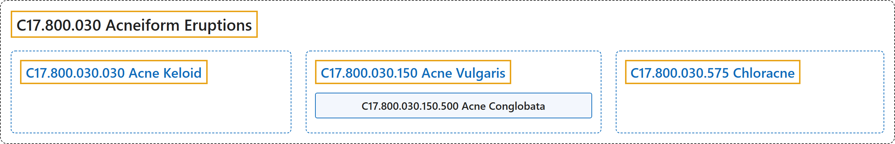

# C17.800.030 Acneiform Eruptions

## Classification

## Glossary

| Term | Definition | 中文翻译 | Source |
|---|---|---|---|
| **C17.800.030 Acneiform Eruptions** 痤疮样疹 | "Visible **efflorescent lesions of the skin caused by acne or resembling acne**. (Dorland, 28th ed, p18, 575)" | 由**痤疮引起或类似痤疮的可见的皮肤发疹性损害**。（Dorland，第 28 版，第 18、575 页） | [National Library of Medicine, 2026, "Acneiform Eruptions" scope note](https://meshb.nlm.nih.gov/record/ui?ui=D017486) |
| **C17.800.030.030 Acne Keloid** 瘢痕疙瘩性痤疮 | "A type of acneiform disorder in which **secondary pyogenic infection in and around pilosebaceous structures ends in keloidal scarring**. It manifests as persistent folliculitis of the back of the neck associated with occlusion of the follicular orifices. It is most often encountered in black or Asian men." | 一种痤疮样疾病，其**毛囊皮脂腺结构内及周围的继发性化脓性感染最终形成瘢痕疙瘩性瘢痕**。表现为颈后部持续性毛囊炎，伴毛囊口闭塞。最常见于黑人或亚洲男性。 | [National Library of Medicine, 2026, "Acne Keloid" scope note](https://meshb.nlm.nih.gov/record/ui?ui=D000153) |
| **C17.800.030.150 Acne Vulgaris** 寻常痤疮 | "A **chronic disorder of the pilosebaceous apparatus** associated with an **increase in sebum secretion**. It is characterized by open comedones (blackheads), closed comedones (whiteheads), and pustular nodules. The cause is unknown, but heredity and age are predisposing factors." | 一种**毛囊皮脂腺单位的慢性疾病**，与**皮脂分泌增加**相关。其特征为开放性粉刺（黑头）、闭合性粉刺（白头）和脓疱性结节。病因不明，但遗传和年龄是易感因素。 | [National Library of Medicine, 2026, "Acne Vulgaris" scope note](https://meshb.nlm.nih.gov/record/ui?ui=D000152) |
| **C17.800.030.150.500 Acne Conglobata** 聚合性痤疮 | "**Severe and chronic form of acne** characterized by **large, burrowing abscesses** associated with disfigurement." | **痤疮的一种严重慢性类型**，特征为**大的、潜行性脓肿**，并伴有毁容。 | [National Library of Medicine, 2026, "Acne Conglobata" scope note](https://meshb.nlm.nih.gov/record/ui?ui=D000069316) |
| **C17.800.030.575 Chloracne** 氯痤疮 | "ACNE-like skin eruptions caused by **exposure to CHLORINE-containing compounds**. Exposure can be by inhalation, ingestion, or through the skin. Chloracne is often seen in people who have occupational contact with chlorinated pesticides, wood preservatives, and sealants." | 由**接触含氯**（CHLORINE）**化合物**引起的痤疮（ACNE）样皮疹。可经吸入、食入或皮肤接触。氯痤疮常见于职业性接触含氯农药、木材防腐剂和密封剂的人群。 | [National Library of Medicine, 2026, "Chloracne" scope note](https://meshb.nlm.nih.gov/record/ui?ui=D054506) |

## References

National Library of Medicine. (2026). *MeSH 2026 descriptor records* [Data set]. Retrieved October 28, 2026, from <https://www.nlm.nih.gov/databases/download/mesh.html>
