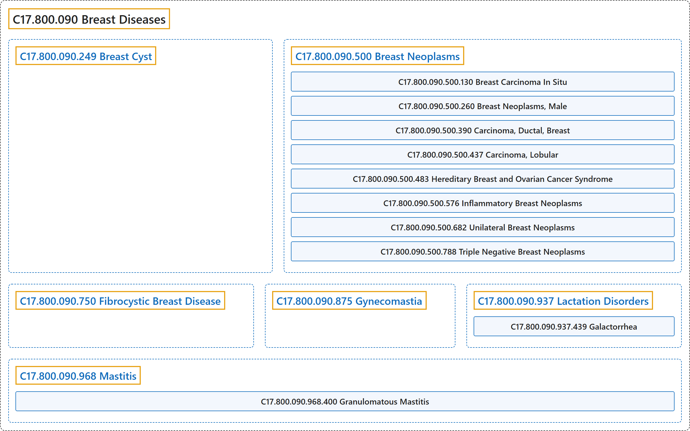

# C17.800.090 Breast Diseases

## Classification

## Glossary

| Term | Definition | 中文翻译 | Source |
|---|---|---|---|
| **C17.800.090 Breast Diseases** 乳腺疾病 | "**Pathological processes of the BREAST**." | **乳房的病理过程**（BREAST）。 | [National Library of Medicine, 2026, "Breast Diseases" scope note](https://meshb.nlm.nih.gov/record/ui?ui=D001941) |
| **C17.800.090.249 Breast Cyst** 乳腺囊肿 | "A **fluid-filled closed cavity or sac** that is lined by an EPITHELIUM and found in the BREAST. It may appear as a single large cyst in one breast, multifocal, or bilateral in FIBROCYSTIC BREAST DISEASE." | 一种**充满液体的封闭腔或囊**，内衬上皮（EPITHELIUM），见于乳房（BREAST）。可表现为一侧乳房单个大囊肿、多灶性，或在乳腺纤维囊性病（FIBROCYSTIC BREAST DISEASE）中为双侧性。 | [National Library of Medicine, 2026, "Breast Cyst" scope note](https://meshb.nlm.nih.gov/record/ui?ui=D047688) |
| **C17.800.090.500 Breast Neoplasms** 乳腺肿瘤 | "**Tumors or cancer of the human BREAST**." | **人类乳房**（BREAST）**的肿瘤或癌**。 | [National Library of Medicine, 2026, "Breast Neoplasms" scope note](https://meshb.nlm.nih.gov/record/ui?ui=D001943) |
| **C17.800.090.500.130 Breast Carcinoma In Situ** 乳腺原位癌 | "A condition in which **abnormal cells have not spread outside the duct, lobule, or nipple** to other tissues of the breast. There are 3 types of breast carcinoma in situ: DUCTAL CARCINOMA IN SITU; LOBULAR CARCINOMA IN SITU; and PAGET DISEASE OF THE NIPPLE." | 一种**异常细胞尚未扩散到导管、小叶或乳头之外**、未累及乳房其他组织的病症。乳腺原位癌有 3 种类型：导管原位癌（DUCTAL CARCINOMA IN SITU）、小叶原位癌（LOBULAR CARCINOMA IN SITU）和乳头佩吉特病（PAGET DISEASE OF THE NIPPLE）。 | [National Library of Medicine, 2026, "Breast Carcinoma In Situ" scope note](https://meshb.nlm.nih.gov/record/ui?ui=D000071960) |
| **C17.800.090.500.260 Breast Neoplasms, Male** 男性乳腺肿瘤 | "**Any neoplasms of the male breast**. These occur infrequently in males in developed countries, the incidence being about 1% of that in females." | **男性乳腺的任何肿瘤**。在发达国家男性中少见，发病率约为女性的 1%。 | [National Library of Medicine, 2026, "Breast Neoplasms, Male" scope note](https://meshb.nlm.nih.gov/record/ui?ui=D018567) |
| **C17.800.090.500.390 Carcinoma, Ductal, Breast** 乳腺导管癌 | "An **invasive (infiltrating) CARCINOMA of the mammary ductal system** (MAMMARY GLANDS) in the human BREAST." | 人类乳房（BREAST）中**乳腺导管系统**（MAMMARY GLANDS）**的浸润性癌**（CARCINOMA）。 | [National Library of Medicine, 2026, "Carcinoma, Ductal, Breast" scope note](https://meshb.nlm.nih.gov/record/ui?ui=D018270) |
| **C17.800.090.500.437 Carcinoma, Lobular** 小叶癌 | "A type of BREAST CANCER where the **abnormal malignant cells form in the lobules**, or milk-producing glands, of the breast." | 一种乳腺癌（BREAST CANCER），其**异常恶性细胞形成于乳腺小叶**（即产乳腺体）中。 | [National Library of Medicine, 2026, "Carcinoma, Lobular" scope note](https://meshb.nlm.nih.gov/record/ui?ui=D018275) |
| **C17.800.090.500.483 Hereditary Breast and Ovarian Cancer Syndrome** 遗传性乳腺癌卵巢癌综合征 | "Autosomal dominant HEREDITARY CANCER SYNDROME in which a **mutation most often in either BRCA1 or BRCA2** is associated with a **significantly increased risk for breast and ovarian cancers**." | 一种常染色体显性遗传性癌症综合征（HEREDITARY CANCER SYNDROME），其中**最常见于 BRCA1 或 BRCA2 的突变**与**乳腺癌和卵巢癌风险显著增加**相关。 | [National Library of Medicine, 2026, "Hereditary Breast and Ovarian Cancer Syndrome" scope note](https://meshb.nlm.nih.gov/record/ui?ui=D061325) |
| **C17.800.090.500.576 Inflammatory Breast Neoplasms** 炎性乳腺肿瘤 | "**Metastatic breast cancer characterized by EDEMA and ERYTHEMA** of the affected breast due to LYMPHATIC METASTASIS and eventual obstruction of LYMPHATIC VESSELS by the cancer cells." | 一种**以受累乳房水肿**（EDEMA）**和红斑**（ERYTHEMA）**为特征的转移性乳腺癌**，由淋巴转移（LYMPHATIC METASTASIS）及癌细胞最终阻塞淋巴管（LYMPHATIC VESSELS）所致。 | [National Library of Medicine, 2026, "Inflammatory Breast Neoplasms" scope note](https://meshb.nlm.nih.gov/record/ui?ui=D058922) |
| **C17.800.090.500.682 Unilateral Breast Neoplasms** 单侧乳腺肿瘤 | "**Tumors or cancer found specifically in one human BREAST**, but not in both." | **仅见于一侧人类乳房**（BREAST）**的肿瘤或癌**，而非双侧。 | [National Library of Medicine, 2026, "Unilateral Breast Neoplasms" scope note](https://meshb.nlm.nih.gov/record/ui?ui=D000069584) |
| **C17.800.090.500.788 Triple Negative Breast Neoplasms** 三阴性乳腺肿瘤 | "Breast neoplasms that **do not express ESTROGEN RECEPTORS; PROGESTERONE RECEPTORS; and do not overexpress the NEU RECEPTOR/HER-2 PROTO-ONCOGENE PROTEIN**." | **不表达雌激素受体**（ESTROGEN RECEPTORS）**、孕激素受体**（PROGESTERONE RECEPTORS）**，且不过度表达 NEU 受体/HER-2 原癌基因蛋白**（NEU RECEPTOR/HER-2 PROTO-ONCOGENE PROTEIN）的乳腺肿瘤。 | [National Library of Medicine, 2026, "Triple Negative Breast Neoplasms" scope note](https://meshb.nlm.nih.gov/record/ui?ui=D064726) |
| **C17.800.090.750 Fibrocystic Breast Disease** 乳腺纤维囊性病 | "A **common and benign breast disease** characterized by varying degree of **fibrocystic changes in the breast tissue**. There are three major patterns of morphological changes, including FIBROSIS, formation of CYSTS, and proliferation of glandular tissue (adenosis). The fibrocystic breast has a dense irregular, lumpy, bumpy consistency." | 一种**常见的良性乳腺疾病**，特征为**乳腺组织中不同程度的纤维囊性改变**。形态学改变有三种主要模式，包括纤维化（FIBROSIS）、囊肿（CYSTS）形成和腺组织增生（腺病）。纤维囊性乳房质地致密、不规则、呈团块状和凹凸不平。 | [National Library of Medicine, 2026, "Fibrocystic Breast Disease" scope note](https://meshb.nlm.nih.gov/record/ui?ui=D005348) |
| **C17.800.090.875 Gynecomastia** 男子乳腺发育 | "**Enlargement of the BREAST in the males**, caused by an **excess of ESTROGENS**. Physiological gynecomastia is normally observed in NEWBORNS; ADOLESCENT; and AGING males." | **男性乳房**（BREAST）**增大**，由**雌激素**（ESTROGENS）**过多**引起。生理性男子乳腺发育通常见于新生儿（NEWBORNS）、青春期（ADOLESCENT）和老年（AGING）男性。 | [National Library of Medicine, 2026, "Gynecomastia" scope note](https://meshb.nlm.nih.gov/record/ui?ui=D006177) |
| **C17.800.090.937 Lactation Disorders** 泌乳障碍 | "**Disturbances of MILK secretion** in either SEX, not necessarily related to PREGNANCY." | 任一性别（SEX）的**乳汁**（MILK）**分泌紊乱**，不一定与妊娠（PREGNANCY）有关。 | [National Library of Medicine, 2026, "Lactation Disorders" scope note](https://meshb.nlm.nih.gov/record/ui?ui=D007775) |
| **C17.800.090.937.439 Galactorrhea** 溢乳 | "**Excessive or inappropriate LACTATION** in females or males, and not necessarily related to PREGNANCY. Galactorrhea can occur either unilaterally or bilaterally, and be profuse or sparse. Its most common cause is HYPERPROLACTINEMIA." | 女性或男性**过度或不适当的泌乳**（LACTATION），且不一定与妊娠（PREGNANCY）有关。溢乳可为单侧或双侧，量可多可少。其最常见原因是高催乳素血症（HYPERPROLACTINEMIA）。 | [National Library of Medicine, 2026, "Galactorrhea" scope note](https://meshb.nlm.nih.gov/record/ui?ui=D005687) |
| **C17.800.090.937.439.500 Chiari-Frommel Syndrome** 希-弗综合征 | "A POSTPARTUM condition consists of **persistent lactation (GALACTORRHEA) and AMENORRHEA** in patients not BREAST FEEDING." | 一种产后（POSTPARTUM）病症，表现为未进行母乳喂养（BREAST FEEDING）的患者出现**持续泌乳**（GALACTORRHEA）**和闭经**（AMENORRHEA）。 | [National Library of Medicine, 2026, "Chiari-Frommel Syndrome" scope note](https://meshb.nlm.nih.gov/record/ui?ui=D002640) |
| **C17.800.090.968 Mastitis** 乳腺炎 | "**INFLAMMATION of the BREAST**, or MAMMARY GLAND." | **乳房**（BREAST）**的炎症**（INFLAMMATION），或乳腺（MAMMARY GLAND）的炎症。 | [National Library of Medicine, 2026, "Mastitis" scope note](https://meshb.nlm.nih.gov/record/ui?ui=D008413) |
| **C17.800.090.968.400 Granulomatous Mastitis** 肉芽肿性乳腺炎 | "A **rare, benign, inflammatory breast disease** occurring in premenopausal women shortly after a recent pregnancy. The origin is unknown but it is commonly mistaken for malignancy and sometimes associated with BREAST FEEDING and the use of ORAL CONTRACEPTIVES." | 一种**罕见的良性炎症性乳腺疾病**，发生于近期妊娠后不久的绝经前女性。其起源不明，但常被误认为恶性肿瘤，有时与母乳喂养（BREAST FEEDING）和口服避孕药（ORAL CONTRACEPTIVES）的使用有关。 | [National Library of Medicine, 2026, "Granulomatous Mastitis" scope note](https://meshb.nlm.nih.gov/record/ui?ui=D058890) |

## References

National Library of Medicine. (2026). *MeSH 2026 descriptor records* [Data set]. Retrieved October 28, 2026, from <https://www.nlm.nih.gov/databases/download/mesh.html>
