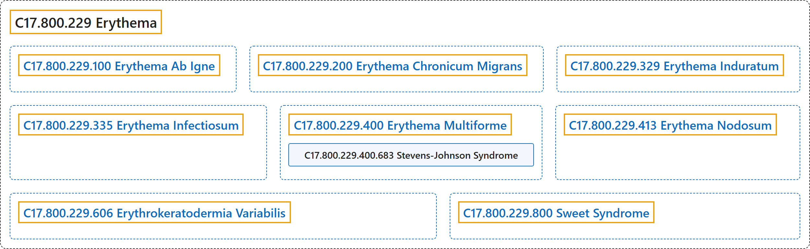

# C17.800.229 Erythema

## Classification

## Glossary

| Term | Definition | 中文翻译 | Source |
|---|---|---|---|
| **C17.800.229 Erythema** 红斑 | "**Redness of the skin produced by congestion of the capillaries**. This condition may result from a variety of disease processes." | **由毛细血管充血引起的皮肤发红**。此病症可由多种疾病过程引起。 | [National Library of Medicine, 2026, "Erythema" scope note](https://meshb.nlm.nih.gov/record/ui?ui=D004890) |
| **C17.800.229.100 Erythema Ab Igne** 火激红斑 | "A cutaneous finding caused by **prolonged heat exposure** (e.g., space heater) and **local heat injury** (e.g., caused by LASER THERAPY). It is characterized by epidermal atrophy, reticular hyperpigmentation, and telangiectatic dermatosis." | 一种由**长期热暴露**（例如取暖器）和**局部热损伤**（例如由激光治疗，LASER THERAPY，所致）引起的皮肤表现。其特征为表皮萎缩、网状色素沉着和毛细血管扩张性皮肤病。 | [National Library of Medicine, 2026, "Erythema Ab Igne" scope note](https://meshb.nlm.nih.gov/record/ui?ui=D000089965) |
| **C17.800.229.200 Erythema Chronicum Migrans** 慢性游走性红斑 | "A **deep type of gyrate erythema** that follows a **bite by an ixodid tick**; it is a stage-1 manifestation of LYME DISEASE. The site of the bite is characterized by a red papule that expands peripherally as a nonscaling, palpable band that clears centrally. This condition is often associated with systemic symptoms such as chills, fever, headache, malaise, nausea, vomiting, fatigue, backache, and stiff neck." | 一种**深在型回状红斑**，发生于**硬蜱叮咬**之后；它是莱姆病（LYME DISEASE）的第 1 期表现。叮咬部位特征为一个红色丘疹，向外周扩展为一条无鳞屑、可触及、中央消退的环带。该病常伴有全身症状，如寒战、发热、头痛、不适、恶心、呕吐、疲劳、背痛和颈项强直。 | [National Library of Medicine, 2026, "Erythema Chronicum Migrans" scope note](https://meshb.nlm.nih.gov/record/ui?ui=D015787) |
| **C17.800.229.329 Erythema Induratum** 硬红斑 | "A type of **panniculitis** characterized histologically by the presence of **granulomas, vasculitis, and necrosis**. It is traditionally considered to be the tuberculous counterpart of nodular vasculitis, but is now known to occur without tuberculous precedent. It is seen most commonly in adolescent and menopausal women, is initiated or exacerbated by cold weather, and typically presents as one or more recurrent erythrocyanotic nodules or plaques on the calves. The nodules may progress to form indurations, ulcerations, and scars." | 一种**脂膜炎**，组织学特征为存在**肉芽肿、血管炎和坏死**。传统上认为它是结节性血管炎的结核性对应病，但现已知其可在无结核前驱的情况下发生。最常见于青春期和绝经期女性，由寒冷天气诱发或加重，典型表现为小腿上一个或多个复发性红绀色结节或斑块。结节可进展形成硬结、溃疡和瘢痕。 | [National Library of Medicine, 2026, "Erythema Induratum" scope note](https://meshb.nlm.nih.gov/record/ui?ui=D004891) |
| **C17.800.229.335 Erythema Infectiosum** 传染性红斑 | "**Contagious infection with HUMAN PAROVIRUS B19** most commonly seen in school age children and characterized by fever, headache, and rashes of the face, trunk, and extremities. It is often confused with RUBELLA." | 一种**人细小病毒 B19**（HUMAN PAROVIRUS B19）**的传染性感染**，最常见于学龄儿童，特征为发热、头痛及面部、躯干和四肢皮疹。常与风疹（RUBELLA）混淆。 | [National Library of Medicine, 2026, "Erythema Infectiosum" scope note](https://meshb.nlm.nih.gov/record/ui?ui=D016731) |
| **C17.800.229.400 Erythema Multiforme** 多形红斑 | "A **skin and mucous membrane disease** characterized by an eruption of macules, papules, nodules, vesicles, and/or bullae with **characteristic bull's-eye lesions** usually occurring on the dorsal aspect of the hands and forearms." | 一种**皮肤和黏膜疾病**，特征为出现斑疹、丘疹、结节、水疱和（或）大疱，伴有**特征性的靶形皮损**，通常发生于手背和前臂背侧。 | [National Library of Medicine, 2026, "Erythema Multiforme" scope note](https://meshb.nlm.nih.gov/record/ui?ui=D004892) |
| **C17.800.229.400.683 Stevens-Johnson Syndrome** 史蒂文斯-约翰逊综合征 | "Rare cutaneous eruption characterized by **extensive KERATINOCYTE apoptosis resulting in skin detachment with mucosal involvement**. It is often provoked by the use of drugs (e.g., antibiotics and anticonvulsants) or associated with PNEUMONIA, MYCOPLASMA. It is considered a continuum of Toxic Epidermal Necrolysis." | 一种罕见的皮疹，特征为**广泛的角质形成细胞**（KERATINOCYTE）**凋亡，导致皮肤剥脱并累及黏膜**。常由药物（如抗生素和抗惊厥药）诱发，或与支原体肺炎（PNEUMONIA, MYCOPLASMA）相关。它被视为与中毒性表皮坏死松解症构成同一连续谱。 | [National Library of Medicine, 2026, "Stevens-Johnson Syndrome" scope note](https://meshb.nlm.nih.gov/record/ui?ui=D013262) |
| **C17.800.229.413 Erythema Nodosum** 结节性红斑 | "An **erythematous eruption** commonly associated with drug reactions or infection and characterized by **inflammatory nodules** that are usually tender, multiple, and bilateral. These nodules are located predominantly on the shins with less common occurrence on the thighs and forearms. They undergo characteristic color changes ending in temporary bruise-like areas. This condition usually subsides in 3-6 weeks without scarring or atrophy." | 一种常与药物反应或感染相关的**红斑性皮疹**，特征为通常有触痛、多发且双侧分布的**炎性结节**。这些结节主要位于胫前，较少见于大腿和前臂。结节会经历特征性的颜色变化，最终形成暂时性的瘀伤样区域。本病通常在 3 至 6 周内消退，不留瘢痕或萎缩。 | [National Library of Medicine, 2026, "Erythema Nodosum" scope note](https://meshb.nlm.nih.gov/record/ui?ui=D004893) |
| **C17.800.229.606 Erythrokeratodermia Variabilis** 可变性红斑角化病 | "An **autosomal dominant skin disease** characterized by **transient and variable noninflammatory ERYTHEMA and hyperkeratosis**. It has been associated with mutations in the genes that code for CONNEXINS. Erythrokeratodermia variabilis inherited in an autosomal recessive fashion has also been reported. Affected individuals often develop PALMOPLANTAR KERATODERMA." | 一种**常染色体显性遗传皮肤病**，特征为**短暂且多变的非炎症性红斑**（ERYTHEMA）**和角化过度**。它与编码连接蛋白（CONNEXINS）的基因突变相关。也有以常染色体隐性方式遗传的可变性红斑角化病的报道。患者常发生掌跖角皮病（PALMOPLANTAR KERATODERMA）。 | [National Library of Medicine, 2026, "Erythrokeratodermia Variabilis" scope note](https://meshb.nlm.nih.gov/record/ui?ui=D056266) |
| **C17.800.229.800 Sweet Syndrome** 斯威特综合征 | "Condition characterized by large, rapidly extending, **erythematous, tender plaques** on the upper body usually accompanied by fever and **dermal infiltration of neutrophilic leukocytes**. It occurs mostly in middle-aged women, is often preceded by an upper respiratory infection, and clinically resembles ERYTHEMA MULTIFORME. Sweet syndrome is associated with LEUKEMIA." | 一种病症，其特征为上半身出现大的、迅速扩展的**红斑性触痛斑块**，通常伴有发热和**真皮中性粒细胞浸润**。多见于中年女性，常在上呼吸道感染后发生，临床上类似多形红斑（ERYTHEMA MULTIFORME）。斯威特综合征与白血病（LEUKEMIA）相关。 | [National Library of Medicine, 2026, "Sweet Syndrome" scope note](https://meshb.nlm.nih.gov/record/ui?ui=D016463) |

## References

National Library of Medicine. (2026). *MeSH 2026 descriptor records* [Data set]. Retrieved October 28, 2026, from <https://www.nlm.nih.gov/databases/download/mesh.html>
