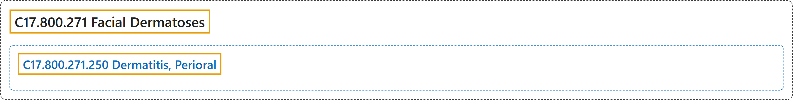

# C17.800.271 Facial Dermatoses

## Classification

## Glossary

| Term | Definition | 中文翻译 | Source |
|---|---|---|---|
| **C17.800.271 Facial Dermatoses** 面部皮肤病 | "**Skin diseases involving the FACE**." | **累及面部**（FACE）**的皮肤疾病**。 | [National Library of Medicine, 2026, "Facial Dermatoses" scope note](https://meshb.nlm.nih.gov/record/ui?ui=D005148) |
| **C17.800.271.250 Dermatitis, Perioral** 口周皮炎 | "A **papular eruption of unknown etiology** that progresses to residual papular erythema and scaling **usually confined to the area of the mouth**, and almost exclusively occurring in young women. It may also be localized or extend to involve the eyelids and adjacent glabella area of the forehead (periocular dermatitis). (Dorland, 28th ed)" | 一种**病因不明的丘疹性皮疹**，进展为残留的丘疹性红斑和鳞屑，**通常局限于口周区域**，几乎只发生于年轻女性。也可局限于或扩展累及眼睑及前额邻近的眉间区域（眼周皮炎）。（Dorland，第 28 版） | [National Library of Medicine, 2026, "Dermatitis, Perioral" scope note](https://meshb.nlm.nih.gov/record/ui?ui=D019557) |

## References

National Library of Medicine. (2026). *MeSH 2026 descriptor records* [Data set]. Retrieved October 28, 2026, from <https://www.nlm.nih.gov/databases/download/mesh.html>
