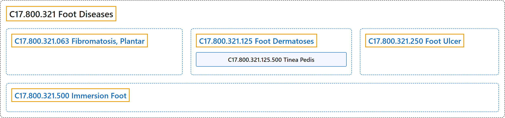

# C17.800.321 Foot Diseases

## Classification

## Glossary

| Term | Definition | 中文翻译 | Source |
|---|---|---|---|
| **C17.800.321 Foot Diseases** 足疾病 | "**Anatomical and functional disorders affecting the foot**." | **累及足部的解剖和功能障碍**。 | [National Library of Medicine, 2026, "Foot Diseases" scope note](https://meshb.nlm.nih.gov/record/ui?ui=D005534) |
| **C17.800.321.063 Fibromatosis, Plantar** 足底纤维瘤病 | "A **fibromatosis of the plantar fascia** characterized by **thickening of the fibrous bands on the plantar aponeurosis** in the sole of the foot and toes." | 一种**足底筋膜的纤维瘤病**，特征为足底及足趾处**足底腱膜上的纤维束增厚**。 | [National Library of Medicine, 2026, "Fibromatosis, Plantar" scope note](https://meshb.nlm.nih.gov/record/ui?ui=D000071380) |
| **C17.800.321.125 Foot Dermatoses** 足部皮肤病 | "**Skin diseases of the foot**, general or unspecified." | **足部的皮肤疾病**，泛指或未特指者。 | [National Library of Medicine, 2026, "Foot Dermatoses" scope note](https://meshb.nlm.nih.gov/record/ui?ui=D005533) |
| **C17.800.321.125.500 Tinea Pedis** 足癣 | "**Dermatological pruritic lesion in the feet**, caused by Trichophyton rubrum, T. mentagrophytes, or Epidermophyton floccosum." | **足部的瘙痒性皮肤病变**，由红色毛癣菌、须癣毛癣菌或絮状表皮癣菌引起。 | [National Library of Medicine, 2026, "Tinea Pedis" scope note](https://meshb.nlm.nih.gov/record/ui?ui=D014008) |
| **C17.800.321.250 Foot Ulcer** 足溃疡 | "**Lesion on the surface of the skin of the foot**, usually accompanied by inflammation. The lesion may become infected or necrotic and is frequently associated with diabetes or leprosy." | **足部皮肤表面的病变**，通常伴有炎症。病变可发生感染或坏死，常与糖尿病或麻风相关。 | [National Library of Medicine, 2026, "Foot Ulcer" scope note](https://meshb.nlm.nih.gov/record/ui?ui=D016523) |
| **C17.800.321.500 Immersion Foot** 浸渍足 | "A condition of the feet produced by **prolonged exposure of the feet to water**. Exposure for 48 hours or more to warm water causes tropical immersion foot or warm-water immersion foot common in Vietnam where troops were exposed to prolonged or repeated wading in paddy fields or streams. Trench foot results from prolonged exposure to cold, without actual freezing. It was common in trench warfare during World War I, when soldiers stood, sometimes for hours, in trenches with a few inches of cold water in them. (Andrews' Diseases of the Skin, 8th ed, p27)" | 一种因**足部长时间浸泡于水中**而产生的足部病症。暴露于温水 48 小时或以上可导致热带浸渍足或温水浸渍足，常见于越南，当时部队长时间或反复在稻田或溪流中涉水。战壕足由长时间暴露于寒冷而未实际冻结所致。它在第一次世界大战的堑壕战中很常见，士兵在积有几英寸冷水的战壕中站立，有时长达数小时。（Andrews 皮肤病学，第 8 版，第 27 页） | [National Library of Medicine, 2026, "Immersion Foot" scope note](https://meshb.nlm.nih.gov/record/ui?ui=D007102) |

## References

National Library of Medicine. (2026). *MeSH 2026 descriptor records* [Data set]. Retrieved October 28, 2026, from <https://www.nlm.nih.gov/databases/download/mesh.html>
