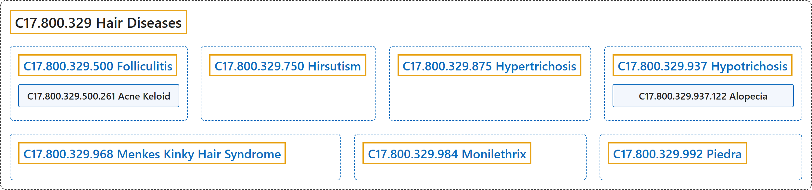

# C17.800.329 Hair Diseases

## Classification

## Glossary

| Term | Definition | 中文翻译 | Source |
|---|---|---|---|
| **C17.800.329 Hair Diseases** 毛发疾病 | "Diseases affecting the **orderly growth and persistence of hair**." | 影响**毛发有序生长和存续**的疾病。 | [National Library of Medicine, 2026, "Hair Diseases" scope note](https://meshb.nlm.nih.gov/record/ui?ui=D006201) |
| **C17.800.329.500 Folliculitis** 毛囊炎 | "**Inflammation of follicles**, primarily hair follicles." | **毛囊的炎症**，主要指毛发的毛囊。 | [National Library of Medicine, 2026, "Folliculitis" scope note](https://meshb.nlm.nih.gov/record/ui?ui=D005499) |
| **C17.800.329.500.261 Acne Keloid** 瘢痕疙瘩性痤疮 | "A type of acneiform disorder in which **secondary pyogenic infection in and around pilosebaceous structures ends in keloidal scarring**. It manifests as persistent folliculitis of the back of the neck associated with occlusion of the follicular orifices. It is most often encountered in black or Asian men." | 一种痤疮样疾病，其**毛囊皮脂腺结构内及周围的继发性化脓性感染最终形成瘢痕疙瘩性瘢痕**。表现为颈后部持续性毛囊炎，伴毛囊口闭塞。最常见于黑人或亚洲男性。 | [National Library of Medicine, 2026, "Acne Keloid" scope note](https://meshb.nlm.nih.gov/record/ui?ui=D000153) |
| **C17.800.329.750 Hirsutism** 多毛症 | "A condition observed in WOMEN and CHILDREN when there is **excess coarse body hair of an adult male distribution pattern**, such as facial and chest areas. It is the result of **elevated ANDROGENS** from the OVARIES, the ADRENAL GLANDS, or exogenous sources. The concept does not include HYPERTRICHOSIS, which is an androgen-independent excessive hair growth." | 见于女性（WOMEN）和儿童（CHILDREN）的一种情况，表现为**呈成年男性分布模式的粗硬体毛过多**，如面部和胸部。它是卵巢（OVARIES）、肾上腺（ADRENAL GLANDS）或外源性来源的**雄激素**（ANDROGENS）**升高**所致。该概念不包括毛增多症（HYPERTRICHOSIS），后者是不依赖雄激素的毛发过度生长。 | [National Library of Medicine, 2026, "Hirsutism" scope note](https://meshb.nlm.nih.gov/record/ui?ui=D006628) |
| **C17.800.329.875 Hypertrichosis** 多毛症 | "**Excessive hair growth at inappropriate locations**, such as on the extremities, the head, and the back. It is caused by genetic or acquired factors, and is an **androgen-independent process**. This concept does not include HIRSUTISM which is an androgen-dependent excess hair growth in WOMEN and CHILDREN." | **在不适当部位的毛发过度生长**，如四肢、头部和背部。由遗传或获得性因素引起，是一种**不依赖雄激素的过程**。本概念不包括女性（WOMEN）和儿童（CHILDREN）中依赖雄激素的毛发过多，即多毛（HIRSUTISM）。 | [National Library of Medicine, 2026, "Hypertrichosis" scope note](https://meshb.nlm.nih.gov/record/ui?ui=D006983) |
| **C17.800.329.937 Hypotrichosis** 毛发稀少症 | "Presence of **less than the normal amount of hair**. (Dorland, 27th ed)" | 毛发量**少于正常**。（Dorland，第 27 版） | [National Library of Medicine, 2026, "Hypotrichosis" scope note](https://meshb.nlm.nih.gov/record/ui?ui=D007039) |
| **C17.800.329.937.122 Alopecia** 脱发 | "**Absence of hair from areas where it is normally present**." | **正常应有毛发的部位毛发缺失**。 | [National Library of Medicine, 2026, "Alopecia" scope note](https://meshb.nlm.nih.gov/record/ui?ui=D000505) |
| **C17.800.329.937.122.147 Alopecia Areata** 斑秃 | "**Loss of scalp and body hair** involving microscopically inflammatory patchy areas." | **头皮和体毛脱落**，累及在显微镜下呈炎症性的斑片状区域。 | [National Library of Medicine, 2026, "Alopecia Areata" scope note](https://meshb.nlm.nih.gov/record/ui?ui=D000506) |
| **C17.800.329.937.122.348 Loose Anagen Hair Syndrome** 生长期毛发松动综合征 | "**Benign childhood alopecia that improves spontaneously with aging**. It is characterized by anagen hairs (misshapen hair bulbs and absent inner and outer root sheaths), thin, and sparse hairs that pulls out easily." | **随年龄增长自发改善的良性儿童脱发**。其特征为生长期毛发（毛球变形，内外根鞘缺失），毛发细而稀疏，易被拔出。 | [National Library of Medicine, 2026, "Loose Anagen Hair Syndrome" scope note](https://meshb.nlm.nih.gov/record/ui?ui=D058247) |
| **C17.800.329.937.122.550 Mucinosis, Follicular** 毛囊黏蛋白病 | "A **disease of the pilosebaceous unit**, presenting clinically as grouped follicular papules or plaques with associated hair loss. It is caused by **mucinous infiltration of tissues**, and usually involving the scalp, face, and neck. It may be primary (idiopathic) or secondary to mycosis fungoides or reticulosis." | 一种**毛囊皮脂腺单位的疾病**，临床表现为成群的毛囊性丘疹或斑块，伴脱发。由**组织黏蛋白浸润**引起，通常累及头皮、面部和颈部。可为原发性（特发性），或继发于蕈样肉芽肿或网状细胞增多症。 | [National Library of Medicine, 2026, "Mucinosis, Follicular" scope note](https://meshb.nlm.nih.gov/record/ui?ui=D000507) |
| **C17.800.329.968 Menkes Kinky Hair Syndrome** Menkes 卷发综合征 | "An **inherited disorder of copper metabolism** transmitted as an **X-linked trait** and characterized by the infantile onset of HYPOTHERMIA, feeding difficulties, hypotonia, SEIZURES, bony deformities, pili torti (twisted hair), and severely impaired intellectual development. Defective copper transport across plasma and endoplasmic reticulum membranes results in copper being unavailable for the synthesis of several copper containing enzymes, including PROTEIN-LYSINE 6-OXIDASE; CERULOPLASMIN; and SUPEROXIDE DISMUTASE. Pathologic changes include defects in arterial elastin, neuronal loss, and gliosis. (From Menkes, Textbook of Child Neurology, 5th ed, p125)" | 一种**遗传性铜代谢障碍**，以 **X 连锁性状**遗传，特征为婴儿期出现低体温（HYPOTHERMIA）、喂养困难、肌张力减退、癫痫发作（SEIZURES）、骨骼畸形、扭曲发（扭转的毛发）及严重智力发育障碍。铜跨质膜和内质网膜的转运缺陷，使铜无法用于合成多种含铜酶，包括蛋白赖氨酸 6-氧化酶（PROTEIN-LYSINE 6-OXIDASE）、铜蓝蛋白（CERULOPLASMIN）和超氧化物歧化酶（SUPEROXIDE DISMUTASE）。病理改变包括动脉弹性蛋白缺陷、神经元丢失和胶质增生。（引自 Menkes，《儿童神经病学教科书》，第 5 版，第 125 页） | [National Library of Medicine, 2026, "Menkes Kinky Hair Syndrome" scope note](https://meshb.nlm.nih.gov/record/ui?ui=D007706) |
| **C17.800.329.984 Monilethrix** 念珠状发 | "Rare **autosomal dominant disorder of the hair shaft**. The clinical features of the disease include HYPOTRICHOSIS, dry, and/or brittle hair, with varying degrees of ALOPECIA. Mutations in the hair-specific keratin genes KRTHB1, KRTHB3, or KRTHB6 are associated with monilethrix. Autosomal recessive monilethrix with limited HYPOTRICHOSIS are also known. Mutations in Dsg4, Liph, and P2ry5 protein genes are associated with the recessive form of monilethrix." | 罕见的**常染色体显性遗传毛干疾病**。本病临床特征包括毛发稀少症（HYPOTRICHOSIS）、干燥和（或）易脆的毛发，以及不同程度的脱发（ALOPECIA）。毛发特异性角蛋白基因 KRTHB1、KRTHB3 或 KRTHB6 的突变与念珠状发相关。伴有局限性毛发稀少症（HYPOTRICHOSIS）的常染色体隐性念珠状发亦有报道。Dsg4、Liph 和 P2ry5 蛋白基因的突变与隐性型念珠状发相关。 | [National Library of Medicine, 2026, "Monilethrix" scope note](https://meshb.nlm.nih.gov/record/ui?ui=D056734) |
| **C17.800.329.992 Piedra** 毛结节菌病 | "Either of two diseases resulting from **fungal infection of the hair shafts**. Black piedra occurs mainly in and on the hairs of the scalp and is caused by Piedraia hortae; white piedra occurs in and on the hairs of the scalp, beard, moustache and genital areas and is caused by Trichosporon species." | 由**毛干真菌感染**引起的两种疾病中的任一种。黑毛结节菌病主要发生于头皮毛发内和毛发上，由何德毛结节菌（Piedraia hortae）引起；白毛结节菌病发生于头皮、胡须、髭须和生殖器部位的毛发内和毛发上，由毛孢子菌属（Trichosporon）菌种引起。 | [National Library of Medicine, 2026, "Piedra" scope note](https://meshb.nlm.nih.gov/record/ui?ui=D010854) |

## References

National Library of Medicine. (2026). *MeSH 2026 descriptor records* [Data set]. Retrieved October 28, 2026, from <https://www.nlm.nih.gov/databases/download/mesh.html>
