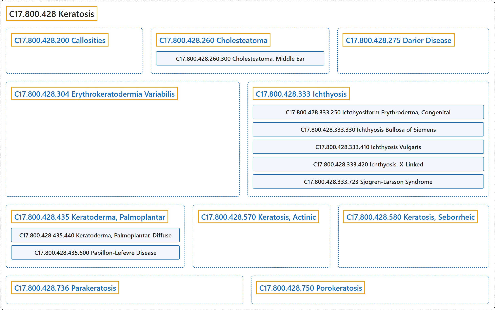

# C17.800.428 Keratosis

## Classification

## Glossary

| Term | Definition | 中文翻译 | Source |
|---|---|---|---|
| **C17.800.428 Keratosis** 角化病 | "**Any horny growth** such as a wart or callus." | **任何角质增生物**，如疣或胼胝。 | [National Library of Medicine, 2026, "Keratosis" scope note](https://meshb.nlm.nih.gov/record/ui?ui=D007642) |
| **C17.800.428.200 Callosities** 胼胝 | "**Localized hyperplasia of the horny layer of the epidermis** due to pressure or friction. (Dorland, 27th ed)" | **表皮角质层的局限性增生**，由压力或摩擦所致。（Dorland，第 27 版） | [National Library of Medicine, 2026, "Callosities" scope note](https://meshb.nlm.nih.gov/record/ui?ui=D002145) |
| **C17.800.428.260 Cholesteatoma** 胆脂瘤 | "A **non-neoplastic mass of keratin-producing squamous EPITHELIUM**, frequently occurring in the MENINGES; bones of the skull, and most commonly in the MIDDLE EAR and MASTOID region. Cholesteatoma can be congenital or acquired. Cholesteatoma is not a tumor nor is it associated with high CHOLESTEROL." | 一种**产生角蛋白的鳞状上皮**（EPITHELIUM）**构成的非肿瘤性肿块**，常发生于脑膜（MENINGES）、颅骨，最常见于中耳（MIDDLE EAR）和乳突（MASTOID）区。胆脂瘤可为先天性或后天性。胆脂瘤不是肿瘤，也与高胆固醇（CHOLESTEROL）无关。 | [National Library of Medicine, 2026, "Cholesteatoma" scope note](https://meshb.nlm.nih.gov/record/ui?ui=D002781) |
| **C17.800.428.260.300 Cholesteatoma, Middle Ear** 中耳胆脂瘤 | "A **mass of KERATIN-producing squamous EPITHELIUM** that resembles an inverted (suck-in) bag of skin in the MIDDLE EAR. It arises from the eardrum (TYMPANIC MEMBRANE) and grows into the MIDDLE EAR causing erosion of EAR OSSICLES and MASTOID that contains the INNER EAR." | **一团产生角蛋白**（KERATIN）**的鳞状上皮**（EPITHELIUM），类似中耳（MIDDLE EAR）内一个内陷（吸入）的皮肤囊袋。它起源于鼓膜（TYMPANIC MEMBRANE），长入中耳（MIDDLE EAR），导致听小骨（EAR OSSICLES）和容纳内耳（INNER EAR）的乳突（MASTOID）受侵蚀。 | [National Library of Medicine, 2026, "Cholesteatoma, Middle Ear" scope note](https://meshb.nlm.nih.gov/record/ui?ui=D018424) |
| **C17.800.428.275 Darier Disease** 毛囊角化病（达里埃病） | "An autosomal dominantly inherited skin disorder characterized by **warty malodorous papules that coalesce into plaques**. It is caused by **mutations in the ATP2A2 gene** encoding SERCA2 protein, one of the SARCOPLASMIC RETICULUM CALCIUM-TRANSPORTING ATPASES. The condition is similar, clinically and histologically, to BENIGN FAMILIAL PEMPHIGUS, another autosomal dominant skin disorder. Both diseases have defective calcium pumps (CALCIUM-TRANSPORTING ATPASES) and unstable desmosomal adhesion junctions (DESMOSOMES) between KERATINOCYTES." | 一种常染色体显性遗传性皮肤病，特征为**融合成斑块的疣状恶臭丘疹**。它由**编码 SERCA2 蛋白的 ATP2A2 基因突变**引起，SERCA2 是肌质网钙转运 ATP 酶（SARCOPLASMIC RETICULUM CALCIUM-TRANSPORTING ATPASES）之一。该病在临床和组织学上与另一种常染色体显性皮肤病家族性良性天疱疮（BENIGN FAMILIAL PEMPHIGUS）相似。两种疾病都存在钙泵缺陷（钙转运 ATP 酶（CALCIUM-TRANSPORTING ATPASES））以及角质形成细胞（KERATINOCYTES）之间桥粒黏附连接（桥粒（DESMOSOMES））不稳定。 | [National Library of Medicine, 2026, "Darier Disease" scope note](https://meshb.nlm.nih.gov/record/ui?ui=D007644) |
| **C17.800.428.304 Erythrokeratodermia Variabilis** 可变性红斑角化病 | "An **autosomal dominant skin disease** characterized by **transient and variable noninflammatory ERYTHEMA and hyperkeratosis**. It has been associated with mutations in the genes that code for CONNEXINS. Erythrokeratodermia variabilis inherited in an autosomal recessive fashion has also been reported. Affected individuals often develop PALMOPLANTAR KERATODERMA." | 一种**常染色体显性遗传皮肤病**，特征为**短暂且多变的非炎症性红斑**（ERYTHEMA）**和角化过度**。它与编码连接蛋白（CONNEXINS）的基因突变相关。也有以常染色体隐性方式遗传的可变性红斑角化病的报道。患者常发生掌跖角皮病（PALMOPLANTAR KERATODERMA）。 | [National Library of Medicine, 2026, "Erythrokeratodermia Variabilis" scope note](https://meshb.nlm.nih.gov/record/ui?ui=D056266) |
| **C17.800.428.333 Ichthyosis** 鱼鳞病 | "Any of several generalized skin disorders characterized by **dryness, roughness, and scaliness**, due to **hypertrophy of the stratum corneum epidermis**. Most are genetic, but some are acquired, developing in association with other systemic disease or genetic syndrome." | 几种泛发性皮肤病的统称，特征为**干燥、粗糙和鳞屑**，由**表皮角质层肥厚**所致。多数为遗传性，但也有获得性者，伴发于其他系统性疾病或遗传综合征。 | [National Library of Medicine, 2026, "Ichthyosis" scope note](https://meshb.nlm.nih.gov/record/ui?ui=D007057) |
| **C17.800.428.333.250 Ichthyosiform Erythroderma, Congenital** 先天性鱼鳞病样红皮病 | "Designation for **several severe forms of ichthyosis, present at birth**, that are characterized by **hyperkeratotic scaling**. Infants may be born encased in a collodion membrane which begins shedding within 24 hours. This is followed in about two weeks by persistent generalized scaling. The forms include bullous (HYPERKERATOSIS, EPIDERMOLYTIC), non-bullous (ICHTHYOSIS, LAMELLAR), wet type, and dry type." | 对**出生时即存在的几种严重鱼鳞病类型**的统称，特征为**角化过度性鳞屑**。婴儿出生时可包裹于火棉胶样膜中，该膜在 24 小时内开始脱落。约两周后继之以持续性全身鳞屑。其类型包括大疱型（HYPERKERATOSIS, EPIDERMOLYTIC）、非大疱型（ICHTHYOSIS, LAMELLAR）、湿型和干型。 | [National Library of Medicine, 2026, "Ichthyosiform Erythroderma, Congenital" scope note](https://meshb.nlm.nih.gov/record/ui?ui=D016113) |
| **C17.800.428.333.250.375 Hyperkeratosis, Epidermolytic** 表皮松解性角化过度症 | "A form of **congenital ichthyosis inherited as an autosomal dominant trait** and characterized by **ERYTHRODERMA and severe hyperkeratosis**. It is manifested at birth by blisters followed by the appearance of thickened, horny, verruciform scales over the entire body, but accentuated in flexural areas. Mutations in the genes that encode KERATIN-1 and KERATIN-10 have been associated with this disorder." | 一种**以常染色体显性性状遗传的先天性鱼鳞病**，特征为**红皮病**（ERYTHRODERMA）**和严重角化过度**。出生时即表现为水疱，随后全身出现增厚、角质、疣状鳞屑，但在屈侧部位更为明显。编码角蛋白 1（KERATIN-1）和角蛋白 10（KERATIN-10）的基因突变与该病相关。 | [National Library of Medicine, 2026, "Hyperkeratosis, Epidermolytic" scope note](https://meshb.nlm.nih.gov/record/ui?ui=D017488) |
| **C17.800.428.333.250.410 Ichthyosis, Lamellar** 板层状鱼鳞病 | "A **chronic, congenital ichthyosis inherited as an autosomal recessive trait**. Infants are usually born encased in a **collodion membrane** which sheds within a few weeks. Scaling is generalized and marked with grayish-brown quadrilateral scales, adherent at their centers and free at the edges. In some cases, scales are so thick that they resemble armored plate." | 一种**以常染色体隐性性状遗传的慢性先天性鱼鳞病**。婴儿出生时通常包裹于**火棉胶膜**中，该膜在数周内脱落。鳞屑泛发，呈灰褐色四边形，中央黏着、边缘游离。某些病例中鳞屑厚到类似铠甲板。 | [National Library of Medicine, 2026, "Ichthyosis, Lamellar" scope note](https://meshb.nlm.nih.gov/record/ui?ui=D017490) |
| **C17.800.428.333.250.705 Netherton Syndrome** 内瑟顿综合征 | "**Rare autosomal recessive disease** with variable expressions. Clinical features of the disease include variable ICHTHYOSIFORM ERYTHRODERMA, CONGENITAL; bamboo hair (trichorrhexis invaginata); and ATOPIC DERMATITIS. The disease is caused by **mutations in the SPINK5 gene**." | 一种表现多样的**罕见常染色体隐性遗传病**。该病的临床特征包括不同程度的先天性鱼鳞病样红皮病（ICHTHYOSIFORM ERYTHRODERMA, CONGENITAL）、竹节状发（套叠性脆发症）和特应性皮炎（ATOPIC DERMATITIS）。该病由 **SPINK5 基因突变**引起。 | [National Library of Medicine, 2026, "Netherton Syndrome" scope note](https://meshb.nlm.nih.gov/record/ui?ui=D056770) |
| **C17.800.428.333.330 Ichthyosis Bullosa of Siemens** Siemens 大疱性鱼鳞病 | "An **autosomal dominant form of ichthyosis** characterized by generalized reddening of the skin (ERYTHEMA) and **widespread blistering**. The disease shows similar, but somewhat milder, clinical and histopathological findings to those in HYPERKERATOSIS, EPIDERMOLYTIC and is associated with the gene that encodes KERATIN-2A." | 一种**常染色体显性遗传的鱼鳞病**，特征为皮肤泛发性发红（红斑（ERYTHEMA））和**广泛水疱形成**。该病的临床和组织病理学表现与表皮松解性角化过度（HYPERKERATOSIS, EPIDERMOLYTIC）相似但稍轻，并与编码角蛋白 2A（KERATIN-2A）的基因相关。 | [National Library of Medicine, 2026, "Ichthyosis Bullosa of Siemens" scope note](https://meshb.nlm.nih.gov/record/ui?ui=D053560) |
| **C17.800.428.333.410 Ichthyosis Vulgaris** 寻常型鱼鳞病 | "**Most common form of ICHTHYOSIS** characterized by **prominent scaling** especially on the exterior surfaces of the extremities. It is inherited as an autosomal dominant trait." | **鱼鳞病**（ICHTHYOSIS）**最常见的类型**，特征为**明显的鳞屑**，尤其见于四肢伸侧。以常染色体显性性状遗传。 | [National Library of Medicine, 2026, "Ichthyosis Vulgaris" scope note](https://meshb.nlm.nih.gov/record/ui?ui=D016112) |
| **C17.800.428.333.420 Ichthyosis, X-Linked** X 连锁鱼鳞病 | "Chronic form of ichthyosis that is inherited as a **sex-linked recessive trait carried on the X-chromosome** and transmitted to the male offspring. It is characterized by severe scaling, especially on the extremities, and is associated with **steroid sulfatase deficiency**." | 一种慢性鱼鳞病，以**位于 X 染色体上的性连锁隐性性状**遗传并传给男性后代。特征为严重脱屑，尤其在四肢，并与**类固醇硫酸酯酶缺乏**相关。 | [National Library of Medicine, 2026, "Ichthyosis, X-Linked" scope note](https://meshb.nlm.nih.gov/record/ui?ui=D016114) |
| **C17.800.428.333.723 Sjogren-Larsson Syndrome** 舍格伦-拉松综合征 | "An **autosomal recessive neurocutaneous disorder** characterized by severe ichthyosis MENTAL RETARDATION; SPASTIC PARAPLEGIA; and congenital ICHTHYOSIS. It is caused by mutation of gene encoding microsomal fatty ALDEHYDE DEHYDROGENASE leading to **defect in fatty alcohol metabolism**." | 一种**常染色体隐性遗传的神经皮肤疾病**，其特征为重度鱼鳞病、精神发育迟滞（MENTAL RETARDATION）、痉挛性截瘫（SPASTIC PARAPLEGIA）和先天性鱼鳞病（ICHTHYOSIS）。由编码微粒体脂肪醛脱氢酶（ALDEHYDE DEHYDROGENASE）的基因突变引起，导致**脂肪醇代谢缺陷**。 | [National Library of Medicine, 2026, "Sjogren-Larsson Syndrome" scope note](https://meshb.nlm.nih.gov/record/ui?ui=D016111) |
| **C17.800.428.435 Keratoderma, Palmoplantar** 掌跖角化病 | "Group of mostly hereditary disorders characterized by **thickening of the palms and soles** as a result of **excessive keratin formation** leading to hypertrophy of the stratum corneum (hyperkeratosis)." | 一组大多为遗传性的疾病，特征为**手掌和足底增厚**，原因是**角蛋白形成过多**，导致角质层肥厚（角化过度）。 | [National Library of Medicine, 2026, "Keratoderma, Palmoplantar" scope note](https://meshb.nlm.nih.gov/record/ui?ui=D007645) |
| **C17.800.428.435.440 Keratoderma, Palmoplantar, Diffuse** 弥漫性掌跖角化病 | "An autosomal dominant disorder characterized by a widely distributed, **well-demarcated hyperkeratosis of the palms and soles**. There is more than one genotypically distinct form, each of which is clinically similar but histologically distinguishable. Diffuse palmoplantar keratoderma is distinct from palmoplantar keratoderma (KERATODERMA, PALMOPLANTAR), as the former exhibits autosomal dominant inheritance and hyperhidrosis is frequently present." | 一种常染色体显性遗传病，特征为广泛分布、**边界清楚的掌跖角化过度**。存在不止一种基因型不同的类型，各型临床相似但组织学上可区分。弥漫性掌跖角化病不同于掌跖角化病（KERATODERMA, PALMOPLANTAR），前者呈常染色体显性遗传，且常伴多汗。 | [National Library of Medicine, 2026, "Keratoderma, Palmoplantar, Diffuse" scope note](https://meshb.nlm.nih.gov/record/ui?ui=D015776) |
| **C17.800.428.435.440.500 Keratoderma, Palmoplantar, Epidermolytic** 表皮松解性掌跖角化病 | "An autosomal dominant hereditary skin disease characterized by **epidermolytic hyperkeratosis that is strictly confined to the palms and soles**. It has been associated with mutations in the gene that codes for KERATIN-9." | 一种常染色体显性遗传性皮肤病，特征为**严格局限于手掌和足底的表皮松解性角化过度**。与编码角蛋白-9（KERATIN-9）的基因突变相关。 | [National Library of Medicine, 2026, "Keratoderma, Palmoplantar, Epidermolytic" scope note](https://meshb.nlm.nih.gov/record/ui?ui=D053546) |
| **C17.800.428.435.600 Papillon-Lefevre Disease** 掌跖角化-牙周破坏综合征 | "Rare, autosomal recessive disorder occurring between the first and fifth years of life. It is characterized by **palmoplantar keratoderma with periodontitis** followed by the **premature shedding of both deciduous and permanent teeth**. Mutations in the gene for CATHEPSIN C have been associated with this disease." | 一种罕见的常染色体隐性疾病，发生于 1 至 5 岁之间。特征为**掌跖角皮病伴牙周炎**，随后**乳牙和恒牙均过早脱落**。组织蛋白酶 C（CATHEPSIN C）基因突变与该病相关。 | [National Library of Medicine, 2026, "Papillon-Lefevre Disease" scope note](https://meshb.nlm.nih.gov/record/ui?ui=D010214) |
| **C17.800.428.570 Keratosis, Actinic** 光线性角化病 | "White or pink lesions on the arms, hands, face, or scalp that arise from **sun-induced DNA DAMAGE to KERATINOCYTES** in exposed areas. They are considered **precursor lesions** to superficial SQUAMOUS CELL CARCINOMA." | 手臂、手、面部或头皮上的白色或粉红色皮损，源于暴露部位**日光诱导的角质形成细胞**（KERATINOCYTES）**DNA 损伤**（DNA DAMAGE）。它们被视为浅表鳞状细胞癌（SQUAMOUS CELL CARCINOMA）的**癌前病变**。 | [National Library of Medicine, 2026, "Keratosis, Actinic" scope note](https://meshb.nlm.nih.gov/record/ui?ui=D055623) |
| **C17.800.428.580 Keratosis, Seborrheic** 脂溢性角化病 | "Benign eccrine poromas that present as **multiple oval, brown-to-black plaques**, located mostly on the chest and back. The age of onset is usually in the fourth or fifth decade." | 良性外泌汗腺汗孔瘤，表现为**多发卵圆形、棕色至黑色斑块**，主要位于胸部和背部。发病年龄通常在四十或五十多岁。 | [National Library of Medicine, 2026, "Keratosis, Seborrheic" scope note](https://meshb.nlm.nih.gov/record/ui?ui=D017492) |
| **C17.800.428.736 Parakeratosis** 角化不全 | "**Persistence of the nuclei of the keratinocytes into the stratum corneum** of the skin. This is a normal state only in the epithelium of true mucous membranes in the mouth and vagina. (Dorland, 27th ed)" | **角质形成细胞的细胞核残留至皮肤角质层**。这仅在口腔和阴道真正黏膜的上皮中属正常状态。（Dorland，第 27 版） | [National Library of Medicine, 2026, "Parakeratosis" scope note](https://meshb.nlm.nih.gov/record/ui?ui=D010241) |
| **C17.800.428.750 Porokeratosis** 汗孔角化症 | "A **heritable disorder of faulty keratinization** characterized by the proliferation of abnormal clones of KERATINOCYTES and lesions showing varying atrophic patches surrounded by an **elevated, keratotic border**. These keratotic lesions can progress to overt cutaneous neoplasm. Several clinical variants are recognized, including porokeratosis of Mibelli, linear porokeratosis, disseminated superficial actinic porokeratosis, palmoplantar porokeratosis, and punctate porokeratosis." | 一种**遗传性角化异常疾病**，特征为角质形成细胞（KERATINOCYTES）异常克隆增生，皮损表现为不同的萎缩性斑片，周围有**隆起的角化性边缘**。这些角化性皮损可进展为明显的皮肤肿瘤。已知若干临床变异型，包括 Mibelli 汗孔角化症、线状汗孔角化症、播散性浅表性光线性汗孔角化症、掌跖汗孔角化症和点状汗孔角化症。 | [National Library of Medicine, 2026, "Porokeratosis" scope note](https://meshb.nlm.nih.gov/record/ui?ui=D017499) |

## References

National Library of Medicine. (2026). *MeSH 2026 descriptor records* [Data set]. Retrieved October 28, 2026, from <https://www.nlm.nih.gov/databases/download/mesh.html>
