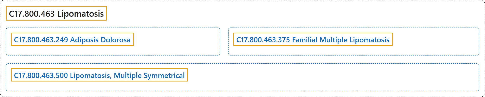

# C17.800.463 Lipomatosis

## Classification

## Glossary

| Term | Definition | 中文翻译 | Source |
|---|---|---|---|
| **C17.800.463 Lipomatosis** 脂肪过多症 | "A disorder characterized by the **accumulation of encapsulated or unencapsulated tumor-like fatty tissue** resembling LIPOMA." | 一种疾病，其特征为类似脂肪瘤（LIPOMA）的**有包膜或无包膜的肿瘤样脂肪组织蓄积**。 | [National Library of Medicine, 2026, "Lipomatosis" scope note](https://meshb.nlm.nih.gov/record/ui?ui=D008068) |
| **C17.800.463.249 Adiposis Dolorosa** 痛性肥胖病 | "A rare disease characterized by **multiple tumor-like fatty deposits that press on nerves** in various sites causing pain and weakness. Often these lipoma-like structures are located on the trunk and limbs but not on the face and hands." | 一种罕见疾病，特征为**多发的瘤样脂肪沉积压迫神经**，在多个部位引起疼痛和无力。这些脂肪瘤样结构常位于躯干和四肢，而不见于面部和手部。 | [National Library of Medicine, 2026, "Adiposis Dolorosa" scope note](https://meshb.nlm.nih.gov/record/ui?ui=D000274) |
| **C17.800.463.375 Familial Multiple Lipomatosis** 家族性多发性脂肪瘤病 | "A rare autosomal disorder characterized by **numerous encapsulated lipomas on the trunk and extremities**. The lipomas are usually not painful but can cause pain when growing. In rare cases, one lipoma can become painful and progress to multiple painful lipomas; it is then referred to as Dercum's Disease Type III" | 一种罕见的常染色体疾病，特征为**躯干和四肢多发的有包膜脂肪瘤**。脂肪瘤通常不痛，但生长时可引起疼痛。少数情况下，一个脂肪瘤可变得疼痛并进展为多发性痛性脂肪瘤，此时称为 III 型 Dercum 病 | [National Library of Medicine, 2026, "Familial Multiple Lipomatosis" scope note](https://meshb.nlm.nih.gov/record/ui?ui=D000071070) |
| **C17.800.463.500 Lipomatosis, Multiple Symmetrical** 多发性对称性脂肪瘤病 | "A condition characterized by the growth of **unencapsulated masses of ADIPOSE TISSUE symmetrically deposited** around the neck, shoulders, or other sites around the body." | 一种病症，特征为**无包膜的脂肪组织**（ADIPOSE TISSUE）**团块对称沉积**于颈部、肩部或身体其他部位周围。 | [National Library of Medicine, 2026, "Lipomatosis, Multiple Symmetrical" scope note](https://meshb.nlm.nih.gov/record/ui?ui=D008069) |

## References

National Library of Medicine. (2026). *MeSH 2026 descriptor records* [Data set]. Retrieved October 28, 2026, from <https://www.nlm.nih.gov/databases/download/mesh.html>
