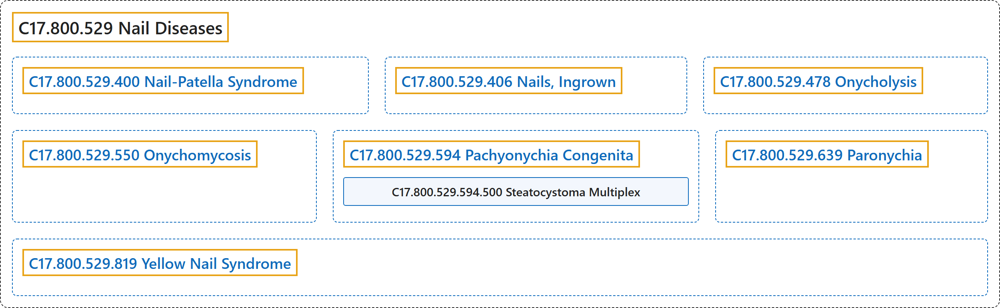

# C17.800.529 Nail Diseases

## Classification

## Glossary

| Term | Definition | 中文翻译 | Source |
|---|---|---|---|
| **C17.800.529 Nail Diseases** 甲疾病 | "**Diseases of the nail plate and tissues surrounding it**. The concept is limited to primates." | **甲板及其周围组织的疾病**。该概念限于灵长类。 | [National Library of Medicine, 2026, "Nail Diseases" scope note](https://meshb.nlm.nih.gov/record/ui?ui=D009260) |
| **C17.800.529.400 Nail-Patella Syndrome** 甲髌综合征 | "A syndrome of multiple abnormalities characterized by the **absence or hypoplasia of the PATELLA** and **congenital nail dystrophy**. It is a genetically determined autosomal dominant trait." | 一种多发异常的综合征，特征为**髌骨**（PATELLA）**缺如或发育不全**以及**先天性甲营养不良**。它是一种由遗传决定的常染色体显性性状。 | [National Library of Medicine, 2026, "Nail-Patella Syndrome" scope note](https://meshb.nlm.nih.gov/record/ui?ui=D009261) |
| **C17.800.529.406 Nails, Ingrown** 嵌甲 | "**Excessive lateral nail growth into the nail fold**. Because the lateral margin of the nail acts as a foreign body, inflammation and granulation may result. It is caused by improperly fitting shoes and by improper trimming of the nail." | **指（趾）甲侧缘过度长入甲襞**。由于甲侧缘起到异物作用，可导致炎症和肉芽形成。由鞋不合脚及修甲不当引起。 | [National Library of Medicine, 2026, "Nails, Ingrown" scope note](https://meshb.nlm.nih.gov/record/ui?ui=D009263) |
| **C17.800.529.478 Onycholysis** 甲剥离 | "**Separation of nail plate from the underlying nail bed**. It can be a sign of skin disease, infection (such as ONYCHOMYCOSIS) or tissue injury." | **甲板与其下方甲床的分离**。可为皮肤病、感染（如甲真菌病（ONYCHOMYCOSIS））或组织损伤的征象。 | [National Library of Medicine, 2026, "Onycholysis" scope note](https://meshb.nlm.nih.gov/record/ui?ui=D054039) |
| **C17.800.529.550 Onychomycosis** 甲真菌病 | "A **fungal infection of the nail**, usually caused by DERMATOPHYTES; YEASTS; or nondermatophyte MOLDS." | **甲的真菌感染**，通常由皮肤癣菌（DERMATOPHYTES）、酵母菌（YEASTS）或非皮肤癣菌霉菌（MOLDS）引起。 | [National Library of Medicine, 2026, "Onychomycosis" scope note](https://meshb.nlm.nih.gov/record/ui?ui=D014009) |
| **C17.800.529.594 Pachyonychia Congenita** 先天性厚甲 | "A group of **inherited ectodermal dysplasias** whose most prominent clinical feature is **hypertrophic nail dystrophy** resulting in PACHYONYCHIA. Several specific subtypes of pachyonychia congenita have been associated with mutations in genes that encode KERATINS." | 一组**遗传性外胚层发育不良**，最突出的临床特征是导致厚甲（PACHYONYCHIA）的**肥厚性甲营养不良**。先天性厚甲的若干特定亚型与编码角蛋白（KERATINS）的基因突变相关。 | [National Library of Medicine, 2026, "Pachyonychia Congenita" scope note](https://meshb.nlm.nih.gov/record/ui?ui=D053549) |
| **C17.800.529.594.500 Steatocystoma Multiplex** 多发性脂囊瘤 | "A disorder characterized by **multiple, wide spread cutaneous cysts** that often become inflamed and rupture. It is caused by the same mutations in the gene coding for KRT-17 that are causative mutations for Pachyonychia congenita, Type 2. Natal teeth involvement is sometimes associated with steatocystoma multiplex." | 一种以**多发、广泛分布的皮肤囊肿**为特征的疾病，这些囊肿常发炎和破裂。它由编码 KRT-17 的基因突变引起，这些突变与 2 型先天性厚甲症的致病突变相同。多发性脂囊瘤有时伴有胎生牙。 | [National Library of Medicine, 2026, "Steatocystoma Multiplex" scope note](https://meshb.nlm.nih.gov/record/ui?ui=D062685) |
| **C17.800.529.639 Paronychia** 甲沟炎 | "An **inflammatory reaction involving the folds of the skin surrounding the fingernail**. It is characterized by acute or chronic purulent, tender, and painful swellings of the tissues around the nail, caused by an abscess of the nail fold. The pathogenic yeast causing paronychia is most frequently Candida albicans. Saprophytic fungi may also be involved. The causative bacteria are usually Staphylococcus, Pseudomonas aeruginosa, or Streptococcus. (Andrews' Diseases of the Skin, 8th ed, p271)" | 一种**累及指甲周围皮肤皱襞的炎症反应**。特征为甲周组织急性或慢性的化脓性、触痛性和疼痛性肿胀，由甲襞脓肿所致。引起甲沟炎的致病酵母菌最常为白念珠菌，也可有腐生真菌参与。致病细菌通常为葡萄球菌、铜绿假单胞菌或链球菌。（《Andrews 皮肤病学》，第 8 版，第 271 页） | [National Library of Medicine, 2026, "Paronychia" scope note](https://meshb.nlm.nih.gov/record/ui?ui=D010304) |
| **C17.800.529.819 Yellow Nail Syndrome** 黄甲综合征 | "A rare condition characterized by the presence of **yellow nails, LYMPHEDEMA, and/or PLEURAL EFFUSION** with respiratory tract involvement. Abnormal lymphatic network may play a role in its etiology. Occasionally inherited, yellow nail syndrome mostly is sporadic without apparent family history." | 一种罕见病症，特征为出现**黄甲、淋巴水肿**（LYMPHEDEMA）**和（或）胸腔积液**（PLEURAL EFFUSION），伴呼吸道受累。异常的淋巴网络可能在其病因中起作用。黄甲综合征偶有遗传，多数为散发且无明显家族史。 | [National Library of Medicine, 2026, "Yellow Nail Syndrome" scope note](https://meshb.nlm.nih.gov/record/ui?ui=D056684) |

## References

National Library of Medicine. (2026). *MeSH 2026 descriptor records* [Data set]. Retrieved October 28, 2026, from <https://www.nlm.nih.gov/databases/download/mesh.html>
