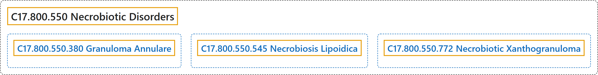

# C17.800.550 Necrobiotic Disorders

## Classification

## Glossary

| Term | Definition | 中文翻译 | Source |
|---|---|---|---|
| **C17.800.550 Necrobiotic Disorders** 渐进性坏死性疾病 | "A group of disorders characterized by **swelling, basophilia, and distortion of collagen bundles in the dermis**." | 一组疾病，其特征为**真皮内胶原束的肿胀、嗜碱性变和扭曲**。 | [National Library of Medicine, 2026, "Necrobiotic Disorders" scope note](https://meshb.nlm.nih.gov/record/ui?ui=D017441) |
| **C17.800.550.380 Granuloma Annulare** 环状肉芽肿 | "Benign granulomatous disease of unknown etiology characterized by a **ring of localized or disseminated papules or nodules** on the skin and **palisading histiocytes surrounding necrobiotic tissue** resulting from altered collagen structures." | 一种病因不明的良性肉芽肿性疾病，特征为皮肤上出现**局限性或播散性丘疹或结节组成的环**，以及**栅栏状排列的组织细胞包绕渐进性坏死组织**，后者源于胶原结构的改变。 | [National Library of Medicine, 2026, "Granuloma Annulare" scope note](https://meshb.nlm.nih.gov/record/ui?ui=D016460) |
| **C17.800.550.545 Necrobiosis Lipoidica** 类脂质渐进性坏死 | "A **degenerative disease of the dermal connective tissue** characterized by the development of erythematous papules or nodules in the pretibial area. The papules form plaques covered with telangiectatic vessels. More than half of the affected patients have diabetes." | 一种**真皮结缔组织的变性疾病**，特征为胫前区出现红斑性丘疹或结节。丘疹融合成斑块，表面覆有毛细血管扩张的血管。半数以上患者患有糖尿病。 | [National Library of Medicine, 2026, "Necrobiosis Lipoidica" scope note](https://meshb.nlm.nih.gov/record/ui?ui=D009335) |
| **C17.800.550.772 Necrobiotic Xanthogranuloma** 坏死性黄色肉芽肿 | "A **cutaneous necrobiotic disorder** characterized by **firm, yellow plaques or nodules**, often in a periorbital distribution. It is often accompanied by an elevated ERYTHROCYTE SEDIMENTATION RATE; LEUKOPENIA; and MONOCLONAL GAMMOPATHY (IgG-kappa type) and systemic involvement." | 一种**皮肤渐进性坏死性疾病**，特征为**质硬的黄色斑块或结节**，常分布于眶周。常伴有红细胞沉降率（ERYTHROCYTE SEDIMENTATION RATE）升高、白细胞减少症（LEUKOPENIA）、单克隆丙种球蛋白病（MONOCLONAL GAMMOPATHY）（IgG-kappa 型）及全身受累。 | [National Library of Medicine, 2026, "Necrobiotic Xanthogranuloma" scope note](https://meshb.nlm.nih.gov/record/ui?ui=D058252) |

## References

National Library of Medicine. (2026). *MeSH 2026 descriptor records* [Data set]. Retrieved October 28, 2026, from <https://www.nlm.nih.gov/databases/download/mesh.html>
