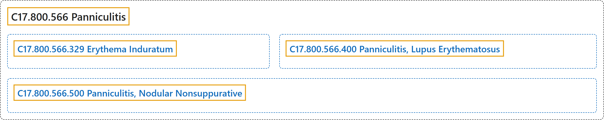

# C17.800.566 Panniculitis

## Classification

## Glossary

| Term | Definition | 中文翻译 | Source |
|---|---|---|---|
| **C17.800.566 Panniculitis** 脂膜炎 | "General term for **inflammation of adipose tissue**, usually of the skin, characterized by **reddened subcutaneous nodules**." | **脂肪组织炎症**的总称，通常发生于皮肤，特征为**发红的皮下结节**。 | [National Library of Medicine, 2026, "Panniculitis" scope note](https://meshb.nlm.nih.gov/record/ui?ui=D015434) |
| **C17.800.566.329 Erythema Induratum** 硬红斑 | "A type of **panniculitis** characterized histologically by the presence of **granulomas, vasculitis, and necrosis**. It is traditionally considered to be the tuberculous counterpart of nodular vasculitis, but is now known to occur without tuberculous precedent. It is seen most commonly in adolescent and menopausal women, is initiated or exacerbated by cold weather, and typically presents as one or more recurrent erythrocyanotic nodules or plaques on the calves. The nodules may progress to form indurations, ulcerations, and scars." | 一种**脂膜炎**，组织学特征为存在**肉芽肿、血管炎和坏死**。传统上认为它是结节性血管炎的结核性对应病，但现已知其可在无结核前驱的情况下发生。最常见于青春期和绝经期女性，由寒冷天气诱发或加重，典型表现为小腿上一个或多个复发性红绀色结节或斑块。结节可进展形成硬结、溃疡和瘢痕。 | [National Library of Medicine, 2026, "Erythema Induratum" scope note](https://meshb.nlm.nih.gov/record/ui?ui=D004891) |
| **C17.800.566.400 Panniculitis, Lupus Erythematosus** 狼疮性脂膜炎 | "A type of **lupus erythematosus** characterized by **deep dermal or subcutaneous nodules**, most often on the head, face, or upper arms. It is generally chronic and occurs most often in women between the ages of 20 and 45." | 一种**红斑狼疮**，特征为**真皮深层或皮下结节**，最常见于头部、面部或上臂。通常呈慢性，最常发生于 20 至 45 岁的女性。 | [National Library of Medicine, 2026, "Panniculitis, Lupus Erythematosus" scope note](https://meshb.nlm.nih.gov/record/ui?ui=D015435) |
| **C17.800.566.500 Panniculitis, Nodular Nonsuppurative** 结节性非化脓性脂膜炎 | "A form of panniculitis characterized by **recurrent episodes of fever** accompanied by the eruption of single or multiple **erythematous subcutaneous nodules** on the lower extremities. They normally resolve, but tend to leave depressions in the skin. The condition is most often seen in women, alone or in association with other disorders." | 一种脂膜炎，其特征为**反复发热**，伴下肢出现单发或多发的**红斑性皮下结节**。结节通常会消退，但往往在皮肤上留下凹陷。本病最常见于女性，可单独发生或与其他疾病相关。 | [National Library of Medicine, 2026, "Panniculitis, Nodular Nonsuppurative" scope note](https://meshb.nlm.nih.gov/record/ui?ui=D010201) |

## References

National Library of Medicine. (2026). *MeSH 2026 descriptor records* [Data set]. Retrieved October 28, 2026, from <https://www.nlm.nih.gov/databases/download/mesh.html>
