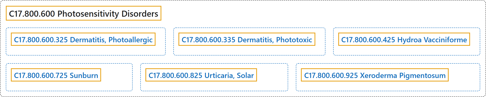

# C17.800.600 Photosensitivity Disorders

## Classification

## Glossary

| Term | Definition | 中文翻译 | Source |
|---|---|---|---|
| **C17.800.600 Photosensitivity Disorders** 光敏性疾病 | "**Abnormal responses to sunlight or artificial light** due to **extreme reactivity of light-absorbing molecules in tissues**. It refers almost exclusively to skin photosensitivity, including sunburn, reactions due to repeated prolonged exposure in the absence of photosensitizing factors, and reactions requiring photosensitizing factors such as photosensitizing agents and certain diseases. With restricted reference to skin tissue, it does not include photosensitivity of the eye to light, as in photophobia or photosensitive epilepsy." | **对日光或人工光的异常反应**，由**组织中吸光分子的极端反应性**所致。它几乎专指皮肤光敏性，包括晒伤、无光敏因素时反复长时间暴露引起的反应，以及需要光敏因素（如光敏剂和某些疾病）的反应。由于仅限于皮肤组织，它不包括眼对光的光敏性，如畏光或光敏性癫痫。 | [National Library of Medicine, 2026, "Photosensitivity Disorders" scope note](https://meshb.nlm.nih.gov/record/ui?ui=D010787) |
| **C17.800.600.325 Dermatitis, Photoallergic** 光变应性皮炎 | "A **delayed hypersensitivity** involving the **reaction between sunlight or other radiant energy source and a chemical substance** to which the individual has been previously exposed and sensitized. It manifests as a papulovesicular, eczematous, or exudative dermatitis occurring chiefly on the light-exposed areas of the skin." | 一种**迟发型超敏反应**，涉及**日光或其他辐射能源与化学物质之间的反应**，个体此前已接触该化学物质并致敏。表现为丘疹水疱性、湿疹样或渗出性皮炎，主要发生于皮肤的曝光部位。 | [National Library of Medicine, 2026, "Dermatitis, Photoallergic" scope note](https://meshb.nlm.nih.gov/record/ui?ui=D017454) |
| **C17.800.600.335 Dermatitis, Phototoxic** 光毒性皮炎 | "A **nonimmunologic, chemically induced type of photosensitivity** producing a sometimes vesiculating dermatitis. It results in hyperpigmentation and desquamation of the light-exposed areas of the skin." | 一种**非免疫性、化学诱发的光敏感类型**，可产生有时伴水疱的皮炎。导致皮肤曝光部位色素沉着过度和脱屑。 | [National Library of Medicine, 2026, "Dermatitis, Phototoxic" scope note](https://meshb.nlm.nih.gov/record/ui?ui=D017484) |
| **C17.800.600.425 Hydroa Vacciniforme** 种痘样水疱病 | "A **vesicular and bullous eruption** having a tendency to recur in summer during childhood and commonly appearing on sun-exposed skin. The lesions are surrounded by an erythematous zone and resemble a vaccination. (From Dorland, 27th ed)" | 一种**水疱和大疱性皮疹**，儿童期易在夏季复发，常见于日光暴露部位皮肤。皮损周围有红斑带，形似种痘。（引自 Dorland，第 27 版） | [National Library of Medicine, 2026, "Hydroa Vacciniforme" scope note](https://meshb.nlm.nih.gov/record/ui?ui=D006837) |
| **C17.800.600.725 Sunburn** 晒伤 | "An **injury to the skin** causing erythema, tenderness, and sometimes blistering and resulting from **excessive exposure to the sun**. The reaction is produced by the ultraviolet radiation in sunlight." | 一种**皮肤损伤**，引起红斑、触痛，有时起疱，由**过度日晒**所致。该反应由日光中的紫外线辐射引起。 | [National Library of Medicine, 2026, "Sunburn" scope note](https://meshb.nlm.nih.gov/record/ui?ui=D013471) |
| **C17.800.600.825 Urticaria, Solar** 日光性荨麻疹 | "**Chromophore-dependent photodermatosis** triggered by UV and visible light." | 由紫外线和可见光诱发的**依赖发色团的光照性皮肤病**。 | [National Library of Medicine, 2026, "Urticaria, Solar" scope note](https://meshb.nlm.nih.gov/record/ui?ui=D000092130) |
| **C17.800.600.925 Xeroderma Pigmentosum** 着色性干皮病 | "A rare, pigmentary, and atrophic autosomal recessive disease. It is manifested as an **extreme photosensitivity to ULTRAVIOLET RAYS** as the result of a deficiency in the enzyme that permits **excisional repair of ultraviolet-damaged DNA**." | 一种罕见的色素性、萎缩性常染色体隐性遗传病。表现为**对紫外线**（ULTRAVIOLET RAYS）**极度光敏**，其原因是缺乏能够对**紫外线损伤的 DNA 进行切除修复**的酶。 | [National Library of Medicine, 2026, "Xeroderma Pigmentosum" scope note](https://meshb.nlm.nih.gov/record/ui?ui=D014983) |

## References

National Library of Medicine. (2026). *MeSH 2026 descriptor records* [Data set]. Retrieved October 28, 2026, from <https://www.nlm.nih.gov/databases/download/mesh.html>
