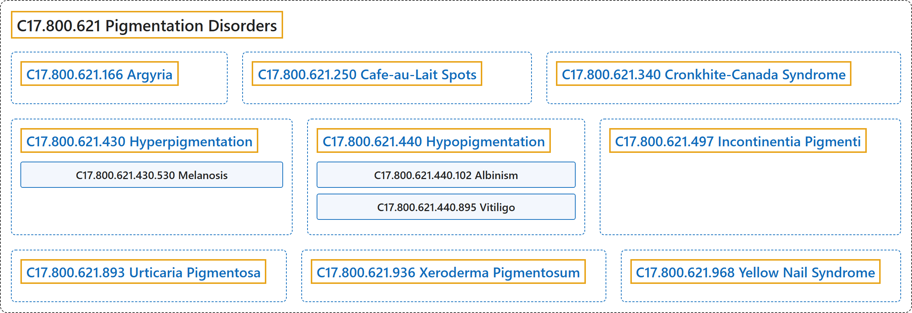

# C17.800.621 Pigmentation Disorders

## Classification

## Glossary

| Term | Definition | 中文翻译 | Source |
|---|---|---|---|
| **C17.800.621 Pigmentation Disorders** 色素沉着障碍 | "**Diseases affecting PIGMENTATION**, including SKIN PIGMENTATION." | **影响色素沉着**（PIGMENTATION）**的疾病**，包括皮肤色素沉着（SKIN PIGMENTATION）。 | [National Library of Medicine, 2026, "Pigmentation Disorders" scope note](https://meshb.nlm.nih.gov/record/ui?ui=D010859) |
| **C17.800.621.166 Argyria** 银质沉着症 | "A **permanent ashen-gray discoloration** of the skin, conjunctiva, and internal organs resulting from **long-continued use of silver salts**. (Dorland, 27th ed)" | 皮肤、结膜和内脏器官的**永久性灰蓝色变色**，由**长期使用银盐**所致。（Dorland，第 27 版） | [National Library of Medicine, 2026, "Argyria" scope note](https://meshb.nlm.nih.gov/record/ui?ui=D001129) |
| **C17.800.621.250 Cafe-au-Lait Spots** 咖啡牛奶斑 | "**Light brown pigmented macules** associated with NEUROFIBROMATOSIS and Albright's syndrome (see FIBROUS DYSPLASIA, POLYOSTOTIC)." | **浅褐色色素斑**，与神经纤维瘤病（NEUROFIBROMATOSIS）及 Albright 综合征（见 FIBROUS DYSPLASIA, POLYOSTOTIC）相关。 | [National Library of Medicine, 2026, "Cafe-au-Lait Spots" scope note](https://meshb.nlm.nih.gov/record/ui?ui=D019080) |
| **C17.800.621.340 Cronkhite-Canada Syndrome** Cronkhite-Canada 综合征 | "A **nonfamilial polyposis syndrome** that is characterized by the presence of **diffuse gastrointestinal polyposis**, skin hyperpigmentation, ALOPECIA; DIARRHEA, and PROTEIN-LOSING ENTEROPATHY. It was first reported by Cronkhite and Canada in 1955." | 一种**非家族性息肉病综合征**，特征为存在**弥漫性胃肠道息肉病**、皮肤色素沉着、脱发（ALOPECIA）、腹泻（DIARRHEA）和蛋白丢失性肠病（PROTEIN-LOSING ENTEROPATHY）。由 Cronkhite 和 Canada 于 1955 年首次报道。 | [National Library of Medicine, 2026, "Cronkhite-Canada Syndrome" scope note](https://meshb.nlm.nih.gov/record/ui?ui=D000098858) |
| **C17.800.621.430 Hyperpigmentation** 色素沉着过度 | "**Excessive pigmentation of the skin**, usually as a result of increased epidermal or dermal melanin pigmentation, hypermelanosis. Hyperpigmentation can be localized or generalized. The condition may arise from exposure to light, chemicals or other substances, or from a primary metabolic imbalance." | **皮肤色素过度沉着**，通常是表皮或真皮黑色素沉着增加（黑色素沉着过度）的结果。色素沉着过度可为局限性或泛发性。可因暴露于光、化学品或其他物质，或因原发性代谢失衡而发生。 | [National Library of Medicine, 2026, "Hyperpigmentation" scope note](https://meshb.nlm.nih.gov/record/ui?ui=D017495) |
| **C17.800.621.430.530 Melanosis** 黑变病 | "Disorders of **increased melanin pigmentation** that develop without preceding inflammatory disease." | 在无先前炎症性疾病情况下发生的**黑色素沉着增加**的疾病。 | [National Library of Medicine, 2026, "Melanosis" scope note](https://meshb.nlm.nih.gov/record/ui?ui=D008548) |
| **C17.800.621.430.530.100 Acanthosis Nigricans** 黑棘皮病 | "A **circumscribed melanosis** consisting of a brown-pigmented, **velvety verrucosity** or fine papillomatosis appearing in the axillae and other body folds. It occurs in association with endocrine disorders, underlying malignancy, administration of certain drugs, or as in inherited disorder." | 一种**局限性黑变病**，表现为棕色色素沉着的**天鹅绒样疣状增生**或细小乳头瘤样增生，出现于腋窝和其他身体皱褶处。它伴发于内分泌疾病、潜在恶性肿瘤、某些药物的使用，或作为遗传性疾病出现。 | [National Library of Medicine, 2026, "Acanthosis Nigricans" scope note](https://meshb.nlm.nih.gov/record/ui?ui=D000052) |
| **C17.800.621.430.530.550 Lentigo** 雀斑样痣 | "**Small circumscribed melanoses** resembling, but differing histologically from, freckles. The concept includes senile lentigo ('liver spots') and nevoid lentigo (nevus spilus, lentigo simplex) and may also occur in association with multiple congenital defects or congenital syndromes (e.g., Peutz-Jeghers syndrome)." | **小的局限性黑变病**，外观类似雀斑但组织学上不同。本概念包括老年性雀斑样痣（“肝斑”）和痣样雀斑样痣（斑痣、单纯性雀斑样痣），也可伴发于多种先天性缺陷或先天性综合征（如 Peutz-Jeghers 综合征）。 | [National Library of Medicine, 2026, "Lentigo" scope note](https://meshb.nlm.nih.gov/record/ui?ui=D007911) |
| **C17.800.621.430.530.550.525 LEOPARD Syndrome** LEOPARD 综合征 | "An **autosomal dominant disorder with an acronym of its seven features** (LENTIGO; ELECTROCARDIOGRAM abnormalities; ocular HYPERTELORISM; PULMONARY STENOSIS; abnormal genitalia; retardation of growth; and DEAFNESS or SENSORINEURAL HEARING LOSS). This syndrome is caused by mutations of PTPN11 gene encoding the non-receptor PROTEIN TYROSINE PHOSPHATASE, type 11, and is an allelic to NOONAN SYNDROME. Features of LEOPARD syndrome overlap with those of NEUROFIBROMATOSIS 1 which is caused by mutations in the NEUROFIBROMATOSIS 1 GENES." | 一种**常染色体显性疾病，其名称为七个特征的首字母缩写**（雀斑样痣（LENTIGO）；心电图（ELECTROCARDIOGRAM）异常；眼距过宽（HYPERTELORISM）；肺动脉狭窄（PULMONARY STENOSIS）；生殖器异常；生长迟缓；以及耳聋（DEAFNESS）或感音神经性听力损失（SENSORINEURAL HEARING LOSS））。该综合征由编码 11 型非受体蛋白酪氨酸磷酸酶（PROTEIN TYROSINE PHOSPHATASE）的 PTPN11 基因突变引起，与努南综合征（NOONAN SYNDROME）为等位基因病。LEOPARD 综合征的特征与神经纤维瘤病 1 型（NEUROFIBROMATOSIS 1）重叠，后者由神经纤维瘤病 1 型基因（NEUROFIBROMATOSIS 1 GENES）突变引起。 | [National Library of Medicine, 2026, "LEOPARD Syndrome" scope note](https://meshb.nlm.nih.gov/record/ui?ui=D044542) |
| **C17.800.621.430.530.550.625 Peutz-Jeghers Syndrome** 波伊茨-耶格综合征 | "A hereditary disease caused by autosomal dominant mutations involving CHROMOSOME 19. It is characterized by the presence of **INTESTINAL POLYPS**, consistently in the JEJUNUM, and **mucocutaneous pigmentation** with MELANIN spots of the lips, buccal MUCOSA, and digits." | 一种由涉及 19 号染色体（CHROMOSOME 19）的常染色体显性突变引起的遗传病。其特征为存在**肠息肉**（INTESTINAL POLYPS），恒定见于空肠（JEJUNUM），以及唇、颊黏膜（MUCOSA）和指（趾）的含黑色素（MELANIN）斑点的**皮肤黏膜色素沉着**。 | [National Library of Medicine, 2026, "Peutz-Jeghers Syndrome" scope note](https://meshb.nlm.nih.gov/record/ui?ui=D010580) |
| **C17.800.621.440 Hypopigmentation** 色素减退 | "A condition caused by a **deficiency or a loss of melanin pigmentation in the epidermis**, also known as hypomelanosis. Hypopigmentation can be localized or generalized, and may result from genetic defects, trauma, inflammation, or infections." | 一种由**表皮黑色素沉着缺乏或丧失**引起的情况，又称黑色素减少症。色素减退可为局限性或泛发性，可由遗传缺陷、外伤、炎症或感染引起。 | [National Library of Medicine, 2026, "Hypopigmentation" scope note](https://meshb.nlm.nih.gov/record/ui?ui=D017496) |
| **C17.800.621.440.102 Albinism** 白化病 | "General term for a number of **inherited defects of amino acid metabolism** in which there is a **deficiency or absence of pigment** in the eyes, skin, or hair." | 多种**遗传性氨基酸代谢缺陷**的总称，表现为眼、皮肤或毛发中**色素缺乏或缺失**。 | [National Library of Medicine, 2026, "Albinism" scope note](https://meshb.nlm.nih.gov/record/ui?ui=D000417) |
| **C17.800.621.440.102.090 Albinism, Ocular** 眼白化病 | "**Albinism affecting the eye** in which pigment of the hair and skin is normal or only slightly diluted. The classic type is X-linked (Nettleship-Falls), but an autosomal recessive form also exists. Ocular abnormalities may include reduced pigmentation of the iris, nystagmus, photophobia, strabismus, and decreased visual acuity." | **累及眼的白化病**，毛发和皮肤色素正常或仅轻度变淡。经典型为 X 连锁（Nettleship-Falls），但也存在常染色体隐性型。眼部异常可包括虹膜色素减少、眼球震颤、畏光、斜视和视力下降。 | [National Library of Medicine, 2026, "Albinism, Ocular" scope note](https://meshb.nlm.nih.gov/record/ui?ui=D016117) |
| **C17.800.621.440.102.100 Albinism, Oculocutaneous** 眼皮肤白化病 | "Heterogeneous group of **autosomal recessive disorders** comprising at least four recognized types, all having in common varying degrees of **hypopigmentation of the skin, hair, and eyes**. The two most common are the tyrosinase-positive and tyrosinase-negative types." | 一组异质性的**常染色体隐性疾病**，至少包括四种公认类型，共同特点是不同程度的**皮肤、毛发和眼睛色素减退**。最常见的两种是酪氨酸酶阳性型和酪氨酸酶阴性型。 | [National Library of Medicine, 2026, "Albinism, Oculocutaneous" scope note](https://meshb.nlm.nih.gov/record/ui?ui=D016115) |
| **C17.800.621.440.102.100.400 Hermanski-Pudlak Syndrome** 赫曼斯基-普德拉克综合征 | "Syndrome characterized by the **triad of oculocutaneous albinism** (ALBINISM, OCULOCUTANEOUS); PLATELET STORAGE POOL DEFICIENCY; and lysosomal accumulation of ceroid lipofuscin." | 一种综合征，其特征为**眼皮肤白化病三联征**（眼皮肤白化病，ALBINISM, OCULOCUTANEOUS）、血小板贮存池缺陷（PLATELET STORAGE POOL DEFICIENCY），以及溶酶体内蜡样脂褐素蓄积。 | [National Library of Medicine, 2026, "Hermanski-Pudlak Syndrome" scope note](https://meshb.nlm.nih.gov/record/ui?ui=D022861) |
| **C17.800.621.440.102.600 Piebaldism** 斑驳病 | "Autosomal dominant, congenital disorder characterized by **localized hypomelanosis of the skin and hair**. The most familiar feature is a **white forelock** presenting in 80 to 90 percent of the patients. The underlying defect is possibly related to the differentiation and migration of melanoblasts, as well as to defective development of the neural crest (neurocristopathy). Piebaldism may be closely related to WAARDENBURG SYNDROME." | 一种常染色体显性先天性疾病，特征为**皮肤和毛发的局限性黑色素减少**。最常见的特征是**白色额发**，见于 80% 至 90% 的患者。潜在缺陷可能与黑色素母细胞的分化和迁移以及神经嵴发育缺陷（神经嵴病）有关。斑驳病可能与瓦登伯格综合征（WAARDENBURG SYNDROME）密切相关。 | [National Library of Medicine, 2026, "Piebaldism" scope note](https://meshb.nlm.nih.gov/record/ui?ui=D016116) |
| **C17.800.621.440.895 Vitiligo** 白癜风 | "A disorder consisting of areas of **macular depigmentation**, commonly on extensor aspects of extremities, on the face or neck, and in skin folds. Age of onset is often in young adulthood and the condition tends to progress gradually with lesions enlarging and extending until a quiescent state is reached." | 一种以**斑状色素脱失**区为表现的疾病，常见于四肢伸侧、面部或颈部以及皮肤皱褶处。发病年龄多在青年期，病情往往逐渐进展，皮损扩大蔓延，直至进入静止状态。 | [National Library of Medicine, 2026, "Vitiligo" scope note](https://meshb.nlm.nih.gov/record/ui?ui=D014820) |
| **C17.800.621.497 Incontinentia Pigmenti** 色素失禁症 | "A **genodermatosis occurring mostly in females** and characterized by **skin changes in three phases** - vesiculobullous, verrucous papillomatous, and macular melanodermic. Hyperpigmentation is bizarre and irregular. Sixty percent of patients have abnormalities of eyes, teeth, central nervous system, and skin appendages." | 一种**主要发生于女性的遗传性皮肤病**，特征为**皮肤改变分三期**：水疱大疱期、疣状乳头瘤期和斑状黑皮期。色素沉着过度形态怪异且不规则。百分之六十的患者有眼、牙齿、中枢神经系统和皮肤附属器的异常。 | [National Library of Medicine, 2026, "Incontinentia Pigmenti" scope note](https://meshb.nlm.nih.gov/record/ui?ui=D007184) |
| **C17.800.621.893 Urticaria Pigmentosa** 色素性荨麻疹 | "The **most common form of cutaneous mastocytosis** (MASTOCYTOSIS, CUTANEOUS) that occurs primarily in children. It is characterized by the multiple small reddish-brown pigmented pruritic macules and papules." | **皮肤肥大细胞增多症最常见的形式**（皮肤肥大细胞增多症（MASTOCYTOSIS, CUTANEOUS）），主要发生于儿童。特征为多发性小的红棕色色素性瘙痒性斑疹和丘疹。 | [National Library of Medicine, 2026, "Urticaria Pigmentosa" scope note](https://meshb.nlm.nih.gov/record/ui?ui=D014582) |
| **C17.800.621.936 Xeroderma Pigmentosum** 着色性干皮病 | "A rare, pigmentary, and atrophic autosomal recessive disease. It is manifested as an **extreme photosensitivity to ULTRAVIOLET RAYS** as the result of a deficiency in the enzyme that permits **excisional repair of ultraviolet-damaged DNA**." | 一种罕见的色素性、萎缩性常染色体隐性遗传病。表现为**对紫外线**（ULTRAVIOLET RAYS）**极度光敏**，其原因是缺乏能够对**紫外线损伤的 DNA 进行切除修复**的酶。 | [National Library of Medicine, 2026, "Xeroderma Pigmentosum" scope note](https://meshb.nlm.nih.gov/record/ui?ui=D014983) |
| **C17.800.621.968 Yellow Nail Syndrome** 黄甲综合征 | "A rare condition characterized by the presence of **yellow nails, LYMPHEDEMA, and/or PLEURAL EFFUSION** with respiratory tract involvement. Abnormal lymphatic network may play a role in its etiology. Occasionally inherited, yellow nail syndrome mostly is sporadic without apparent family history." | 一种罕见病症，特征为出现**黄甲、淋巴水肿**（LYMPHEDEMA）**和（或）胸腔积液**（PLEURAL EFFUSION），伴呼吸道受累。异常的淋巴网络可能在其病因中起作用。黄甲综合征偶有遗传，多数为散发且无明显家族史。 | [National Library of Medicine, 2026, "Yellow Nail Syndrome" scope note](https://meshb.nlm.nih.gov/record/ui?ui=D056684) |

## References

National Library of Medicine. (2026). *MeSH 2026 descriptor records* [Data set]. Retrieved October 28, 2026, from <https://www.nlm.nih.gov/databases/download/mesh.html>
