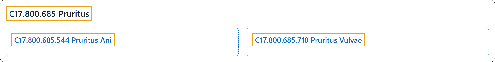

# C17.800.685 Pruritus

## Classification

## Glossary

| Term | Definition | 中文翻译 | Source |
|---|---|---|---|
| **C17.800.685 Pruritus** 瘙痒 | "An **intense itching sensation** that produces the **urge to rub or scratch the skin** to obtain relief." | 一种**强烈的痒感**，使人产生**想要摩擦或搔抓皮肤的冲动**以求缓解。 | [National Library of Medicine, 2026, "Pruritus" scope note](https://meshb.nlm.nih.gov/record/ui?ui=D011537) |
| **C17.800.685.544 Pruritus Ani** 肛门瘙痒症 | "**Intense chronic itching in the anal area**." | **肛门区域的剧烈慢性瘙痒**。 | [National Library of Medicine, 2026, "Pruritus Ani" scope note](https://meshb.nlm.nih.gov/record/ui?ui=D011538) |
| **C17.800.685.710 Pruritus Vulvae** 外阴瘙痒 | "**Intense itching of the external female genitals**." | **女性外生殖器的剧烈瘙痒**。 | [National Library of Medicine, 2026, "Pruritus Vulvae" scope note](https://meshb.nlm.nih.gov/record/ui?ui=D011539) |

## References

National Library of Medicine. (2026). *MeSH 2026 descriptor records* [Data set]. Retrieved October 28, 2026, from <https://www.nlm.nih.gov/databases/download/mesh.html>
