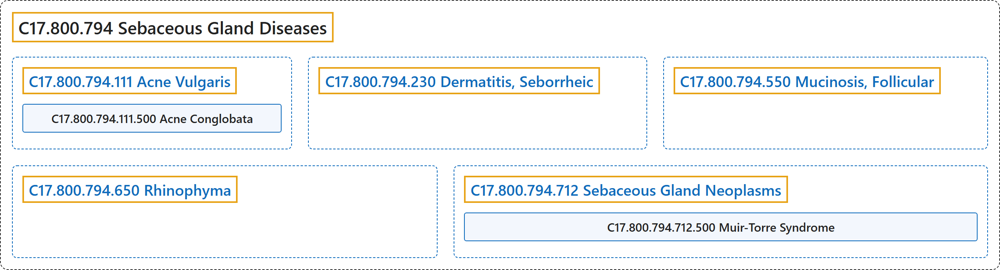

# C17.800.794 Sebaceous Gland Diseases

## Classification

## Glossary

| Term | Definition | 中文翻译 | Source |
|---|---|---|---|
| **C17.800.794 Sebaceous Gland Diseases** 皮脂腺疾病 | "**Diseases of the sebaceous glands** such as sebaceous hyperplasia and sebaceous cell carcinoma (SEBACEOUS GLAND NEOPLASMS)." | **皮脂腺的疾病**，如皮脂腺增生和皮脂腺细胞癌（皮脂腺肿瘤（SEBACEOUS GLAND NEOPLASMS））。 | [National Library of Medicine, 2026, "Sebaceous Gland Diseases" scope note](https://meshb.nlm.nih.gov/record/ui?ui=D012625) |
| **C17.800.794.111 Acne Vulgaris** 寻常痤疮 | "A **chronic disorder of the pilosebaceous apparatus** associated with an **increase in sebum secretion**. It is characterized by open comedones (blackheads), closed comedones (whiteheads), and pustular nodules. The cause is unknown, but heredity and age are predisposing factors." | 一种**毛囊皮脂腺单位的慢性疾病**，与**皮脂分泌增加**相关。其特征为开放性粉刺（黑头）、闭合性粉刺（白头）和脓疱性结节。病因不明，但遗传和年龄是易感因素。 | [National Library of Medicine, 2026, "Acne Vulgaris" scope note](https://meshb.nlm.nih.gov/record/ui?ui=D000152) |
| **C17.800.794.111.500 Acne Conglobata** 聚合性痤疮 | "**Severe and chronic form of acne** characterized by **large, burrowing abscesses** associated with disfigurement." | **痤疮的一种严重慢性类型**，特征为**大的、潜行性脓肿**，并伴有毁容。 | [National Library of Medicine, 2026, "Acne Conglobata" scope note](https://meshb.nlm.nih.gov/record/ui?ui=D000069316) |
| **C17.800.794.230 Dermatitis, Seborrheic** 脂溢性皮炎 | "A **chronic inflammatory disease of the skin with unknown etiology**. It is characterized by moderate ERYTHEMA, dry, moist, or greasy (SEBACEOUS GLAND) scaling and yellow crusted patches on various areas, especially the scalp, that exfoliate as dandruff. Seborrheic dermatitis is common in children and adolescents with HIV INFECTIONS." | 一种**病因不明的慢性炎症性皮肤病**。特征为中度红斑（ERYTHEMA）、干性、湿性或油腻性（皮脂腺（SEBACEOUS GLAND））鳞屑，以及身体各部位尤其是头皮上的黄色结痂斑片，后者以头皮屑形式脱落。脂溢性皮炎常见于患有 HIV 感染（HIV INFECTIONS）的儿童和青少年。 | [National Library of Medicine, 2026, "Dermatitis, Seborrheic" scope note](https://meshb.nlm.nih.gov/record/ui?ui=D012628) |
| **C17.800.794.550 Mucinosis, Follicular** 毛囊黏蛋白病 | "A **disease of the pilosebaceous unit**, presenting clinically as grouped follicular papules or plaques with associated hair loss. It is caused by **mucinous infiltration of tissues**, and usually involving the scalp, face, and neck. It may be primary (idiopathic) or secondary to mycosis fungoides or reticulosis." | 一种**毛囊皮脂腺单位的疾病**，临床表现为成群的毛囊性丘疹或斑块，伴脱发。由**组织黏蛋白浸润**引起，通常累及头皮、面部和颈部。可为原发性（特发性），或继发于蕈样肉芽肿或网状细胞增多症。 | [National Library of Medicine, 2026, "Mucinosis, Follicular" scope note](https://meshb.nlm.nih.gov/record/ui?ui=D000507) |
| **C17.800.794.650 Rhinophyma** 肥大性酒渣鼻 | "A **manifestation of severe ROSACEA** resulting in **significant enlargement of the NOSE** and occurring primarily in men. It is caused by hypertrophy of the SEBACEOUS GLANDS and surrounding CONNECTIVE TISSUE. The nose is reddened and marked with TELANGIECTASIS." | 一种**重度酒渣鼻**（ROSACEA）**的表现**，导致**鼻**（NOSE）**显著增大**，主要发生于男性。由皮脂腺（SEBACEOUS GLANDS）及周围结缔组织（CONNECTIVE TISSUE）肥大所致。鼻部发红并伴有毛细血管扩张（TELANGIECTASIS）。 | [National Library of Medicine, 2026, "Rhinophyma" scope note](https://meshb.nlm.nih.gov/record/ui?ui=D012224) |
| **C17.800.794.712 Sebaceous Gland Neoplasms** 皮脂腺肿瘤 | "**New abnormal growth of tissue in the SEBACEOUS GLANDS**." | **皮脂腺**（SEBACEOUS GLANDS）**中组织的新的异常生长**。 | [National Library of Medicine, 2026, "Sebaceous Gland Neoplasms" scope note](https://meshb.nlm.nih.gov/record/ui?ui=D012626) |
| **C17.800.794.712.500 Muir-Torre Syndrome** Muir-Torre 综合征 | "A **form of LYNCH SYNDROME II** associated with cutaneous **SEBACEOUS GLAND NEOPLASMS**. Muir-Torre syndrome is also associated with other visceral malignant diseases include colorectal, endometrial, urological, and upper gastrointestinal neoplasms." | **林奇综合征 II 型**（LYNCH SYNDROME II）的一种形式，伴皮肤**皮脂腺肿瘤**（SEBACEOUS GLAND NEOPLASMS）。Muir-Torre 综合征还与其他内脏恶性疾病相关，包括结直肠、子宫内膜、泌尿系统和上消化道肿瘤。 | [National Library of Medicine, 2026, "Muir-Torre Syndrome" scope note](https://meshb.nlm.nih.gov/record/ui?ui=D055653) |

## References

National Library of Medicine. (2026). *MeSH 2026 descriptor records* [Data set]. Retrieved October 28, 2026, from <https://www.nlm.nih.gov/databases/download/mesh.html>
