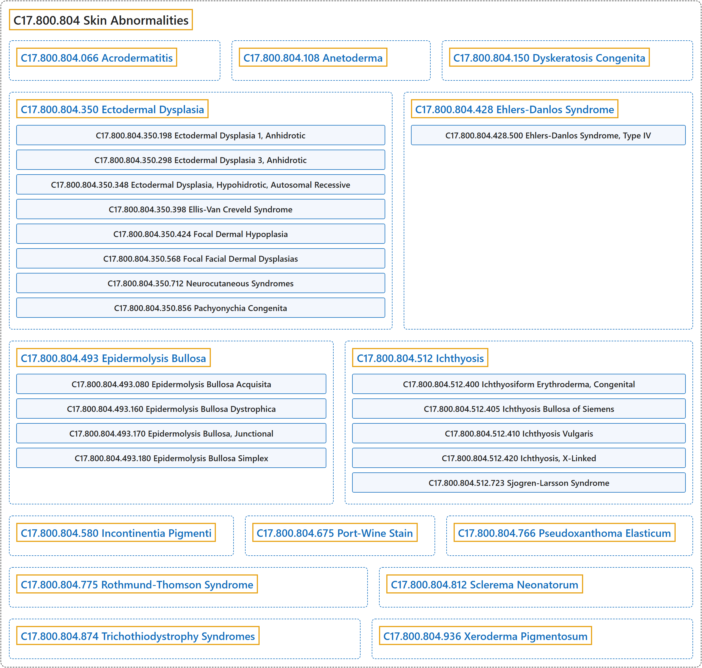

# C17.800.804 Skin Abnormalities

## Classification

## Glossary

| Term | Definition | 中文翻译 | Source |
|---|---|---|---|
| **C17.800.804 Skin Abnormalities** 皮肤异常 | "**Congenital structural abnormalities of the skin**." | **皮肤的先天性结构异常**。 | [National Library of Medicine, 2026, "Skin Abnormalities" scope note](https://meshb.nlm.nih.gov/record/ui?ui=D012868) |
| **C17.800.804.066 Acrodermatitis** 肢端皮炎 | "**Inflammation involving the skin of the extremities**, especially the hands and feet. Several forms are known, some idiopathic and some hereditary. The infantile form is called Gianotti-Crosti syndrome." | **累及四肢皮肤的炎症**，尤其是手和足。已知有多种类型，有些为特发性，有些为遗传性。婴儿型称为 Gianotti-Crosti 综合征。 | [National Library of Medicine, 2026, "Acrodermatitis" scope note](https://meshb.nlm.nih.gov/record/ui?ui=D000169) |
| **C17.800.804.108 Anetoderma** 皮肤松弛症（斑状萎缩） | "Benign DERMATOSIS caused by a **loss of dermal ELASTIC TISSUE** resulting in **localized sac-like areas of flaccid skin**. It can be either primary (idiopathic) or secondary to other skin conditions, PENICILLAMINE use, or premature birth." | 一种良性皮肤病（DERMATOSIS），由**真皮弹性组织**（ELASTIC TISSUE）**缺失**引起，导致**局部出现囊袋状的松弛皮肤区域**。它可以是原发性（特发性）的，也可以继发于其他皮肤病、青霉胺（PENICILLAMINE）的使用或早产。 | [National Library of Medicine, 2026, "Anetoderma" scope note](https://meshb.nlm.nih.gov/record/ui?ui=D057088) |
| **C17.800.804.150 Dyskeratosis Congenita** 先天性角化不良 | "A predominantly X-linked recessive syndrome characterized by a **triad of reticular skin pigmentation, nail dystrophy and leukoplakia of mucous membranes**. Oral and dental abnormalities may also be present. Complications are a predisposition to malignancy and bone marrow involvement with pancytopenia. (from Int J Paediatr Dent 2000 Dec;10(4):328-34) The X-linked form is also known as Zinsser-Cole-Engman syndrome and involves the gene which encodes a highly conserved protein called dyskerin." | 一种主要为 X 连锁隐性遗传的综合征，特征为**网状皮肤色素沉着、甲营养不良和黏膜白斑三联征**。也可存在口腔和牙齿异常。并发症包括易患恶性肿瘤以及骨髓受累伴全血细胞减少。（引自 Int J Paediatr Dent 2000 Dec;10(4):328-34）X 连锁型又称 Zinsser-Cole-Engman 综合征，涉及编码一种高度保守蛋白（角化不良蛋白 dyskerin）的基因。 | [National Library of Medicine, 2026, "Dyskeratosis Congenita" scope note](https://meshb.nlm.nih.gov/record/ui?ui=D019871) |
| **C17.800.804.350 Ectodermal Dysplasia** 外胚层发育不良 | "A group of **hereditary disorders involving tissues and structures derived from the embryonic ectoderm**. They are characterized by the presence of abnormalities at birth and involvement of both the epidermis and skin appendages. They are generally nonprogressive and diffuse. Various forms exist, including anhidrotic and hidrotic dysplasias, FOCAL DERMAL HYPOPLASIA, and aplasia cutis congenita." | 一组**累及源自胚胎外胚层的组织和结构的遗传性疾病**。其特征为出生时即存在异常，并同时累及表皮和皮肤附属器。通常为非进行性且呈弥漫性。有多种类型，包括无汗型和有汗型发育不良、局灶性真皮发育不全（FOCAL DERMAL HYPOPLASIA）以及先天性皮肤发育不全。 | [National Library of Medicine, 2026, "Ectodermal Dysplasia" scope note](https://meshb.nlm.nih.gov/record/ui?ui=D004476) |
| **C17.800.804.350.198 Ectodermal Dysplasia 1, Anhidrotic** 无汗性外胚层发育不良 1 型 | "An **X-linked form of ectodermal dysplasia** which results from mutations of the gene encoding ECTODYSPLASIN." | 一种 **X 连锁的外胚层发育不良**，由编码外异蛋白（ECTODYSPLASIN）的基因突变所致。 | [National Library of Medicine, 2026, "Ectodermal Dysplasia 1, Anhidrotic" scope note](https://meshb.nlm.nih.gov/record/ui?ui=D053358) |
| **C17.800.804.350.298 Ectodermal Dysplasia 3, Anhidrotic** 无汗性外胚层发育不良 3 型 | "An **autosomal dominant form of ectodermal dysplasia** which is due to mutations in the gene for the **EDAR RECEPTOR**." | 一种**常染色体显性形式的外胚层发育不良**，由 **EDAR 受体**（EDAR RECEPTOR）基因突变引起。 | [National Library of Medicine, 2026, "Ectodermal Dysplasia 3, Anhidrotic" scope note](https://meshb.nlm.nih.gov/record/ui?ui=D053359) |
| **C17.800.804.350.348 Ectodermal Dysplasia, Hypohidrotic, Autosomal Recessive** 常染色体隐性少汗性外胚层发育不良 | "An **autosomal recessive form of ectodermal dysplasia** which is due to mutations in the gene for the EDAR RECEPTOR or EDAR-ASSOCIATED DEATH DOMAIN PROTEIN." | 一种**常染色体隐性遗传形式的外胚层发育不良**，由 EDAR 受体（EDAR RECEPTOR）或 EDAR 相关死亡结构域蛋白（EDAR-ASSOCIATED DEATH DOMAIN PROTEIN）的基因突变所致。 | [National Library of Medicine, 2026, "Ectodermal Dysplasia, Hypohidrotic, Autosomal Recessive" scope note](https://meshb.nlm.nih.gov/record/ui?ui=D053360) |
| **C17.800.804.350.398 Ellis-Van Creveld Syndrome** 埃利伟综合征（软骨外胚层发育不良） | "**Dwarfism** occurring in association with defective development of skin, hair, and teeth, **polydactyly**, and defect of the cardiac septum. (Dorland, 27th ed)" | **侏儒症**，伴有皮肤、毛发和牙齿发育缺陷、**多指**（趾）以及心间隔缺损。（Dorland，第 27 版） | [National Library of Medicine, 2026, "Ellis-Van Creveld Syndrome" scope note](https://meshb.nlm.nih.gov/record/ui?ui=D004613) |
| **C17.800.804.350.424 Focal Dermal Hypoplasia** 局灶性真皮发育不全 | "A genetic skin disease characterized by **hypoplasia of the dermis**, herniations of fat, and hand anomalies. It is found exclusively in females and transmitted as an X-linked dominant trait." | 一种遗传性皮肤病，特征为**真皮发育不全**、脂肪疝出及手部畸形。仅见于女性，以 X 连锁显性性状遗传。 | [National Library of Medicine, 2026, "Focal Dermal Hypoplasia" scope note](https://meshb.nlm.nih.gov/record/ui?ui=D005489) |
| **C17.800.804.350.568 Focal Facial Dermal Dysplasias** 局灶性面部真皮发育不良 | "A **heterogenous group of genetic disorders** characterized by **scar-like atrophic lesions on the temple region of the head** including preauricular area. Location of skin defects is likely related to defects in fusion of embryonic facial prominences during development of the face. Focal facial dermal dysplasia (FFDD) is generally divided into four subtypes according to the location of the lesions and inheritance pattern: FFDD1 (Brauer syndrome); FFDD2 (Brauer-Setleis syndrome); FFDD3 (Setleis syndrome); and FFDD4. Mutations in TWIST2 Protein and/or CYP26C1 (see CYP26 FAMILY) are associated with FFDD3, and 4." | 一组**异质性遗传病**，特征为**头部颞区的瘢痕样萎缩性皮损**，包括耳前区。皮肤缺损的部位可能与面部发育过程中胚胎面突融合缺陷有关。局灶性面部真皮发育不良（FFDD）一般根据皮损部位和遗传方式分为四个亚型：FFDD1（Brauer 综合征）；FFDD2（Brauer-Setleis 综合征）；FFDD3（Setleis 综合征）；以及 FFDD4。TWIST2 蛋白和（或）CYP26C1（见 CYP26 FAMILY）的突变与 FFDD3 和 4 相关。 | [National Library of Medicine, 2026, "Focal Facial Dermal Dysplasias" scope note](https://meshb.nlm.nih.gov/record/ui?ui=D000090303) |
| **C17.800.804.350.712 Neurocutaneous Syndromes** 神经皮肤综合征 | "A group of disorders characterized by **ectodermal-based malformations and neoplastic growths** in the skin, nervous system, and other organs." | 一组疾病，特征为皮肤、神经系统和其他器官中**源于外胚层的畸形和肿瘤性生长**。 | [National Library of Medicine, 2026, "Neurocutaneous Syndromes" scope note](https://meshb.nlm.nih.gov/record/ui?ui=D020752) |
| **C17.800.804.350.856 Pachyonychia Congenita** 先天性厚甲 | "A group of **inherited ectodermal dysplasias** whose most prominent clinical feature is **hypertrophic nail dystrophy** resulting in PACHYONYCHIA. Several specific subtypes of pachyonychia congenita have been associated with mutations in genes that encode KERATINS." | 一组**遗传性外胚层发育不良**，最突出的临床特征是导致厚甲（PACHYONYCHIA）的**肥厚性甲营养不良**。先天性厚甲的若干特定亚型与编码角蛋白（KERATINS）的基因突变相关。 | [National Library of Medicine, 2026, "Pachyonychia Congenita" scope note](https://meshb.nlm.nih.gov/record/ui?ui=D053549) |
| **C17.800.804.350.856.500 Steatocystoma Multiplex** 多发性脂囊瘤 | "A disorder characterized by **multiple, wide spread cutaneous cysts** that often become inflamed and rupture. It is caused by the same mutations in the gene coding for KRT-17 that are causative mutations for Pachyonychia congenita, Type 2. Natal teeth involvement is sometimes associated with steatocystoma multiplex." | 一种以**多发、广泛分布的皮肤囊肿**为特征的疾病，这些囊肿常发炎和破裂。它由编码 KRT-17 的基因突变引起，这些突变与 2 型先天性厚甲症的致病突变相同。多发性脂囊瘤有时伴有胎生牙。 | [National Library of Medicine, 2026, "Steatocystoma Multiplex" scope note](https://meshb.nlm.nih.gov/record/ui?ui=D062685) |
| **C17.800.804.428 Ehlers-Danlos Syndrome** 埃勒斯-当洛斯综合征 | "A heterogeneous group of **autosomally inherited COLLAGEN DISEASES** caused by **defects in the synthesis or structure of FIBRILLAR COLLAGEN**. There are numerous subtypes: classical, hypermobility, vascular, and others. Common clinical features include hyperextensible skin and joints, skin fragility and reduced wound healing capability." | 一组异质性的**常染色体遗传性胶原病**（COLLAGEN DISEASES），由**纤维状胶原**（FIBRILLAR COLLAGEN）**合成或结构缺陷**所致。有众多亚型：经典型、过度活动型、血管型及其他。常见临床特征包括皮肤和关节过度伸展、皮肤脆弱以及伤口愈合能力降低。 | [National Library of Medicine, 2026, "Ehlers-Danlos Syndrome" scope note](https://meshb.nlm.nih.gov/record/ui?ui=D004535) |
| **C17.800.804.428.500 Ehlers-Danlos Syndrome, Type IV** 埃勒斯-当洛综合征IV型（血管型） | "A subtype of Ehlers-Danlos syndrome (EDS) characterized by **vascular pathologies**, e.g., AORTIC DISSECTION in addition to common EDS findings, e.g., hyperextensible skin and joints, skin fragility and reduced wound healing capability. It is associated with mutations in **collagen type III alpha 1 chain gene** (COLLAGEN TYPE III)." | 埃勒斯-当洛综合征（EDS）的一个亚型，除常见的 EDS 表现（如皮肤和关节过度伸展、皮肤脆弱及伤口愈合能力下降）外，还以**血管病变**为特征，如主动脉夹层（AORTIC DISSECTION）。它与**III 型胶原 α1 链基因**（COLLAGEN TYPE III）的突变有关。 | [National Library of Medicine, 2026, "Ehlers-Danlos Syndrome, Type IV" scope note](https://meshb.nlm.nih.gov/record/ui?ui=D000094623) |
| **C17.800.804.493 Epidermolysis Bullosa** 大疱性表皮松解症 | "Group of **genetically determined disorders** characterized by the **blistering of skin and mucosae**. There are four major forms: acquired, simple, junctional, and dystrophic. Each of the latter three has several varieties." | 一组**遗传决定的疾病**，其特征为**皮肤和黏膜起疱**。有四种主要类型：获得性、单纯型、交界型和营养不良型。后三者各有若干变型。 | [National Library of Medicine, 2026, "Epidermolysis Bullosa" scope note](https://meshb.nlm.nih.gov/record/ui?ui=D004820) |
| **C17.800.804.493.080 Epidermolysis Bullosa Acquisita** 获得性大疱性表皮松解症 | "Form of epidermolysis bullosa characterized by **trauma-induced, subepidermal blistering** with no family history of the disease. Direct immunofluorescence shows IMMUNOGLOBULIN G deposited at the dermo-epidermal junction." | 大疱性表皮松解症的一种类型，特征为**外伤诱发的表皮下水疱**，且无该病家族史。直接免疫荧光显示免疫球蛋白 G（IMMUNOGLOBULIN G）沉积于真皮表皮交界处。 | [National Library of Medicine, 2026, "Epidermolysis Bullosa Acquisita" scope note](https://meshb.nlm.nih.gov/record/ui?ui=D016107) |
| **C17.800.804.493.160 Epidermolysis Bullosa Dystrophica** 营养不良型大疱性表皮松解症 | "Form of epidermolysis bullosa characterized by **atrophy of blistered areas, severe scarring, and nail changes**. It is most often present at birth or in early infancy and occurs in both autosomal dominant and recessive forms. All forms of dystrophic epidermolysis bullosa result from mutations in COLLAGEN TYPE VII, a major component fibrils of BASEMENT MEMBRANE and EPIDERMIS." | 大疱性表皮松解症的一种类型，特征为**水疱区萎缩、严重瘢痕形成及甲改变**。多于出生时或婴儿早期出现，有常染色体显性和隐性两种遗传形式。所有营养不良型大疱性表皮松解症均由 VII 型胶原（COLLAGEN TYPE VII）突变所致，VII 型胶原是基底膜（BASEMENT MEMBRANE）和表皮（EPIDERMIS）纤维的主要成分。 | [National Library of Medicine, 2026, "Epidermolysis Bullosa Dystrophica" scope note](https://meshb.nlm.nih.gov/record/ui?ui=D016108) |
| **C17.800.804.493.170 Epidermolysis Bullosa, Junctional** 交界型大疱性表皮松解症 | "Form of epidermolysis bullosa having onset at birth or during the neonatal period and transmitted through autosomal recessive inheritance. It is characterized by **generalized blister formation**, extensive denudation, and separation and cleavage of the basal cell plasma membranes from the basement membrane." | 大疱性表皮松解症的一种类型，于出生时或新生儿期发病，经常染色体隐性遗传。特征为**泛发性水疱形成**、大面积表皮剥脱，以及基底细胞质膜与基底膜的分离和裂开。 | [National Library of Medicine, 2026, "Epidermolysis Bullosa, Junctional" scope note](https://meshb.nlm.nih.gov/record/ui?ui=D016109) |
| **C17.800.804.493.180 Epidermolysis Bullosa Simplex** 单纯型大疱性表皮松解症 | "A form of epidermolysis bullosa characterized by **serous bullae that heal without scarring**. Mutations in the genes that encode KERATIN-5 and KERATIN-14 have been associated with several subtypes of epidermolysis bullosa simplex." | 一种大疱性表皮松解症，特征为**愈合后不留瘢痕的浆液性大疱**。编码角蛋白-5（KERATIN-5）和角蛋白-14（KERATIN-14）的基因突变与单纯型大疱性表皮松解症的若干亚型相关。 | [National Library of Medicine, 2026, "Epidermolysis Bullosa Simplex" scope note](https://meshb.nlm.nih.gov/record/ui?ui=D016110) |
| **C17.800.804.512 Ichthyosis** 鱼鳞病 | "Any of several generalized skin disorders characterized by **dryness, roughness, and scaliness**, due to **hypertrophy of the stratum corneum epidermis**. Most are genetic, but some are acquired, developing in association with other systemic disease or genetic syndrome." | 几种泛发性皮肤病的统称，特征为**干燥、粗糙和鳞屑**，由**表皮角质层肥厚**所致。多数为遗传性，但也有获得性者，伴发于其他系统性疾病或遗传综合征。 | [National Library of Medicine, 2026, "Ichthyosis" scope note](https://meshb.nlm.nih.gov/record/ui?ui=D007057) |
| **C17.800.804.512.400 Ichthyosiform Erythroderma, Congenital** 先天性鱼鳞病样红皮病 | "Designation for **several severe forms of ichthyosis, present at birth**, that are characterized by **hyperkeratotic scaling**. Infants may be born encased in a collodion membrane which begins shedding within 24 hours. This is followed in about two weeks by persistent generalized scaling. The forms include bullous (HYPERKERATOSIS, EPIDERMOLYTIC), non-bullous (ICHTHYOSIS, LAMELLAR), wet type, and dry type." | 对**出生时即存在的几种严重鱼鳞病类型**的统称，特征为**角化过度性鳞屑**。婴儿出生时可包裹于火棉胶样膜中，该膜在 24 小时内开始脱落。约两周后继之以持续性全身鳞屑。其类型包括大疱型（HYPERKERATOSIS, EPIDERMOLYTIC）、非大疱型（ICHTHYOSIS, LAMELLAR）、湿型和干型。 | [National Library of Medicine, 2026, "Ichthyosiform Erythroderma, Congenital" scope note](https://meshb.nlm.nih.gov/record/ui?ui=D016113) |
| **C17.800.804.512.400.375 Hyperkeratosis, Epidermolytic** 表皮松解性角化过度症 | "A form of **congenital ichthyosis inherited as an autosomal dominant trait** and characterized by **ERYTHRODERMA and severe hyperkeratosis**. It is manifested at birth by blisters followed by the appearance of thickened, horny, verruciform scales over the entire body, but accentuated in flexural areas. Mutations in the genes that encode KERATIN-1 and KERATIN-10 have been associated with this disorder." | 一种**以常染色体显性性状遗传的先天性鱼鳞病**，特征为**红皮病**（ERYTHRODERMA）**和严重角化过度**。出生时即表现为水疱，随后全身出现增厚、角质、疣状鳞屑，但在屈侧部位更为明显。编码角蛋白 1（KERATIN-1）和角蛋白 10（KERATIN-10）的基因突变与该病相关。 | [National Library of Medicine, 2026, "Hyperkeratosis, Epidermolytic" scope note](https://meshb.nlm.nih.gov/record/ui?ui=D017488) |
| **C17.800.804.512.400.410 Ichthyosis, Lamellar** 板层状鱼鳞病 | "A **chronic, congenital ichthyosis inherited as an autosomal recessive trait**. Infants are usually born encased in a **collodion membrane** which sheds within a few weeks. Scaling is generalized and marked with grayish-brown quadrilateral scales, adherent at their centers and free at the edges. In some cases, scales are so thick that they resemble armored plate." | 一种**以常染色体隐性性状遗传的慢性先天性鱼鳞病**。婴儿出生时通常包裹于**火棉胶膜**中，该膜在数周内脱落。鳞屑泛发，呈灰褐色四边形，中央黏着、边缘游离。某些病例中鳞屑厚到类似铠甲板。 | [National Library of Medicine, 2026, "Ichthyosis, Lamellar" scope note](https://meshb.nlm.nih.gov/record/ui?ui=D017490) |
| **C17.800.804.512.400.705 Netherton Syndrome** 内瑟顿综合征 | "**Rare autosomal recessive disease** with variable expressions. Clinical features of the disease include variable ICHTHYOSIFORM ERYTHRODERMA, CONGENITAL; bamboo hair (trichorrhexis invaginata); and ATOPIC DERMATITIS. The disease is caused by **mutations in the SPINK5 gene**." | 一种表现多样的**罕见常染色体隐性遗传病**。该病的临床特征包括不同程度的先天性鱼鳞病样红皮病（ICHTHYOSIFORM ERYTHRODERMA, CONGENITAL）、竹节状发（套叠性脆发症）和特应性皮炎（ATOPIC DERMATITIS）。该病由 **SPINK5 基因突变**引起。 | [National Library of Medicine, 2026, "Netherton Syndrome" scope note](https://meshb.nlm.nih.gov/record/ui?ui=D056770) |
| **C17.800.804.512.405 Ichthyosis Bullosa of Siemens** Siemens 大疱性鱼鳞病 | "An **autosomal dominant form of ichthyosis** characterized by generalized reddening of the skin (ERYTHEMA) and **widespread blistering**. The disease shows similar, but somewhat milder, clinical and histopathological findings to those in HYPERKERATOSIS, EPIDERMOLYTIC and is associated with the gene that encodes KERATIN-2A." | 一种**常染色体显性遗传的鱼鳞病**，特征为皮肤泛发性发红（红斑（ERYTHEMA））和**广泛水疱形成**。该病的临床和组织病理学表现与表皮松解性角化过度（HYPERKERATOSIS, EPIDERMOLYTIC）相似但稍轻，并与编码角蛋白 2A（KERATIN-2A）的基因相关。 | [National Library of Medicine, 2026, "Ichthyosis Bullosa of Siemens" scope note](https://meshb.nlm.nih.gov/record/ui?ui=D053560) |
| **C17.800.804.512.410 Ichthyosis Vulgaris** 寻常型鱼鳞病 | "**Most common form of ICHTHYOSIS** characterized by **prominent scaling** especially on the exterior surfaces of the extremities. It is inherited as an autosomal dominant trait." | **鱼鳞病**（ICHTHYOSIS）**最常见的类型**，特征为**明显的鳞屑**，尤其见于四肢伸侧。以常染色体显性性状遗传。 | [National Library of Medicine, 2026, "Ichthyosis Vulgaris" scope note](https://meshb.nlm.nih.gov/record/ui?ui=D016112) |
| **C17.800.804.512.420 Ichthyosis, X-Linked** X 连锁鱼鳞病 | "Chronic form of ichthyosis that is inherited as a **sex-linked recessive trait carried on the X-chromosome** and transmitted to the male offspring. It is characterized by severe scaling, especially on the extremities, and is associated with **steroid sulfatase deficiency**." | 一种慢性鱼鳞病，以**位于 X 染色体上的性连锁隐性性状**遗传并传给男性后代。特征为严重脱屑，尤其在四肢，并与**类固醇硫酸酯酶缺乏**相关。 | [National Library of Medicine, 2026, "Ichthyosis, X-Linked" scope note](https://meshb.nlm.nih.gov/record/ui?ui=D016114) |
| **C17.800.804.512.723 Sjogren-Larsson Syndrome** 舍格伦-拉松综合征 | "An **autosomal recessive neurocutaneous disorder** characterized by severe ichthyosis MENTAL RETARDATION; SPASTIC PARAPLEGIA; and congenital ICHTHYOSIS. It is caused by mutation of gene encoding microsomal fatty ALDEHYDE DEHYDROGENASE leading to **defect in fatty alcohol metabolism**." | 一种**常染色体隐性遗传的神经皮肤疾病**，其特征为重度鱼鳞病、精神发育迟滞（MENTAL RETARDATION）、痉挛性截瘫（SPASTIC PARAPLEGIA）和先天性鱼鳞病（ICHTHYOSIS）。由编码微粒体脂肪醛脱氢酶（ALDEHYDE DEHYDROGENASE）的基因突变引起，导致**脂肪醇代谢缺陷**。 | [National Library of Medicine, 2026, "Sjogren-Larsson Syndrome" scope note](https://meshb.nlm.nih.gov/record/ui?ui=D016111) |
| **C17.800.804.580 Incontinentia Pigmenti** 色素失禁症 | "A **genodermatosis occurring mostly in females** and characterized by **skin changes in three phases** - vesiculobullous, verrucous papillomatous, and macular melanodermic. Hyperpigmentation is bizarre and irregular. Sixty percent of patients have abnormalities of eyes, teeth, central nervous system, and skin appendages." | 一种**主要发生于女性的遗传性皮肤病**，特征为**皮肤改变分三期**：水疱大疱期、疣状乳头瘤期和斑状黑皮期。色素沉着过度形态怪异且不规则。百分之六十的患者有眼、牙齿、中枢神经系统和皮肤附属器的异常。 | [National Library of Medicine, 2026, "Incontinentia Pigmenti" scope note](https://meshb.nlm.nih.gov/record/ui?ui=D007184) |
| **C17.800.804.675 Port-Wine Stain** 葡萄酒色斑 | "A **vascular malformation of developmental origin** characterized pathologically by **ectasia of superficial dermal capillaries**, and clinically by persistent macular erythema. In the past, port wine stains have frequently been termed capillary hemangiomas, which they are not; unfortunately this confusing practice persists: HEMANGIOMA, CAPILLARY is neoplastic, a port-wine stain is non-neoplastic. Port-wine stains vary in color from fairly pale pink to deep red or purple and in size from a few millimeters to many centimeters in diameter. The face is the most frequently affected site and they are most often unilateral. (From Rook et al., Textbook of Dermatology, 5th ed, p483)" | 一种**发育起源的血管畸形**，病理特征为**真皮浅层毛细血管扩张**，临床特征为持续性斑状红斑。过去葡萄酒色斑常被称为毛细血管瘤，但它们并非如此；遗憾的是这种混淆的做法仍在延续：毛细血管瘤（HEMANGIOMA, CAPILLARY）是肿瘤性的，而葡萄酒色斑是非肿瘤性的。葡萄酒色斑颜色从相当浅的粉红色到深红色或紫色不等，大小从数毫米到数十厘米直径不等。面部是最常受累的部位，且多为单侧。（引自 Rook 等，Textbook of Dermatology，第 5 版，第 483 页） | [National Library of Medicine, 2026, "Port-Wine Stain" scope note](https://meshb.nlm.nih.gov/record/ui?ui=D019339) |
| **C17.800.804.766 Pseudoxanthoma Elasticum** 弹性纤维假黄瘤 | "An **inherited disorder of connective tissue** with extensive **degeneration and calcification of ELASTIC TISSUE** primarily in the skin, eye, and vasculature. At least two forms exist, autosomal recessive and autosomal dominant. This disorder is caused by mutations of one of the ATP-BINDING CASSETTE TRANSPORTERS. Patients are predisposed to MYOCARDIAL INFARCTION and GASTROINTESTINAL HEMORRHAGE." | 一种**遗传性结缔组织疾病**，主要在皮肤、眼和血管系统中出现广泛的**弹性组织**（ELASTIC TISSUE）**变性和钙化**。至少存在两种类型：常染色体隐性型和常染色体显性型。本病由某种 ATP 结合盒转运蛋白（ATP-BINDING CASSETTE TRANSPORTERS）的突变所致。患者易发生心肌梗死（MYOCARDIAL INFARCTION）和胃肠道出血（GASTROINTESTINAL HEMORRHAGE）。 | [National Library of Medicine, 2026, "Pseudoxanthoma Elasticum" scope note](https://meshb.nlm.nih.gov/record/ui?ui=D011561) |
| **C17.800.804.775 Rothmund-Thomson Syndrome** 罗特蒙德-汤姆森综合征 | "An **autosomal recessive syndrome** occurring principally in females, characterized by the presence of **reticulated, atrophic, hyperpigmented, telangiectatic cutaneous plaques**, often accompanied by juvenile cataracts, saddle nose, congenital bone defects, disturbances in the growth of HAIR; NAILS; and TEETH; and HYPOGONADISM." | 一种主要见于女性的**常染色体隐性遗传综合征**，其特征为存在**网状、萎缩、色素沉着过度、毛细血管扩张的皮肤斑块**，常伴有幼年白内障、鞍鼻、先天性骨缺损，以及毛发（HAIR）、甲（NAILS）和牙齿（TEETH）的生长障碍和性腺功能减退（HYPOGONADISM）。 | [National Library of Medicine, 2026, "Rothmund-Thomson Syndrome" scope note](https://meshb.nlm.nih.gov/record/ui?ui=D011038) |
| **C17.800.804.812 Sclerema Neonatorum** 新生儿硬化症 | "A severe, sometimes fatal, **disorder of adipose tissue** occurring chiefly in preterm or debilitated infants suffering from an underlying illness and manifested by a **diffuse, nonpitting induration** of the affected tissue. The skin becomes cold, yellowish, mottled, and inflexible." | 一种严重、有时致命的**脂肪组织疾病**，主要发生于患有基础疾病的早产儿或体弱婴儿，表现为受累组织**弥漫性、非凹陷性硬化**。皮肤变得冰冷、发黄、呈斑驳状且失去弹性。 | [National Library of Medicine, 2026, "Sclerema Neonatorum" scope note](https://meshb.nlm.nih.gov/record/ui?ui=D012593) |
| **C17.800.804.874 Trichothiodystrophy Syndromes** 毛发低硫营养不良综合征 | "Autosomal recessive neuroectodermal disorders characterized by **brittle sulfur-deficient hair** associated with impaired intellect, decreased fertility, and short stature. It may include nail dystrophy, ICHTHYOSIS, and photosensitivity correlated with a NUCLEOTIDE EXCISION REPAIR defect. All individuals with this disorder have a deficiency of cysteine-rich KERATIN-ASSOCIATED PROTEINS found in the interfilamentous matrix. Photosensitive trichothiodystrophy can be caused by mutation in at least 2 separate genes: ERCC2 PROTEIN gene and the related ERCC3. Nonphotosensitive trichothiodystrophy can be caused by mutation in the TTDN1 gene." | 常染色体隐性遗传的神经外胚层疾病，特征为**脆性缺硫毛发**，伴智力受损、生育力下降和身材矮小。可包括甲营养不良、鱼鳞病（ICHTHYOSIS）以及与核苷酸切除修复（NUCLEOTIDE EXCISION REPAIR）缺陷相关的光敏感。所有患者均缺乏存在于丝间基质中的富含半胱氨酸的角蛋白相关蛋白（KERATIN-ASSOCIATED PROTEINS）。光敏型毛发低硫营养不良可由至少 2 个不同基因的突变引起：ERCC2 蛋白（ERCC2 PROTEIN）基因及相关的 ERCC3。非光敏型毛发低硫营养不良可由 TTDN1 基因突变引起。 | [National Library of Medicine, 2026, "Trichothiodystrophy Syndromes" scope note](https://meshb.nlm.nih.gov/record/ui?ui=D054463) |
| **C17.800.804.936 Xeroderma Pigmentosum** 着色性干皮病 | "A rare, pigmentary, and atrophic autosomal recessive disease. It is manifested as an **extreme photosensitivity to ULTRAVIOLET RAYS** as the result of a deficiency in the enzyme that permits **excisional repair of ultraviolet-damaged DNA**." | 一种罕见的色素性、萎缩性常染色体隐性遗传病。表现为**对紫外线**（ULTRAVIOLET RAYS）**极度光敏**，其原因是缺乏能够对**紫外线损伤的 DNA 进行切除修复**的酶。 | [National Library of Medicine, 2026, "Xeroderma Pigmentosum" scope note](https://meshb.nlm.nih.gov/record/ui?ui=D014983) |

## References

National Library of Medicine. (2026). *MeSH 2026 descriptor records* [Data set]. Retrieved October 28, 2026, from <https://www.nlm.nih.gov/databases/download/mesh.html>
