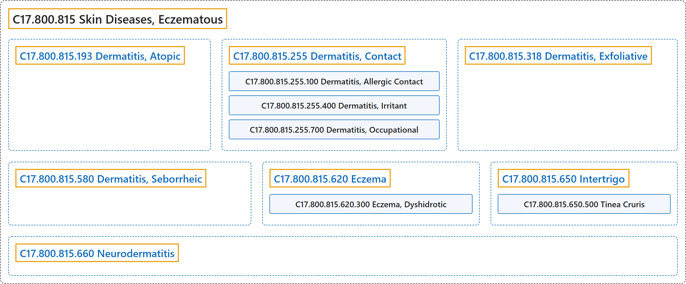

# C17.800.815 Skin Diseases, Eczematous

## Classification

## Glossary

| Term | Definition | 中文翻译 | Source |
|---|---|---|---|
| **C17.800.815 Skin Diseases, Eczematous** 湿疹样皮肤病 | "Any of a variety of **eruptive skin disorders** characterized by **erythema, oozing, vesiculation, and scaling**. Etiology is varied." | 多种**发疹性皮肤病**中的任何一种，特征为**红斑、渗出、水疱形成和鳞屑**。病因多样。 | [National Library of Medicine, 2026, "Skin Diseases, Eczematous" scope note](https://meshb.nlm.nih.gov/record/ui?ui=D017443) |
| **C17.800.815.193 Dermatitis, Atopic** 特应性皮炎 | "A **chronic inflammatory genetically determined disease of the skin** marked by **increased ability to form reagin (IgE)**, with increased susceptibility to allergic rhinitis and asthma, and hereditary disposition to a lowered threshold for pruritus. It is manifested by lichenification, excoriation, and crusting, mainly on the flexural surfaces of the elbow and knee. In infants it is known as infantile eczema." | 一种**遗传决定的慢性炎症性皮肤病**，特征为**形成反应素（IgE）的能力增强**，对过敏性鼻炎和哮喘的易感性增加，并有瘙痒阈值降低的遗传素质。表现为苔藓样变、表皮剥脱和结痂，主要位于肘、膝屈侧。在婴儿中称为婴儿湿疹。 | [National Library of Medicine, 2026, "Dermatitis, Atopic" scope note](https://meshb.nlm.nih.gov/record/ui?ui=D003876) |
| **C17.800.815.255 Dermatitis, Contact** 接触性皮炎 | "A type of **acute or chronic skin reaction** in which sensitivity is manifested by **reactivity to materials or substances coming in contact with the skin**. It may involve allergic or non-allergic mechanisms." | 一类**急性或慢性皮肤反应**，其敏感性表现为**对接触皮肤的材料或物质产生反应**。可涉及变应性或非变应性机制。 | [National Library of Medicine, 2026, "Dermatitis, Contact" scope note](https://meshb.nlm.nih.gov/record/ui?ui=D003877) |
| **C17.800.815.255.100 Dermatitis, Allergic Contact** 变应性接触性皮炎 | "A **contact dermatitis due to allergic sensitization to various substances**. These substances subsequently produce inflammatory reactions in the skin of those who have acquired hypersensitivity to them as a result of prior exposure." | 一种**因对各种物质发生变应性致敏而引起的接触性皮炎**。这些物质随后在因既往接触而获得超敏性的人的皮肤中引起炎症反应。 | [National Library of Medicine, 2026, "Dermatitis, Allergic Contact" scope note](https://meshb.nlm.nih.gov/record/ui?ui=D017449) |
| **C17.800.815.255.100.600 Dermatitis, Photoallergic** 光变应性皮炎 | "A **delayed hypersensitivity** involving the **reaction between sunlight or other radiant energy source and a chemical substance** to which the individual has been previously exposed and sensitized. It manifests as a papulovesicular, eczematous, or exudative dermatitis occurring chiefly on the light-exposed areas of the skin." | 一种**迟发型超敏反应**，涉及**日光或其他辐射能源与化学物质之间的反应**，个体此前已接触该化学物质并致敏。表现为丘疹水疱性、湿疹样或渗出性皮炎，主要发生于皮肤的曝光部位。 | [National Library of Medicine, 2026, "Dermatitis, Photoallergic" scope note](https://meshb.nlm.nih.gov/record/ui?ui=D017454) |
| **C17.800.815.255.100.700 Dermatitis, Toxicodendron** 毒漆树皮炎 | "An **allergic contact dermatitis** caused by exposure to **plants of the genus Toxicodendron** (formerly Rhus). These include poison ivy, poison oak, and poison sumac, all plants that contain the substance urushiol, a potent skin sensitizing agent. (From Dorland, 27th ed)" | 一种**变应性接触性皮炎**，由接触**漆树属（Toxicodendron）植物**（旧称 Rhus）引起。这些植物包括毒常春藤、毒橡树和毒漆树，均含有漆酚这种强效皮肤致敏物质。（引自 Dorland，第 27 版） | [National Library of Medicine, 2026, "Dermatitis, Toxicodendron" scope note](https://meshb.nlm.nih.gov/record/ui?ui=D011040) |
| **C17.800.815.255.400 Dermatitis, Irritant** 刺激性皮炎 | "A **non-allergic contact dermatitis caused by prolonged exposure to irritants** and not explained by delayed hypersensitivity mechanisms." | 一种**由长期接触刺激物引起的非过敏性接触性皮炎**，不能用迟发型超敏反应机制解释。 | [National Library of Medicine, 2026, "Dermatitis, Irritant" scope note](https://meshb.nlm.nih.gov/record/ui?ui=D017453) |
| **C17.800.815.255.400.225 Dermatitis, Phototoxic** 光毒性皮炎 | "A **nonimmunologic, chemically induced type of photosensitivity** producing a sometimes vesiculating dermatitis. It results in hyperpigmentation and desquamation of the light-exposed areas of the skin." | 一种**非免疫性、化学诱发的光敏感类型**，可产生有时伴水疱的皮炎。导致皮肤曝光部位色素沉着过度和脱屑。 | [National Library of Medicine, 2026, "Dermatitis, Phototoxic" scope note](https://meshb.nlm.nih.gov/record/ui?ui=D017484) |
| **C17.800.815.255.400.250 Diaper Rash** 尿布疹 | "A type of **irritant dermatitis localized to the area in contact with a diaper** and occurring most often as a reaction to prolonged contact with urine, feces, or retained soap or detergent." | 一种**局限于与尿布接触部位的刺激性皮炎**，最常因长时间接触尿液、粪便或残留的肥皂或洗涤剂而发生。 | [National Library of Medicine, 2026, "Diaper Rash" scope note](https://meshb.nlm.nih.gov/record/ui?ui=D003963) |
| **C17.800.815.255.700 Dermatitis, Occupational** 职业性皮炎 | "A **recurrent contact dermatitis** caused by **substances found in the work place**." | 一种由**工作场所中存在的物质**引起的**复发性接触性皮炎**。 | [National Library of Medicine, 2026, "Dermatitis, Occupational" scope note](https://meshb.nlm.nih.gov/record/ui?ui=D009783) |
| **C17.800.815.318 Dermatitis, Exfoliative** 剥脱性皮炎 | "The **widespread involvement of the skin by a scaly, erythematous dermatitis** occurring either as a secondary or reactive process to an underlying cutaneous disorder (e.g., atopic dermatitis, psoriasis, etc.), or as a primary or idiopathic disease. It is often associated with the loss of hair and nails, hyperkeratosis of the palms and soles, and pruritus. (From Dorland, 27th ed)" | **鳞屑性红斑性皮炎对皮肤的广泛累及**，可作为基础皮肤病（如特应性皮炎、银屑病等）的继发或反应性过程发生，也可作为原发或特发性疾病发生。它常伴有毛发和指（趾）甲脱落、掌跖角化过度及瘙痒。（引自 Dorland，第 27 版） | [National Library of Medicine, 2026, "Dermatitis, Exfoliative" scope note](https://meshb.nlm.nih.gov/record/ui?ui=D003873) |
| **C17.800.815.580 Dermatitis, Seborrheic** 脂溢性皮炎 | "A **chronic inflammatory disease of the skin with unknown etiology**. It is characterized by moderate ERYTHEMA, dry, moist, or greasy (SEBACEOUS GLAND) scaling and yellow crusted patches on various areas, especially the scalp, that exfoliate as dandruff. Seborrheic dermatitis is common in children and adolescents with HIV INFECTIONS." | 一种**病因不明的慢性炎症性皮肤病**。特征为中度红斑（ERYTHEMA）、干性、湿性或油腻性（皮脂腺（SEBACEOUS GLAND））鳞屑，以及身体各部位尤其是头皮上的黄色结痂斑片，后者以头皮屑形式脱落。脂溢性皮炎常见于患有 HIV 感染（HIV INFECTIONS）的儿童和青少年。 | [National Library of Medicine, 2026, "Dermatitis, Seborrheic" scope note](https://meshb.nlm.nih.gov/record/ui?ui=D012628) |
| **C17.800.815.620 Eczema** 湿疹 | "A dermatitis characterized by a **spongiotic tissue reaction pattern** occurring as a reaction to many endogenous and exogenous agents." | 一种皮炎，特征为**海绵水肿性组织反应模式**，作为对多种内源性和外源性因素的反应而发生。 | [National Library of Medicine, 2026, "Eczema" scope note](https://meshb.nlm.nih.gov/record/ui?ui=D004485) |
| **C17.800.815.620.300 Eczema, Dyshidrotic** 汗疱疹 | "A **recurrent eczematous reaction** characterized by the development of **vesicular eruptions on the palms and soles**, particularly along the sides and between the digits. It is accompanied by pruritus, a burning sensation, and hyperhidrosis. The disease is self-limiting, lasting only a few weeks. (Dorland, 27th ed)" | 一种**复发性湿疹样反应**，特征为**手掌和足底出现水疱性皮疹**，尤其是沿指（趾）侧缘和指（趾）间。伴有瘙痒、烧灼感和多汗。该病为自限性，仅持续数周。（Dorland，第 27 版） | [National Library of Medicine, 2026, "Eczema, Dyshidrotic" scope note](https://meshb.nlm.nih.gov/record/ui?ui=D011146) |
| **C17.800.815.650 Intertrigo** 擦烂 | "A **superficial dermatitis occurring on skin surfaces in contact with each other**, such as the axillae, neck creases, intergluteal fold, between the toes, etc. Obesity is a predisposing factor. The condition is caused by moisture and friction and is characterized by erythema, maceration, burning, and exudation." | 一种**发生于相互接触的皮肤表面的浅表性皮炎**，如腋窝、颈部皱褶、臀间沟、趾间等。肥胖是易感因素。本病由潮湿和摩擦引起，特征为红斑、浸渍、烧灼感和渗出。 | [National Library of Medicine, 2026, "Intertrigo" scope note](https://meshb.nlm.nih.gov/record/ui?ui=D007402) |
| **C17.800.815.650.500 Tinea Cruris** 股癣 | "**Fungal infection of the groin**. The main causative fungus is TRICHOPHYTON." | **腹股沟的真菌感染**。主要致病真菌为毛癣菌（TRICHOPHYTON）。 | [National Library of Medicine, 2026, "Tinea Cruris" scope note](https://meshb.nlm.nih.gov/record/ui?ui=D000084002) |
| **C17.800.815.660 Neurodermatitis** 神经性皮炎 | "An extremely variable **eczematous skin disease** that is presumed to be a **response to prolonged vigorous scratching, rubbing, or pinching** to relieve intense pruritus. It varies in intensity, severity, course, and morphologic expression in different individuals. Neurodermatitis is believed by some to be psychogenic. The circumscribed or localized form is often referred to as lichen simplex chronicus." | 一种表现极为多变的**湿疹样皮肤病**，被认为是为缓解剧烈瘙痒而**长期用力搔抓、摩擦或掐捏所致的反应**。其强度、严重程度、病程和形态表现因人而异。有人认为神经性皮炎属心因性。局限型常称为慢性单纯性苔藓。 | [National Library of Medicine, 2026, "Neurodermatitis" scope note](https://meshb.nlm.nih.gov/record/ui?ui=D009450) |

## References

National Library of Medicine. (2026). *MeSH 2026 descriptor records* [Data set]. Retrieved October 28, 2026, from <https://www.nlm.nih.gov/databases/download/mesh.html>
