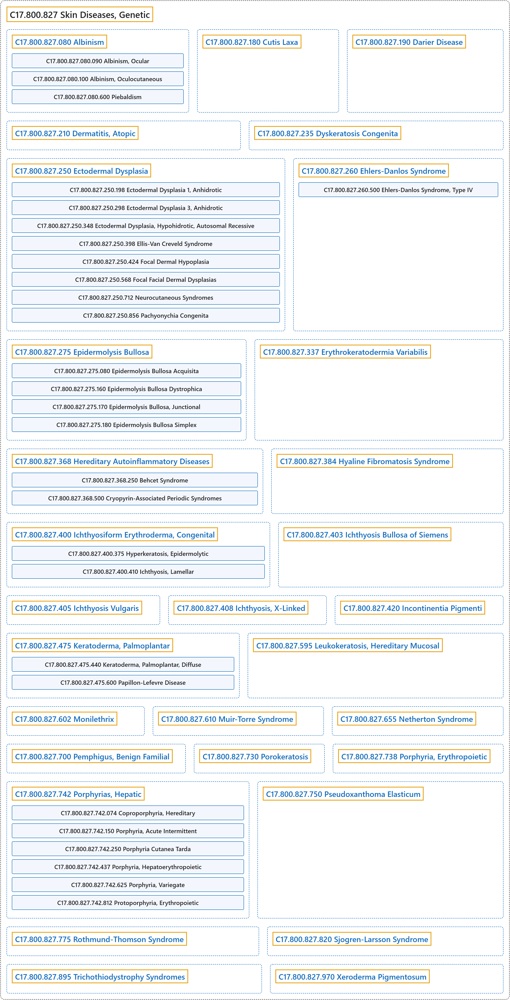

# C17.800.827 Skin Diseases, Genetic

## Classification

## Glossary

| Term | Definition | 中文翻译 | Source |
|---|---|---|---|
| **C17.800.827 Skin Diseases, Genetic** 遗传性皮肤病 | "**Diseases of the skin with a genetic component**, usually the result of various inborn errors of metabolism." | **具有遗传成分的皮肤疾病**，通常是各种先天性代谢缺陷的结果。 | [National Library of Medicine, 2026, "Skin Diseases, Genetic" scope note](https://meshb.nlm.nih.gov/record/ui?ui=D012873) |
| **C17.800.827.080 Albinism** 白化病 | "General term for a number of **inherited defects of amino acid metabolism** in which there is a **deficiency or absence of pigment** in the eyes, skin, or hair." | 多种**遗传性氨基酸代谢缺陷**的总称，表现为眼、皮肤或毛发中**色素缺乏或缺失**。 | [National Library of Medicine, 2026, "Albinism" scope note](https://meshb.nlm.nih.gov/record/ui?ui=D000417) |
| **C17.800.827.080.090 Albinism, Ocular** 眼白化病 | "**Albinism affecting the eye** in which pigment of the hair and skin is normal or only slightly diluted. The classic type is X-linked (Nettleship-Falls), but an autosomal recessive form also exists. Ocular abnormalities may include reduced pigmentation of the iris, nystagmus, photophobia, strabismus, and decreased visual acuity." | **累及眼的白化病**，毛发和皮肤色素正常或仅轻度变淡。经典型为 X 连锁（Nettleship-Falls），但也存在常染色体隐性型。眼部异常可包括虹膜色素减少、眼球震颤、畏光、斜视和视力下降。 | [National Library of Medicine, 2026, "Albinism, Ocular" scope note](https://meshb.nlm.nih.gov/record/ui?ui=D016117) |
| **C17.800.827.080.100 Albinism, Oculocutaneous** 眼皮肤白化病 | "Heterogeneous group of **autosomal recessive disorders** comprising at least four recognized types, all having in common varying degrees of **hypopigmentation of the skin, hair, and eyes**. The two most common are the tyrosinase-positive and tyrosinase-negative types." | 一组异质性的**常染色体隐性疾病**，至少包括四种公认类型，共同特点是不同程度的**皮肤、毛发和眼睛色素减退**。最常见的两种是酪氨酸酶阳性型和酪氨酸酶阴性型。 | [National Library of Medicine, 2026, "Albinism, Oculocutaneous" scope note](https://meshb.nlm.nih.gov/record/ui?ui=D016115) |
| **C17.800.827.080.100.400 Hermanski-Pudlak Syndrome** 赫曼斯基-普德拉克综合征 | "Syndrome characterized by the **triad of oculocutaneous albinism** (ALBINISM, OCULOCUTANEOUS); PLATELET STORAGE POOL DEFICIENCY; and lysosomal accumulation of ceroid lipofuscin." | 一种综合征，其特征为**眼皮肤白化病三联征**（眼皮肤白化病，ALBINISM, OCULOCUTANEOUS）、血小板贮存池缺陷（PLATELET STORAGE POOL DEFICIENCY），以及溶酶体内蜡样脂褐素蓄积。 | [National Library of Medicine, 2026, "Hermanski-Pudlak Syndrome" scope note](https://meshb.nlm.nih.gov/record/ui?ui=D022861) |
| **C17.800.827.080.600 Piebaldism** 斑驳病 | "Autosomal dominant, congenital disorder characterized by **localized hypomelanosis of the skin and hair**. The most familiar feature is a **white forelock** presenting in 80 to 90 percent of the patients. The underlying defect is possibly related to the differentiation and migration of melanoblasts, as well as to defective development of the neural crest (neurocristopathy). Piebaldism may be closely related to WAARDENBURG SYNDROME." | 一种常染色体显性先天性疾病，特征为**皮肤和毛发的局限性黑色素减少**。最常见的特征是**白色额发**，见于 80% 至 90% 的患者。潜在缺陷可能与黑色素母细胞的分化和迁移以及神经嵴发育缺陷（神经嵴病）有关。斑驳病可能与瓦登伯格综合征（WAARDENBURG SYNDROME）密切相关。 | [National Library of Medicine, 2026, "Piebaldism" scope note](https://meshb.nlm.nih.gov/record/ui?ui=D016116) |
| **C17.800.827.180 Cutis Laxa** 皮肤松垂 | "A group of connective tissue diseases in which **skin hangs in loose pendulous folds**. It is believed to be associated with decreased elastic tissue formation as well as an abnormality in elastin formation. Cutis laxa is usually a genetic disease, but acquired cases have been reported. (From Dorland, 27th ed)" | 一组结缔组织病，其中**皮肤呈松弛下垂的皱褶**。据认为它与弹性组织形成减少以及弹性蛋白形成异常有关。皮肤松垂通常是遗传性疾病，但也有后天获得性病例的报道。（引自 Dorland，第 27 版） | [National Library of Medicine, 2026, "Cutis Laxa" scope note](https://meshb.nlm.nih.gov/record/ui?ui=D003483) |
| **C17.800.827.190 Darier Disease** 毛囊角化病（达里埃病） | "An autosomal dominantly inherited skin disorder characterized by **warty malodorous papules that coalesce into plaques**. It is caused by **mutations in the ATP2A2 gene** encoding SERCA2 protein, one of the SARCOPLASMIC RETICULUM CALCIUM-TRANSPORTING ATPASES. The condition is similar, clinically and histologically, to BENIGN FAMILIAL PEMPHIGUS, another autosomal dominant skin disorder. Both diseases have defective calcium pumps (CALCIUM-TRANSPORTING ATPASES) and unstable desmosomal adhesion junctions (DESMOSOMES) between KERATINOCYTES." | 一种常染色体显性遗传性皮肤病，特征为**融合成斑块的疣状恶臭丘疹**。它由**编码 SERCA2 蛋白的 ATP2A2 基因突变**引起，SERCA2 是肌质网钙转运 ATP 酶（SARCOPLASMIC RETICULUM CALCIUM-TRANSPORTING ATPASES）之一。该病在临床和组织学上与另一种常染色体显性皮肤病家族性良性天疱疮（BENIGN FAMILIAL PEMPHIGUS）相似。两种疾病都存在钙泵缺陷（钙转运 ATP 酶（CALCIUM-TRANSPORTING ATPASES））以及角质形成细胞（KERATINOCYTES）之间桥粒黏附连接（桥粒（DESMOSOMES））不稳定。 | [National Library of Medicine, 2026, "Darier Disease" scope note](https://meshb.nlm.nih.gov/record/ui?ui=D007644) |
| **C17.800.827.210 Dermatitis, Atopic** 特应性皮炎 | "A **chronic inflammatory genetically determined disease of the skin** marked by **increased ability to form reagin (IgE)**, with increased susceptibility to allergic rhinitis and asthma, and hereditary disposition to a lowered threshold for pruritus. It is manifested by lichenification, excoriation, and crusting, mainly on the flexural surfaces of the elbow and knee. In infants it is known as infantile eczema." | 一种**遗传决定的慢性炎症性皮肤病**，特征为**形成反应素（IgE）的能力增强**，对过敏性鼻炎和哮喘的易感性增加，并有瘙痒阈值降低的遗传素质。表现为苔藓样变、表皮剥脱和结痂，主要位于肘、膝屈侧。在婴儿中称为婴儿湿疹。 | [National Library of Medicine, 2026, "Dermatitis, Atopic" scope note](https://meshb.nlm.nih.gov/record/ui?ui=D003876) |
| **C17.800.827.235 Dyskeratosis Congenita** 先天性角化不良 | "A predominantly X-linked recessive syndrome characterized by a **triad of reticular skin pigmentation, nail dystrophy and leukoplakia of mucous membranes**. Oral and dental abnormalities may also be present. Complications are a predisposition to malignancy and bone marrow involvement with pancytopenia. (from Int J Paediatr Dent 2000 Dec;10(4):328-34) The X-linked form is also known as Zinsser-Cole-Engman syndrome and involves the gene which encodes a highly conserved protein called dyskerin." | 一种主要为 X 连锁隐性遗传的综合征，特征为**网状皮肤色素沉着、甲营养不良和黏膜白斑三联征**。也可存在口腔和牙齿异常。并发症包括易患恶性肿瘤以及骨髓受累伴全血细胞减少。（引自 Int J Paediatr Dent 2000 Dec;10(4):328-34）X 连锁型又称 Zinsser-Cole-Engman 综合征，涉及编码一种高度保守蛋白（角化不良蛋白 dyskerin）的基因。 | [National Library of Medicine, 2026, "Dyskeratosis Congenita" scope note](https://meshb.nlm.nih.gov/record/ui?ui=D019871) |
| **C17.800.827.250 Ectodermal Dysplasia** 外胚层发育不良 | "A group of **hereditary disorders involving tissues and structures derived from the embryonic ectoderm**. They are characterized by the presence of abnormalities at birth and involvement of both the epidermis and skin appendages. They are generally nonprogressive and diffuse. Various forms exist, including anhidrotic and hidrotic dysplasias, FOCAL DERMAL HYPOPLASIA, and aplasia cutis congenita." | 一组**累及源自胚胎外胚层的组织和结构的遗传性疾病**。其特征为出生时即存在异常，并同时累及表皮和皮肤附属器。通常为非进行性且呈弥漫性。有多种类型，包括无汗型和有汗型发育不良、局灶性真皮发育不全（FOCAL DERMAL HYPOPLASIA）以及先天性皮肤发育不全。 | [National Library of Medicine, 2026, "Ectodermal Dysplasia" scope note](https://meshb.nlm.nih.gov/record/ui?ui=D004476) |
| **C17.800.827.250.198 Ectodermal Dysplasia 1, Anhidrotic** 无汗性外胚层发育不良 1 型 | "An **X-linked form of ectodermal dysplasia** which results from mutations of the gene encoding ECTODYSPLASIN." | 一种 **X 连锁的外胚层发育不良**，由编码外异蛋白（ECTODYSPLASIN）的基因突变所致。 | [National Library of Medicine, 2026, "Ectodermal Dysplasia 1, Anhidrotic" scope note](https://meshb.nlm.nih.gov/record/ui?ui=D053358) |
| **C17.800.827.250.298 Ectodermal Dysplasia 3, Anhidrotic** 无汗性外胚层发育不良 3 型 | "An **autosomal dominant form of ectodermal dysplasia** which is due to mutations in the gene for the **EDAR RECEPTOR**." | 一种**常染色体显性形式的外胚层发育不良**，由 **EDAR 受体**（EDAR RECEPTOR）基因突变引起。 | [National Library of Medicine, 2026, "Ectodermal Dysplasia 3, Anhidrotic" scope note](https://meshb.nlm.nih.gov/record/ui?ui=D053359) |
| **C17.800.827.250.348 Ectodermal Dysplasia, Hypohidrotic, Autosomal Recessive** 常染色体隐性少汗性外胚层发育不良 | "An **autosomal recessive form of ectodermal dysplasia** which is due to mutations in the gene for the EDAR RECEPTOR or EDAR-ASSOCIATED DEATH DOMAIN PROTEIN." | 一种**常染色体隐性遗传形式的外胚层发育不良**，由 EDAR 受体（EDAR RECEPTOR）或 EDAR 相关死亡结构域蛋白（EDAR-ASSOCIATED DEATH DOMAIN PROTEIN）的基因突变所致。 | [National Library of Medicine, 2026, "Ectodermal Dysplasia, Hypohidrotic, Autosomal Recessive" scope note](https://meshb.nlm.nih.gov/record/ui?ui=D053360) |
| **C17.800.827.250.398 Ellis-Van Creveld Syndrome** 埃利伟综合征（软骨外胚层发育不良） | "**Dwarfism** occurring in association with defective development of skin, hair, and teeth, **polydactyly**, and defect of the cardiac septum. (Dorland, 27th ed)" | **侏儒症**，伴有皮肤、毛发和牙齿发育缺陷、**多指**（趾）以及心间隔缺损。（Dorland，第 27 版） | [National Library of Medicine, 2026, "Ellis-Van Creveld Syndrome" scope note](https://meshb.nlm.nih.gov/record/ui?ui=D004613) |
| **C17.800.827.250.424 Focal Dermal Hypoplasia** 局灶性真皮发育不全 | "A genetic skin disease characterized by **hypoplasia of the dermis**, herniations of fat, and hand anomalies. It is found exclusively in females and transmitted as an X-linked dominant trait." | 一种遗传性皮肤病，特征为**真皮发育不全**、脂肪疝出及手部畸形。仅见于女性，以 X 连锁显性性状遗传。 | [National Library of Medicine, 2026, "Focal Dermal Hypoplasia" scope note](https://meshb.nlm.nih.gov/record/ui?ui=D005489) |
| **C17.800.827.250.568 Focal Facial Dermal Dysplasias** 局灶性面部真皮发育不良 | "A **heterogenous group of genetic disorders** characterized by **scar-like atrophic lesions on the temple region of the head** including preauricular area. Location of skin defects is likely related to defects in fusion of embryonic facial prominences during development of the face. Focal facial dermal dysplasia (FFDD) is generally divided into four subtypes according to the location of the lesions and inheritance pattern: FFDD1 (Brauer syndrome); FFDD2 (Brauer-Setleis syndrome); FFDD3 (Setleis syndrome); and FFDD4. Mutations in TWIST2 Protein and/or CYP26C1 (see CYP26 FAMILY) are associated with FFDD3, and 4." | 一组**异质性遗传病**，特征为**头部颞区的瘢痕样萎缩性皮损**，包括耳前区。皮肤缺损的部位可能与面部发育过程中胚胎面突融合缺陷有关。局灶性面部真皮发育不良（FFDD）一般根据皮损部位和遗传方式分为四个亚型：FFDD1（Brauer 综合征）；FFDD2（Brauer-Setleis 综合征）；FFDD3（Setleis 综合征）；以及 FFDD4。TWIST2 蛋白和（或）CYP26C1（见 CYP26 FAMILY）的突变与 FFDD3 和 4 相关。 | [National Library of Medicine, 2026, "Focal Facial Dermal Dysplasias" scope note](https://meshb.nlm.nih.gov/record/ui?ui=D000090303) |
| **C17.800.827.250.712 Neurocutaneous Syndromes** 神经皮肤综合征 | "A group of disorders characterized by **ectodermal-based malformations and neoplastic growths** in the skin, nervous system, and other organs." | 一组疾病，特征为皮肤、神经系统和其他器官中**源于外胚层的畸形和肿瘤性生长**。 | [National Library of Medicine, 2026, "Neurocutaneous Syndromes" scope note](https://meshb.nlm.nih.gov/record/ui?ui=D020752) |
| **C17.800.827.250.856 Pachyonychia Congenita** 先天性厚甲 | "A group of **inherited ectodermal dysplasias** whose most prominent clinical feature is **hypertrophic nail dystrophy** resulting in PACHYONYCHIA. Several specific subtypes of pachyonychia congenita have been associated with mutations in genes that encode KERATINS." | 一组**遗传性外胚层发育不良**，最突出的临床特征是导致厚甲（PACHYONYCHIA）的**肥厚性甲营养不良**。先天性厚甲的若干特定亚型与编码角蛋白（KERATINS）的基因突变相关。 | [National Library of Medicine, 2026, "Pachyonychia Congenita" scope note](https://meshb.nlm.nih.gov/record/ui?ui=D053549) |
| **C17.800.827.250.856.500 Steatocystoma Multiplex** 多发性脂囊瘤 | "A disorder characterized by **multiple, wide spread cutaneous cysts** that often become inflamed and rupture. It is caused by the same mutations in the gene coding for KRT-17 that are causative mutations for Pachyonychia congenita, Type 2. Natal teeth involvement is sometimes associated with steatocystoma multiplex." | 一种以**多发、广泛分布的皮肤囊肿**为特征的疾病，这些囊肿常发炎和破裂。它由编码 KRT-17 的基因突变引起，这些突变与 2 型先天性厚甲症的致病突变相同。多发性脂囊瘤有时伴有胎生牙。 | [National Library of Medicine, 2026, "Steatocystoma Multiplex" scope note](https://meshb.nlm.nih.gov/record/ui?ui=D062685) |
| **C17.800.827.260 Ehlers-Danlos Syndrome** 埃勒斯-当洛斯综合征 | "A heterogeneous group of **autosomally inherited COLLAGEN DISEASES** caused by **defects in the synthesis or structure of FIBRILLAR COLLAGEN**. There are numerous subtypes: classical, hypermobility, vascular, and others. Common clinical features include hyperextensible skin and joints, skin fragility and reduced wound healing capability." | 一组异质性的**常染色体遗传性胶原病**（COLLAGEN DISEASES），由**纤维状胶原**（FIBRILLAR COLLAGEN）**合成或结构缺陷**所致。有众多亚型：经典型、过度活动型、血管型及其他。常见临床特征包括皮肤和关节过度伸展、皮肤脆弱以及伤口愈合能力降低。 | [National Library of Medicine, 2026, "Ehlers-Danlos Syndrome" scope note](https://meshb.nlm.nih.gov/record/ui?ui=D004535) |
| **C17.800.827.260.500 Ehlers-Danlos Syndrome, Type IV** 埃勒斯-当洛综合征IV型（血管型） | "A subtype of Ehlers-Danlos syndrome (EDS) characterized by **vascular pathologies**, e.g., AORTIC DISSECTION in addition to common EDS findings, e.g., hyperextensible skin and joints, skin fragility and reduced wound healing capability. It is associated with mutations in **collagen type III alpha 1 chain gene** (COLLAGEN TYPE III)." | 埃勒斯-当洛综合征（EDS）的一个亚型，除常见的 EDS 表现（如皮肤和关节过度伸展、皮肤脆弱及伤口愈合能力下降）外，还以**血管病变**为特征，如主动脉夹层（AORTIC DISSECTION）。它与**III 型胶原 α1 链基因**（COLLAGEN TYPE III）的突变有关。 | [National Library of Medicine, 2026, "Ehlers-Danlos Syndrome, Type IV" scope note](https://meshb.nlm.nih.gov/record/ui?ui=D000094623) |
| **C17.800.827.275 Epidermolysis Bullosa** 大疱性表皮松解症 | "Group of **genetically determined disorders** characterized by the **blistering of skin and mucosae**. There are four major forms: acquired, simple, junctional, and dystrophic. Each of the latter three has several varieties." | 一组**遗传决定的疾病**，其特征为**皮肤和黏膜起疱**。有四种主要类型：获得性、单纯型、交界型和营养不良型。后三者各有若干变型。 | [National Library of Medicine, 2026, "Epidermolysis Bullosa" scope note](https://meshb.nlm.nih.gov/record/ui?ui=D004820) |
| **C17.800.827.275.080 Epidermolysis Bullosa Acquisita** 获得性大疱性表皮松解症 | "Form of epidermolysis bullosa characterized by **trauma-induced, subepidermal blistering** with no family history of the disease. Direct immunofluorescence shows IMMUNOGLOBULIN G deposited at the dermo-epidermal junction." | 大疱性表皮松解症的一种类型，特征为**外伤诱发的表皮下水疱**，且无该病家族史。直接免疫荧光显示免疫球蛋白 G（IMMUNOGLOBULIN G）沉积于真皮表皮交界处。 | [National Library of Medicine, 2026, "Epidermolysis Bullosa Acquisita" scope note](https://meshb.nlm.nih.gov/record/ui?ui=D016107) |
| **C17.800.827.275.160 Epidermolysis Bullosa Dystrophica** 营养不良型大疱性表皮松解症 | "Form of epidermolysis bullosa characterized by **atrophy of blistered areas, severe scarring, and nail changes**. It is most often present at birth or in early infancy and occurs in both autosomal dominant and recessive forms. All forms of dystrophic epidermolysis bullosa result from mutations in COLLAGEN TYPE VII, a major component fibrils of BASEMENT MEMBRANE and EPIDERMIS." | 大疱性表皮松解症的一种类型，特征为**水疱区萎缩、严重瘢痕形成及甲改变**。多于出生时或婴儿早期出现，有常染色体显性和隐性两种遗传形式。所有营养不良型大疱性表皮松解症均由 VII 型胶原（COLLAGEN TYPE VII）突变所致，VII 型胶原是基底膜（BASEMENT MEMBRANE）和表皮（EPIDERMIS）纤维的主要成分。 | [National Library of Medicine, 2026, "Epidermolysis Bullosa Dystrophica" scope note](https://meshb.nlm.nih.gov/record/ui?ui=D016108) |
| **C17.800.827.275.170 Epidermolysis Bullosa, Junctional** 交界型大疱性表皮松解症 | "Form of epidermolysis bullosa having onset at birth or during the neonatal period and transmitted through autosomal recessive inheritance. It is characterized by **generalized blister formation**, extensive denudation, and separation and cleavage of the basal cell plasma membranes from the basement membrane." | 大疱性表皮松解症的一种类型，于出生时或新生儿期发病，经常染色体隐性遗传。特征为**泛发性水疱形成**、大面积表皮剥脱，以及基底细胞质膜与基底膜的分离和裂开。 | [National Library of Medicine, 2026, "Epidermolysis Bullosa, Junctional" scope note](https://meshb.nlm.nih.gov/record/ui?ui=D016109) |
| **C17.800.827.275.180 Epidermolysis Bullosa Simplex** 单纯型大疱性表皮松解症 | "A form of epidermolysis bullosa characterized by **serous bullae that heal without scarring**. Mutations in the genes that encode KERATIN-5 and KERATIN-14 have been associated with several subtypes of epidermolysis bullosa simplex." | 一种大疱性表皮松解症，特征为**愈合后不留瘢痕的浆液性大疱**。编码角蛋白-5（KERATIN-5）和角蛋白-14（KERATIN-14）的基因突变与单纯型大疱性表皮松解症的若干亚型相关。 | [National Library of Medicine, 2026, "Epidermolysis Bullosa Simplex" scope note](https://meshb.nlm.nih.gov/record/ui?ui=D016110) |
| **C17.800.827.337 Erythrokeratodermia Variabilis** 可变性红斑角化病 | "An **autosomal dominant skin disease** characterized by **transient and variable noninflammatory ERYTHEMA and hyperkeratosis**. It has been associated with mutations in the genes that code for CONNEXINS. Erythrokeratodermia variabilis inherited in an autosomal recessive fashion has also been reported. Affected individuals often develop PALMOPLANTAR KERATODERMA." | 一种**常染色体显性遗传皮肤病**，特征为**短暂且多变的非炎症性红斑**（ERYTHEMA）**和角化过度**。它与编码连接蛋白（CONNEXINS）的基因突变相关。也有以常染色体隐性方式遗传的可变性红斑角化病的报道。患者常发生掌跖角皮病（PALMOPLANTAR KERATODERMA）。 | [National Library of Medicine, 2026, "Erythrokeratodermia Variabilis" scope note](https://meshb.nlm.nih.gov/record/ui?ui=D056266) |
| **C17.800.827.368 Hereditary Autoinflammatory Diseases** 遗传性自身炎症性疾病 | "Hereditary inflammation conditions, characterized by **recurrent episodes of systemic inflammation**. Common symptoms include recurrent fever, rash, arthritis, fatigue, and secondary AMYLOIDOSIS. Hereditary autoinflammatory diseases are associated with mutations in genes involved in regulation of normal inflammatory process and are **not caused by AUTOANTIBODIES**, or antigen specific T-LYMPHOCYTES." | 遗传性炎症病症，其特征为**反复发作的全身性炎症**。常见症状包括反复发热、皮疹、关节炎、乏力和继发性淀粉样变性（AMYLOIDOSIS）。遗传性自身炎症性疾病与参与正常炎症过程调节的基因突变相关，且**并非由自身抗体**（AUTOANTIBODIES）或抗原特异性 T 淋巴细胞（T-LYMPHOCYTES）引起。 | [National Library of Medicine, 2026, "Hereditary Autoinflammatory Diseases" scope note](https://meshb.nlm.nih.gov/record/ui?ui=D056660) |
| **C17.800.827.368.250 Behcet Syndrome** 白塞综合征 | "Rare **chronic inflammatory disease involving the small blood vessels**. It is of unknown etiology and characterized by **mucocutaneous ulceration in the mouth and genital region** and uveitis with hypopyon. The neuro-ocular form may cause blindness and death. SYNOVITIS; THROMBOPHLEBITIS; gastrointestinal ulcerations; RETINAL VASCULITIS; and OPTIC ATROPHY may occur as well." | 一种罕见的**累及小血管的慢性炎症性疾病**。其病因不明，特征为**口腔和生殖器区域的皮肤黏膜溃疡**以及伴前房积脓的葡萄膜炎。神经眼型可导致失明和死亡。也可发生滑膜炎（SYNOVITIS）、血栓性静脉炎（THROMBOPHLEBITIS）、胃肠道溃疡、视网膜血管炎（RETINAL VASCULITIS）和视神经萎缩（OPTIC ATROPHY）。 | [National Library of Medicine, 2026, "Behcet Syndrome" scope note](https://meshb.nlm.nih.gov/record/ui?ui=D001528) |
| **C17.800.827.368.500 Cryopyrin-Associated Periodic Syndromes** 冷吡啉相关周期性综合征 | "A group of rare autosomal dominant diseases, commonly characterized by **atypical URTICARIA (hives) with systemic symptoms** that develop into end-organ damage. The atypical hives do not involve T-cell or autoantibody. Cryopyrin-associated periodic syndrome includes three previously distinct disorders: Familial cold autoinflammatory syndrome; Muckle-Wells Syndrome; and CINCA Syndrome, that are now considered to represent a disease continuum, all caused by **NLRP3 PROTEIN mutations**." | 一组罕见的常染色体显性遗传病，共同特征为**伴全身症状的非典型荨麻疹**（URTICARIA）（风团），可发展为终末器官损害。这种非典型风团不涉及 T 细胞或自身抗体。冷吡啉相关周期性综合征包括三种既往被视为独立的疾病：家族性寒冷自身炎症综合征、Muckle-Wells 综合征和 CINCA 综合征，现认为它们构成一个疾病连续谱，均由 **NLRP3 蛋白**（NLRP3 PROTEIN）**突变**引起。 | [National Library of Medicine, 2026, "Cryopyrin-Associated Periodic Syndromes" scope note](https://meshb.nlm.nih.gov/record/ui?ui=D056587) |
| **C17.800.827.384 Hyaline Fibromatosis Syndrome** 透明纤维瘤病综合征 | "Autosomal recessive disorder characterized by **HYALINE deposition in the skin, bone, gastrointestinal tract, muscles and glands**; multiple subcutaneous skin nodules; GINGIVAL HYPERTROPHY; and joint CONTRACTURES. Mutations in the capillary morphogenesis protein-2 are associated with the disorder." | 常染色体隐性遗传病，特征为**透明物质**（HYALINE）**在皮肤、骨、胃肠道、肌肉和腺体中沉积**；多发性皮下皮肤结节；牙龈肥大（GINGIVAL HYPERTROPHY）；以及关节挛缩（CONTRACTURES）。毛细血管形态发生蛋白-2 的突变与本病相关。 | [National Library of Medicine, 2026, "Hyaline Fibromatosis Syndrome" scope note](https://meshb.nlm.nih.gov/record/ui?ui=D057770) |
| **C17.800.827.400 Ichthyosiform Erythroderma, Congenital** 先天性鱼鳞病样红皮病 | "Designation for **several severe forms of ichthyosis, present at birth**, that are characterized by **hyperkeratotic scaling**. Infants may be born encased in a collodion membrane which begins shedding within 24 hours. This is followed in about two weeks by persistent generalized scaling. The forms include bullous (HYPERKERATOSIS, EPIDERMOLYTIC), non-bullous (ICHTHYOSIS, LAMELLAR), wet type, and dry type." | 对**出生时即存在的几种严重鱼鳞病类型**的统称，特征为**角化过度性鳞屑**。婴儿出生时可包裹于火棉胶样膜中，该膜在 24 小时内开始脱落。约两周后继之以持续性全身鳞屑。其类型包括大疱型（HYPERKERATOSIS, EPIDERMOLYTIC）、非大疱型（ICHTHYOSIS, LAMELLAR）、湿型和干型。 | [National Library of Medicine, 2026, "Ichthyosiform Erythroderma, Congenital" scope note](https://meshb.nlm.nih.gov/record/ui?ui=D016113) |
| **C17.800.827.400.375 Hyperkeratosis, Epidermolytic** 表皮松解性角化过度症 | "A form of **congenital ichthyosis inherited as an autosomal dominant trait** and characterized by **ERYTHRODERMA and severe hyperkeratosis**. It is manifested at birth by blisters followed by the appearance of thickened, horny, verruciform scales over the entire body, but accentuated in flexural areas. Mutations in the genes that encode KERATIN-1 and KERATIN-10 have been associated with this disorder." | 一种**以常染色体显性性状遗传的先天性鱼鳞病**，特征为**红皮病**（ERYTHRODERMA）**和严重角化过度**。出生时即表现为水疱，随后全身出现增厚、角质、疣状鳞屑，但在屈侧部位更为明显。编码角蛋白 1（KERATIN-1）和角蛋白 10（KERATIN-10）的基因突变与该病相关。 | [National Library of Medicine, 2026, "Hyperkeratosis, Epidermolytic" scope note](https://meshb.nlm.nih.gov/record/ui?ui=D017488) |
| **C17.800.827.400.410 Ichthyosis, Lamellar** 板层状鱼鳞病 | "A **chronic, congenital ichthyosis inherited as an autosomal recessive trait**. Infants are usually born encased in a **collodion membrane** which sheds within a few weeks. Scaling is generalized and marked with grayish-brown quadrilateral scales, adherent at their centers and free at the edges. In some cases, scales are so thick that they resemble armored plate." | 一种**以常染色体隐性性状遗传的慢性先天性鱼鳞病**。婴儿出生时通常包裹于**火棉胶膜**中，该膜在数周内脱落。鳞屑泛发，呈灰褐色四边形，中央黏着、边缘游离。某些病例中鳞屑厚到类似铠甲板。 | [National Library of Medicine, 2026, "Ichthyosis, Lamellar" scope note](https://meshb.nlm.nih.gov/record/ui?ui=D017490) |
| **C17.800.827.403 Ichthyosis Bullosa of Siemens** Siemens 大疱性鱼鳞病 | "An **autosomal dominant form of ichthyosis** characterized by generalized reddening of the skin (ERYTHEMA) and **widespread blistering**. The disease shows similar, but somewhat milder, clinical and histopathological findings to those in HYPERKERATOSIS, EPIDERMOLYTIC and is associated with the gene that encodes KERATIN-2A." | 一种**常染色体显性遗传的鱼鳞病**，特征为皮肤泛发性发红（红斑（ERYTHEMA））和**广泛水疱形成**。该病的临床和组织病理学表现与表皮松解性角化过度（HYPERKERATOSIS, EPIDERMOLYTIC）相似但稍轻，并与编码角蛋白 2A（KERATIN-2A）的基因相关。 | [National Library of Medicine, 2026, "Ichthyosis Bullosa of Siemens" scope note](https://meshb.nlm.nih.gov/record/ui?ui=D053560) |
| **C17.800.827.405 Ichthyosis Vulgaris** 寻常型鱼鳞病 | "**Most common form of ICHTHYOSIS** characterized by **prominent scaling** especially on the exterior surfaces of the extremities. It is inherited as an autosomal dominant trait." | **鱼鳞病**（ICHTHYOSIS）**最常见的类型**，特征为**明显的鳞屑**，尤其见于四肢伸侧。以常染色体显性性状遗传。 | [National Library of Medicine, 2026, "Ichthyosis Vulgaris" scope note](https://meshb.nlm.nih.gov/record/ui?ui=D016112) |
| **C17.800.827.408 Ichthyosis, X-Linked** X 连锁鱼鳞病 | "Chronic form of ichthyosis that is inherited as a **sex-linked recessive trait carried on the X-chromosome** and transmitted to the male offspring. It is characterized by severe scaling, especially on the extremities, and is associated with **steroid sulfatase deficiency**." | 一种慢性鱼鳞病，以**位于 X 染色体上的性连锁隐性性状**遗传并传给男性后代。特征为严重脱屑，尤其在四肢，并与**类固醇硫酸酯酶缺乏**相关。 | [National Library of Medicine, 2026, "Ichthyosis, X-Linked" scope note](https://meshb.nlm.nih.gov/record/ui?ui=D016114) |
| **C17.800.827.420 Incontinentia Pigmenti** 色素失禁症 | "A **genodermatosis occurring mostly in females** and characterized by **skin changes in three phases** - vesiculobullous, verrucous papillomatous, and macular melanodermic. Hyperpigmentation is bizarre and irregular. Sixty percent of patients have abnormalities of eyes, teeth, central nervous system, and skin appendages." | 一种**主要发生于女性的遗传性皮肤病**，特征为**皮肤改变分三期**：水疱大疱期、疣状乳头瘤期和斑状黑皮期。色素沉着过度形态怪异且不规则。百分之六十的患者有眼、牙齿、中枢神经系统和皮肤附属器的异常。 | [National Library of Medicine, 2026, "Incontinentia Pigmenti" scope note](https://meshb.nlm.nih.gov/record/ui?ui=D007184) |
| **C17.800.827.475 Keratoderma, Palmoplantar** 掌跖角化病 | "Group of mostly hereditary disorders characterized by **thickening of the palms and soles** as a result of **excessive keratin formation** leading to hypertrophy of the stratum corneum (hyperkeratosis)." | 一组大多为遗传性的疾病，特征为**手掌和足底增厚**，原因是**角蛋白形成过多**，导致角质层肥厚（角化过度）。 | [National Library of Medicine, 2026, "Keratoderma, Palmoplantar" scope note](https://meshb.nlm.nih.gov/record/ui?ui=D007645) |
| **C17.800.827.475.440 Keratoderma, Palmoplantar, Diffuse** 弥漫性掌跖角化病 | "An autosomal dominant disorder characterized by a widely distributed, **well-demarcated hyperkeratosis of the palms and soles**. There is more than one genotypically distinct form, each of which is clinically similar but histologically distinguishable. Diffuse palmoplantar keratoderma is distinct from palmoplantar keratoderma (KERATODERMA, PALMOPLANTAR), as the former exhibits autosomal dominant inheritance and hyperhidrosis is frequently present." | 一种常染色体显性遗传病，特征为广泛分布、**边界清楚的掌跖角化过度**。存在不止一种基因型不同的类型，各型临床相似但组织学上可区分。弥漫性掌跖角化病不同于掌跖角化病（KERATODERMA, PALMOPLANTAR），前者呈常染色体显性遗传，且常伴多汗。 | [National Library of Medicine, 2026, "Keratoderma, Palmoplantar, Diffuse" scope note](https://meshb.nlm.nih.gov/record/ui?ui=D015776) |
| **C17.800.827.475.440.500 Keratoderma, Palmoplantar, Epidermolytic** 表皮松解性掌跖角化病 | "An autosomal dominant hereditary skin disease characterized by **epidermolytic hyperkeratosis that is strictly confined to the palms and soles**. It has been associated with mutations in the gene that codes for KERATIN-9." | 一种常染色体显性遗传性皮肤病，特征为**严格局限于手掌和足底的表皮松解性角化过度**。与编码角蛋白-9（KERATIN-9）的基因突变相关。 | [National Library of Medicine, 2026, "Keratoderma, Palmoplantar, Epidermolytic" scope note](https://meshb.nlm.nih.gov/record/ui?ui=D053546) |
| **C17.800.827.475.600 Papillon-Lefevre Disease** 掌跖角化-牙周破坏综合征 | "Rare, autosomal recessive disorder occurring between the first and fifth years of life. It is characterized by **palmoplantar keratoderma with periodontitis** followed by the **premature shedding of both deciduous and permanent teeth**. Mutations in the gene for CATHEPSIN C have been associated with this disease." | 一种罕见的常染色体隐性疾病，发生于 1 至 5 岁之间。特征为**掌跖角皮病伴牙周炎**，随后**乳牙和恒牙均过早脱落**。组织蛋白酶 C（CATHEPSIN C）基因突变与该病相关。 | [National Library of Medicine, 2026, "Papillon-Lefevre Disease" scope note](https://meshb.nlm.nih.gov/record/ui?ui=D010214) |
| **C17.800.827.595 Leukokeratosis, Hereditary Mucosal** 遗传性黏膜白色角化病 | "An autosomal dominant disorder that is manifested by **thickened spongiform ORAL MUCOSA with a white opalescent tint**. Other MUCOSAL TISSUE may also be involved mucosa found in the VAGINA; RECTUM, and NASAL CAVITY may be similarly involved. This form of LEUKOKERATOSIS can be caused by a mutation in the gene for KERATIN 4 and is not considered a PRENEOPLASTIC CONDITION." | 一种常染色体显性疾病，表现为**增厚的海绵状口腔黏膜**（ORAL MUCOSA）**，带有乳白色光泽**。其他黏膜组织（MUCOSAL TISSUE）也可受累，阴道（VAGINA）、直肠（RECTUM）和鼻腔（NASAL CAVITY）中的黏膜可同样受累。这种白色角化病（LEUKOKERATOSIS）可由角蛋白 4（KERATIN 4）基因突变引起，不被视为癌前病变（PRENEOPLASTIC CONDITION）。 | [National Library of Medicine, 2026, "Leukokeratosis, Hereditary Mucosal" scope note](https://meshb.nlm.nih.gov/record/ui?ui=D053529) |
| **C17.800.827.602 Monilethrix** 念珠状发 | "Rare **autosomal dominant disorder of the hair shaft**. The clinical features of the disease include HYPOTRICHOSIS, dry, and/or brittle hair, with varying degrees of ALOPECIA. Mutations in the hair-specific keratin genes KRTHB1, KRTHB3, or KRTHB6 are associated with monilethrix. Autosomal recessive monilethrix with limited HYPOTRICHOSIS are also known. Mutations in Dsg4, Liph, and P2ry5 protein genes are associated with the recessive form of monilethrix." | 罕见的**常染色体显性遗传毛干疾病**。本病临床特征包括毛发稀少症（HYPOTRICHOSIS）、干燥和（或）易脆的毛发，以及不同程度的脱发（ALOPECIA）。毛发特异性角蛋白基因 KRTHB1、KRTHB3 或 KRTHB6 的突变与念珠状发相关。伴有局限性毛发稀少症（HYPOTRICHOSIS）的常染色体隐性念珠状发亦有报道。Dsg4、Liph 和 P2ry5 蛋白基因的突变与隐性型念珠状发相关。 | [National Library of Medicine, 2026, "Monilethrix" scope note](https://meshb.nlm.nih.gov/record/ui?ui=D056734) |
| **C17.800.827.610 Muir-Torre Syndrome** Muir-Torre 综合征 | "A **form of LYNCH SYNDROME II** associated with cutaneous **SEBACEOUS GLAND NEOPLASMS**. Muir-Torre syndrome is also associated with other visceral malignant diseases include colorectal, endometrial, urological, and upper gastrointestinal neoplasms." | **林奇综合征 II 型**（LYNCH SYNDROME II）的一种形式，伴皮肤**皮脂腺肿瘤**（SEBACEOUS GLAND NEOPLASMS）。Muir-Torre 综合征还与其他内脏恶性疾病相关，包括结直肠、子宫内膜、泌尿系统和上消化道肿瘤。 | [National Library of Medicine, 2026, "Muir-Torre Syndrome" scope note](https://meshb.nlm.nih.gov/record/ui?ui=D055653) |
| **C17.800.827.655 Netherton Syndrome** 内瑟顿综合征 | "**Rare autosomal recessive disease** with variable expressions. Clinical features of the disease include variable ICHTHYOSIFORM ERYTHRODERMA, CONGENITAL; bamboo hair (trichorrhexis invaginata); and ATOPIC DERMATITIS. The disease is caused by **mutations in the SPINK5 gene**." | 一种表现多样的**罕见常染色体隐性遗传病**。该病的临床特征包括不同程度的先天性鱼鳞病样红皮病（ICHTHYOSIFORM ERYTHRODERMA, CONGENITAL）、竹节状发（套叠性脆发症）和特应性皮炎（ATOPIC DERMATITIS）。该病由 **SPINK5 基因突变**引起。 | [National Library of Medicine, 2026, "Netherton Syndrome" scope note](https://meshb.nlm.nih.gov/record/ui?ui=D056770) |
| **C17.800.827.700 Pemphigus, Benign Familial** 家族性良性天疱疮 | "An autosomal dominantly inherited skin disorder characterized by **recurrent eruptions of vesicles and BULLAE** mainly on the neck, axillae, and groin. **Mutations in the ATP2C1 gene** (encoding the secretory pathway Ca2++/Mn2++ ATPase 1 (SPCA1)) cause this disease. It is clinically and histologically similar to DARIER DISEASE - both have abnormal, unstable DESMOSOMES between KERATINOCYTES and defective CALCIUM-TRANSPORTING ATPASES. It is unrelated to PEMPHIGUS VULGARIS though it closely resembles that disease." | 一种常染色体显性遗传的皮肤病，其特征为**水疱和大疱**（BULLAE）**反复发作**，主要见于颈部、腋窝和腹股沟。**ATP2C1 基因突变**（该基因编码分泌途径 Ca2++/Mn2++ ATP 酶 1（SPCA1））导致本病。其在临床和组织学上与达里埃病（DARIER DISEASE）相似，两者均有角质形成细胞（KERATINOCYTES）之间异常、不稳定的桥粒（DESMOSOMES）以及缺陷的钙转运 ATP 酶（CALCIUM-TRANSPORTING ATPASES）。本病与寻常型天疱疮（PEMPHIGUS VULGARIS）无关，尽管与之十分相似。 | [National Library of Medicine, 2026, "Pemphigus, Benign Familial" scope note](https://meshb.nlm.nih.gov/record/ui?ui=D016506) |
| **C17.800.827.730 Porokeratosis** 汗孔角化症 | "A **heritable disorder of faulty keratinization** characterized by the proliferation of abnormal clones of KERATINOCYTES and lesions showing varying atrophic patches surrounded by an **elevated, keratotic border**. These keratotic lesions can progress to overt cutaneous neoplasm. Several clinical variants are recognized, including porokeratosis of Mibelli, linear porokeratosis, disseminated superficial actinic porokeratosis, palmoplantar porokeratosis, and punctate porokeratosis." | 一种**遗传性角化异常疾病**，特征为角质形成细胞（KERATINOCYTES）异常克隆增生，皮损表现为不同的萎缩性斑片，周围有**隆起的角化性边缘**。这些角化性皮损可进展为明显的皮肤肿瘤。已知若干临床变异型，包括 Mibelli 汗孔角化症、线状汗孔角化症、播散性浅表性光线性汗孔角化症、掌跖汗孔角化症和点状汗孔角化症。 | [National Library of Medicine, 2026, "Porokeratosis" scope note](https://meshb.nlm.nih.gov/record/ui?ui=D017499) |
| **C17.800.827.738 Porphyria, Erythropoietic** 红细胞生成性卟啉病 | "An autosomal recessive porphyria that is due to a **deficiency of UROPORPHYRINOGEN III SYNTHASE in the BONE MARROW**; also known as congenital erythropoietic porphyria. This disease is characterized by SPLENOMEGALY; ANEMIA; photosensitivity; cutaneous lesions; accumulation of hydroxymethylbilane; and increased excretion of UROPORPHYRINS and COPROPORPHYRINS." | 一种常染色体隐性卟啉病，由**骨髓**（BONE MARROW）**中尿卟啉原 III 合酶**（UROPORPHYRINOGEN III SYNTHASE）**缺乏**所致，又称先天性红细胞生成性卟啉病。该病特征为脾肿大（SPLENOMEGALY）、贫血（ANEMIA）、光敏感、皮肤损害、羟甲基胆色烷蓄积以及尿卟啉（UROPORPHYRINS）和粪卟啉（COPROPORPHYRINS）排泄增加。 | [National Library of Medicine, 2026, "Porphyria, Erythropoietic" scope note](https://meshb.nlm.nih.gov/record/ui?ui=D017092) |
| **C17.800.827.742 Porphyrias, Hepatic** 肝性卟啉病 | "A group of metabolic diseases due to **deficiency of one of a number of LIVER enzymes in the biosynthetic pathway of HEME**. They are characterized by the accumulation and increased excretion of PORPHYRINS or its precursors. Clinical features include neurological symptoms (PORPHYRIA, ACUTE INTERMITTENT), cutaneous lesions due to photosensitivity (PORPHYRIA CUTANEA TARDA), or both (HEREDITARY COPROPORPHYRIA). Hepatic porphyrias can be hereditary or acquired as a result of toxicity to the hepatic tissues." | 一组代谢性疾病，由**血红素**（HEME）**生物合成途径中若干肝**（LIVER）**酶之一的缺乏**所致。特征为卟啉（PORPHYRINS）或其前体的蓄积和排泄增加。临床表现包括神经系统症状（急性间歇性卟啉病（PORPHYRIA, ACUTE INTERMITTENT））、光敏所致的皮肤病变（迟发性皮肤卟啉病（PORPHYRIA CUTANEA TARDA）），或两者兼有（遗传性粪卟啉病（HEREDITARY COPROPORPHYRIA））。肝性卟啉病可为遗传性，也可因肝组织中毒而获得。 | [National Library of Medicine, 2026, "Porphyrias, Hepatic" scope note](https://meshb.nlm.nih.gov/record/ui?ui=D017094) |
| **C17.800.827.742.074 Coproporphyria, Hereditary** 遗传性粪卟啉症 | "An **autosomal dominant porphyria** that is due to a **deficiency of COPROPORPHYRINOGEN OXIDASE** in the LIVER, the sixth enzyme in the 8-enzyme biosynthetic pathway of HEME. Clinical features include both neurological symptoms and cutaneous lesions. Patients excrete increased levels of porphyrin precursors, 5-AMINOLEVULINATE and COPROPORPHYRINS." | 一种**常染色体显性遗传的卟啉症**，由肝脏（LIVER）中**粪卟啉原氧化酶**（COPROPORPHYRINOGEN OXIDASE）**缺乏**所致，该酶是血红素（HEME）8 酶生物合成途径中的第六个酶。临床特征包括神经系统症状和皮肤损害。患者排出的卟啉前体 5-氨基乙酰丙酸（5-AMINOLEVULINATE）和粪卟啉（COPROPORPHYRINS）水平升高。 | [National Library of Medicine, 2026, "Coproporphyria, Hereditary" scope note](https://meshb.nlm.nih.gov/record/ui?ui=D046349) |
| **C17.800.827.742.150 Porphyria, Acute Intermittent** 急性间歇性卟啉病 | "An **autosomal dominant porphyria** that is due to a **deficiency of HYDROXYMETHYLBILANE SYNTHASE in the LIVER**, the third enzyme in the 8-enzyme biosynthetic pathway of HEME. Clinical features are recurrent and life-threatening neurologic disturbances, ABDOMINAL PAIN, and elevated level of AMINOLEVULINIC ACID and PORPHOBILINOGEN in the urine." | 一种**常染色体显性卟啉病**，由**肝脏**（LIVER）**中羟甲基胆色烷合酶**（HYDROXYMETHYLBILANE SYNTHASE）**缺乏**引起，该酶是血红素（HEME）8 酶生物合成途径中的第三个酶。临床特征为复发性且危及生命的神经系统紊乱、腹痛（ABDOMINAL PAIN），以及尿中氨基乙酰丙酸（AMINOLEVULINIC ACID）和胆色素原（PORPHOBILINOGEN）水平升高。 | [National Library of Medicine, 2026, "Porphyria, Acute Intermittent" scope note](https://meshb.nlm.nih.gov/record/ui?ui=D017118) |
| **C17.800.827.742.250 Porphyria Cutanea Tarda** 迟发性皮肤卟啉病 | "An autosomal dominant or acquired porphyria due to a **deficiency of UROPORPHYRINOGEN DECARBOXYLASE** in the LIVER. It is characterized by **photosensitivity and cutaneous lesions** with little or no neurologic symptoms. Type I is the acquired form and is strongly associated with liver diseases and hepatic toxicities caused by alcohol or estrogenic steroids. Type II is the familial form." | 一种常染色体显性遗传或获得性卟啉病，由肝脏（LIVER）中**尿卟啉原脱羧酶**（UROPORPHYRINOGEN DECARBOXYLASE）**缺乏**所致。其特征为**光敏和皮肤病变**，神经系统症状很少或没有。I 型为获得型，与肝病及酒精或雌激素类固醇引起的肝毒性密切相关。II 型为家族型。 | [National Library of Medicine, 2026, "Porphyria Cutanea Tarda" scope note](https://meshb.nlm.nih.gov/record/ui?ui=D017119) |
| **C17.800.827.742.437 Porphyria, Hepatoerythropoietic** 肝红细胞生成性卟啉病 | "An autosomal recessive cutaneous porphyria that is due to a **deficiency of UROPORPHYRINOGEN DECARBOXYLASE in both the LIVER and the BONE MARROW**. Similar to PORPHYRIA CUTANEA TARDA, this disorder is caused by defects in the fifth enzyme in the 8-enzyme biosynthetic pathway of HEME, but is a homozygous enzyme deficiency with less than 10% of the normal enzyme activity. Cutaneous lesions are severe and mutilating." | 一种常染色体隐性皮肤型卟啉病，由**肝脏和骨髓中尿卟啉原脱羧酶**（UROPORPHYRINOGEN DECARBOXYLASE；LIVER；BONE MARROW）**缺乏**所致。与迟发性皮肤卟啉病（PORPHYRIA CUTANEA TARDA）类似，该病由血红素（HEME）8 酶生物合成途径中第五个酶的缺陷引起，但属于纯合子酶缺乏，酶活性低于正常的 10%。皮肤损害严重且致残毁。 | [National Library of Medicine, 2026, "Porphyria, Hepatoerythropoietic" scope note](https://meshb.nlm.nih.gov/record/ui?ui=D017121) |
| **C17.800.827.742.625 Porphyria, Variegate** 混合型卟啉病 | "An autosomal dominant porphyria that is due to a **deficiency of protoporphyrinogen oxidase** (EC 1.3.3.4) in the LIVER, the seventh enzyme in the 8-enzyme biosynthetic pathway of HEME. Clinical features include both neurological symptoms and cutaneous lesions. Patients excrete increased levels of porphyrin precursors, COPROPORPHYRINS and protoporphyrinogen." | 一种常染色体显性遗传的卟啉病，由肝（LIVER）中**原卟啉原氧化酶缺乏**（EC 1.3.3.4）所致，该酶是血红素（HEME）8 酶生物合成途径中的第七个酶。临床表现包括神经系统症状和皮肤病变。患者排出的卟啉前体、粪卟啉（COPROPORPHYRINS）和原卟啉原水平升高。 | [National Library of Medicine, 2026, "Porphyria, Variegate" scope note](https://meshb.nlm.nih.gov/record/ui?ui=D046350) |
| **C17.800.827.742.812 Protoporphyria, Erythropoietic** 红细胞生成性原卟啉症 | "An **autosomal dominant porphyria** that is due to a **deficiency of FERROCHELATASE** (heme synthetase) in both the LIVER and the BONE MARROW, the last enzyme in the 8-enzyme biosynthetic pathway of HEME. Clinical features include mainly neurological symptoms, rarely cutaneous lesions, and elevated levels of protoporphyrin and COPROPORPHYRINS in the feces." | 一种**常染色体显性遗传的卟啉症**，由肝脏（LIVER）和骨髓（BONE MARROW）中**亚铁螯合酶**（FERROCHELATASE）**缺乏**（血红素合成酶）所致，该酶是血红素（HEME）8 酶生物合成途径中的最后一个酶。临床特征主要包括神经系统症状，皮肤损害少见，粪便中原卟啉和粪卟啉（COPROPORPHYRINS）水平升高。 | [National Library of Medicine, 2026, "Protoporphyria, Erythropoietic" scope note](https://meshb.nlm.nih.gov/record/ui?ui=D046351) |
| **C17.800.827.750 Pseudoxanthoma Elasticum** 弹性纤维假黄瘤 | "An **inherited disorder of connective tissue** with extensive **degeneration and calcification of ELASTIC TISSUE** primarily in the skin, eye, and vasculature. At least two forms exist, autosomal recessive and autosomal dominant. This disorder is caused by mutations of one of the ATP-BINDING CASSETTE TRANSPORTERS. Patients are predisposed to MYOCARDIAL INFARCTION and GASTROINTESTINAL HEMORRHAGE." | 一种**遗传性结缔组织疾病**，主要在皮肤、眼和血管系统中出现广泛的**弹性组织**（ELASTIC TISSUE）**变性和钙化**。至少存在两种类型：常染色体隐性型和常染色体显性型。本病由某种 ATP 结合盒转运蛋白（ATP-BINDING CASSETTE TRANSPORTERS）的突变所致。患者易发生心肌梗死（MYOCARDIAL INFARCTION）和胃肠道出血（GASTROINTESTINAL HEMORRHAGE）。 | [National Library of Medicine, 2026, "Pseudoxanthoma Elasticum" scope note](https://meshb.nlm.nih.gov/record/ui?ui=D011561) |
| **C17.800.827.775 Rothmund-Thomson Syndrome** 罗特蒙德-汤姆森综合征 | "An **autosomal recessive syndrome** occurring principally in females, characterized by the presence of **reticulated, atrophic, hyperpigmented, telangiectatic cutaneous plaques**, often accompanied by juvenile cataracts, saddle nose, congenital bone defects, disturbances in the growth of HAIR; NAILS; and TEETH; and HYPOGONADISM." | 一种主要见于女性的**常染色体隐性遗传综合征**，其特征为存在**网状、萎缩、色素沉着过度、毛细血管扩张的皮肤斑块**，常伴有幼年白内障、鞍鼻、先天性骨缺损，以及毛发（HAIR）、甲（NAILS）和牙齿（TEETH）的生长障碍和性腺功能减退（HYPOGONADISM）。 | [National Library of Medicine, 2026, "Rothmund-Thomson Syndrome" scope note](https://meshb.nlm.nih.gov/record/ui?ui=D011038) |
| **C17.800.827.820 Sjogren-Larsson Syndrome** 舍格伦-拉松综合征 | "An **autosomal recessive neurocutaneous disorder** characterized by severe ichthyosis MENTAL RETARDATION; SPASTIC PARAPLEGIA; and congenital ICHTHYOSIS. It is caused by mutation of gene encoding microsomal fatty ALDEHYDE DEHYDROGENASE leading to **defect in fatty alcohol metabolism**." | 一种**常染色体隐性遗传的神经皮肤疾病**，其特征为重度鱼鳞病、精神发育迟滞（MENTAL RETARDATION）、痉挛性截瘫（SPASTIC PARAPLEGIA）和先天性鱼鳞病（ICHTHYOSIS）。由编码微粒体脂肪醛脱氢酶（ALDEHYDE DEHYDROGENASE）的基因突变引起，导致**脂肪醇代谢缺陷**。 | [National Library of Medicine, 2026, "Sjogren-Larsson Syndrome" scope note](https://meshb.nlm.nih.gov/record/ui?ui=D016111) |
| **C17.800.827.895 Trichothiodystrophy Syndromes** 毛发低硫营养不良综合征 | "Autosomal recessive neuroectodermal disorders characterized by **brittle sulfur-deficient hair** associated with impaired intellect, decreased fertility, and short stature. It may include nail dystrophy, ICHTHYOSIS, and photosensitivity correlated with a NUCLEOTIDE EXCISION REPAIR defect. All individuals with this disorder have a deficiency of cysteine-rich KERATIN-ASSOCIATED PROTEINS found in the interfilamentous matrix. Photosensitive trichothiodystrophy can be caused by mutation in at least 2 separate genes: ERCC2 PROTEIN gene and the related ERCC3. Nonphotosensitive trichothiodystrophy can be caused by mutation in the TTDN1 gene." | 常染色体隐性遗传的神经外胚层疾病，特征为**脆性缺硫毛发**，伴智力受损、生育力下降和身材矮小。可包括甲营养不良、鱼鳞病（ICHTHYOSIS）以及与核苷酸切除修复（NUCLEOTIDE EXCISION REPAIR）缺陷相关的光敏感。所有患者均缺乏存在于丝间基质中的富含半胱氨酸的角蛋白相关蛋白（KERATIN-ASSOCIATED PROTEINS）。光敏型毛发低硫营养不良可由至少 2 个不同基因的突变引起：ERCC2 蛋白（ERCC2 PROTEIN）基因及相关的 ERCC3。非光敏型毛发低硫营养不良可由 TTDN1 基因突变引起。 | [National Library of Medicine, 2026, "Trichothiodystrophy Syndromes" scope note](https://meshb.nlm.nih.gov/record/ui?ui=D054463) |
| **C17.800.827.970 Xeroderma Pigmentosum** 着色性干皮病 | "A rare, pigmentary, and atrophic autosomal recessive disease. It is manifested as an **extreme photosensitivity to ULTRAVIOLET RAYS** as the result of a deficiency in the enzyme that permits **excisional repair of ultraviolet-damaged DNA**." | 一种罕见的色素性、萎缩性常染色体隐性遗传病。表现为**对紫外线**（ULTRAVIOLET RAYS）**极度光敏**，其原因是缺乏能够对**紫外线损伤的 DNA 进行切除修复**的酶。 | [National Library of Medicine, 2026, "Xeroderma Pigmentosum" scope note](https://meshb.nlm.nih.gov/record/ui?ui=D014983) |

## References

National Library of Medicine. (2026). *MeSH 2026 descriptor records* [Data set]. Retrieved October 28, 2026, from <https://www.nlm.nih.gov/databases/download/mesh.html>
