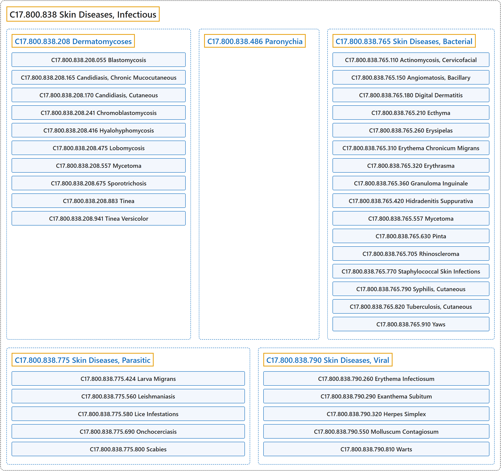

# C17.800.838 Skin Diseases, Infectious

## Classification

## Glossary

| Term | Definition | 中文翻译 | Source |
|---|---|---|---|
| **C17.800.838 Skin Diseases, Infectious** 感染性皮肤病 | "Skin diseases **caused by bacteria, fungi, parasites, or viruses**." | **由细菌、真菌、寄生虫或病毒引起**的皮肤病。 | [National Library of Medicine, 2026, "Skin Diseases, Infectious" scope note](https://meshb.nlm.nih.gov/record/ui?ui=D012874) |
| **C17.800.838.208 Dermatomycoses** 皮肤真菌病 | "**Superficial infections of the skin or its appendages** by any of various fungi." | 由各种真菌引起的**皮肤或其附属器的浅表感染**。 | [National Library of Medicine, 2026, "Dermatomycoses" scope note](https://meshb.nlm.nih.gov/record/ui?ui=D003881) |
| **C17.800.838.208.055 Blastomycosis** 芽生菌病 | "A **fungal infection by BLASTOMYCES** that may appear in two forms: 1, a primary lesion characterized by the formation of a small cutaneous nodule and small nodules along the lymphatics that may heal within several months; and 2, chronic granulomatous lesions characterized by thick crusts, warty growths, and unusual vascularity and infection in the middle or upper lobes of the lung." | 一种由**芽生菌**（BLASTOMYCES）**引起的真菌感染**，可表现为两种形式：1，原发性病变，特征为形成小的皮肤结节及沿淋巴管的小结节，可在数月内愈合；2，慢性肉芽肿性病变，特征为厚痂、疣状增生、异常血管增生以及肺中叶或上叶感染。 | [National Library of Medicine, 2026, "Blastomycosis" scope note](https://meshb.nlm.nih.gov/record/ui?ui=D001759) |
| **C17.800.838.208.165 Candidiasis, Chronic Mucocutaneous** 慢性黏膜皮肤念珠菌病 | "A clinical syndrome characterized by development, usually in infancy or childhood, of a **chronic, often widespread candidiasis of skin, nails, and mucous membranes**. It may be secondary to one of the immunodeficiency syndromes, inherited as an autosomal recessive trait, or associated with defects in cell-mediated immunity, endocrine disorders, dental stomatitis, or malignancy." | 一种临床综合征，特征为通常于婴儿期或儿童期发生的**皮肤、指甲和黏膜的慢性、常为广泛的念珠菌病**。可继发于某种免疫缺陷综合征，以常染色体隐性性状遗传，或与细胞介导免疫缺陷、内分泌疾病、义齿性口炎或恶性肿瘤相关。 | [National Library of Medicine, 2026, "Candidiasis, Chronic Mucocutaneous" scope note](https://meshb.nlm.nih.gov/record/ui?ui=D002178) |
| **C17.800.838.208.170 Candidiasis, Cutaneous** 皮肤念珠菌病 | "**Candidiasis of the skin** manifested as eczema-like lesions of the interdigital spaces, perleche, or chronic paronychia. (Dorland, 27th ed)" | **皮肤的念珠菌病**，表现为指（趾）间隙湿疹样皮损、口角炎或慢性甲沟炎。（Dorland，第 27 版） | [National Library of Medicine, 2026, "Candidiasis, Cutaneous" scope note](https://meshb.nlm.nih.gov/record/ui?ui=D002179) |
| **C17.800.838.208.241 Chromoblastomycosis** 着色芽生菌病 | "**Scaly papule or warty growth, caused by five fungi**, that spreads as a result of satellite lesions affecting the foot or leg. The extremity may become swollen and, at its distal portion, covered with various nodular, tumorous, verrucous lesions that resemble cauliflower. In rare instances, the disease may begin on the hand or wrist and involve the entire upper extremity. (Arnold, Odom, and James, Andrew's Diseases of the Skin, 8th ed, p362)" | **由五种真菌引起的鳞屑性丘疹或疣状增生**，通过卫星灶扩散，累及足或腿。患肢可肿胀，其远端可覆盖各种类似菜花的结节状、肿瘤样、疣状损害。在罕见情况下，该病可始于手或腕部并累及整个上肢。（Arnold、Odom 和 James，Andrew's Diseases of the Skin，第 8 版，第 362 页） | [National Library of Medicine, 2026, "Chromoblastomycosis" scope note](https://meshb.nlm.nih.gov/record/ui?ui=D002862) |
| **C17.800.838.208.416 Hyalohyphomycosis** 透明丝孢霉病 | "**OPPORTUNISTIC INFECTIONS** caused by a heterogeneous group of MITOSPORIC FUNGI with **clear (hyalo-) HYPHAE** in the host. Common causative agents include ACREMONIUM; ASPERGILLUS; CHRYSOSPORIUM; FUSARIUM; PAECILOMYCES; PENICILLIUM; PSEUDALLESCHERIA; SCEDOSPORIUM; and SCOPULARIOPSIS. Normally a dermatomycoses, it can become invasive in the IMMUNOCOMPROMISED HOST." | 由一组异质性的丝孢真菌（MITOSPORIC FUNGI）引起的**机会性感染**（OPPORTUNISTIC INFECTIONS），这些真菌在宿主体内具有**透明（hyalo-）菌丝**（HYPHAE）。常见病原包括枝顶孢属（ACREMONIUM）、曲霉属（ASPERGILLUS）、金孢子菌属（CHRYSOSPORIUM）、镰刀菌属（FUSARIUM）、拟青霉属（PAECILOMYCES）、青霉属（PENICILLIUM）、假阿利什霉属（PSEUDALLESCHERIA）、赛多孢属（SCEDOSPORIUM）和帚霉属（SCOPULARIOPSIS）。通常为一种皮肤真菌病，但在免疫功能低下宿主（IMMUNOCOMPROMISED HOST）中可成为侵袭性。 | [National Library of Medicine, 2026, "Hyalohyphomycosis" scope note](https://meshb.nlm.nih.gov/record/ui?ui=D060605) |
| **C17.800.838.208.416.125 Alternariosis** 链格孢病 | "**Opportunistic fungal infection** by a member of ALTERNARIA genus." | 由链格孢属（ALTERNARIA）成员引起的**机会性真菌感染**。 | [National Library of Medicine, 2026, "Alternariosis" scope note](https://meshb.nlm.nih.gov/record/ui?ui=D060487) |
| **C17.800.838.208.416.375 Cerebral Phaeohyphomycosis** 脑暗色丝孢霉病 | "**CNS infections caused by neurotropic dematiaceous fungi** that contain melanin in their cell walls. The infections often result in BRAIN ABSCESS; ENCEPHALITIS; and MENINGITIS in patients who are often immunocompetent. The common causative fungi include members Cladophialophora bantiana, Exophiala dermatitidis, Rhinocladiella mackenziei, and Ochroconis gallopavum. R. mackenziei infection is seen almost exclusively in patients from the MIDDLE EAST." | **由嗜神经暗色真菌引起的中枢神经系统感染**，这些真菌的细胞壁含有黑色素。感染常导致脑脓肿（BRAIN ABSCESS）、脑炎（ENCEPHALITIS）和脑膜炎（MENINGITIS），患者往往免疫功能正常。常见致病真菌包括斑替枝孢瓶霉、皮炎外瓶霉、麦氏喙枝孢霉和鸡赭霉。麦氏喙枝孢霉感染几乎只见于来自中东（MIDDLE EAST）的患者。 | [National Library of Medicine, 2026, "Cerebral Phaeohyphomycosis" scope note](https://meshb.nlm.nih.gov/record/ui?ui=D060425) |
| **C17.800.838.208.416.500 Fusariosis** 镰刀菌病 | "**OPPORTUNISTIC INFECTIONS with the soil fungus FUSARIUM**. Typically the infection is limited to the nail plate (ONYCHOMYCOSIS). The infection can however become systemic especially in an IMMUNOCOMPROMISED HOST (e.g., NEUTROPENIA) and results in cutaneous and subcutaneous lesions, fever, KERATITIS, and pulmonary infections." | **由土壤真菌镰刀菌属**（FUSARIUM）**引起的机会性感染**（OPPORTUNISTIC INFECTIONS）。通常感染局限于甲板（甲真菌病（ONYCHOMYCOSIS））。但感染可变为全身性，尤其在免疫功能低下宿主（IMMUNOCOMPROMISED HOST）（如中性粒细胞减少症（NEUTROPENIA））中，导致皮肤及皮下病变、发热、角膜炎（KERATITIS）和肺部感染。 | [National Library of Medicine, 2026, "Fusariosis" scope note](https://meshb.nlm.nih.gov/record/ui?ui=D060585) |
| **C17.800.838.208.475 Lobomycosis** 罗伯芽生菌病 | "A **chronic, fungal, subcutaneous infection** endemic in rural regions in South America and Central America. The causal organism is Lacazia labol." | 一种**慢性、真菌性皮下感染**，流行于南美洲和中美洲农村地区。病原体为罗伯菌（Lacazia labol）。 | [National Library of Medicine, 2026, "Lobomycosis" scope note](https://meshb.nlm.nih.gov/record/ui?ui=D060368) |
| **C17.800.838.208.557 Mycetoma** 足菌肿 | "A **chronic progressive subcutaneous infection** caused by species of fungi (eumycetoma), or actinomycetes (actinomycetoma). It is characterized by tumefaction, abscesses, and **tumor-like granules representing microcolonies of pathogens**, such as MADURELLA fungi and bacteria ACTINOMYCETES, with different grain colors." | 一种由真菌（真菌性足菌肿）或放线菌（放线菌性足菌肿）引起的**慢性进行性皮下感染**。其特征为肿胀、脓肿，以及**代表病原体微菌落的肿瘤样颗粒**，如马杜拉分枝菌属（MADURELLA）真菌和放线菌（ACTINOMYCETES）细菌，颗粒颜色各异。 | [National Library of Medicine, 2026, "Mycetoma" scope note](https://meshb.nlm.nih.gov/record/ui?ui=D008271) |
| **C17.800.838.208.675 Sporotrichosis** 孢子丝菌病 | "The commonest and least serious of the deep mycoses, characterized by **nodular lesions of the cutaneous and subcutaneous tissues**. It is caused by inhalation of contaminated dust or by infection of a wound with SPOROTHRIX." | 深部真菌病中最常见且最不严重的一种，特征为**皮肤和皮下组织的结节性病变**。它由吸入受污染的尘埃或伤口感染孢子丝菌（SPOROTHRIX）引起。 | [National Library of Medicine, 2026, "Sporotrichosis" scope note](https://meshb.nlm.nih.gov/record/ui?ui=D013174) |
| **C17.800.838.208.883 Tinea** 癣 | "**Fungal infection of keratinized tissues** such as hair, skin and nails. The main causative fungi include MICROSPORUM; TRICHOPHYTON; and EPIDERMOPHYTON." | **角化组织的真菌感染**，如毛发、皮肤和指甲。主要致病真菌包括小孢子菌属（MICROSPORUM）、毛癣菌属（TRICHOPHYTON）和表皮癣菌属（EPIDERMOPHYTON）。 | [National Library of Medicine, 2026, "Tinea" scope note](https://meshb.nlm.nih.gov/record/ui?ui=D014005) |
| **C17.800.838.208.883.458 Onychomycosis** 甲真菌病 | "A **fungal infection of the nail**, usually caused by DERMATOPHYTES; YEASTS; or nondermatophyte MOLDS." | **甲的真菌感染**，通常由皮肤癣菌（DERMATOPHYTES）、酵母菌（YEASTS）或非皮肤癣菌霉菌（MOLDS）引起。 | [National Library of Medicine, 2026, "Onychomycosis" scope note](https://meshb.nlm.nih.gov/record/ui?ui=D014009) |
| **C17.800.838.208.883.558 Tinea Capitis** 头癣 | "**Ringworm of the scalp and associated hair** mainly caused by species of MICROSPORUM; TRICHOPHYTON; and EPIDERMOPHYTON, which may occasionally involve the eyebrows and eyelashes." | **头皮及相关毛发的癣**，主要由小孢子菌属（MICROSPORUM）、毛癣菌属（TRICHOPHYTON）和表皮癣菌属（EPIDERMOPHYTON）的菌种引起，偶可累及眉毛和睫毛。 | [National Library of Medicine, 2026, "Tinea Capitis" scope note](https://meshb.nlm.nih.gov/record/ui?ui=D014006) |
| **C17.800.838.208.883.558.708 Tinea Favosa** 黄癣 | "A disease of the scalp that may affect the glabrous skin and the nails and is recognized by the **concave sulfur-yellow crusts** that form around loose, wiry hairs. Atrophy ensues, leaving a smooth, glossy, thin, paper-white patch. This type of disease is rare in the United States and more frequently seen in the Middle East, Africa, Southeastern Europe, and other countries bordering the Mediterranean Sea. (Arnold, Odom, and James, Andrew's Diseases of the Skin, 8th ed, p319)" | 一种头皮疾病，可累及无毛皮肤和指（趾）甲，其识别特征为在松动、硬直的毛发周围形成**凹陷的硫黄色痂**。随后出现萎缩，留下光滑、有光泽、菲薄、纸白色的斑片。此类疾病在美国罕见，较多见于中东、非洲、东南欧及地中海沿岸其他国家。（Arnold、Odom 和 James，《Andrew's Diseases of the Skin》，第 8 版，第 319 页） | [National Library of Medicine, 2026, "Tinea Favosa" scope note](https://meshb.nlm.nih.gov/record/ui?ui=D014007) |
| **C17.800.838.208.883.608 Tinea Cruris** 股癣 | "**Fungal infection of the groin**. The main causative fungus is TRICHOPHYTON." | **腹股沟的真菌感染**。主要致病真菌为毛癣菌（TRICHOPHYTON）。 | [National Library of Medicine, 2026, "Tinea Cruris" scope note](https://meshb.nlm.nih.gov/record/ui?ui=D000084002) |
| **C17.800.838.208.883.658 Tinea Pedis** 足癣 | "**Dermatological pruritic lesion in the feet**, caused by Trichophyton rubrum, T. mentagrophytes, or Epidermophyton floccosum." | **足部的瘙痒性皮肤病变**，由红色毛癣菌、须癣毛癣菌或絮状表皮癣菌引起。 | [National Library of Medicine, 2026, "Tinea Pedis" scope note](https://meshb.nlm.nih.gov/record/ui?ui=D014008) |
| **C17.800.838.208.941 Tinea Versicolor** 花斑癣 | "A common chronic, noninflammatory and usually symptomless disorder, characterized by the occurrence of **multiple macular patches of all sizes and shapes**, and varying in pigmentation from fawn-colored to brown. It is seen most frequently in hot, humid, tropical regions and is mostly caused by **MALASSEZIA FURFUR** (formerly Pityrosporum orbiculare)." | 一种常见的慢性、非炎症性且通常无症状的疾病，特征为出现**大小形状各异的多发斑片**，色素从淡黄褐色至褐色不等。最常见于炎热潮湿的热带地区，主要由**糠秕马拉色菌**（MALASSEZIA FURFUR）（旧称圆形糠秕孢子菌）引起。 | [National Library of Medicine, 2026, "Tinea Versicolor" scope note](https://meshb.nlm.nih.gov/record/ui?ui=D014010) |
| **C17.800.838.486 Paronychia** 甲沟炎 | "An **inflammatory reaction involving the folds of the skin surrounding the fingernail**. It is characterized by acute or chronic purulent, tender, and painful swellings of the tissues around the nail, caused by an abscess of the nail fold. The pathogenic yeast causing paronychia is most frequently Candida albicans. Saprophytic fungi may also be involved. The causative bacteria are usually Staphylococcus, Pseudomonas aeruginosa, or Streptococcus. (Andrews' Diseases of the Skin, 8th ed, p271)" | 一种**累及指甲周围皮肤皱襞的炎症反应**。特征为甲周组织急性或慢性的化脓性、触痛性和疼痛性肿胀，由甲襞脓肿所致。引起甲沟炎的致病酵母菌最常为白念珠菌，也可有腐生真菌参与。致病细菌通常为葡萄球菌、铜绿假单胞菌或链球菌。（《Andrews 皮肤病学》，第 8 版，第 271 页） | [National Library of Medicine, 2026, "Paronychia" scope note](https://meshb.nlm.nih.gov/record/ui?ui=D010304) |
| **C17.800.838.765 Skin Diseases, Bacterial** 细菌性皮肤病 | "**Skin diseases caused by bacteria**." | **由细菌引起的皮肤病**。 | [National Library of Medicine, 2026, "Skin Diseases, Bacterial" scope note](https://meshb.nlm.nih.gov/record/ui?ui=D017192) |
| **C17.800.838.765.110 Actinomycosis, Cervicofacial** 颈面部放线菌病 | "A form of ACTINOMYCOSIS characterized by **slow-growing inflammatory lesions of the lymph nodes that drain the mouth** (lumpy jaw), reddening of the overlying skin, and intraperitoneal abscesses." | 放线菌病（ACTINOMYCOSIS）的一种类型，其特征为**引流口腔的淋巴结发生生长缓慢的炎症性病变**（大颌病），表面皮肤发红，以及腹腔内脓肿。 | [National Library of Medicine, 2026, "Actinomycosis, Cervicofacial" scope note](https://meshb.nlm.nih.gov/record/ui?ui=D000197) |
| **C17.800.838.765.150 Angiomatosis, Bacillary** 杆菌性血管瘤病 | "A **reactive vascular proliferation** that is characterized by the multiple tumor-like lesions in skin, bone, brain, and other organs. Bacillary angiomatosis is caused by **infection with gram-negative Bartonella bacilli** (such as BARTONELLA HENSELAE), and is often seen in AIDS patients and other IMMUNOCOMPROMISED HOSTS." | 一种**反应性血管增生**，特征为皮肤、骨、脑及其他器官的多发瘤样病变。杆菌性血管瘤病由**感染革兰氏阴性巴尔通体杆菌**（如汉赛巴尔通体（BARTONELLA HENSELAE））引起，常见于艾滋病患者和其他免疫功能低下宿主（IMMUNOCOMPROMISED HOSTS）。 | [National Library of Medicine, 2026, "Angiomatosis, Bacillary" scope note](https://meshb.nlm.nih.gov/record/ui?ui=D016917) |
| **C17.800.838.765.180 Digital Dermatitis** 指间皮炎 | "**Highly contagious infectious dermatitis** with lesions near the interdigital spaces usually in cattle. It causes discomfort and often severe lameness (LAMENESS, ANIMAL). Lesions can be either erosive or proliferative and wart-like with papillary growths and hypertrophied hairs. DICHELOBACTER NODOSUS and TREPONEMA are the most commonly associated causative agents for this mixed bacterial infection disease." | 一种**高度传染性的感染性皮炎**，病变位于趾间隙附近，通常见于牛。可引起不适，常致严重跛行（动物跛行（LAMENESS, ANIMAL））。病变可为糜烂性，或为增生性疣状，伴乳头状增生和毛发肥大。结节偶蹄形菌（DICHELOBACTER NODOSUS）和密螺旋体（TREPONEMA）是这种混合细菌感染性疾病最常见的相关病原体。 | [National Library of Medicine, 2026, "Digital Dermatitis" scope note](https://meshb.nlm.nih.gov/record/ui?ui=D058066) |
| **C17.800.838.765.210 Ecthyma** 臁疮 | "An **ulcerative pyoderma** usually caused by **group A beta-hemolytic streptococcal infection** at the site of minor trauma. (Dorland, 27th ed)" | 一种**溃疡性脓皮病**，通常由轻微外伤部位的**A 组β溶血性链球菌感染**引起。（Dorland，第 27 版） | [National Library of Medicine, 2026, "Ecthyma" scope note](https://meshb.nlm.nih.gov/record/ui?ui=D004473) |
| **C17.800.838.765.260 Erysipelas** 丹毒 | "An **acute infection of the skin caused by species of STREPTOCOCCUS**. This disease most frequently affects infants, young children, and the elderly. Characteristics include pink-to-red lesions that spread rapidly and are warm to the touch. The commonest site of involvement is the face." | 一种**由链球菌属**（STREPTOCOCCUS）**菌种引起的急性皮肤感染**。本病最常累及婴儿、幼儿和老年人。特征包括迅速扩散、触之温热的粉红至红色皮损。最常受累的部位是面部。 | [National Library of Medicine, 2026, "Erysipelas" scope note](https://meshb.nlm.nih.gov/record/ui?ui=D004886) |
| **C17.800.838.765.310 Erythema Chronicum Migrans** 慢性游走性红斑 | "A **deep type of gyrate erythema** that follows a **bite by an ixodid tick**; it is a stage-1 manifestation of LYME DISEASE. The site of the bite is characterized by a red papule that expands peripherally as a nonscaling, palpable band that clears centrally. This condition is often associated with systemic symptoms such as chills, fever, headache, malaise, nausea, vomiting, fatigue, backache, and stiff neck." | 一种**深在型回状红斑**，发生于**硬蜱叮咬**之后；它是莱姆病（LYME DISEASE）的第 1 期表现。叮咬部位特征为一个红色丘疹，向外周扩展为一条无鳞屑、可触及、中央消退的环带。该病常伴有全身症状，如寒战、发热、头痛、不适、恶心、呕吐、疲劳、背痛和颈项强直。 | [National Library of Medicine, 2026, "Erythema Chronicum Migrans" scope note](https://meshb.nlm.nih.gov/record/ui?ui=D015787) |
| **C17.800.838.765.320 Erythrasma** 红癣 | "A **chronic bacterial infection of major folds of the skin**, caused by Corynebacterium minutissimum." | 一种**皮肤主要皱褶部位的慢性细菌感染**，由微细棒状杆菌（Corynebacterium minutissimum）引起。 | [National Library of Medicine, 2026, "Erythrasma" scope note](https://meshb.nlm.nih.gov/record/ui?ui=D004894) |
| **C17.800.838.765.360 Granuloma Inguinale** 腹股沟肉芽肿 | "**Anogenital ulcers caused by Calymmatobacterium granulomatis** as distinguished from lymphogranuloma inguinale (see LYMPHOGRANULOMA VENEREUM) caused by CHLAMYDIA TRACHOMATIS. Diagnosis is made by demonstration of typical intracellular **Donovan bodies** in crushed-tissue smears." | **由肉芽肿荚膜杆菌引起的肛门生殖器溃疡**，区别于由沙眼衣原体（CHLAMYDIA TRACHOMATIS）引起的腹股沟淋巴肉芽肿（见性病淋巴肉芽肿，LYMPHOGRANULOMA VENEREUM）。诊断依据是在压碎组织涂片中显示典型的细胞内**杜诺凡小体**。 | [National Library of Medicine, 2026, "Granuloma Inguinale" scope note](https://meshb.nlm.nih.gov/record/ui?ui=D006100) |
| **C17.800.838.765.420 Hidradenitis Suppurativa** 化脓性汗腺炎 | "A **chronic suppurative and cicatricial disease of the apocrine glands** occurring chiefly in the axillae in women and in the groin and anal regions in men. It is characterized by poral occlusion with secondary bacterial infection, evolving into abscesses which eventually rupture. As the disease becomes chronic, ulcers appear, sinus tracts enlarge, fistulas develop, and fibrosis and scarring become evident." | 一种**大汗腺的慢性化脓性和瘢痕性疾病**，女性主要发生于腋窝，男性主要发生于腹股沟和肛周区域。其特征为毛孔闭塞继发细菌感染，发展为脓肿并最终破溃。随着疾病转为慢性，出现溃疡，窦道扩大，瘘管形成，纤维化和瘢痕变得明显。 | [National Library of Medicine, 2026, "Hidradenitis Suppurativa" scope note](https://meshb.nlm.nih.gov/record/ui?ui=D017497) |
| **C17.800.838.765.557 Mycetoma** 足菌肿 | "A **chronic progressive subcutaneous infection** caused by species of fungi (eumycetoma), or actinomycetes (actinomycetoma). It is characterized by tumefaction, abscesses, and **tumor-like granules representing microcolonies of pathogens**, such as MADURELLA fungi and bacteria ACTINOMYCETES, with different grain colors." | 一种由真菌（真菌性足菌肿）或放线菌（放线菌性足菌肿）引起的**慢性进行性皮下感染**。其特征为肿胀、脓肿，以及**代表病原体微菌落的肿瘤样颗粒**，如马杜拉分枝菌属（MADURELLA）真菌和放线菌（ACTINOMYCETES）细菌，颗粒颜色各异。 | [National Library of Medicine, 2026, "Mycetoma" scope note](https://meshb.nlm.nih.gov/record/ui?ui=D008271) |
| **C17.800.838.765.630 Pinta** 品他病 | "An **infectious disease of the skin caused by Treponema carateum** that occurs only in the western hemisphere. Age of onset is between 10 and 20 years of age. This condition is characterized by marked changes in the skin color and is believed to be transmitted by direct person-to-person contact." | 一种**由品他密螺旋体引起的皮肤感染性疾病**，仅见于西半球。发病年龄在 10 至 20 岁之间。其特征为显著的皮肤颜色改变，被认为经人与人直接接触传播。 | [National Library of Medicine, 2026, "Pinta" scope note](https://meshb.nlm.nih.gov/record/ui?ui=D010874) |
| **C17.800.838.765.705 Rhinoscleroma** 鼻硬结病 | "A **granulomatous disease caused by KLEBSIELLA RHINOSCLEROMATIS infection**. Despite its name, this disease is not limited to the nose and NASOPHARYNX but may affect any part of the RESPIRATORY TRACT, sometimes with extension to the lip and the skin." | 一种**由鼻硬结克雷伯菌**（KLEBSIELLA RHINOSCLEROMATIS）**感染引起的肉芽肿性疾病**。尽管名称如此，本病并不局限于鼻和鼻咽（NASOPHARYNX），可累及呼吸道（RESPIRATORY TRACT）的任何部位，有时扩展至唇部和皮肤。 | [National Library of Medicine, 2026, "Rhinoscleroma" scope note](https://meshb.nlm.nih.gov/record/ui?ui=D012226) |
| **C17.800.838.765.770 Staphylococcal Skin Infections** 葡萄球菌性皮肤感染 | "Infections to the skin caused by **bacteria of the genus STAPHYLOCOCCUS**." | 由**葡萄球菌属**（STAPHYLOCOCCUS）**细菌**引起的皮肤感染。 | [National Library of Medicine, 2026, "Staphylococcal Skin Infections" scope note](https://meshb.nlm.nih.gov/record/ui?ui=D013207) |
| **C17.800.838.765.770.270 Furunculosis** 疖病 | "A **persistent skin infection marked by the presence of furuncles**, often chronic and recurrent. In humans, the causative agent is various species of STAPHYLOCOCCUS. In salmonid fish (SALMONIDS), the pathogen is AEROMONAS SALMONICIDA." | 一种以**出现疖为标志的持续性皮肤感染**，常为慢性和复发性。在人类中，病原体为多种葡萄球菌（STAPHYLOCOCCUS）。在鲑科鱼类（SALMONIDS）中，病原体为杀鲑气单胞菌（AEROMONAS SALMONICIDA）。 | [National Library of Medicine, 2026, "Furunculosis" scope note](https://meshb.nlm.nih.gov/record/ui?ui=D005667) |
| **C17.800.838.765.770.270.200 Carbuncle** 痈 | "An infection of cutaneous and subcutaneous tissue that consists of a **cluster of boils**. Commonly, the causative agent is STAPHYLOCOCCUS AUREUS. Carbuncles produce fever, leukocytosis, extreme pain, and prostration." | 一种皮肤和皮下组织的感染，由**一簇疖**组成。常见致病菌为金黄色葡萄球菌（STAPHYLOCOCCUS AUREUS）。痈可引起发热、白细胞增多、剧痛和虚脱。 | [National Library of Medicine, 2026, "Carbuncle" scope note](https://meshb.nlm.nih.gov/record/ui?ui=D002270) |
| **C17.800.838.765.770.360 Impetigo** 脓疱疮 | "A common **superficial bacterial infection** caused by STAPHYLOCOCCUS AUREUS or group A beta-hemolytic streptococci. Characteristics include pustular lesions that rupture and discharge a thin, amber-colored fluid that dries and forms a crust. This condition is commonly located on the face, especially about the mouth and nose." | 一种常见的**浅表细菌感染**，由金黄色葡萄球菌（STAPHYLOCOCCUS AUREUS）或 A 组 β 溶血性链球菌引起。特征为脓疱性病变破裂后流出稀薄的琥珀色液体，干燥后结痂。该病常见于面部，尤其是口鼻周围。 | [National Library of Medicine, 2026, "Impetigo" scope note](https://meshb.nlm.nih.gov/record/ui?ui=D007169) |
| **C17.800.838.765.770.770 Staphylococcal Scalded Skin Syndrome** 葡萄球菌烫伤样皮肤综合征 | "A disease of infants due to group 2 phage type 17 staphylococci that produce an **epidermolytic exotoxin**. Superficial fine vesicles and bullae form and rupture easily, resulting in **loss of large sheets of epidermis**." | 一种婴儿疾病，由产生**表皮松解性外毒素**的 2 组 17 型噬菌体葡萄球菌所致。表浅细小水疱和大疱形成并易破裂，导致**大片表皮脱失**。 | [National Library of Medicine, 2026, "Staphylococcal Scalded Skin Syndrome" scope note](https://meshb.nlm.nih.gov/record/ui?ui=D013206) |
| **C17.800.838.765.790 Syphilis, Cutaneous** 皮肤梅毒 | "**Cutaneous lesions arising from infection with Treponema pallidum**. In the primary stage, 18-21 days following infection, one or more chancres appear. If untreated, the subsequent stages of the disease appear as syphilids. These eruptions are superficial, nondestructive, exanthematic, transient, macular roseolas that may later be maculopapular or papular polymorphous or scaly, pustular, pigmented eruptions.(Arnold, Odom, and James, Andrew's Diseases of the Skin, 8th ed, p409)" | **由梅毒螺旋体（Treponema pallidum）感染引起的皮肤损害**。在一期，感染后 18 至 21 天出现一个或多个硬下疳。若不治疗，疾病的后续阶段表现为梅毒疹。这些皮疹为浅表、非破坏性、发疹性、短暂的斑状玫瑰疹，之后可变为斑丘疹或丘疹，呈多形性或鳞屑性、脓疱性、色素性皮疹。（Arnold、Odom 和 James，Andrew's Diseases of the Skin，第 8 版，第 409 页） | [National Library of Medicine, 2026, "Syphilis, Cutaneous" scope note](https://meshb.nlm.nih.gov/record/ui?ui=D013591) |
| **C17.800.838.765.820 Tuberculosis, Cutaneous** 皮肤结核 | "**Tuberculosis of the skin**. It includes scrofuloderma and tuberculid, but not LUPUS VULGARIS." | **皮肤的结核病**。包括瘰疬性皮肤结核和结核疹，但不包括寻常狼疮（LUPUS VULGARIS）。 | [National Library of Medicine, 2026, "Tuberculosis, Cutaneous" scope note](https://meshb.nlm.nih.gov/record/ui?ui=D014382) |
| **C17.800.838.765.820.320 Erythema Induratum** 硬红斑 | "A type of **panniculitis** characterized histologically by the presence of **granulomas, vasculitis, and necrosis**. It is traditionally considered to be the tuberculous counterpart of nodular vasculitis, but is now known to occur without tuberculous precedent. It is seen most commonly in adolescent and menopausal women, is initiated or exacerbated by cold weather, and typically presents as one or more recurrent erythrocyanotic nodules or plaques on the calves. The nodules may progress to form indurations, ulcerations, and scars." | 一种**脂膜炎**，组织学特征为存在**肉芽肿、血管炎和坏死**。传统上认为它是结节性血管炎的结核性对应病，但现已知其可在无结核前驱的情况下发生。最常见于青春期和绝经期女性，由寒冷天气诱发或加重，典型表现为小腿上一个或多个复发性红绀色结节或斑块。结节可进展形成硬结、溃疡和瘢痕。 | [National Library of Medicine, 2026, "Erythema Induratum" scope note](https://meshb.nlm.nih.gov/record/ui?ui=D004891) |
| **C17.800.838.765.820.470 Lupus Vulgaris** 寻常狼疮 | "A **form of cutaneous tuberculosis**. It is seen predominantly in women and typically involves the NASAL MUCOSA; BUCCAL MUCOSA; and conjunctival mucosa." | **皮肤结核的一种类型**。主要见于女性，通常累及鼻黏膜（NASAL MUCOSA）、颊黏膜（BUCCAL MUCOSA）和结膜黏膜。 | [National Library of Medicine, 2026, "Lupus Vulgaris" scope note](https://meshb.nlm.nih.gov/record/ui?ui=D008177) |
| **C17.800.838.765.910 Yaws** 雅司病 | "A **systemic non-venereal infection of the tropics** caused by TREPONEMA PALLIDUM subspecies pertenue." | 一种由苍白密螺旋体（TREPONEMA PALLIDUM）极细亚种引起的**热带地区全身性非性病感染**。 | [National Library of Medicine, 2026, "Yaws" scope note](https://meshb.nlm.nih.gov/record/ui?ui=D015001) |
| **C17.800.838.775 Skin Diseases, Parasitic** 寄生虫性皮肤病 | "**Skin diseases caused by ARTHROPODS; HELMINTHS; or other parasites**." | **由节肢动物**（ARTHROPODS）**、蠕虫**（HELMINTHS）**或其他寄生虫引起的皮肤疾病**。 | [National Library of Medicine, 2026, "Skin Diseases, Parasitic" scope note](https://meshb.nlm.nih.gov/record/ui?ui=D012876) |
| **C17.800.838.775.424 Larva Migrans** 幼虫移行症 | "Infections caused by **nematode larvae which never develop into the adult stage and migrate through various body tissues**. They commonly infect the skin, eyes, and viscera in man. Ancylostoma brasiliensis causes cutaneous larva migrans. Toxocara causes visceral larva migrans." | 由**永不发育为成虫阶段、并在身体各组织中移行的线虫幼虫**引起的感染。它们在人体中常感染皮肤、眼睛和内脏。巴西钩口线虫（Ancylostoma brasiliensis）引起皮肤幼虫移行症。弓蛔虫（Toxocara）引起内脏幼虫移行症。 | [National Library of Medicine, 2026, "Larva Migrans" scope note](https://meshb.nlm.nih.gov/record/ui?ui=D007815) |
| **C17.800.838.775.560 Leishmaniasis** 利什曼病 | "A disease caused by any of a number of species of **protozoa in the genus LEISHMANIA**. There are four major clinical types of this infection: cutaneous (Old and New World) (LEISHMANIASIS, CUTANEOUS), diffuse cutaneous (LEISHMANIASIS, DIFFUSE CUTANEOUS), mucocutaneous (LEISHMANIASIS, MUCOCUTANEOUS), and visceral (LEISHMANIASIS, VISCERAL)." | 一种由**利什曼原虫属**（LEISHMANIA）**中的多种原虫**中任一种引起的疾病。该感染有四种主要临床类型：皮肤型（旧大陆和新大陆）（皮肤利什曼病，LEISHMANIASIS, CUTANEOUS）、弥漫性皮肤型（弥漫性皮肤利什曼病，LEISHMANIASIS, DIFFUSE CUTANEOUS）、黏膜皮肤型（黏膜皮肤利什曼病，LEISHMANIASIS, MUCOCUTANEOUS）和内脏型（内脏利什曼病，LEISHMANIASIS, VISCERAL）。 | [National Library of Medicine, 2026, "Leishmaniasis" scope note](https://meshb.nlm.nih.gov/record/ui?ui=D007896) |
| **C17.800.838.775.560.400 Leishmaniasis, Cutaneous** 皮肤利什曼病 | "An endemic disease that is characterized by the development of **single or multiple localized lesions on exposed areas of skin that typically ulcerate**. The disease has been divided into Old and New World forms. Old World leishmaniasis is separated into three distinct types according to epidemiology and clinical manifestations and is caused by species of the L. tropica and L. aethiopica complexes as well as by species of the L. major genus. New World leishmaniasis, also called American leishmaniasis, occurs in South and Central America and is caused by species of the L. mexicana or L. braziliensis complexes." | 一种地方性疾病，特征为在暴露的皮肤部位出现**单发或多发、通常会溃烂的局限性病变**。该病分为旧大陆型和新大陆型。旧大陆利什曼病根据流行病学和临床表现分为三种不同类型，由热带利什曼原虫和埃塞俄比亚利什曼原虫复合体的种以及硕大利什曼原虫的种引起。新大陆利什曼病又称美洲利什曼病，发生于南美洲和中美洲，由墨西哥利什曼原虫或巴西利什曼原虫复合体的种引起。 | [National Library of Medicine, 2026, "Leishmaniasis, Cutaneous" scope note](https://meshb.nlm.nih.gov/record/ui?ui=D016773) |
| **C17.800.838.775.560.400.350 Leishmaniasis, Diffuse Cutaneous** 弥漫性皮肤利什曼病 | "A form of LEISHMANIASIS, CUTANEOUS caused by Leishmania aethiopica in Ethiopia and Kenya, L. pifanoi in Venezuela, L. braziliensis in South America, and L. mexicana in Central America. This disease is characterized by **massive dissemination of skin lesions without visceral involvement**." | 皮肤利什曼病（LEISHMANIASIS, CUTANEOUS）的一种类型，在埃塞俄比亚和肯尼亚由埃塞俄比亚利什曼原虫引起，在委内瑞拉由皮法诺利什曼原虫引起，在南美洲由巴西利什曼原虫引起，在中美洲由墨西哥利什曼原虫引起。该病的特征为**皮肤病变大量播散而无内脏受累**。 | [National Library of Medicine, 2026, "Leishmaniasis, Diffuse Cutaneous" scope note](https://meshb.nlm.nih.gov/record/ui?ui=D016774) |
| **C17.800.838.775.560.400.385 Leishmaniasis, Mucocutaneous** 黏膜皮肤利什曼病 | "A disease characterized by the **chronic, progressive spread of lesions** from New World cutaneous leishmaniasis caused by species of the L. braziliensis complex to the **nasal, pharyngeal, and buccal mucosa** some time after the appearance of the initial cutaneous lesion. Nasal obstruction and epistaxis are frequent presenting symptoms." | 一种疾病，特征为由 L. braziliensis 复合群菌种引起的新大陆皮肤利什曼病的**皮损呈慢性、进行性扩散**，在初发皮肤皮损出现一段时间后累及**鼻、咽和颊黏膜**。鼻塞和鼻出血是常见的首发症状。 | [National Library of Medicine, 2026, "Leishmaniasis, Mucocutaneous" scope note](https://meshb.nlm.nih.gov/record/ui?ui=D007897) |
| **C17.800.838.775.580 Lice Infestations** 虱病 | "**Parasitic attack or subsistence on the skin by members of the order Phthiraptera**, especially on humans by Pediculus humanus of the family Pediculidae. The hair of the head, eyelashes, and pubis is a frequent site of infestation. (From Dorland, 28th ed; Stedman, 26th ed)" | **虱目（Phthiraptera）成员在皮肤上的寄生侵袭或寄生生存**，尤其是虱科（Pediculidae）的人虱（Pediculus humanus）在人体上的寄生。头发、睫毛和阴毛是常见的侵染部位。（引自 Dorland，第 28 版；Stedman，第 26 版） | [National Library of Medicine, 2026, "Lice Infestations" scope note](https://meshb.nlm.nih.gov/record/ui?ui=D010373) |
| **C17.800.838.775.690 Onchocerciasis** 盘尾丝虫病 | "**Infection with nematodes of the genus ONCHOCERCA**. Characteristics include the presence of firm subcutaneous nodules filled with adult worms, PRURITUS, and ocular lesions." | **盘尾丝虫属**（ONCHOCERCA）**线虫的感染**。特征包括存在充满成虫的坚实皮下结节、瘙痒（PRURITUS）和眼部病变。 | [National Library of Medicine, 2026, "Onchocerciasis" scope note](https://meshb.nlm.nih.gov/record/ui?ui=D009855) |
| **C17.800.838.775.800 Scabies** 疥疮 | "A **contagious cutaneous inflammation** caused by the **bite of the mite SARCOPTES SCABIEI**. It is characterized by pruritic papular eruptions and burrows and affects primarily the axillae, elbows, wrists, and genitalia, although it can spread to cover the entire body." | 一种**传染性皮肤炎症**，由**疥螨**（SARCOPTES SCABIEI）**叮咬**引起。其特征为瘙痒性丘疹和隧道，主要累及腋窝、肘部、腕部和生殖器，但也可扩展至全身。 | [National Library of Medicine, 2026, "Scabies" scope note](https://meshb.nlm.nih.gov/record/ui?ui=D012532) |
| **C17.800.838.790 Skin Diseases, Viral** 病毒性皮肤病 | "**Skin diseases caused by viruses**." | **由病毒引起的皮肤病**。 | [National Library of Medicine, 2026, "Skin Diseases, Viral" scope note](https://meshb.nlm.nih.gov/record/ui?ui=D017193) |
| **C17.800.838.790.260 Erythema Infectiosum** 传染性红斑 | "**Contagious infection with HUMAN PAROVIRUS B19** most commonly seen in school age children and characterized by fever, headache, and rashes of the face, trunk, and extremities. It is often confused with RUBELLA." | 一种**人细小病毒 B19**（HUMAN PAROVIRUS B19）**的传染性感染**，最常见于学龄儿童，特征为发热、头痛及面部、躯干和四肢皮疹。常与风疹（RUBELLA）混淆。 | [National Library of Medicine, 2026, "Erythema Infectiosum" scope note](https://meshb.nlm.nih.gov/record/ui?ui=D016731) |
| **C17.800.838.790.290 Exanthema Subitum** 幼儿急疹 | "An acute, short-lived, **viral disease of infants and young children** characterized by a **high fever at onset** that drops to normal after 3-4 days and the concomitant appearance of a macular or maculopapular rash that appears first on the trunk and then spreads to other areas. It is the sixth of the classical exanthematous diseases and is caused by HHV-6; (HERPESVIRUS 6, HUMAN). (From Dorland, 27th ed)" | 一种急性、短暂的**婴幼儿病毒性疾病**，特征为**起病时高热**，3 至 4 天后降至正常，同时出现斑疹或斑丘疹，先见于躯干，后扩散至其他部位。它是第六种经典出疹性疾病，由 HHV-6（人疱疹病毒 6 型（HERPESVIRUS 6, HUMAN））引起。（引自 Dorland，第 27 版） | [National Library of Medicine, 2026, "Exanthema Subitum" scope note](https://meshb.nlm.nih.gov/record/ui?ui=D005077) |
| **C17.800.838.790.320 Herpes Simplex** 单纯疱疹 | "A group of **acute infections caused by herpes simplex virus type 1 or type 2** that is characterized by the development of one or more **small fluid-filled vesicles with a raised erythematous base** on the skin or mucous membrane. It occurs as a primary infection or recurs due to a reactivation of a latent infection. (Dorland, 27th ed.)" | 一组**由 1 型或 2 型单纯疱疹病毒引起的急性感染**，特征为在皮肤或黏膜上出现一个或多个**基底隆起发红的充液小水疱**。可作为原发感染发生，或因潜伏感染再激活而复发。（Dorland，第 27 版） | [National Library of Medicine, 2026, "Herpes Simplex" scope note](https://meshb.nlm.nih.gov/record/ui?ui=D006561) |
| **C17.800.838.790.320.320 Herpes Labialis** 唇疱疹 | "**Herpes simplex, caused by type 1 virus**, primarily spread by oral secretions and usually occurring as a concomitant of fever. It may also develop in the absence of fever or prior illness. It commonly involves the facial region, especially the lips and the nares. (Dorland, 27th ed.)" | **由 1 型病毒引起的单纯疱疹**，主要通过口腔分泌物传播，通常伴随发热出现。也可在无发热或既往疾病的情况下发生。常累及面部，尤其是唇部和鼻孔。（Dorland，第 27 版） | [National Library of Medicine, 2026, "Herpes Labialis" scope note](https://meshb.nlm.nih.gov/record/ui?ui=D006560) |
| **C17.800.838.790.320.410 Kaposi Varicelliform Eruption** 卡波西水痘样疹 | "A **disseminated vesicular-pustular eruption** caused by the herpes simplex virus (HERPESVIRUS HOMINIS), the VACCINIA VIRUS, or Varicella zoster (HERPESVIRUS 3, HUMAN). It is usually superimposed on a preexisting, inactive or active, atopic dermatitis (DERMATITIS, ATOPIC)." | 一种由单纯疱疹病毒（人疱疹病毒，HERPESVIRUS HOMINIS）、牛痘病毒（VACCINIA VIRUS）或水痘带状疱疹病毒（人疱疹病毒 3 型，HERPESVIRUS 3, HUMAN）引起的**播散性水疱脓疱性皮疹**。通常叠加于先前存在的、静止或活动的特应性皮炎（DERMATITIS, ATOPIC）之上。 | [National Library of Medicine, 2026, "Kaposi Varicelliform Eruption" scope note](https://meshb.nlm.nih.gov/record/ui?ui=D007617) |
| **C17.800.838.790.550 Molluscum Contagiosum** 传染性软疣 | "A common, benign, usually self-limited **viral infection of the skin** and occasionally the conjunctivae by a **poxvirus** (MOLLUSCUM CONTAGIOSUM VIRUS). (Dorland, 27th ed)" | 一种常见、良性、通常具有自限性的**皮肤**（偶尔累及结膜）**病毒感染**，由一种**痘病毒**（传染性软疣病毒（MOLLUSCUM CONTAGIOSUM VIRUS））引起。（Dorland，第 27 版） | [National Library of Medicine, 2026, "Molluscum Contagiosum" scope note](https://meshb.nlm.nih.gov/record/ui?ui=D008976) |
| **C17.800.838.790.810 Warts** 疣 | "**Benign epidermal proliferations or tumors**; some are viral in origin." | **良性表皮增生或肿瘤**；部分为病毒源性。 | [National Library of Medicine, 2026, "Warts" scope note](https://meshb.nlm.nih.gov/record/ui?ui=D014860) |
| **C17.800.838.790.810.110 Condylomata Acuminata** 尖锐湿疣 | "**Sexually transmitted form of anogenital warty growth** caused by the HUMAN PAPILLOMAVIRUS VIRUSES." | 由人乳头瘤病毒（HUMAN PAPILLOMAVIRUS VIRUSES）引起的**经性传播的肛门生殖器疣状增生**。 | [National Library of Medicine, 2026, "Condylomata Acuminata" scope note](https://meshb.nlm.nih.gov/record/ui?ui=D003218) |
| **C17.800.838.790.810.110.500 Buschke-Lowenstein Tumor** Buschke-Lowenstein 瘤 | "**Exophytic tumor of the anogenital region associated with HPV infections**. It becomes a large cauliflower-like, hyperkeratotic, verrucous mass that is locally destructive with little atypical cells. Histologically, tumor cells are broad rete peg structures that tend to invade deeper than CONDYLOMATA ACUMINATA." | **与 HPV 感染相关的肛门生殖器区外生性肿瘤**。它会成为一个大的菜花样、角化过度、疣状肿块，具有局部破坏性，非典型细胞很少。组织学上，肿瘤细胞呈宽大的表皮突结构，比尖锐湿疣（CONDYLOMATA ACUMINATA）侵袭更深。 | [National Library of Medicine, 2026, "Buschke-Lowenstein Tumor" scope note](https://meshb.nlm.nih.gov/record/ui?ui=D062688) |
| **C17.800.838.790.810.260 Epidermodysplasia Verruciformis** 疣状表皮发育不良 | "An **autosomal recessive trait with impaired cell-mediated immunity**. About 15 **human papillomaviruses** are implicated in associated infection, four of which lead to skin neoplasms. The disease begins in childhood with red papules and later spreads over the body as gray or yellow scales." | 一种**伴细胞介导免疫受损的常染色体隐性性状**。约 15 种**人乳头瘤病毒**与相关感染有关，其中四种可导致皮肤肿瘤。本病始于儿童期，表现为红色丘疹，之后以灰色或黄色鳞屑形式蔓延全身。 | [National Library of Medicine, 2026, "Epidermodysplasia Verruciformis" scope note](https://meshb.nlm.nih.gov/record/ui?ui=D004819) |

## References

National Library of Medicine. (2026). *MeSH 2026 descriptor records* [Data set]. Retrieved October 28, 2026, from <https://www.nlm.nih.gov/databases/download/mesh.html>
