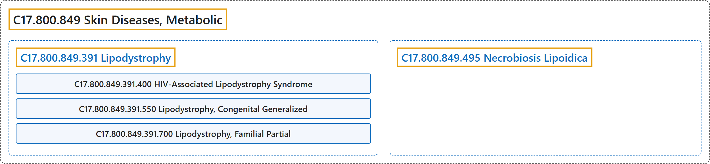

# C17.800.849 Skin Diseases, Metabolic

## Classification

## Glossary

| Term | Definition | 中文翻译 | Source |
|---|---|---|---|
| **C17.800.849 Skin Diseases, Metabolic** 代谢性皮肤病 | "Diseases of the skin associated with **underlying metabolic disorders**." | 与**基础代谢紊乱**相关的皮肤疾病。 | [National Library of Medicine, 2026, "Skin Diseases, Metabolic" scope note](https://meshb.nlm.nih.gov/record/ui?ui=D012875) |
| **C17.800.849.391 Lipodystrophy** 脂肪营养不良 | "A collection of heterogenous conditions resulting from **defective LIPID METABOLISM** and characterized by **ADIPOSE TISSUE atrophy**. Often there is redistribution of body fat resulting in peripheral fat wasting and central adiposity. They include generalized, localized, congenital, and acquired lipodystrophy." | 一组异质性病症，由**脂质代谢**（LIPID METABOLISM）**缺陷**所致，特征为**脂肪组织**（ADIPOSE TISSUE）**萎缩**。常有身体脂肪的重新分布，导致外周脂肪消耗和向心性肥胖。包括全身性、局部性、先天性和获得性脂肪营养不良。 | [National Library of Medicine, 2026, "Lipodystrophy" scope note](https://meshb.nlm.nih.gov/record/ui?ui=D008060) |
| **C17.800.849.391.400 HIV-Associated Lipodystrophy Syndrome** HIV 相关脂肪代谢障碍综合征 | "Defective metabolism leading to **fat maldistribution in patients infected with HIV**. The etiology appears to be multifactorial and probably involves some combination of infection-induced alterations in metabolism, direct effects of antiretroviral therapy, and patient-related factors." | 代谢缺陷导致 **HIV 感染患者的脂肪分布异常**。其病因似为多因素，可能涉及感染所致代谢改变、抗逆转录病毒治疗的直接作用以及患者相关因素的某种组合。 | [National Library of Medicine, 2026, "HIV-Associated Lipodystrophy Syndrome" scope note](https://meshb.nlm.nih.gov/record/ui?ui=D039682) |
| **C17.800.849.391.550 Lipodystrophy, Congenital Generalized** 先天性全身性脂肪营养不良 | "Congenital disorders, usually autosomal recessive, characterized by **severe generalized lack of ADIPOSE TISSUE**, extreme INSULIN RESISTANCE, and HYPERTRIGLYCERIDEMIA." | 先天性疾病，通常为常染色体隐性遗传，特征为**严重的全身性脂肪组织**（ADIPOSE TISSUE）**缺乏**、极度胰岛素抵抗（INSULIN RESISTANCE）和高甘油三酯血症（HYPERTRIGLYCERIDEMIA）。 | [National Library of Medicine, 2026, "Lipodystrophy, Congenital Generalized" scope note](https://meshb.nlm.nih.gov/record/ui?ui=D052497) |
| **C17.800.849.391.700 Lipodystrophy, Familial Partial** 家族性部分性脂肪营养不良 | "Inherited conditions characterized by the **partial loss of ADIPOSE TISSUE**, either confined to the extremities with normal or increased fat deposits on the face, neck and trunk (type 1), or confined to the loss of SUBCUTANEOUS FAT from the limbs and trunk (type 2). Type 3 is associated with mutation in the gene encoding PEROXISOME PROLIFERATOR-ACTIVATED RECEPTOR GAMMA." | 遗传性病症，其特征为**脂肪组织**（ADIPOSE TISSUE）**部分丧失**：或局限于四肢，而面部、颈部和躯干脂肪沉积正常或增加（1 型）；或局限于四肢和躯干的皮下脂肪（SUBCUTANEOUS FAT）丧失（2 型）。3 型与编码过氧化物酶体增殖物激活受体γ（PEROXISOME PROLIFERATOR-ACTIVATED RECEPTOR GAMMA）的基因突变相关。 | [National Library of Medicine, 2026, "Lipodystrophy, Familial Partial" scope note](https://meshb.nlm.nih.gov/record/ui?ui=D052496) |
| **C17.800.849.495 Necrobiosis Lipoidica** 类脂质渐进性坏死 | "A **degenerative disease of the dermal connective tissue** characterized by the development of erythematous papules or nodules in the pretibial area. The papules form plaques covered with telangiectatic vessels. More than half of the affected patients have diabetes." | 一种**真皮结缔组织的变性疾病**，特征为胫前区出现红斑性丘疹或结节。丘疹融合成斑块，表面覆有毛细血管扩张的血管。半数以上患者患有糖尿病。 | [National Library of Medicine, 2026, "Necrobiosis Lipoidica" scope note](https://meshb.nlm.nih.gov/record/ui?ui=D009335) |

## References

National Library of Medicine. (2026). *MeSH 2026 descriptor records* [Data set]. Retrieved October 28, 2026, from <https://www.nlm.nih.gov/databases/download/mesh.html>
