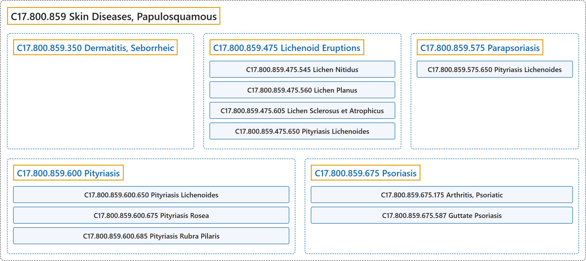

# C17.800.859 Skin Diseases, Papulosquamous

## Classification

## Glossary

| Term | Definition | 中文翻译 | Source |
|---|---|---|---|
| **C17.800.859 Skin Diseases, Papulosquamous** 丘疹鳞屑性皮肤病 | "A group of dermatoses with distinct morphologic features. The **primary lesion is most commonly a papule**, usually erythematous, with a **variable degree of scaling** on the surface. Plaques form through the coalescing of primary lesions." | 一组具有独特形态特征的皮肤病。**原发皮损最常见为丘疹**，通常为红斑性，表面有**不同程度的鳞屑**。原发皮损融合形成斑块。 | [National Library of Medicine, 2026, "Skin Diseases, Papulosquamous" scope note](https://meshb.nlm.nih.gov/record/ui?ui=D017444) |
| **C17.800.859.350 Dermatitis, Seborrheic** 脂溢性皮炎 | "A **chronic inflammatory disease of the skin with unknown etiology**. It is characterized by moderate ERYTHEMA, dry, moist, or greasy (SEBACEOUS GLAND) scaling and yellow crusted patches on various areas, especially the scalp, that exfoliate as dandruff. Seborrheic dermatitis is common in children and adolescents with HIV INFECTIONS." | 一种**病因不明的慢性炎症性皮肤病**。特征为中度红斑（ERYTHEMA）、干性、湿性或油腻性（皮脂腺（SEBACEOUS GLAND））鳞屑，以及身体各部位尤其是头皮上的黄色结痂斑片，后者以头皮屑形式脱落。脂溢性皮炎常见于患有 HIV 感染（HIV INFECTIONS）的儿童和青少年。 | [National Library of Medicine, 2026, "Dermatitis, Seborrheic" scope note](https://meshb.nlm.nih.gov/record/ui?ui=D012628) |
| **C17.800.859.475 Lichenoid Eruptions** 苔藓样疹 | "Conditions in which there is **histological damage to the lower epidermis** along with a **grouped chronic inflammatory infiltrate in the papillary dermis** disturbing the interface between the epidermis and dermis. LICHEN PLANUS is the prototype of all lichenoid eruptions. (From Rook et al., Textbook of Dermatology, 4th ed, p398)" | 一类病症，组织学上存在**表皮下部损伤**，并伴**真皮乳头层成群的慢性炎症细胞浸润**，扰乱表皮与真皮之间的交界面。扁平苔藓（LICHEN PLANUS）是所有苔藓样疹的原型。（引自 Rook 等，《皮肤病学教科书》，第 4 版，第 398 页） | [National Library of Medicine, 2026, "Lichenoid Eruptions" scope note](https://meshb.nlm.nih.gov/record/ui?ui=D017512) |
| **C17.800.859.475.545 Lichen Nitidus** 光泽苔藓 | "A chronic inflammatory disease characterized by **shiny, flat-topped, usually flesh-colored micropapules** no larger than the head of a pin. Lesions are localized in the early stages, found chiefly on the lower abdomen, penis, and inner surface of the thighs. Distribution may become generalized as the disease progresses." | 一种慢性炎症性疾病，特征为**有光泽、顶部扁平、通常呈肤色的微小丘疹**，不大于针头。早期皮损局限，主要见于下腹部、阴茎和大腿内侧。随病情进展，分布可变为泛发。 | [National Library of Medicine, 2026, "Lichen Nitidus" scope note](https://meshb.nlm.nih.gov/record/ui?ui=D017513) |
| **C17.800.859.475.560 Lichen Planus** 扁平苔藓 | "An **inflammatory, pruritic disease of the skin and mucous membranes**, which can be either generalized or localized. It is characterized by distinctive **purplish, flat-topped papules** having a predilection for the trunk and flexor surfaces. The lesions may be discrete or coalesce to form plaques. Histologically, there is a saw-tooth pattern of epidermal hyperplasia and vacuolar alteration of the basal layer of the epidermis along with an intense upper dermal inflammatory infiltrate composed predominantly of T-cells. Etiology is unknown." | 一种**皮肤和黏膜的炎症性瘙痒性疾病**，可为泛发性或局限性。特征为独特的**紫色平顶丘疹**，好发于躯干和屈侧。损害可散在分布，也可融合成斑块。组织学上可见锯齿状表皮增生和表皮基底层空泡变性，伴以 T 细胞为主的真皮上部致密炎症浸润。病因不明。 | [National Library of Medicine, 2026, "Lichen Planus" scope note](https://meshb.nlm.nih.gov/record/ui?ui=D008010) |
| **C17.800.859.475.560.397 Lichen Planus, Oral** 口腔扁平苔藓 | "**Oral lesions accompanying cutaneous lichen planus** or often occurring alone. The buccal mucosa, lips, gingivae, floor of the mouth, and palate are usually affected (in a descending order of frequency). Typically, oral lesions consist of radiating white or gray, velvety, threadlike lines, arranged in a reticular pattern, at the intersection of which there may be minute, white, elevated dots or streaks (**Wickham's striae**). (Jablonski, Illustrated Dictionary of Dentistry)" | **伴随皮肤扁平苔藓**或常单独发生**的口腔病变**。通常累及颊黏膜、唇、牙龈、口底和腭（按发生频率递减排列）。典型的口腔病变由放射状的白色或灰色、天鹅绒样、丝线状线条组成，呈网状排列，其交叉处可有微小的白色隆起小点或条纹（**威克姆纹**）。（Jablonski，Illustrated Dictionary of Dentistry） | [National Library of Medicine, 2026, "Lichen Planus, Oral" scope note](https://meshb.nlm.nih.gov/record/ui?ui=D017676) |
| **C17.800.859.475.605 Lichen Sclerosus et Atrophicus** 硬化萎缩性苔藓 | "A **chronic inflammatory mucocutaneous disease** usually affecting the female genitalia (VULVAR LICHEN SCLEROSUS) and BALANITIS XEROTICA OBLITERANS in males. It is also called white spot disease and Csillag's disease." | 一种**慢性炎症性皮肤黏膜疾病**，在女性通常累及外生殖器（外阴硬化性苔藓（VULVAR LICHEN SCLEROSUS）），在男性表现为闭塞性干燥性龟头炎（BALANITIS XEROTICA OBLITERANS）。又称白点病和 Csillag 病。 | [National Library of Medicine, 2026, "Lichen Sclerosus et Atrophicus" scope note](https://meshb.nlm.nih.gov/record/ui?ui=D018459) |
| **C17.800.859.475.650 Pityriasis Lichenoides** 苔藓样糠疹 | "**A subgroup of PARAPSORIASIS** itself divided into acute and chronic forms. The acute form is characterized by the abrupt onset of a generalized, reddish-brown, maculopapular eruption. Lesions may be vesicular, hemorrhagic, crusted, or necrotic. Histologically the disease is characterized by epidermal necrolysis. The chronic form shows milder skin changes with necrosis." | **副银屑病**（PARAPSORIASIS）**的一个亚组**，本身又分为急性和慢性两型。急性型特征为突然出现泛发性红棕色斑丘疹。皮损可呈水疱性、出血性、结痂性或坏死性。组织学上该病以表皮坏死松解为特征。慢性型皮肤改变较轻，伴坏死。 | [National Library of Medicine, 2026, "Pityriasis Lichenoides" scope note](https://meshb.nlm.nih.gov/record/ui?ui=D017514) |
| **C17.800.859.575 Parapsoriasis** 副银屑病 | "The term applied to a group of relatively uncommon **inflammatory, maculopapular, scaly eruptions of unknown etiology** and resistant to conventional treatment. Eruptions are both psoriatic and lichenoid in appearance, but the diseases are distinct from psoriasis, lichen planus, or other recognized dermatoses. Proposed nomenclature divides parapsoriasis into two distinct subgroups, PITYRIASIS LICHENOIDES and parapsoriasis en plaques (small- and large-plaque parapsoriasis)." | 用于一组相对少见的**病因不明的炎症性斑丘疹性鳞屑性皮疹**的术语，对常规治疗抵抗。皮疹外观兼具银屑病样和苔藓样，但这些疾病有别于银屑病、扁平苔藓或其他已知皮肤病。拟议的命名法将副银屑病分为两个不同亚组：苔藓样糠疹（PITYRIASIS LICHENOIDES）和斑块状副银屑病（小斑块和大斑块副银屑病）。 | [National Library of Medicine, 2026, "Parapsoriasis" scope note](https://meshb.nlm.nih.gov/record/ui?ui=D010267) |
| **C17.800.859.575.650 Pityriasis Lichenoides** 苔藓样糠疹 | "**A subgroup of PARAPSORIASIS** itself divided into acute and chronic forms. The acute form is characterized by the abrupt onset of a generalized, reddish-brown, maculopapular eruption. Lesions may be vesicular, hemorrhagic, crusted, or necrotic. Histologically the disease is characterized by epidermal necrolysis. The chronic form shows milder skin changes with necrosis." | **副银屑病**（PARAPSORIASIS）**的一个亚组**，本身又分为急性和慢性两型。急性型特征为突然出现泛发性红棕色斑丘疹。皮损可呈水疱性、出血性、结痂性或坏死性。组织学上该病以表皮坏死松解为特征。慢性型皮肤改变较轻，伴坏死。 | [National Library of Medicine, 2026, "Pityriasis Lichenoides" scope note](https://meshb.nlm.nih.gov/record/ui?ui=D017514) |
| **C17.800.859.600 Pityriasis** 糠疹 | "A name originally applied to a group of skin diseases characterized by the **formation of fine, branny scales**, but now used only with a modifier. (Dorland, 27th ed)" | 最初用于一组以**形成细小糠状鳞屑**为特征的皮肤病的名称，但现在仅与修饰语连用。（Dorland，第 27 版） | [National Library of Medicine, 2026, "Pityriasis" scope note](https://meshb.nlm.nih.gov/record/ui?ui=D010915) |
| **C17.800.859.600.650 Pityriasis Lichenoides** 苔藓样糠疹 | "**A subgroup of PARAPSORIASIS** itself divided into acute and chronic forms. The acute form is characterized by the abrupt onset of a generalized, reddish-brown, maculopapular eruption. Lesions may be vesicular, hemorrhagic, crusted, or necrotic. Histologically the disease is characterized by epidermal necrolysis. The chronic form shows milder skin changes with necrosis." | **副银屑病**（PARAPSORIASIS）**的一个亚组**，本身又分为急性和慢性两型。急性型特征为突然出现泛发性红棕色斑丘疹。皮损可呈水疱性、出血性、结痂性或坏死性。组织学上该病以表皮坏死松解为特征。慢性型皮肤改变较轻，伴坏死。 | [National Library of Medicine, 2026, "Pityriasis Lichenoides" scope note](https://meshb.nlm.nih.gov/record/ui?ui=D017514) |
| **C17.800.859.600.675 Pityriasis Rosea** 玫瑰糠疹 | "A **mild exanthematous inflammation of unknown etiology**. It is characterized by the presence of **salmon-colored maculopapular lesions**. The most striking feature is the arrangement of the lesions such that the long axis is parallel to the lines of cleavage. The eruptions are usually generalized, affecting chiefly the trunk, and the course is often self-limiting." | 一种**病因不明的轻度发疹性炎症**。其特征为存在**橙红色斑丘疹**。最显著的特点是皮损的排列，其长轴与皮肤裂纹线平行。皮疹通常泛发，主要累及躯干，病程常呈自限性。 | [National Library of Medicine, 2026, "Pityriasis Rosea" scope note](https://meshb.nlm.nih.gov/record/ui?ui=D017515) |
| **C17.800.859.600.685 Pityriasis Rubra Pilaris** 毛发红糠疹 | "A chronic skin disease characterized by **small follicular papules**, disseminated **reddish-brown scaly patches**, and often, palmoplantar hyperkeratosis. The papules are about the size of a pin and topped by a horny plug." | 一种慢性皮肤病，特征为**小的毛囊性丘疹**、播散的**红褐色鳞屑性斑片**，且常伴掌跖角化过度。丘疹约针头大小，顶端有角质栓。 | [National Library of Medicine, 2026, "Pityriasis Rubra Pilaris" scope note](https://meshb.nlm.nih.gov/record/ui?ui=D010916) |
| **C17.800.859.675 Psoriasis** 银屑病 | "A common genetically determined, **chronic, inflammatory skin disease** characterized by **rounded erythematous, dry, scaling patches**. The lesions have a predilection for nails, scalp, genitalia, extensor surfaces, and the lumbosacral region. Accelerated epidermopoiesis is considered to be the fundamental pathologic feature in psoriasis." | 一种常见的遗传决定的**慢性炎症性皮肤病**，特征为**圆形、红斑性、干燥、覆有鳞屑的斑片**。皮损好发于指甲、头皮、生殖器、伸侧面和腰骶部。表皮生成加速被认为是银屑病的基本病理特征。 | [National Library of Medicine, 2026, "Psoriasis" scope note](https://meshb.nlm.nih.gov/record/ui?ui=D011565) |
| **C17.800.859.675.175 Arthritis, Psoriatic** 银屑病关节炎 | "A type of **inflammatory arthritis associated with PSORIASIS**, often involving the axial joints and the peripheral terminal interphalangeal joints. It is characterized by the presence of HLA-B27-associated SPONDYLARTHROPATHY, and the absence of rheumatoid factor." | 一种**与银屑病**（PSORIASIS）**相关的炎性关节炎**，常累及中轴关节及外周远端指间关节。其特征为存在 HLA-B27 相关的脊柱关节病（SPONDYLARTHROPATHY），且类风湿因子阴性。 | [National Library of Medicine, 2026, "Arthritis, Psoriatic" scope note](https://meshb.nlm.nih.gov/record/ui?ui=D015535) |
| **C17.800.859.675.587 Guttate Psoriasis** 点滴状银屑病 | "A skin condition, typically emerges suddenly and frequently occurs after an infection such as STREPTOCOCCAL INFECTION. While prevalent among children, it can also manifest in young adults. Its defining feature is the **eruption of small, red, scaly patches** that typically appear on the arms, legs, and torso." | 一种皮肤病，通常突然出现，常在感染如链球菌感染（STREPTOCOCCAL INFECTION）后发生。虽在儿童中多见，也可见于年轻成人。其决定性特征是**突然出现小的、红色、有鳞屑的斑片**，通常见于手臂、腿部和躯干。 | [National Library of Medicine, 2026, "Guttate Psoriasis" scope note](https://meshb.nlm.nih.gov/record/ui?ui=D000098650) |

## References

National Library of Medicine. (2026). *MeSH 2026 descriptor records* [Data set]. Retrieved October 28, 2026, from <https://www.nlm.nih.gov/databases/download/mesh.html>
