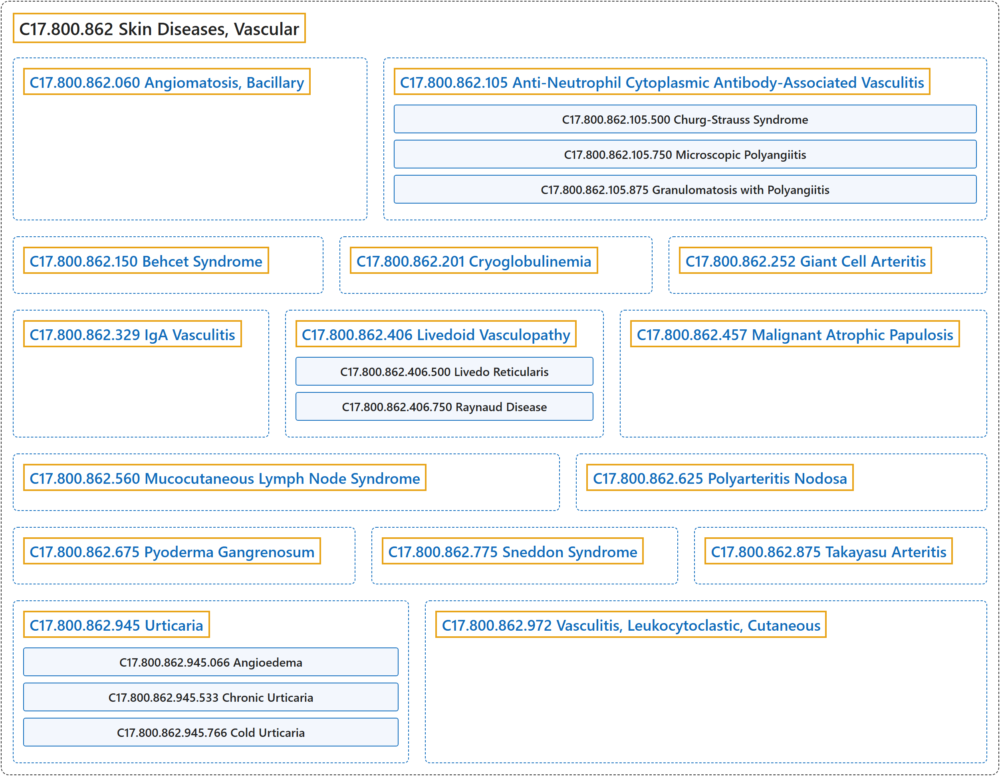

# C17.800.862 Skin Diseases, Vascular

## Classification

## Glossary

| Term | Definition | 中文翻译 | Source |
|---|---|---|---|
| **C17.800.862 Skin Diseases, Vascular** 血管性皮肤病 | "Skin diseases **affecting or involving the cutaneous blood vessels** and generally manifested as inflammation, swelling, erythema, or necrosis in the affected area." | **影响或累及皮肤血管**的皮肤疾病，通常在受累部位表现为炎症、肿胀、红斑或坏死。 | [National Library of Medicine, 2026, "Skin Diseases, Vascular" scope note](https://meshb.nlm.nih.gov/record/ui?ui=D017445) |
| **C17.800.862.060 Angiomatosis, Bacillary** 杆菌性血管瘤病 | "A **reactive vascular proliferation** that is characterized by the multiple tumor-like lesions in skin, bone, brain, and other organs. Bacillary angiomatosis is caused by **infection with gram-negative Bartonella bacilli** (such as BARTONELLA HENSELAE), and is often seen in AIDS patients and other IMMUNOCOMPROMISED HOSTS." | 一种**反应性血管增生**，特征为皮肤、骨、脑及其他器官的多发瘤样病变。杆菌性血管瘤病由**感染革兰氏阴性巴尔通体杆菌**（如汉赛巴尔通体（BARTONELLA HENSELAE））引起，常见于艾滋病患者和其他免疫功能低下宿主（IMMUNOCOMPROMISED HOSTS）。 | [National Library of Medicine, 2026, "Angiomatosis, Bacillary" scope note](https://meshb.nlm.nih.gov/record/ui?ui=D016917) |
| **C17.800.862.105 Anti-Neutrophil Cytoplasmic Antibody-Associated Vasculitis** 抗中性粒细胞胞质抗体相关性血管炎 | "Group of systemic vasculitis with a **strong association with ANCA**. The disorders are characterized by **necrotizing inflammation of small and medium size vessels**, with little or no immune-complex deposits in vessel walls." | 一组**与抗中性粒细胞胞质抗体**（ANCA）**密切相关**的系统性血管炎。这些疾病的特征为**中小血管的坏死性炎症**，血管壁中免疫复合物沉积很少或没有。 | [National Library of Medicine, 2026, "Anti-Neutrophil Cytoplasmic Antibody-Associated Vasculitis" scope note](https://meshb.nlm.nih.gov/record/ui?ui=D056648) |
| **C17.800.862.105.500 Churg-Strauss Syndrome** 变应性肉芽肿性血管炎 | "**Widespread necrotizing angiitis with granulomas**. Pulmonary involvement is frequent. Asthma or other respiratory infection may precede evidence of vasculitis. Eosinophilia and lung involvement differentiate this disease from POLYARTERITIS NODOSA." | **伴肉芽肿的广泛坏死性血管炎**。常有肺部受累。哮喘或其他呼吸道感染可先于血管炎的证据出现。嗜酸性粒细胞增多和肺部受累可将本病与结节性多动脉炎（POLYARTERITIS NODOSA）相区别。 | [National Library of Medicine, 2026, "Churg-Strauss Syndrome" scope note](https://meshb.nlm.nih.gov/record/ui?ui=D015267) |
| **C17.800.862.105.750 Microscopic Polyangiitis** 显微镜下多血管炎 | "A **primary systemic vasculitis of small- and some medium-sized vessels**. It is characterized by a tropism for kidneys and lungs, positive association with anti-neutrophil cytoplasmic antibodies (ANCA), and a paucity of immunoglobulin deposits in vessel walls." | 一种**累及小血管及部分中等血管的原发性系统性血管炎**。其特征为偏好累及肾和肺，与抗中性粒细胞胞质抗体（ANCA）呈正相关，血管壁中免疫球蛋白沉积稀少。 | [National Library of Medicine, 2026, "Microscopic Polyangiitis" scope note](https://meshb.nlm.nih.gov/record/ui?ui=D055953) |
| **C17.800.862.105.875 Granulomatosis with Polyangiitis** 肉芽肿性多血管炎 | "A multisystemic disease of a complex genetic background. It is characterized by **inflammation of the blood vessels (VASCULITIS)** leading to damage in any number of organs. The common features include **granulomatous inflammation of the RESPIRATORY TRACT and KIDNEYS**. Most patients have measurable autoantibodies (ANTINEUTROPHIL CYTOPLASMIC ANTIBODIES) against MYELOBLASTIN." | 一种具有复杂遗传背景的多系统疾病。其特征为**血管的炎症**（血管炎（VASCULITIS）），导致任意数量的器官受损。常见特征包括**呼吸道**（RESPIRATORY TRACT）**和肾脏**（KIDNEYS）**的肉芽肿性炎症**。大多数患者具有可测得的针对髓成细胞素（MYELOBLASTIN）的自身抗体（抗中性粒细胞胞质抗体（ANTINEUTROPHIL CYTOPLASMIC ANTIBODIES））。 | [National Library of Medicine, 2026, "Granulomatosis with Polyangiitis" scope note](https://meshb.nlm.nih.gov/record/ui?ui=D014890) |
| **C17.800.862.150 Behcet Syndrome** 白塞综合征 | "Rare **chronic inflammatory disease involving the small blood vessels**. It is of unknown etiology and characterized by **mucocutaneous ulceration in the mouth and genital region** and uveitis with hypopyon. The neuro-ocular form may cause blindness and death. SYNOVITIS; THROMBOPHLEBITIS; gastrointestinal ulcerations; RETINAL VASCULITIS; and OPTIC ATROPHY may occur as well." | 一种罕见的**累及小血管的慢性炎症性疾病**。其病因不明，特征为**口腔和生殖器区域的皮肤黏膜溃疡**以及伴前房积脓的葡萄膜炎。神经眼型可导致失明和死亡。也可发生滑膜炎（SYNOVITIS）、血栓性静脉炎（THROMBOPHLEBITIS）、胃肠道溃疡、视网膜血管炎（RETINAL VASCULITIS）和视神经萎缩（OPTIC ATROPHY）。 | [National Library of Medicine, 2026, "Behcet Syndrome" scope note](https://meshb.nlm.nih.gov/record/ui?ui=D001528) |
| **C17.800.862.201 Cryoglobulinemia** 冷球蛋白血症 | "A condition characterized by the presence of **abnormal quantities of CRYOGLOBULINS in the blood**. Upon cold exposure, these abnormal proteins precipitate into the microvasculature leading to restricted blood flow in the exposed areas." | 一种病症，其特征为**血液中存在异常数量的冷球蛋白**（CRYOGLOBULINS）。遇冷时，这些异常蛋白在微血管中沉淀，导致暴露部位血流受限。 | [National Library of Medicine, 2026, "Cryoglobulinemia" scope note](https://meshb.nlm.nih.gov/record/ui?ui=D003449) |
| **C17.800.862.252 Giant Cell Arteritis** 巨细胞动脉炎 | "A systemic autoimmune disorder that typically **affects medium and large ARTERIES**, usually leading to **occlusive granulomatous vasculitis** with transmural infiltrate containing multinucleated GIANT CELLS. The TEMPORAL ARTERY is commonly involved. This disorder appears primarily in people over the age of 50. Symptoms include FEVER; FATIGUE; HEADACHE; visual impairment; pain in the jaw and tongue; and aggravation of pain by cold temperatures. (From Adams et al., Principles of Neurology, 6th ed)" | 一种系统性自身免疫病，通常**累及中、大动脉**（ARTERIES），常导致**闭塞性肉芽肿性血管炎**，伴含多核巨细胞（GIANT CELLS）的全层浸润。常累及颞动脉（TEMPORAL ARTERY）。该病主要见于 50 岁以上人群。症状包括发热（FEVER）、疲劳（FATIGUE）、头痛（HEADACHE）、视力障碍、颌部和舌部疼痛，以及寒冷使疼痛加重。（引自 Adams 等，《Principles of Neurology》，第 6 版） | [National Library of Medicine, 2026, "Giant Cell Arteritis" scope note](https://meshb.nlm.nih.gov/record/ui?ui=D013700) |
| **C17.800.862.329 IgA Vasculitis** IgA 血管炎 | "A **systemic non-thrombocytopenic purpura** caused by HYPERSENSITIVITY VASCULITIS and deposition of IGA-containing IMMUNE COMPLEXES within the blood vessels throughout the body, including those in the kidney (KIDNEY GLOMERULUS). Clinical symptoms include URTICARIA; ERYTHEMA; ARTHRITIS; GASTROINTESTINAL HEMORRHAGE; and renal involvement. Most cases are seen in children after acute upper respiratory infections." | 一种**全身性非血小板减少性紫癜**，由超敏性血管炎（HYPERSENSITIVITY VASCULITIS）及含 IgA 的免疫复合物（IMMUNE COMPLEXES）在全身血管内沉积所致，包括肾内血管（肾小球（KIDNEY GLOMERULUS））。临床症状包括荨麻疹（URTICARIA）、红斑（ERYTHEMA）、关节炎（ARTHRITIS）、胃肠道出血（GASTROINTESTINAL HEMORRHAGE）和肾脏受累。多数病例见于儿童急性上呼吸道感染之后。 | [National Library of Medicine, 2026, "IgA Vasculitis" scope note](https://meshb.nlm.nih.gov/record/ui?ui=D011695) |
| **C17.800.862.406 Livedoid Vasculopathy** 青斑样血管病 | "A **rare cutaneous thrombotic disease due to occlusion of dermal vessels**. It is characterized by purpuric maculae and ulcerations especially during summer which form scars called atrophie blanche. It is more associated with other syndromes (e.g., PROTEIN C DEFICIENCY; HYPERHOMOCYSTEINEMIA). Livedo reticularis with systemic involvement and stroke is SNEDDON SYNDROME." | 一种**由真皮血管闭塞引起的罕见皮肤血栓性疾病**。其特征为紫癜性斑疹和溃疡，尤其在夏季出现，形成称为白色萎缩的瘢痕。更多与其他综合征相关（如蛋白 C 缺乏症（PROTEIN C DEFICIENCY）；高同型半胱氨酸血症（HYPERHOMOCYSTEINEMIA））。伴有全身受累和卒中的网状青斑为斯内登综合征（SNEDDON SYNDROME）。 | [National Library of Medicine, 2026, "Livedoid Vasculopathy" scope note](https://meshb.nlm.nih.gov/record/ui?ui=D000090122) |
| **C17.800.862.406.500 Livedo Reticularis** 网状青斑 | "A condition characterized by a **reticular or fishnet pattern on the skin** of lower extremities and other parts of the body. This red and blue pattern is due to deoxygenated blood in unstable dermal blood vessels. The condition is intensified by cold exposure and relieved by rewarming." | 一种病症，特征为下肢及身体其他部位**皮肤上出现网状或渔网状花纹**。这种红蓝色花纹是由于不稳定的真皮血管中的脱氧血液所致。遇冷加重，复温后缓解。 | [National Library of Medicine, 2026, "Livedo Reticularis" scope note](https://meshb.nlm.nih.gov/record/ui?ui=D054068) |
| **C17.800.862.406.750 Raynaud Disease** 雷诺病 | "An **idiopathic vascular disorder** characterized by **bilateral Raynaud phenomenon**, the abrupt onset of digital paleness or CYANOSIS in response to cold exposure or stress." | 一种**特发性血管疾病**，其特征为**双侧雷诺现象**，即遇冷或应激时手指突然苍白或发绀（CYANOSIS）。 | [National Library of Medicine, 2026, "Raynaud Disease" scope note](https://meshb.nlm.nih.gov/record/ui?ui=D011928) |
| **C17.800.862.406.750.500 CREST Syndrome** CREST 综合征 | "A **mild form of LIMITED SCLERODERMA**, a multi-system disorder. Its features include symptoms of CALCINOSIS; RAYNAUD DISEASE; ESOPHAGEAL MOTILITY DISORDERS; sclerodactyly, and TELANGIECTASIS. When the defect in esophageal function is not prominent, it is known as CRST syndrome." | **局限性硬皮病**（LIMITED SCLERODERMA）**的一种轻型**，是一种多系统疾病。其特征包括钙质沉着（CALCINOSIS）、雷诺病（RAYNAUD DISEASE）、食管动力障碍（ESOPHAGEAL MOTILITY DISORDERS）、指端硬化和毛细血管扩张（TELANGIECTASIS）等症状。当食管功能缺陷不明显时，称为 CRST 综合征。 | [National Library of Medicine, 2026, "CREST Syndrome" scope note](https://meshb.nlm.nih.gov/record/ui?ui=D017675) |
| **C17.800.862.457 Malignant Atrophic Papulosis** 恶性萎缩性丘疹病 | "Variously described as a vasculopathy, endovasculitis, or occlusive arteriopathy, this condition occurs in a benign cutaneous form and a lethal multiorgan systemic variant. It is characterized by a **narrowing and occlusion of the lumen of small to medium-sized blood vessels**, leading to ischemia and infarction in the involved organ systems. The etiology and pathophysiology are unknown." | 该病被不同地描述为血管病、血管内膜炎或闭塞性动脉病，有良性皮肤型和致死性多器官系统变异型。其特征为**中小血管管腔狭窄和闭塞**，导致受累器官系统缺血和梗死。其病因和病理生理学不明。 | [National Library of Medicine, 2026, "Malignant Atrophic Papulosis" scope note](https://meshb.nlm.nih.gov/record/ui?ui=D054853) |
| **C17.800.862.560 Mucocutaneous Lymph Node Syndrome** 皮肤黏膜淋巴结综合征 | "An **acute, febrile, mucocutaneous condition** accompanied by **swelling of cervical lymph nodes** in infants and young children. The principal symptoms are fever, congestion of the ocular conjunctivae, reddening of the lips and oral cavity, protuberance of tongue papillae, and edema or erythema of the extremities." | 一种**急性、发热性、皮肤黏膜病症**，伴婴幼儿**颈部淋巴结肿大**。主要症状为发热、眼结膜充血、口唇和口腔发红、舌乳头突出以及四肢水肿或红斑。 | [National Library of Medicine, 2026, "Mucocutaneous Lymph Node Syndrome" scope note](https://meshb.nlm.nih.gov/record/ui?ui=D009080) |
| **C17.800.862.625 Polyarteritis Nodosa** 结节性多动脉炎 | "A form of **necrotizing non-granulomatous inflammation** occurring primarily in **medium-sized ARTERIES**, often with microaneurysms. It is characterized by muscle, joint, and abdominal pain resulting from arterial infarction and scarring in affected organs. Polyarteritis nodosa with lung involvement is called CHURG-STRAUSS SYNDROME." | 一种**坏死性非肉芽肿性炎症**，主要发生于**中等大小的动脉**（ARTERIES），常伴微动脉瘤。其特征为受累器官动脉梗死和瘢痕形成所致的肌肉、关节和腹部疼痛。伴有肺部受累的结节性多动脉炎称为 Churg-Strauss 综合征（CHURG-STRAUSS SYNDROME）。 | [National Library of Medicine, 2026, "Polyarteritis Nodosa" scope note](https://meshb.nlm.nih.gov/record/ui?ui=D010488) |
| **C17.800.862.675 Pyoderma Gangrenosum** 坏疽性脓皮病 | "An idiopathic, rapidly evolving, and severely debilitating disease occurring most commonly in association with chronic ulcerative colitis. It is characterized by the presence of **boggy, purplish ulcers with undermined borders**, appearing mostly on the legs. The majority of cases are in people between 40 and 60 years old. Its etiology is unknown." | 一种特发性、进展迅速且严重致衰弱的疾病，最常与慢性溃疡性结肠炎相伴发生。其特征为出现**边缘潜行的松软紫色溃疡**，多见于腿部。大多数病例为 40 至 60 岁的人。其病因不明。 | [National Library of Medicine, 2026, "Pyoderma Gangrenosum" scope note](https://meshb.nlm.nih.gov/record/ui?ui=D017511) |
| **C17.800.862.775 Sneddon Syndrome** Sneddon 综合征 | "A **systemic non-inflammatory arteriopathy** primarily of middle-aged females characterized by the **association of LIVEDO RETICULARIS, multiple thrombotic CEREBRAL INFARCTION; CORONARY DISEASE, and HYPERTENSION**. Elevation of antiphospholipid antibody titers (see also ANTIPHOSPHOLIPID SYNDROME), cardiac valvulopathy, ISCHEMIC ATTACK, TRANSIENT; SEIZURES; DEMENTIA; and chronic ischemia of the extremities may also occur. Pathologic examination of affected arteries reveals non-inflammatory adventitial fibrosis, thrombosis, and changes in the media (From Jablonski, Dictionary of Syndromes & Eponymic Diseases, 2d ed; Adams et al., Principles of Neurology, 6th ed, p861; Arch Neurol 1997 Jan;54(1):53-60). Mutations in the CECR1 gene (ADA2 protein, human) are associated with Sneddon syndrome." | 一种主要见于中年女性的**全身性非炎症性动脉病**，特征为**网状青斑**（LIVEDO RETICULARIS）**、多发性血栓性脑梗死**（CEREBRAL INFARCTION）**、冠状动脉疾病**（CORONARY DISEASE）**和高血压**（HYPERTENSION）**合并存在**。还可出现抗磷脂抗体滴度升高（另见抗磷脂综合征（ANTIPHOSPHOLIPID SYNDROME））、心脏瓣膜病、短暂性脑缺血发作（ISCHEMIC ATTACK, TRANSIENT）、癫痫发作（SEIZURES）、痴呆（DEMENTIA）以及四肢慢性缺血。受累动脉的病理检查显示非炎症性外膜纤维化、血栓形成和中膜改变（引自 Jablonski，Dictionary of Syndromes & Eponymic Diseases，第 2 版；Adams 等，Principles of Neurology，第 6 版，第 861 页；Arch Neurol 1997 Jan;54(1):53-60）。CECR1 基因（ADA2 蛋白，人）突变与 Sneddon 综合征相关。 | [National Library of Medicine, 2026, "Sneddon Syndrome" scope note](https://meshb.nlm.nih.gov/record/ui?ui=D018860) |
| **C17.800.862.875 Takayasu Arteritis** 大动脉炎 | "A **chronic inflammatory process that affects the AORTA and its primary branches**, such as the brachiocephalic artery (BRACHIOCEPHALIC TRUNK) and CAROTID ARTERIES. It results in progressive arterial stenosis, occlusion, and aneurysm formation. The pulse in the arm is hard to detect. Patients with aortitis syndrome often exhibit retinopathy." | 一种**累及主动脉**（AORTA）**及其主要分支的慢性炎症过程**，这些分支如头臂动脉（头臂干，BRACHIOCEPHALIC TRUNK）和颈动脉（CAROTID ARTERIES）。它导致进行性动脉狭窄、闭塞和动脉瘤形成。上肢脉搏难以触及。主动脉炎综合征患者常出现视网膜病变。 | [National Library of Medicine, 2026, "Takayasu Arteritis" scope note](https://meshb.nlm.nih.gov/record/ui?ui=D013625) |
| **C17.800.862.945 Urticaria** 荨麻疹 | "A **vascular reaction of the skin** characterized by **erythema and wheal formation** due to localized increase of vascular permeability. The causative mechanism may be allergy, infection, or stress." | 一种**皮肤血管反应**，特征为局部血管通透性增加所致的**红斑和风团形成**。致病机制可能是过敏、感染或应激。 | [National Library of Medicine, 2026, "Urticaria" scope note](https://meshb.nlm.nih.gov/record/ui?ui=D014581) |
| **C17.800.862.945.066 Angioedema** 血管性水肿 | "Swelling involving the deep DERMIS, subcutaneous, or submucosal tissues, representing **localized EDEMA**. Angioedema often occurs in the face, lips, tongue, and larynx." | 累及真皮（DERMIS）深层、皮下或黏膜下组织的肿胀，表现为**局限性水肿**（EDEMA）。血管性水肿常发生于面部、口唇、舌和喉部。 | [National Library of Medicine, 2026, "Angioedema" scope note](https://meshb.nlm.nih.gov/record/ui?ui=D000799) |
| **C17.800.862.945.066.500 Angioedemas, Hereditary** 遗传性血管性水肿 | "Inherited disorders that are characterized by **subcutaneous and submucosal EDEMA** in the upper RESPIRATORY TRACT and GASTROINTESTINAL TRACT." | 遗传性疾病，特征为上呼吸道（RESPIRATORY TRACT）和胃肠道（GASTROINTESTINAL TRACT）的**皮下和黏膜下水肿**（EDEMA）。 | [National Library of Medicine, 2026, "Angioedemas, Hereditary" scope note](https://meshb.nlm.nih.gov/record/ui?ui=D054179) |
| **C17.800.862.945.066.500.500 Hereditary Angioedema Type III** 遗传性血管性水肿 III 型 | "A form of **hereditary angioedema that occurs in women** and is precipitated or worsened by **high ESTROGEN levels**. It is associated with mutations in the gene for FACTOR XII that result in its increased activity." | 一种**发生于女性的遗传性血管性水肿**，由**高雌激素**（ESTROGEN）**水平**诱发或加重。它与凝血因子 XII（FACTOR XII）基因突变相关，该突变导致其活性增加。 | [National Library of Medicine, 2026, "Hereditary Angioedema Type III" scope note](https://meshb.nlm.nih.gov/record/ui?ui=D056828) |
| **C17.800.862.945.066.500.750 Hereditary Angioedema Types I and II** I 型和 II 型遗传性血管性水肿 | "Forms of hereditary angioedema that occur due to **mutations in the gene for COMPLEMENT C1 INHIBITOR PROTEIN**. Type I hereditary angioedema is associated with reduced serum levels of complement C1 inhibitor protein. Type II hereditary angioedema is associated with the production of a non-functional complement C1 inhibitor protein." | 遗传性血管性水肿的若干类型，由**补体 C1 抑制蛋白**（COMPLEMENT C1 INHIBITOR PROTEIN）**基因突变**所致。I 型遗传性血管性水肿与血清补体 C1 抑制蛋白水平降低相关。II 型遗传性血管性水肿与产生无功能的补体 C1 抑制蛋白相关。 | [National Library of Medicine, 2026, "Hereditary Angioedema Types I and II" scope note](https://meshb.nlm.nih.gov/record/ui?ui=D056829) |
| **C17.800.862.945.533 Chronic Urticaria** 慢性荨麻疹 | "Wheals (urticaria) and/or angioedema presented with **daily symptoms lasting for more than 6 weeks**. It may be classified into chronic spontaneous and chronic inducible urticaria depending on whether a specific trigger can be linked to the development of vascular reaction." | 风团（荨麻疹）和/或血管性水肿，伴**每日症状持续超过 6 周**。根据能否将特定诱因与血管反应的发生联系起来，可分为慢性自发性荨麻疹和慢性诱导性荨麻疹。 | [National Library of Medicine, 2026, "Chronic Urticaria" scope note](https://meshb.nlm.nih.gov/record/ui?ui=D000080223) |
| **C17.800.862.945.533.500 Chronic Inducible Urticaria** 慢性诱导性荨麻疹 | "**Chronic urticaria with identified triggering factor** which is either physical, e.g., vibratory urticaria, or non-physical, e.g., aquagenic urticaria." | **有明确诱发因素的慢性荨麻疹**，诱发因素可为物理性的（如振动性荨麻疹），也可为非物理性的（如水源性荨麻疹）。 | [National Library of Medicine, 2026, "Chronic Inducible Urticaria" scope note](https://meshb.nlm.nih.gov/record/ui?ui=D000094482) |
| **C17.800.862.945.533.500.500 Cryopyrin-Associated Periodic Syndromes** 冷吡啉相关周期性综合征 | "A group of rare autosomal dominant diseases, commonly characterized by **atypical URTICARIA (hives) with systemic symptoms** that develop into end-organ damage. The atypical hives do not involve T-cell or autoantibody. Cryopyrin-associated periodic syndrome includes three previously distinct disorders: Familial cold autoinflammatory syndrome; Muckle-Wells Syndrome; and CINCA Syndrome, that are now considered to represent a disease continuum, all caused by **NLRP3 PROTEIN mutations**." | 一组罕见的常染色体显性遗传病，共同特征为**伴全身症状的非典型荨麻疹**（URTICARIA）（风团），可发展为终末器官损害。这种非典型风团不涉及 T 细胞或自身抗体。冷吡啉相关周期性综合征包括三种既往被视为独立的疾病：家族性寒冷自身炎症综合征、Muckle-Wells 综合征和 CINCA 综合征，现认为它们构成一个疾病连续谱，均由 **NLRP3 蛋白**（NLRP3 PROTEIN）**突变**引起。 | [National Library of Medicine, 2026, "Cryopyrin-Associated Periodic Syndromes" scope note](https://meshb.nlm.nih.gov/record/ui?ui=D056587) |
| **C17.800.862.945.533.500.750 Urticaria, Solar** 日光性荨麻疹 | "**Chromophore-dependent photodermatosis** triggered by UV and visible light." | 由紫外线和可见光诱发的**依赖发色团的光照性皮肤病**。 | [National Library of Medicine, 2026, "Urticaria, Solar" scope note](https://meshb.nlm.nih.gov/record/ui?ui=D000092130) |
| **C17.800.862.945.766 Cold Urticaria** 寒冷性荨麻疹 | "Various **skin flares developing after exposure to cold temperature**. While most are characterized by a limited episodic cutaneous condition characterized by URTICARIAL WHEALS, such as in allergic urticaria, other types are more severe and generalized and rarely familial, e.g., cryopyrin-associated periodic syndromes." | **暴露于低温后出现的各种皮肤风团发作**。多数表现为局限性发作性皮肤病症，特征为荨麻疹风团（URTICARIAL WHEALS），如变应性荨麻疹；其他类型则更为严重和泛发，且罕见家族性，如冷吡啉相关周期性综合征。 | [National Library of Medicine, 2026, "Cold Urticaria" scope note](https://meshb.nlm.nih.gov/record/ui?ui=D000096703) |
| **C17.800.862.945.766.500 Cryopyrin-Associated Periodic Syndromes** 冷吡啉相关周期性综合征 | "A group of rare autosomal dominant diseases, commonly characterized by **atypical URTICARIA (hives) with systemic symptoms** that develop into end-organ damage. The atypical hives do not involve T-cell or autoantibody. Cryopyrin-associated periodic syndrome includes three previously distinct disorders: Familial cold autoinflammatory syndrome; Muckle-Wells Syndrome; and CINCA Syndrome, that are now considered to represent a disease continuum, all caused by **NLRP3 PROTEIN mutations**." | 一组罕见的常染色体显性遗传病，共同特征为**伴全身症状的非典型荨麻疹**（URTICARIA）（风团），可发展为终末器官损害。这种非典型风团不涉及 T 细胞或自身抗体。冷吡啉相关周期性综合征包括三种既往被视为独立的疾病：家族性寒冷自身炎症综合征、Muckle-Wells 综合征和 CINCA 综合征，现认为它们构成一个疾病连续谱，均由 **NLRP3 蛋白**（NLRP3 PROTEIN）**突变**引起。 | [National Library of Medicine, 2026, "Cryopyrin-Associated Periodic Syndromes" scope note](https://meshb.nlm.nih.gov/record/ui?ui=D056587) |
| **C17.800.862.972 Vasculitis, Leukocytoclastic, Cutaneous** 皮肤白细胞破碎性血管炎 | "Disorder characterized by a **vasculitic syndrome associated with exposure to an antigen** such as a drug, infectious agent, or other foreign or endogenous substance. Its pathophysiology includes immune complex deposition and a wide range of skin lesions. Hypersensitivity or allergy is present in some but not all cases." | 一种疾病，特征为**与接触抗原相关的血管炎综合征**，抗原如药物、感染因子或其他外源性或内源性物质。其病理生理包括免疫复合物沉积和多种皮肤损害。部分而非全部病例存在超敏反应或变态反应。 | [National Library of Medicine, 2026, "Vasculitis, Leukocytoclastic, Cutaneous" scope note](https://meshb.nlm.nih.gov/record/ui?ui=D018366) |

## References

National Library of Medicine. (2026). *MeSH 2026 descriptor records* [Data set]. Retrieved October 28, 2026, from <https://www.nlm.nih.gov/databases/download/mesh.html>
