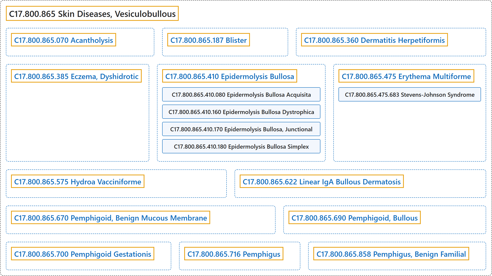

# C17.800.865 Skin Diseases, Vesiculobullous

## Classification

## Glossary

| Term | Definition | 中文翻译 | Source |
|---|---|---|---|
| **C17.800.865 Skin Diseases, Vesiculobullous** 水疱大疱性皮肤病 | "Skin diseases characterized by **local or general distributions of blisters**. They are classified according to the site and mode of blister formation. Lesions can appear spontaneously or be precipitated by infection, trauma, or sunlight. Etiologies include immunologic and genetic factors. (From Scientific American Medicine, 1990)" | 以**局部或全身分布的水疱**为特征的皮肤疾病。根据水疱形成的部位和方式进行分类。皮损可自发出现，或由感染、外伤或日光诱发。病因包括免疫和遗传因素。（引自 Scientific American Medicine，1990） | [National Library of Medicine, 2026, "Skin Diseases, Vesiculobullous" scope note](https://meshb.nlm.nih.gov/record/ui?ui=D012872) |
| **C17.800.865.070 Acantholysis** 棘层松解 | "**Separation of the prickle cells of the stratum spinosum** of the epidermis, resulting in atrophy of the prickle cell layer. It is seen in diseases such as pemphigus vulgaris (see PEMPHIGUS) and DARIER DISEASE." | 表皮**棘层棘细胞之间的分离**，导致棘细胞层萎缩。见于寻常型天疱疮（见天疱疮（PEMPHIGUS））和毛囊角化病（DARIER DISEASE）等疾病。 | [National Library of Medicine, 2026, "Acantholysis" scope note](https://meshb.nlm.nih.gov/record/ui?ui=D000051) |
| **C17.800.865.187 Blister** 水疱 | "Visible **accumulations of fluid within or beneath the epidermis**." | 表皮内或表皮下可见的**液体积聚**。 | [National Library of Medicine, 2026, "Blister" scope note](https://meshb.nlm.nih.gov/record/ui?ui=D001768) |
| **C17.800.865.360 Dermatitis Herpetiformis** 疱疹样皮炎 | "Rare, chronic, **papulo-vesicular disease** characterized by an **intensely pruritic eruption** consisting of various combinations of symmetrical, erythematous, papular, vesicular, or bullous lesions. The disease is strongly associated with the presence of HLA-B8 and HLA-DR3 antigens. A variety of different autoantibodies has been detected in small numbers in patients with dermatitis herpetiformis." | 一种罕见的慢性**丘疹水疱性疾病**，特征为**剧烈瘙痒的皮疹**，由对称性红斑、丘疹、水疱或大疱性病变的各种组合构成。该病与 HLA-B8 和 HLA-DR3 抗原的存在密切相关。在疱疹样皮炎患者中已检出少量多种不同的自身抗体。 | [National Library of Medicine, 2026, "Dermatitis Herpetiformis" scope note](https://meshb.nlm.nih.gov/record/ui?ui=D003874) |
| **C17.800.865.385 Eczema, Dyshidrotic** 汗疱疹 | "A **recurrent eczematous reaction** characterized by the development of **vesicular eruptions on the palms and soles**, particularly along the sides and between the digits. It is accompanied by pruritus, a burning sensation, and hyperhidrosis. The disease is self-limiting, lasting only a few weeks. (Dorland, 27th ed)" | 一种**复发性湿疹样反应**，特征为**手掌和足底出现水疱性皮疹**，尤其是沿指（趾）侧缘和指（趾）间。伴有瘙痒、烧灼感和多汗。该病为自限性，仅持续数周。（Dorland，第 27 版） | [National Library of Medicine, 2026, "Eczema, Dyshidrotic" scope note](https://meshb.nlm.nih.gov/record/ui?ui=D011146) |
| **C17.800.865.410 Epidermolysis Bullosa** 大疱性表皮松解症 | "Group of **genetically determined disorders** characterized by the **blistering of skin and mucosae**. There are four major forms: acquired, simple, junctional, and dystrophic. Each of the latter three has several varieties." | 一组**遗传决定的疾病**，其特征为**皮肤和黏膜起疱**。有四种主要类型：获得性、单纯型、交界型和营养不良型。后三者各有若干变型。 | [National Library of Medicine, 2026, "Epidermolysis Bullosa" scope note](https://meshb.nlm.nih.gov/record/ui?ui=D004820) |
| **C17.800.865.410.080 Epidermolysis Bullosa Acquisita** 获得性大疱性表皮松解症 | "Form of epidermolysis bullosa characterized by **trauma-induced, subepidermal blistering** with no family history of the disease. Direct immunofluorescence shows IMMUNOGLOBULIN G deposited at the dermo-epidermal junction." | 大疱性表皮松解症的一种类型，特征为**外伤诱发的表皮下水疱**，且无该病家族史。直接免疫荧光显示免疫球蛋白 G（IMMUNOGLOBULIN G）沉积于真皮表皮交界处。 | [National Library of Medicine, 2026, "Epidermolysis Bullosa Acquisita" scope note](https://meshb.nlm.nih.gov/record/ui?ui=D016107) |
| **C17.800.865.410.160 Epidermolysis Bullosa Dystrophica** 营养不良型大疱性表皮松解症 | "Form of epidermolysis bullosa characterized by **atrophy of blistered areas, severe scarring, and nail changes**. It is most often present at birth or in early infancy and occurs in both autosomal dominant and recessive forms. All forms of dystrophic epidermolysis bullosa result from mutations in COLLAGEN TYPE VII, a major component fibrils of BASEMENT MEMBRANE and EPIDERMIS." | 大疱性表皮松解症的一种类型，特征为**水疱区萎缩、严重瘢痕形成及甲改变**。多于出生时或婴儿早期出现，有常染色体显性和隐性两种遗传形式。所有营养不良型大疱性表皮松解症均由 VII 型胶原（COLLAGEN TYPE VII）突变所致，VII 型胶原是基底膜（BASEMENT MEMBRANE）和表皮（EPIDERMIS）纤维的主要成分。 | [National Library of Medicine, 2026, "Epidermolysis Bullosa Dystrophica" scope note](https://meshb.nlm.nih.gov/record/ui?ui=D016108) |
| **C17.800.865.410.170 Epidermolysis Bullosa, Junctional** 交界型大疱性表皮松解症 | "Form of epidermolysis bullosa having onset at birth or during the neonatal period and transmitted through autosomal recessive inheritance. It is characterized by **generalized blister formation**, extensive denudation, and separation and cleavage of the basal cell plasma membranes from the basement membrane." | 大疱性表皮松解症的一种类型，于出生时或新生儿期发病，经常染色体隐性遗传。特征为**泛发性水疱形成**、大面积表皮剥脱，以及基底细胞质膜与基底膜的分离和裂开。 | [National Library of Medicine, 2026, "Epidermolysis Bullosa, Junctional" scope note](https://meshb.nlm.nih.gov/record/ui?ui=D016109) |
| **C17.800.865.410.180 Epidermolysis Bullosa Simplex** 单纯型大疱性表皮松解症 | "A form of epidermolysis bullosa characterized by **serous bullae that heal without scarring**. Mutations in the genes that encode KERATIN-5 and KERATIN-14 have been associated with several subtypes of epidermolysis bullosa simplex." | 一种大疱性表皮松解症，特征为**愈合后不留瘢痕的浆液性大疱**。编码角蛋白-5（KERATIN-5）和角蛋白-14（KERATIN-14）的基因突变与单纯型大疱性表皮松解症的若干亚型相关。 | [National Library of Medicine, 2026, "Epidermolysis Bullosa Simplex" scope note](https://meshb.nlm.nih.gov/record/ui?ui=D016110) |
| **C17.800.865.475 Erythema Multiforme** 多形红斑 | "A **skin and mucous membrane disease** characterized by an eruption of macules, papules, nodules, vesicles, and/or bullae with **characteristic bull's-eye lesions** usually occurring on the dorsal aspect of the hands and forearms." | 一种**皮肤和黏膜疾病**，特征为出现斑疹、丘疹、结节、水疱和（或）大疱，伴有**特征性的靶形皮损**，通常发生于手背和前臂背侧。 | [National Library of Medicine, 2026, "Erythema Multiforme" scope note](https://meshb.nlm.nih.gov/record/ui?ui=D004892) |
| **C17.800.865.475.683 Stevens-Johnson Syndrome** 史蒂文斯-约翰逊综合征 | "Rare cutaneous eruption characterized by **extensive KERATINOCYTE apoptosis resulting in skin detachment with mucosal involvement**. It is often provoked by the use of drugs (e.g., antibiotics and anticonvulsants) or associated with PNEUMONIA, MYCOPLASMA. It is considered a continuum of Toxic Epidermal Necrolysis." | 一种罕见的皮疹，特征为**广泛的角质形成细胞**（KERATINOCYTE）**凋亡，导致皮肤剥脱并累及黏膜**。常由药物（如抗生素和抗惊厥药）诱发，或与支原体肺炎（PNEUMONIA, MYCOPLASMA）相关。它被视为与中毒性表皮坏死松解症构成同一连续谱。 | [National Library of Medicine, 2026, "Stevens-Johnson Syndrome" scope note](https://meshb.nlm.nih.gov/record/ui?ui=D013262) |
| **C17.800.865.575 Hydroa Vacciniforme** 种痘样水疱病 | "A **vesicular and bullous eruption** having a tendency to recur in summer during childhood and commonly appearing on sun-exposed skin. The lesions are surrounded by an erythematous zone and resemble a vaccination. (From Dorland, 27th ed)" | 一种**水疱和大疱性皮疹**，儿童期易在夏季复发，常见于日光暴露部位皮肤。皮损周围有红斑带，形似种痘。（引自 Dorland，第 27 版） | [National Library of Medicine, 2026, "Hydroa Vacciniforme" scope note](https://meshb.nlm.nih.gov/record/ui?ui=D006837) |
| **C17.800.865.622 Linear IgA Bullous Dermatosis** 线状 IgA 大疱性皮病 | "Autoimmune disease characterized by **subepidermal blisters** and **linear deposition of autoantibodies at the dermoepidermal junction**. The accumulated autoantibodies are of IMMUNOGLOBULIN A and occasionally IMMUNOGLOBULIN G classes against epidermal BASEMENT MEMBRANE proteins. The dermatosis is sometimes associated with malignancies and use of certain drugs (e.g., VANCOMYCIN)." | 自身免疫性疾病，特征为**表皮下水疱**及**自身抗体在真皮表皮交界处呈线状沉积**。沉积的自身抗体为免疫球蛋白 A（IMMUNOGLOBULIN A）类，偶为免疫球蛋白 G（IMMUNOGLOBULIN G）类，针对表皮基底膜（BASEMENT MEMBRANE）蛋白。本皮病有时与恶性肿瘤及使用某些药物（如万古霉素（VANCOMYCIN））相关。 | [National Library of Medicine, 2026, "Linear IgA Bullous Dermatosis" scope note](https://meshb.nlm.nih.gov/record/ui?ui=D062027) |
| **C17.800.865.670 Pemphigoid, Benign Mucous Membrane** 良性黏膜类天疱疮 | "A **chronic blistering disease with predilection for mucous membranes** and less frequently the skin, and with a tendency to scarring. It is sometimes called ocular pemphigoid because of conjunctival mucous membrane involvement." | 一种**好发于黏膜的慢性大疱性疾病**，较少累及皮肤，有形成瘢痕的倾向。由于累及结膜黏膜，有时称为眼类天疱疮。 | [National Library of Medicine, 2026, "Pemphigoid, Benign Mucous Membrane" scope note](https://meshb.nlm.nih.gov/record/ui?ui=D010390) |
| **C17.800.865.690 Pemphigoid, Bullous** 大疱性类天疱疮 | "A chronic and relatively benign **subepidermal blistering disease** usually of the elderly and without histopathologic acantholysis." | 一种慢性、相对良性的**表皮下水疱病**，通常见于老年人，组织病理学上无棘层松解。 | [National Library of Medicine, 2026, "Pemphigoid, Bullous" scope note](https://meshb.nlm.nih.gov/record/ui?ui=D010391) |
| **C17.800.865.700 Pemphigoid Gestationis** 妊娠类天疱疮 | "An itching, **autoimmune, bullous SKIN disease** that occurs during the **last two trimesters of PREGNANCY** and PUERPERIUM. It also affects non-pregnant females with tissue of PLACENTA origin, such as CHORIOCARCINOMA; or HYDATIDIFORM MOLE. It exhibits antigenic and clinical similarity to bullous pemphigoid (PEMPHIGOID, BULLOUS). This disease does not involve herpes viruses (old name, herpes gestationis)." | 一种瘙痒性、**自身免疫性大疱性皮肤**（SKIN）**病**，发生于**妊娠**（PREGNANCY）**中晚期**及产褥期（PUERPERIUM）。它也可累及含有胎盘（PLACENTA）来源组织的非妊娠女性，如绒毛膜癌（CHORIOCARCINOMA）或葡萄胎（HYDATIDIFORM MOLE）。它在抗原和临床上与大疱性类天疱疮（PEMPHIGOID, BULLOUS）相似。该病与疱疹病毒无关（旧称妊娠疱疹）。 | [National Library of Medicine, 2026, "Pemphigoid Gestationis" scope note](https://meshb.nlm.nih.gov/record/ui?ui=D006559) |
| **C17.800.865.716 Pemphigus** 天疱疮 | "Group of **chronic blistering diseases** characterized histologically by **ACANTHOLYSIS and blister formation within the EPIDERMIS**." | 一组**慢性大疱性疾病**，组织学特征为**棘层松解**（ACANTHOLYSIS）**及表皮**（EPIDERMIS）**内水疱形成**。 | [National Library of Medicine, 2026, "Pemphigus" scope note](https://meshb.nlm.nih.gov/record/ui?ui=D010392) |
| **C17.800.865.858 Pemphigus, Benign Familial** 家族性良性天疱疮 | "An autosomal dominantly inherited skin disorder characterized by **recurrent eruptions of vesicles and BULLAE** mainly on the neck, axillae, and groin. **Mutations in the ATP2C1 gene** (encoding the secretory pathway Ca2++/Mn2++ ATPase 1 (SPCA1)) cause this disease. It is clinically and histologically similar to DARIER DISEASE - both have abnormal, unstable DESMOSOMES between KERATINOCYTES and defective CALCIUM-TRANSPORTING ATPASES. It is unrelated to PEMPHIGUS VULGARIS though it closely resembles that disease." | 一种常染色体显性遗传的皮肤病，其特征为**水疱和大疱**（BULLAE）**反复发作**，主要见于颈部、腋窝和腹股沟。**ATP2C1 基因突变**（该基因编码分泌途径 Ca2++/Mn2++ ATP 酶 1（SPCA1））导致本病。其在临床和组织学上与达里埃病（DARIER DISEASE）相似，两者均有角质形成细胞（KERATINOCYTES）之间异常、不稳定的桥粒（DESMOSOMES）以及缺陷的钙转运 ATP 酶（CALCIUM-TRANSPORTING ATPASES）。本病与寻常型天疱疮（PEMPHIGUS VULGARIS）无关，尽管与之十分相似。 | [National Library of Medicine, 2026, "Pemphigus, Benign Familial" scope note](https://meshb.nlm.nih.gov/record/ui?ui=D016506) |

## References

National Library of Medicine. (2026). *MeSH 2026 descriptor records* [Data set]. Retrieved October 28, 2026, from <https://www.nlm.nih.gov/databases/download/mesh.html>
