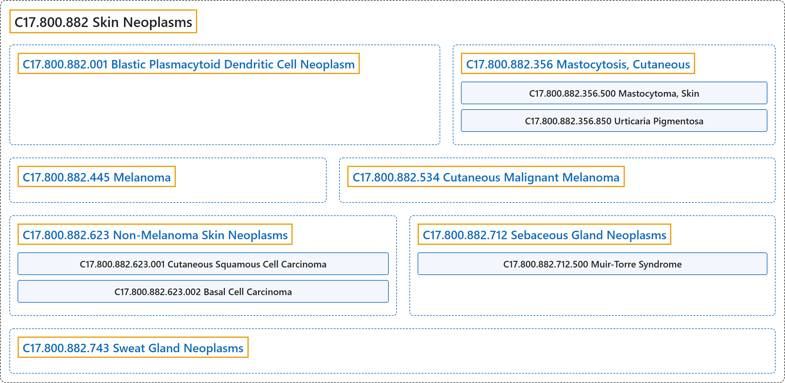

# C17.800.882 Skin Neoplasms

## Classification

## Glossary

| Term | Definition | 中文翻译 | Source |
|---|---|---|---|
| **C17.800.882 Skin Neoplasms** 皮肤肿瘤 | "**Tumors or cancer of the SKIN**." | **皮肤**（SKIN）**的肿瘤或癌**。 | [National Library of Medicine, 2026, "Skin Neoplasms" scope note](https://meshb.nlm.nih.gov/record/ui?ui=D012878) |
| **C17.800.882.001 Blastic Plasmacytoid Dendritic Cell Neoplasm** 母细胞性浆细胞样树突状细胞肿瘤 | "A **rare and aggressive hematologic malignancy** derived from the **precursors of PLASMACYTOID DENDRITIC CELLS**. Blastic plasmacytoid dendritic cell neoplasms affect bone marrow and blood in addition to the lymph nodes, spleen, central nervous system, and skin." | 一种**罕见的侵袭性血液系统恶性肿瘤**，源自**浆细胞样树突状细胞**（PLASMACYTOID DENDRITIC CELLS）**的前体**。母细胞性浆细胞样树突状细胞肿瘤除累及淋巴结、脾、中枢神经系统和皮肤外，还累及骨髓和血液。 | [National Library of Medicine, 2026, "Blastic Plasmacytoid Dendritic Cell Neoplasm" scope note](https://meshb.nlm.nih.gov/record/ui?ui=D000099067) |
| **C17.800.882.356 Mastocytosis, Cutaneous** 皮肤肥大细胞增多症 | "Skin lesions due to **abnormal infiltration of MAST CELLS**. Cutaneous mastocytosis is **confined to the skin** without the involvement of other tissues or organs, and is mostly found in children. The three major variants are: URTICARIA PIGMENTOSA; diffuse cutaneous mastocytosis; and SOLITARY MASTOCYTOMA OF SKIN." | 由**肥大细胞**（MAST CELLS）**异常浸润**所致的皮肤病变。皮肤肥大细胞增多症**局限于皮肤**，不累及其他组织或器官，多见于儿童。三种主要变型为：色素性荨麻疹（URTICARIA PIGMENTOSA）、弥漫性皮肤肥大细胞增多症和皮肤孤立性肥大细胞瘤（SOLITARY MASTOCYTOMA OF SKIN）。 | [National Library of Medicine, 2026, "Mastocytosis, Cutaneous" scope note](https://meshb.nlm.nih.gov/record/ui?ui=D034701) |
| **C17.800.882.356.500 Mastocytoma, Skin** 皮肤肥大细胞瘤 | "A **variant of cutaneous mastocytosis** which occurs as a **single lesion** usually in infants. It is found mostly in the wrist and trunk and there is no atypical cytomorphology." | **皮肤肥大细胞增生症的一种变异型**，通常以**单个皮损**出现于婴儿。主要见于腕部和躯干，无非典型细胞形态。 | [National Library of Medicine, 2026, "Mastocytoma, Skin" scope note](https://meshb.nlm.nih.gov/record/ui?ui=D054705) |
| **C17.800.882.356.850 Urticaria Pigmentosa** 色素性荨麻疹 | "The **most common form of cutaneous mastocytosis** (MASTOCYTOSIS, CUTANEOUS) that occurs primarily in children. It is characterized by the multiple small reddish-brown pigmented pruritic macules and papules." | **皮肤肥大细胞增多症最常见的形式**（皮肤肥大细胞增多症（MASTOCYTOSIS, CUTANEOUS）），主要发生于儿童。特征为多发性小的红棕色色素性瘙痒性斑疹和丘疹。 | [National Library of Medicine, 2026, "Urticaria Pigmentosa" scope note](https://meshb.nlm.nih.gov/record/ui?ui=D014582) |
| **C17.800.882.445 Melanoma** 黑色素瘤 | "A **malignant neoplasm derived from cells that are capable of forming melanin**, which may occur in the skin of any part of the body, in the eye, or, rarely, in the mucous membranes of the genitalia, anus, oral cavity, or other sites. It occurs mostly in adults and may originate de novo or from a pigmented nevus or malignant lentigo. Melanomas frequently metastasize widely, and the regional lymph nodes, liver, lungs, and brain are likely to be involved. The incidence of malignant skin melanomas is rising rapidly in all parts of the world. (Stedman, 25th ed; from Rook et al., Textbook of Dermatology, 4th ed, p2445)" | 一种**源自能形成黑色素的细胞的恶性肿瘤**，可发生于身体任何部位的皮肤、眼，少数发生于生殖器、肛门、口腔或其他部位的黏膜。主要见于成人，可原发，或起源于色素痣或恶性雀斑样痣。黑色素瘤常广泛转移，区域淋巴结、肝、肺和脑易受累。全世界恶性皮肤黑色素瘤的发病率均在迅速上升。（Stedman，第 25 版；引自 Rook 等，《皮肤病学教科书》，第 4 版，第 2445 页） | [National Library of Medicine, 2026, "Melanoma" scope note](https://meshb.nlm.nih.gov/record/ui?ui=D008545) |
| **C17.800.882.534 Cutaneous Malignant Melanoma** 皮肤恶性黑色素瘤 | "A **primary melanoma that originates from atypical skin MELANOCYTES**, especially from acquired and congenital MELANOCYTIC NEVI, and DYSPLASTIC NEVI." | 一种**起源于非典型皮肤黑素细胞**（MELANOCYTES）**的原发性黑色素瘤**，尤其起源于获得性和先天性黑素细胞痣（MELANOCYTIC NEVI）以及发育不良痣（DYSPLASTIC NEVI）。 | [National Library of Medicine, 2026, "Cutaneous Malignant Melanoma" scope note](https://meshb.nlm.nih.gov/record/ui?ui=D000096142) |
| **C17.800.882.623 Non-Melanoma Skin Neoplasms** 非黑色素瘤皮肤肿瘤 | "Skin neoplasms that are **not MELANOMA**." | **不属于黑色素瘤**（MELANOMA）的皮肤肿瘤。 | [National Library of Medicine, 2026, "Non-Melanoma Skin Neoplasms" scope note](https://meshb.nlm.nih.gov/record/ui?ui=D000099313) |
| **C17.800.882.623.001 Cutaneous Squamous Cell Carcinoma** 皮肤鳞状细胞癌 | "A **non-melanoma skin neoplasm** that is one of the **three principal types of skin cancer**. It often presents as a hard lump or ulcer and is more likely to metastasize than BASAL CELL CARCINOMA." | 一种**非黑色素瘤皮肤肿瘤**，是**皮肤癌的三种主要类型**之一。常表现为硬结或溃疡，比基底细胞癌（BASAL CELL CARCINOMA）更易转移。 | [National Library of Medicine, 2026, "Cutaneous Squamous Cell Carcinoma" scope note](https://meshb.nlm.nih.gov/record/ui?ui=D000099314) |
| **C17.800.882.623.001.001 Bowen's Disease** 鲍恩病 | "A persistent progressive **non-elevated red scaly or crusted plaque** which is due to an **intradermal carcinoma** and is potentially malignant. Atypical squamous cells proliferate through the whole thickness of the epidermis. The lesions may occur anywhere on the skin surface or on mucosal surfaces. The cause most frequently found is trivalent arsenic compounds. Freezing, cauterization or diathermy coagulation is often effective. (From Rook et al., Textbook of Dermatology, 4th ed, pp2428-9)" | 一种持续进展的**不隆起的红色鳞屑性或结痂性斑块**，由**表皮内癌**引起，具有潜在恶性。非典型鳞状细胞增殖贯穿表皮全层。皮损可发生于皮肤表面或黏膜表面的任何部位。最常发现的病因是三价砷化合物。冷冻、烧灼或电热凝固常有效。（引自 Rook 等，《Textbook of Dermatology》，第 4 版，第 2428 至 2429 页） | [National Library of Medicine, 2026, "Bowen's Disease" scope note](https://meshb.nlm.nih.gov/record/ui?ui=D001913) |
| **C17.800.882.623.002 Basal Cell Carcinoma** 基底细胞癌 | "A **malignant skin neoplasm that seldom metastasizes** but has potentialities for local invasion and destruction. Clinically it is divided into types: nodular, cicatricial, morphaic, and erythematoid (pagetoid). They develop on hair-bearing skin, most commonly on sun-exposed areas. Approximately 85% are found on the head and neck area and the remaining 15% on the trunk and limbs. (From DeVita Jr et al., Cancer: Principles & Practice of Oncology, 3d ed, p1471)" | 一种**很少转移的恶性皮肤肿瘤**，但具有局部侵袭和破坏的潜能。临床上分为结节型、瘢痕型、硬斑病样型和红斑型（佩吉特样）。发生于有毛皮肤，最常见于日光暴露部位。约 85% 位于头颈部，其余 15% 位于躯干和四肢。（引自 DeVita Jr 等，《癌症：肿瘤学原理与实践》，第 3 版，第 1471 页） | [National Library of Medicine, 2026, "Basal Cell Carcinoma" scope note](https://meshb.nlm.nih.gov/record/ui?ui=D002280) |
| **C17.800.882.623.002.001 Basal Cell Nevus Syndrome** 基底细胞痣综合征 | "Hereditary disorder consisting of **multiple basal cell carcinomas, odontogenic keratocysts, and multiple skeletal defects**, e.g., frontal and temporoparietal bossing, bifurcated and splayed ribs, kyphoscoliosis, fusion of vertebrae, and cervicothoracic spina bifida. Genetic transmission is autosomal dominant." | 遗传性疾病，由**多发性基底细胞癌、牙源性角化囊肿和多种骨骼缺陷**组成，如额部和颞顶部隆起、分叉和张开的肋骨、脊柱后侧凸、椎骨融合及颈胸段脊柱裂。遗传方式为常染色体显性。 | [National Library of Medicine, 2026, "Basal Cell Nevus Syndrome" scope note](https://meshb.nlm.nih.gov/record/ui?ui=D001478) |
| **C17.800.882.712 Sebaceous Gland Neoplasms** 皮脂腺肿瘤 | "**New abnormal growth of tissue in the SEBACEOUS GLANDS**." | **皮脂腺**（SEBACEOUS GLANDS）**中组织的新的异常生长**。 | [National Library of Medicine, 2026, "Sebaceous Gland Neoplasms" scope note](https://meshb.nlm.nih.gov/record/ui?ui=D012626) |
| **C17.800.882.712.500 Muir-Torre Syndrome** Muir-Torre 综合征 | "A **form of LYNCH SYNDROME II** associated with cutaneous **SEBACEOUS GLAND NEOPLASMS**. Muir-Torre syndrome is also associated with other visceral malignant diseases include colorectal, endometrial, urological, and upper gastrointestinal neoplasms." | **林奇综合征 II 型**（LYNCH SYNDROME II）的一种形式，伴皮肤**皮脂腺肿瘤**（SEBACEOUS GLAND NEOPLASMS）。Muir-Torre 综合征还与其他内脏恶性疾病相关，包括结直肠、子宫内膜、泌尿系统和上消化道肿瘤。 | [National Library of Medicine, 2026, "Muir-Torre Syndrome" scope note](https://meshb.nlm.nih.gov/record/ui?ui=D055653) |
| **C17.800.882.743 Sweat Gland Neoplasms** 汗腺肿瘤 | "**New abnormal growth of tissue in the SWEAT GLANDS**." | **汗腺**（SWEAT GLANDS）**内组织新的异常生长**。 | [National Library of Medicine, 2026, "Sweat Gland Neoplasms" scope note](https://meshb.nlm.nih.gov/record/ui?ui=D013544) |

## References

National Library of Medicine. (2026). *MeSH 2026 descriptor records* [Data set]. Retrieved October 28, 2026, from <https://www.nlm.nih.gov/databases/download/mesh.html>
