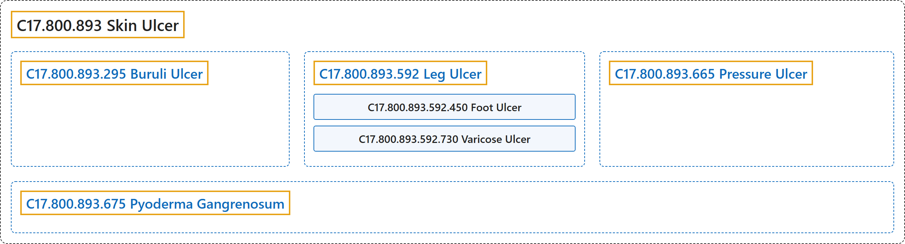

# C17.800.893 Skin Ulcer

## Classification

## Glossary

| Term | Definition | 中文翻译 | Source |
|---|---|---|---|
| **C17.800.893 Skin Ulcer** 皮肤溃疡 | "An **ULCER of the skin and underlying tissues**." | **皮肤及其下组织的溃疡**（ULCER）。 | [National Library of Medicine, 2026, "Skin Ulcer" scope note](https://meshb.nlm.nih.gov/record/ui?ui=D012883) |
| **C17.800.893.295 Buruli Ulcer** 布鲁里溃疡 | "A lesion in the skin and subcutaneous tissues due to **infections by MYCOBACTERIUM ULCERANS**. It was first reported in Uganda, Africa." | 由**溃疡分枝杆菌**（MYCOBACTERIUM ULCERANS）**感染**引起的皮肤和皮下组织病变。最早报道于非洲乌干达。 | [National Library of Medicine, 2026, "Buruli Ulcer" scope note](https://meshb.nlm.nih.gov/record/ui?ui=D054312) |
| **C17.800.893.592 Leg Ulcer** 腿部溃疡 | "**Ulceration of the skin and underlying structures of the lower extremity**. About 90% of the cases are due to venous insufficiency (VARICOSE ULCER), 5% to arterial disease, and the remaining 5% to other causes." | **下肢皮肤及其下方结构的溃疡**。约 90% 的病例由静脉功能不全（静脉曲张性溃疡（VARICOSE ULCER））引起，5% 由动脉疾病引起，其余 5% 由其他原因引起。 | [National Library of Medicine, 2026, "Leg Ulcer" scope note](https://meshb.nlm.nih.gov/record/ui?ui=D007871) |
| **C17.800.893.592.450 Foot Ulcer** 足溃疡 | "**Lesion on the surface of the skin of the foot**, usually accompanied by inflammation. The lesion may become infected or necrotic and is frequently associated with diabetes or leprosy." | **足部皮肤表面的病变**，通常伴有炎症。病变可发生感染或坏死，常与糖尿病或麻风相关。 | [National Library of Medicine, 2026, "Foot Ulcer" scope note](https://meshb.nlm.nih.gov/record/ui?ui=D016523) |
| **C17.800.893.592.450.200 Diabetic Foot** 糖尿病足 | "**Common foot problems in persons with DIABETES MELLITUS**, caused by any combination of factors such as DIABETIC NEUROPATHIES; PERIPHERAL VASCULAR DISEASES; and INFECTION. With the loss of sensation and poor circulation, injuries and infections often lead to severe foot ulceration, GANGRENE and AMPUTATION, SURGICAL." | **糖尿病**（DIABETES MELLITUS）**患者常见的足部问题**，由糖尿病神经病变（DIABETIC NEUROPATHIES）、周围血管疾病（PERIPHERAL VASCULAR DISEASES）和感染（INFECTION）等因素的任意组合所致。随着感觉丧失和循环不良，损伤和感染常导致严重的足部溃疡、坏疽（GANGRENE）和外科截肢（AMPUTATION, SURGICAL）。 | [National Library of Medicine, 2026, "Diabetic Foot" scope note](https://meshb.nlm.nih.gov/record/ui?ui=D017719) |
| **C17.800.893.592.730 Varicose Ulcer** 静脉曲张性溃疡 | "**Skin breakdown or ulceration in the drainage area of a VARICOSE VEIN**, usually in the leg." | **静脉曲张**（VARICOSE VEIN）**引流区域的皮肤破损或溃疡**，通常位于腿部。 | [National Library of Medicine, 2026, "Varicose Ulcer" scope note](https://meshb.nlm.nih.gov/record/ui?ui=D014647) |
| **C17.800.893.665 Pressure Ulcer** 压疮 | "An ulceration caused by **prolonged pressure on the SKIN and TISSUES** when one stays in one position for a long period of time, such as lying in bed. The bony areas of the body are the most frequently affected sites which become ischemic (ISCHEMIA) under sustained and constant pressure." | 一种因长时间保持一个体位（如卧床）时**皮肤**（SKIN）**和组织**（TISSUES）**长期受压**而引起的溃疡。身体骨突部位是最常受累的部位，在持续恒定的压力下会发生缺血（ISCHEMIA）。 | [National Library of Medicine, 2026, "Pressure Ulcer" scope note](https://meshb.nlm.nih.gov/record/ui?ui=D003668) |
| **C17.800.893.675 Pyoderma Gangrenosum** 坏疽性脓皮病 | "An idiopathic, rapidly evolving, and severely debilitating disease occurring most commonly in association with chronic ulcerative colitis. It is characterized by the presence of **boggy, purplish ulcers with undermined borders**, appearing mostly on the legs. The majority of cases are in people between 40 and 60 years old. Its etiology is unknown." | 一种特发性、进展迅速且严重致衰弱的疾病，最常与慢性溃疡性结肠炎相伴发生。其特征为出现**边缘潜行的松软紫色溃疡**，多见于腿部。大多数病例为 40 至 60 岁的人。其病因不明。 | [National Library of Medicine, 2026, "Pyoderma Gangrenosum" scope note](https://meshb.nlm.nih.gov/record/ui?ui=D017511) |

## References

National Library of Medicine. (2026). *MeSH 2026 descriptor records* [Data set]. Retrieved October 28, 2026, from <https://www.nlm.nih.gov/databases/download/mesh.html>
