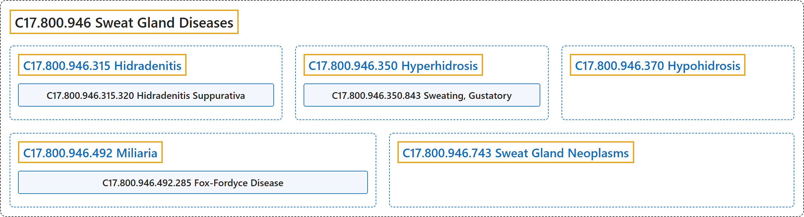

# C17.800.946 Sweat Gland Diseases

## Classification

## Glossary

| Term | Definition | 中文翻译 | Source |
|---|---|---|---|
| **C17.800.946 Sweat Gland Diseases** 汗腺疾病 | "**Diseases of the SWEAT GLANDS**." | **汗腺**（SWEAT GLANDS）**的疾病**。 | [National Library of Medicine, 2026, "Sweat Gland Diseases" scope note](https://meshb.nlm.nih.gov/record/ui?ui=D013543) |
| **C17.800.946.315 Hidradenitis** 汗腺炎 | "The **inflammation of a sweat gland** (usually of the apocrine type). The condition can be idiopathic or occur as a result of or in association with another underlying condition. Neutrophilic eccrine hidradenitis is a relatively rare variant that has been reported in patients undergoing chemotherapy, usually for non-Hodgkin lymphomas or leukemic conditions." | **汗腺的炎症**（通常为顶泌汗腺型）。该病可为特发性，或由另一种基础疾病引起或与之相关。中性粒细胞性外泌汗腺炎是一种相对罕见的变异型，见于接受化疗的患者，通常针对非霍奇金淋巴瘤或白血病。 | [National Library of Medicine, 2026, "Hidradenitis" scope note](https://meshb.nlm.nih.gov/record/ui?ui=D016575) |
| **C17.800.946.315.320 Hidradenitis Suppurativa** 化脓性汗腺炎 | "A **chronic suppurative and cicatricial disease of the apocrine glands** occurring chiefly in the axillae in women and in the groin and anal regions in men. It is characterized by poral occlusion with secondary bacterial infection, evolving into abscesses which eventually rupture. As the disease becomes chronic, ulcers appear, sinus tracts enlarge, fistulas develop, and fibrosis and scarring become evident." | 一种**大汗腺的慢性化脓性和瘢痕性疾病**，女性主要发生于腋窝，男性主要发生于腹股沟和肛周区域。其特征为毛孔闭塞继发细菌感染，发展为脓肿并最终破溃。随着疾病转为慢性，出现溃疡，窦道扩大，瘘管形成，纤维化和瘢痕变得明显。 | [National Library of Medicine, 2026, "Hidradenitis Suppurativa" scope note](https://meshb.nlm.nih.gov/record/ui?ui=D017497) |
| **C17.800.946.350 Hyperhidrosis** 多汗症 | "**Excessive sweating**. In the localized type, the most frequent sites are the palms, soles, axillae, inguinal folds, and the perineal area. Its chief cause is thought to be emotional. Generalized hyperhidrosis may be induced by a hot, humid environment, by fever, or by vigorous exercise." | **过度出汗**。局限型最常见的部位是手掌、足底、腋窝、腹股沟皱襞和会阴区。其主要原因被认为是情绪性的。全身性多汗症可由炎热潮湿的环境、发热或剧烈运动诱发。 | [National Library of Medicine, 2026, "Hyperhidrosis" scope note](https://meshb.nlm.nih.gov/record/ui?ui=D006945) |
| **C17.800.946.350.843 Sweating, Gustatory** 味觉性出汗 | "An autonomic disorder characterized by **excessive sweating of the forehead, upper lip, perioral region, or sternum subsequent to gustatory stimuli**. The auriculotemporal syndrome features facial flushing or sweating limited to the distribution of the auriculotemporal nerve and may develop after trauma to the parotid gland, in association with PAROTID NEOPLASMS, or following their surgical removal. (From Ann Neurol 1997 Dec;42(6):973-5)" | 一种自主神经障碍，特征为**味觉刺激后前额、上唇、口周区域或胸骨部位过度出汗**。耳颞神经综合征表现为局限于耳颞神经分布区的面部潮红或出汗，可在腮腺创伤后、伴发腮腺肿瘤（PAROTID NEOPLASMS）时或腮腺肿瘤手术切除后发生。（引自 Ann Neurol 1997 Dec;42(6):973-5） | [National Library of Medicine, 2026, "Sweating, Gustatory" scope note](https://meshb.nlm.nih.gov/record/ui?ui=D013547) |
| **C17.800.946.370 Hypohidrosis** 少汗症 | "**Abnormally diminished or absent perspiration**. Both generalized and segmented (reduced or absent sweating in circumscribed locations) forms of the disease are usually associated with other underlying conditions." | **出汗异常减少或缺失**。本病的全身型和节段型（局限部位出汗减少或缺失）通常都与其他基础疾病相关。 | [National Library of Medicine, 2026, "Hypohidrosis" scope note](https://meshb.nlm.nih.gov/record/ui?ui=D007007) |
| **C17.800.946.492 Miliaria** 粟粒疹（痱子） | "A syndrome of cutaneous changes associated with **sweat retention and extravasation of sweat** at different levels in the skin. Miliaria rubra, or prickly heat, results from apocrine duct obstruction. The sweat then seeps into the epidermis, producing pruritic erythematous papulovesicles. (From Dorland, 27th ed)" | 一种与**汗液潴留及汗液**在皮肤不同层次**外渗**相关的皮肤改变综合征。红色粟粒疹即痱子，由顶泌汗腺导管阻塞引起。汗液随后渗入表皮，产生瘙痒性红斑丘疱疹。（引自 Dorland，第 27 版） | [National Library of Medicine, 2026, "Miliaria" scope note](https://meshb.nlm.nih.gov/record/ui?ui=D008883) |
| **C17.800.946.492.285 Fox-Fordyce Disease** Fox-Fordyce 病 | "Chronic pruritic disease, usually in women, characterized by **small follicular papular eruptions** in APOCRINE GLANDS areas. It is caused by **obstruction and rupture of intraepidermal apocrine ducts**." | 一种慢性瘙痒性疾病，常见于女性，特征为顶泌汗腺（APOCRINE GLANDS）分布区的**小毛囊性丘疹**。由**表皮内顶泌汗腺导管阻塞和破裂**所致。 | [National Library of Medicine, 2026, "Fox-Fordyce Disease" scope note](https://meshb.nlm.nih.gov/record/ui?ui=D005588) |
| **C17.800.946.743 Sweat Gland Neoplasms** 汗腺肿瘤 | "**New abnormal growth of tissue in the SWEAT GLANDS**." | **汗腺**（SWEAT GLANDS）**内组织新的异常生长**。 | [National Library of Medicine, 2026, "Sweat Gland Neoplasms" scope note](https://meshb.nlm.nih.gov/record/ui?ui=D013544) |

## References

National Library of Medicine. (2026). *MeSH 2026 descriptor records* [Data set]. Retrieved October 28, 2026, from <https://www.nlm.nih.gov/databases/download/mesh.html>
