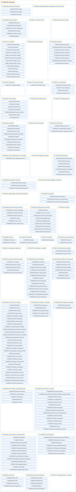

# C17.800 Skin Diseases

## Classification

## Glossary

| Term | Definition | 中文翻译 | Source |
|---|---|---|---|
| **C17.800 Skin Diseases** 皮肤疾病 | "**Diseases involving the DERMIS or EPIDERMIS**." | **累及真皮**（DERMIS）**或表皮**（EPIDERMIS）**的疾病**。 | [National Library of Medicine, 2026, "Skin Diseases" scope note](https://meshb.nlm.nih.gov/record/ui?ui=D012871) |
| **[C17.800.030 Acneiform Eruptions](c17-800-030-acneiform-eruptions.md)** 痤疮样疹 | "Visible **efflorescent lesions of the skin caused by acne or resembling acne**. (Dorland, 28th ed, p18, 575)" | 由**痤疮引起或类似痤疮的可见的皮肤发疹性损害**。（Dorland，第 28 版，第 18、575 页） | [National Library of Medicine, 2026, "Acneiform Eruptions" scope note](https://meshb.nlm.nih.gov/record/ui?ui=D017486) |
| **[C17.800.060 Angiolymphoid Hyperplasia with Eosinophilia](c17-800-060-angiolymphoid-hyperplasia-with-eosinophilia.md)** 血管淋巴样增生伴嗜酸性粒细胞增多 | "Solitary or multiple **benign cutaneous nodules** comprised of **immature and mature vascular structures** intermingled with endothelial cells and a varied infiltrate of eosinophils, histiocytes, lymphocytes, and mast cells." | 单发或多发的**良性皮肤结节**，由**未成熟和成熟的血管结构**组成，其间混杂内皮细胞以及由嗜酸性粒细胞、组织细胞、淋巴细胞和肥大细胞构成的多样浸润。 | [National Library of Medicine, 2026, "Angiolymphoid Hyperplasia with Eosinophilia" scope note](https://meshb.nlm.nih.gov/record/ui?ui=D000796) |
| **[C17.800.090 Breast Diseases](c17-800-090-breast-diseases.md)** 乳腺疾病 | "**Pathological processes of the BREAST**." | **乳房的病理过程**（BREAST）。 | [National Library of Medicine, 2026, "Breast Diseases" scope note](https://meshb.nlm.nih.gov/record/ui?ui=D001941) |
| **[C17.800.113 Calcinosis Cutis](c17-800-113-calcinosis-cutis.md)** 皮肤钙质沉着症 | "**Pathological deposition of calcium in the skin and subcutaneous tissue**. Excessive calcification of the skin may be associated with underlying diseases that cause tissue damage (e.g. EHLERS-DANLOS SYNDROME; PSEUDOXANTHOMA ELASTICUM; ROTHMUND-THOMSON SYNDROME; and WERNER SYNDROME) or that cause abnormal calcium and phosphate metabolism (e.g., CALCIPHYLAXIS; CHRONIC KIDNEY FAILURE; HYPERPARATHYROIDISM; and SARCOIDOSIS)." | **钙在皮肤和皮下组织中的病理性沉积**。皮肤过度钙化可能与引起组织损伤的基础疾病（如埃勒斯-当洛斯综合征（EHLERS-DANLOS SYNDROME）、弹性纤维假黄瘤（PSEUDOXANTHOMA ELASTICUM）、罗特蒙德-汤姆森综合征（ROTHMUND-THOMSON SYNDROME）和沃纳综合征（WERNER SYNDROME））有关，或与引起钙磷代谢异常的疾病（如钙化防御（CALCIPHYLAXIS）、慢性肾衰竭（CHRONIC KIDNEY FAILURE）、甲状旁腺功能亢进（HYPERPARATHYROIDISM）和结节病（SARCOIDOSIS））有关。 | [National Library of Medicine, 2026, "Calcinosis Cutis" scope note](https://meshb.nlm.nih.gov/record/ui?ui=D000092182) |
| **[C17.800.135 Cutaneous Fistula](c17-800-135-cutaneous-fistula.md)** 皮肤瘘 | "An **abnormal passage or communication leading from an internal organ to the surface of the body**." | 一种**从内脏器官通向体表的异常通道或交通**。 | [National Library of Medicine, 2026, "Cutaneous Fistula" scope note](https://meshb.nlm.nih.gov/record/ui?ui=D017577) |
| **[C17.800.174 Dermatitis](c17-800-174-dermatitis.md)** 皮炎 | "Any **inflammation of the skin**." | 任何**皮肤的炎症**。 | [National Library of Medicine, 2026, "Dermatitis" scope note](https://meshb.nlm.nih.gov/record/ui?ui=D003872) |
| **[C17.800.185 Dermatomyositis](c17-800-185-dermatomyositis.md)** 皮肌炎 | "A subacute or chronic **inflammatory disease of muscle and skin**, marked by **proximal muscle weakness and a characteristic skin rash**. The illness occurs with approximately equal frequency in children and adults. The skin lesions usually take the form of a purplish rash (or less often an exfoliative dermatitis) involving the nose, cheeks, forehead, upper trunk, and arms. The disease is associated with a complement mediated intramuscular microangiopathy, leading to loss of capillaries, muscle ischemia, muscle-fiber necrosis, and perifascicular atrophy. The childhood form of this disease tends to evolve into a systemic vasculitis. Dermatomyositis may occur in association with malignant neoplasms. (From Adams et al., Principles of Neurology, 6th ed, pp1405-6)" | 一种亚急性或慢性的**肌肉和皮肤炎症性疾病**，以**近端肌无力和特征性皮疹**为特点。该病在儿童和成人中的发病率大致相等。皮肤病变通常表现为紫红色皮疹（较少为剥脱性皮炎），累及鼻、面颊、前额、上躯干和上肢。该病与补体介导的肌内微血管病有关，导致毛细血管丧失、肌肉缺血、肌纤维坏死和束周萎缩。儿童型往往发展为系统性血管炎。皮肌炎可伴发恶性肿瘤。（引自 Adams 等，《神经病学原理》，第 6 版，第 1405-1406 页） | [National Library of Medicine, 2026, "Dermatomyositis" scope note](https://meshb.nlm.nih.gov/record/ui?ui=D003882) |
| **[C17.800.229 Erythema](c17-800-229-erythema.md)** 红斑 | "**Redness of the skin produced by congestion of the capillaries**. This condition may result from a variety of disease processes." | **由毛细血管充血引起的皮肤发红**。此病症可由多种疾病过程引起。 | [National Library of Medicine, 2026, "Erythema" scope note](https://meshb.nlm.nih.gov/record/ui?ui=D004890) |
| **[C17.800.257 Exanthema](c17-800-257-exanthema.md)** 疹病 | "Diseases in which **skin eruptions or rashes are a prominent manifestation**. Classically, six such diseases were described with similar rashes; they were numbered in the order in which they were reported. Only the fourth (Duke's disease), fifth (ERYTHEMA INFECTIOSUM), and sixth (EXANTHEMA SUBITUM) numeric designations survive as occasional synonyms in current terminology." | 以**皮疹或出疹为突出表现**的疾病。传统上曾描述过六种皮疹相似的此类疾病，按报道顺序编号。在当前术语中，只有第四病（杜克病）、第五病（传染性红斑（ERYTHEMA INFECTIOSUM））和第六病（幼儿急疹（EXANTHEMA SUBITUM））的数字名称仍偶尔作为同义词使用。 | [National Library of Medicine, 2026, "Exanthema" scope note](https://meshb.nlm.nih.gov/record/ui?ui=D005076) |
| **[C17.800.271 Facial Dermatoses](c17-800-271-facial-dermatoses.md)** 面部皮肤病 | "**Skin diseases involving the FACE**." | **累及面部**（FACE）**的皮肤疾病**。 | [National Library of Medicine, 2026, "Facial Dermatoses" scope note](https://meshb.nlm.nih.gov/record/ui?ui=D005148) |
| **[C17.800.321 Foot Diseases](c17-800-321-foot-diseases.md)** 足疾病 | "**Anatomical and functional disorders affecting the foot**." | **累及足部的解剖和功能障碍**。 | [National Library of Medicine, 2026, "Foot Diseases" scope note](https://meshb.nlm.nih.gov/record/ui?ui=D005534) |
| **[C17.800.329 Hair Diseases](c17-800-329-hair-diseases.md)** 毛发疾病 | "Diseases affecting the **orderly growth and persistence of hair**." | 影响**毛发有序生长和存续**的疾病。 | [National Library of Medicine, 2026, "Hair Diseases" scope note](https://meshb.nlm.nih.gov/record/ui?ui=D006201) |
| **[C17.800.338 Hand Dermatoses](c17-800-338-hand-dermatoses.md)** 手部皮肤病 | "**Skin diseases involving the HANDS**." | **累及手部**（HANDS）**的皮肤疾病**。 | [National Library of Medicine, 2026, "Hand Dermatoses" scope note](https://meshb.nlm.nih.gov/record/ui?ui=D006229) |
| **[C17.800.417 Keratoacanthoma](c17-800-417-keratoacanthoma.md)** 角化棘皮瘤 | "A **benign, non-neoplastic, usually self-limiting epithelial lesion** **closely resembling squamous cell carcinoma** clinically and histopathologically. It occurs in solitary, multiple, and eruptive forms. The solitary and multiple forms occur on sunlight exposed areas and are identical histologically; they affect primarily white males. The eruptive form usually involves both sexes and appears as a generalized papular eruption." | 一种**良性、非肿瘤性、通常具有自限性的上皮病变**，在临床和组织病理学上**与鳞状细胞癌极为相似**。它有单发型、多发型和发疹型。单发型和多发型发生于日光暴露部位，组织学上相同，主要累及白人男性。发疹型通常两性均可累及，表现为泛发性丘疹样皮疹。 | [National Library of Medicine, 2026, "Keratoacanthoma" scope note](https://meshb.nlm.nih.gov/record/ui?ui=D007636) |
| **[C17.800.428 Keratosis](c17-800-428-keratosis.md)** 角化病 | "**Any horny growth** such as a wart or callus." | **任何角质增生物**，如疣或胼胝。 | [National Library of Medicine, 2026, "Keratosis" scope note](https://meshb.nlm.nih.gov/record/ui?ui=D007642) |
| **[C17.800.446 Leg Dermatoses](c17-800-446-leg-dermatoses.md)** 腿皮肤病 | "A nonspecific term used to denote **any cutaneous lesion or group of lesions, or eruptions of any type on the leg**. (From Stedman, 25th ed)" | 一个非特异性术语，用于指**腿部的任何皮肤损害或损害群，或任何类型的皮疹**。（引自 Stedman，第 25 版） | [National Library of Medicine, 2026, "Leg Dermatoses" scope note](https://meshb.nlm.nih.gov/record/ui?ui=D007868) |
| **[C17.800.463 Lipomatosis](c17-800-463-lipomatosis.md)** 脂肪过多症 | "A disorder characterized by the **accumulation of encapsulated or unencapsulated tumor-like fatty tissue** resembling LIPOMA." | 一种疾病，其特征为类似脂肪瘤（LIPOMA）的**有包膜或无包膜的肿瘤样脂肪组织蓄积**。 | [National Library of Medicine, 2026, "Lipomatosis" scope note](https://meshb.nlm.nih.gov/record/ui?ui=D008068) |
| **[C17.800.480 Lupus Erythematosus, Cutaneous](c17-800-480-lupus-erythematosus-cutaneous.md)** 皮肤型红斑狼疮 | "A form of lupus erythematosus in which **the skin may be the only organ involved** or in which skin involvement precedes the spread into other body systems. It has been classified into three forms - acute (= LUPUS ERYTHEMATOSUS, SYSTEMIC with skin lesions), subacute, and chronic (= LUPUS ERYTHEMATOSUS, DISCOID)." | 红斑狼疮的一种类型，其中**皮肤可能是唯一受累的器官**，或皮肤受累先于向其他身体系统的扩散。分为三型：急性（即伴有皮肤病变的系统性红斑狼疮（LUPUS ERYTHEMATOSUS, SYSTEMIC））、亚急性和慢性（即盘状红斑狼疮（LUPUS ERYTHEMATOSUS, DISCOID））。 | [National Library of Medicine, 2026, "Lupus Erythematosus, Cutaneous" scope note](https://meshb.nlm.nih.gov/record/ui?ui=D008178) |
| **[C17.800.518 Morgellons Disease](c17-800-518-morgellons-disease.md)** 莫吉隆斯病 | "An unexplained illness which is characterized by skin manifestations including **non-healing lesions, itching, and the appearance of fibers**." | 一种不明原因的疾病，特征为皮肤表现，包括**不愈合的损害、瘙痒以及纤维出现**。 | [National Library of Medicine, 2026, "Morgellons Disease" scope note](https://meshb.nlm.nih.gov/record/ui?ui=D055535) |
| **[C17.800.529 Nail Diseases](c17-800-529-nail-diseases.md)** 甲疾病 | "**Diseases of the nail plate and tissues surrounding it**. The concept is limited to primates." | **甲板及其周围组织的疾病**。该概念限于灵长类。 | [National Library of Medicine, 2026, "Nail Diseases" scope note](https://meshb.nlm.nih.gov/record/ui?ui=D009260) |
| **[C17.800.550 Necrobiotic Disorders](c17-800-550-necrobiotic-disorders.md)** 渐进性坏死性疾病 | "A group of disorders characterized by **swelling, basophilia, and distortion of collagen bundles in the dermis**." | 一组疾病，其特征为**真皮内胶原束的肿胀、嗜碱性变和扭曲**。 | [National Library of Medicine, 2026, "Necrobiotic Disorders" scope note](https://meshb.nlm.nih.gov/record/ui?ui=D017441) |
| **[C17.800.551 Necrolytic Migratory Erythema](c17-800-551-necrolytic-migratory-erythema.md)** 坏死松解性游走性红斑 | "**Recurrent cutaneous manifestation of GLUCAGONOMA** characterized by necrolytic polycyclic migratory lesions with scaling borders. It is associated with elevated secretion of GLUCAGON by the tumor. Other conditions with elevated serum glucagon levels such as HEPATIC CIRRHOSIS may also result in similar skin lesions, which are referred to as pseudoglucagonoma syndrome." | **胰高血糖素瘤**（GLUCAGONOMA）**的复发性皮肤表现**，特征为坏死松解性、多环状、游走性损害，边缘有鳞屑。它与肿瘤分泌胰高血糖素（GLUCAGON）增多相关。其他血清胰高血糖素水平升高的病症如肝硬化（HEPATIC CIRRHOSIS）也可引起类似皮肤损害，称为假性胰高血糖素瘤综合征。 | [National Library of Medicine, 2026, "Necrolytic Migratory Erythema" scope note](https://meshb.nlm.nih.gov/record/ui?ui=D058568) |
| **[C17.800.553 Nephrogenic Fibrosing Dermopathy](c17-800-553-nephrogenic-fibrosing-dermopathy.md)** 肾源性纤维化皮病 | "A chronic, acquired, idiopathic, **progressive eruption of the skin that occurs in the context of RENAL FAILURE**. It is sometimes accompanied by systemic fibrosis. The pathogenesis seems to be multifactorial, with postulated involvement of circulating fibrocytes. There is a strong association between this disorder and the use of **gadolinium-based contrast agents**." | 一种慢性、获得性、特发性、**在肾衰竭**（RENAL FAILURE）**背景下发生的进行性皮疹**。有时伴有系统性纤维化。其发病机制似为多因素，推测与循环纤维细胞有关。本病与使用**钆基造影剂**之间存在密切关联。 | [National Library of Medicine, 2026, "Nephrogenic Fibrosing Dermopathy" scope note](https://meshb.nlm.nih.gov/record/ui?ui=D054989) |
| **[C17.800.566 Panniculitis](c17-800-566-panniculitis.md)** 脂膜炎 | "General term for **inflammation of adipose tissue**, usually of the skin, characterized by **reddened subcutaneous nodules**." | **脂肪组织炎症**的总称，通常发生于皮肤，特征为**发红的皮下结节**。 | [National Library of Medicine, 2026, "Panniculitis" scope note](https://meshb.nlm.nih.gov/record/ui?ui=D015434) |
| **[C17.800.600 Photosensitivity Disorders](c17-800-600-photosensitivity-disorders.md)** 光敏性疾病 | "**Abnormal responses to sunlight or artificial light** due to **extreme reactivity of light-absorbing molecules in tissues**. It refers almost exclusively to skin photosensitivity, including sunburn, reactions due to repeated prolonged exposure in the absence of photosensitizing factors, and reactions requiring photosensitizing factors such as photosensitizing agents and certain diseases. With restricted reference to skin tissue, it does not include photosensitivity of the eye to light, as in photophobia or photosensitive epilepsy." | **对日光或人工光的异常反应**，由**组织中吸光分子的极端反应性**所致。它几乎专指皮肤光敏性，包括晒伤、无光敏因素时反复长时间暴露引起的反应，以及需要光敏因素（如光敏剂和某些疾病）的反应。由于仅限于皮肤组织，它不包括眼对光的光敏性，如畏光或光敏性癫痫。 | [National Library of Medicine, 2026, "Photosensitivity Disorders" scope note](https://meshb.nlm.nih.gov/record/ui?ui=D010787) |
| **[C17.800.621 Pigmentation Disorders](c17-800-621-pigmentation-disorders.md)** 色素沉着障碍 | "**Diseases affecting PIGMENTATION**, including SKIN PIGMENTATION." | **影响色素沉着**（PIGMENTATION）**的疾病**，包括皮肤色素沉着（SKIN PIGMENTATION）。 | [National Library of Medicine, 2026, "Pigmentation Disorders" scope note](https://meshb.nlm.nih.gov/record/ui?ui=D010859) |
| **[C17.800.674 Prurigo](c17-800-674-prurigo.md)** 痒疹 | "A name applied to **several itchy skin eruptions of unknown cause**. The characteristic course is the formation of a dome-shaped papule with a small transient vesicle on top, followed by crusting over or lichenification. (From Dorland, 27th ed)" | 对**若干原因不明的瘙痒性皮疹**的统称。典型病程是形成顶端带有小的一过性水疱的圆顶状丘疹，随后结痂或苔藓样变。（引自 Dorland，第 27 版） | [National Library of Medicine, 2026, "Prurigo" scope note](https://meshb.nlm.nih.gov/record/ui?ui=D011536) |
| **[C17.800.685 Pruritus](c17-800-685-pruritus.md)** 瘙痒 | "An **intense itching sensation** that produces the **urge to rub or scratch the skin** to obtain relief." | 一种**强烈的痒感**，使人产生**想要摩擦或搔抓皮肤的冲动**以求缓解。 | [National Library of Medicine, 2026, "Pruritus" scope note](https://meshb.nlm.nih.gov/record/ui?ui=D011537) |
| **[C17.800.695 Pyoderma](c17-800-695-pyoderma.md)** 脓皮病 | "Any **purulent skin disease** (Dorland, 27th ed)." | 任何**化脓性皮肤病**（Dorland，第 27 版）。 | [National Library of Medicine, 2026, "Pyoderma" scope note](https://meshb.nlm.nih.gov/record/ui?ui=D011711) |
| **[C17.800.716 Rosacea](c17-800-716-rosacea.md)** 酒渣鼻 | "A cutaneous disorder primarily of **convexities of the central part of the FACE**, such as FOREHEAD; CHEEK; NOSE; and CHIN. It is characterized by FLUSHING; ERYTHEMA; EDEMA; RHINOPHYMA; papules; and ocular symptoms. It may occur at any age but typically after age 30. There are various subtypes of rosacea: erythematotelangiectatic, papulopustular, phymatous, and ocular (National Rosacea Society's Expert Committee on the Classification and Staging of Rosacea, J Am Acad Dermatol 2002; 46:584-7)." | 一种主要累及**面部**（FACE）**中央凸出部位**的皮肤病，如前额（FOREHEAD）、面颊（CHEEK）、鼻（NOSE）和下颏（CHIN）。其特征为潮红（FLUSHING）、红斑（ERYTHEMA）、水肿（EDEMA）、鼻赘（RHINOPHYMA）、丘疹及眼部症状。可发生于任何年龄，但通常在 30 岁以后。酒渣鼻有多种亚型：红斑毛细血管扩张型、丘疹脓疱型、肥大增生型和眼型（美国国家酒渣鼻协会酒渣鼻分类与分期专家委员会，J Am Acad Dermatol 2002；46:584-7）。 | [National Library of Medicine, 2026, "Rosacea" scope note](https://meshb.nlm.nih.gov/record/ui?ui=D012393) |
| **[C17.800.738 Scalp Dermatoses](c17-800-738-scalp-dermatoses.md)** 头皮皮肤病 | "**Skin diseases involving the SCALP**." | **累及头皮的皮肤病**（SCALP）。 | [National Library of Medicine, 2026, "Scalp Dermatoses" scope note](https://meshb.nlm.nih.gov/record/ui?ui=D012536) |
| **[C17.800.751 Scleredema Adultorum](c17-800-751-scleredema-adultorum.md)** 成人硬肿病 | "A **diffuse, non-pitting induration of the skin** of unknown etiology that occurs most commonly in association with diabetes mellitus, predominantly in females. It typically begins on the face or head and spreads to other areas of the body, sometimes involving noncutaneous tissues. Often it is preceded by any of various infections, notably staphylococcal infections. The condition resolves spontaneously, usually within two years of onset. (From Dorland, 27th ed)" | 一种病因不明的**弥漫性、非凹陷性皮肤硬肿**，最常与糖尿病相伴发生，以女性为主。它通常始于面部或头部，并扩展到身体其他部位，有时累及皮肤以外的组织。发病前常有各种感染，尤其是葡萄球菌感染。该病可自发消退，通常在发病后两年内。（引自 Dorland，第 27 版） | [National Library of Medicine, 2026, "Scleredema Adultorum" scope note](https://meshb.nlm.nih.gov/record/ui?ui=D012592) |
| **[C17.800.767 Scleroderma, Localized](c17-800-767-scleroderma-localized.md)** 局限性硬皮病 | "A term used to describe a variety of **localized asymmetrical SKIN thickening** that is similar to those of SYSTEMIC SCLERODERMA but without the disease features in the multiple internal organs and BLOOD VESSELS. Lesions may be characterized as patches or plaques (morphea), bands (linear), or nodules." | 用于描述多种**局限性不对称皮肤**（SKIN）**增厚**的术语，类似于系统性硬皮病（SYSTEMIC SCLERODERMA）的皮肤增厚，但没有多个内脏器官和血管（BLOOD VESSELS）的病变特征。皮损可表现为斑片或斑块（硬斑病）、带状（线状）或结节。 | [National Library of Medicine, 2026, "Scleroderma, Localized" scope note](https://meshb.nlm.nih.gov/record/ui?ui=D012594) |
| **[C17.800.784 Scleroderma, Systemic](c17-800-784-scleroderma-systemic.md)** 系统性硬皮病 | "A **chronic multi-system disorder of CONNECTIVE TISSUE**. It is characterized by SCLEROSIS in the SKIN, the LUNGS, the HEART, the GASTROINTESTINAL TRACT, the KIDNEYS, and the MUSCULOSKELETAL SYSTEM. Other important features include diseased small BLOOD VESSELS and AUTOANTIBODIES. The disorder is named for its most prominent feature (hard skin), and classified into subsets by the extent of skin thickening: LIMITED SCLERODERMA and DIFFUSE SCLERODERMA." | 一种**结缔组织**（CONNECTIVE TISSUE）**的慢性多系统疾病**。其特征为皮肤（SKIN）、肺（LUNGS）、心脏（HEART）、胃肠道（GASTROINTESTINAL TRACT）、肾（KIDNEYS）和肌肉骨骼系统（MUSCULOSKELETAL SYSTEM）的硬化（SCLEROSIS）。其他重要特征包括小血管（BLOOD VESSELS）病变和自身抗体（AUTOANTIBODIES）。该病以其最突出的特征（皮肤变硬）命名，并按皮肤增厚的范围分为亚型：局限性硬皮病（LIMITED SCLERODERMA）和弥漫性硬皮病（DIFFUSE SCLERODERMA）。 | [National Library of Medicine, 2026, "Scleroderma, Systemic" scope note](https://meshb.nlm.nih.gov/record/ui?ui=D012595) |
| **[C17.800.794 Sebaceous Gland Diseases](c17-800-794-sebaceous-gland-diseases.md)** 皮脂腺疾病 | "**Diseases of the sebaceous glands** such as sebaceous hyperplasia and sebaceous cell carcinoma (SEBACEOUS GLAND NEOPLASMS)." | **皮脂腺的疾病**，如皮脂腺增生和皮脂腺细胞癌（皮脂腺肿瘤（SEBACEOUS GLAND NEOPLASMS））。 | [National Library of Medicine, 2026, "Sebaceous Gland Diseases" scope note](https://meshb.nlm.nih.gov/record/ui?ui=D012625) |
| **[C17.800.804 Skin Abnormalities](c17-800-804-skin-abnormalities.md)** 皮肤异常 | "**Congenital structural abnormalities of the skin**." | **皮肤的先天性结构异常**。 | [National Library of Medicine, 2026, "Skin Abnormalities" scope note](https://meshb.nlm.nih.gov/record/ui?ui=D012868) |
| **[C17.800.815 Skin Diseases, Eczematous](c17-800-815-skin-diseases-eczematous.md)** 湿疹样皮肤病 | "Any of a variety of **eruptive skin disorders** characterized by **erythema, oozing, vesiculation, and scaling**. Etiology is varied." | 多种**发疹性皮肤病**中的任何一种，特征为**红斑、渗出、水疱形成和鳞屑**。病因多样。 | [National Library of Medicine, 2026, "Skin Diseases, Eczematous" scope note](https://meshb.nlm.nih.gov/record/ui?ui=D017443) |
| **[C17.800.827 Skin Diseases, Genetic](c17-800-827-skin-diseases-genetic.md)** 遗传性皮肤病 | "**Diseases of the skin with a genetic component**, usually the result of various inborn errors of metabolism." | **具有遗传成分的皮肤疾病**，通常是各种先天性代谢缺陷的结果。 | [National Library of Medicine, 2026, "Skin Diseases, Genetic" scope note](https://meshb.nlm.nih.gov/record/ui?ui=D012873) |
| **[C17.800.838 Skin Diseases, Infectious](c17-800-838-skin-diseases-infectious.md)** 感染性皮肤病 | "Skin diseases **caused by bacteria, fungi, parasites, or viruses**." | **由细菌、真菌、寄生虫或病毒引起**的皮肤病。 | [National Library of Medicine, 2026, "Skin Diseases, Infectious" scope note](https://meshb.nlm.nih.gov/record/ui?ui=D012874) |
| **[C17.800.849 Skin Diseases, Metabolic](c17-800-849-skin-diseases-metabolic.md)** 代谢性皮肤病 | "Diseases of the skin associated with **underlying metabolic disorders**." | 与**基础代谢紊乱**相关的皮肤疾病。 | [National Library of Medicine, 2026, "Skin Diseases, Metabolic" scope note](https://meshb.nlm.nih.gov/record/ui?ui=D012875) |
| **[C17.800.859 Skin Diseases, Papulosquamous](c17-800-859-skin-diseases-papulosquamous.md)** 丘疹鳞屑性皮肤病 | "A group of dermatoses with distinct morphologic features. The **primary lesion is most commonly a papule**, usually erythematous, with a **variable degree of scaling** on the surface. Plaques form through the coalescing of primary lesions." | 一组具有独特形态特征的皮肤病。**原发皮损最常见为丘疹**，通常为红斑性，表面有**不同程度的鳞屑**。原发皮损融合形成斑块。 | [National Library of Medicine, 2026, "Skin Diseases, Papulosquamous" scope note](https://meshb.nlm.nih.gov/record/ui?ui=D017444) |
| **[C17.800.862 Skin Diseases, Vascular](c17-800-862-skin-diseases-vascular.md)** 血管性皮肤病 | "Skin diseases **affecting or involving the cutaneous blood vessels** and generally manifested as inflammation, swelling, erythema, or necrosis in the affected area." | **影响或累及皮肤血管**的皮肤疾病，通常在受累部位表现为炎症、肿胀、红斑或坏死。 | [National Library of Medicine, 2026, "Skin Diseases, Vascular" scope note](https://meshb.nlm.nih.gov/record/ui?ui=D017445) |
| **[C17.800.865 Skin Diseases, Vesiculobullous](c17-800-865-skin-diseases-vesiculobullous.md)** 水疱大疱性皮肤病 | "Skin diseases characterized by **local or general distributions of blisters**. They are classified according to the site and mode of blister formation. Lesions can appear spontaneously or be precipitated by infection, trauma, or sunlight. Etiologies include immunologic and genetic factors. (From Scientific American Medicine, 1990)" | 以**局部或全身分布的水疱**为特征的皮肤疾病。根据水疱形成的部位和方式进行分类。皮损可自发出现，或由感染、外伤或日光诱发。病因包括免疫和遗传因素。（引自 Scientific American Medicine，1990） | [National Library of Medicine, 2026, "Skin Diseases, Vesiculobullous" scope note](https://meshb.nlm.nih.gov/record/ui?ui=D012872) |
| **[C17.800.882 Skin Neoplasms](c17-800-882-skin-neoplasms.md)** 皮肤肿瘤 | "**Tumors or cancer of the SKIN**." | **皮肤**（SKIN）**的肿瘤或癌**。 | [National Library of Medicine, 2026, "Skin Neoplasms" scope note](https://meshb.nlm.nih.gov/record/ui?ui=D012878) |
| **[C17.800.893 Skin Ulcer](c17-800-893-skin-ulcer.md)** 皮肤溃疡 | "An **ULCER of the skin and underlying tissues**." | **皮肤及其下组织的溃疡**（ULCER）。 | [National Library of Medicine, 2026, "Skin Ulcer" scope note](https://meshb.nlm.nih.gov/record/ui?ui=D012883) |
| **[C17.800.946 Sweat Gland Diseases](c17-800-946-sweat-gland-diseases.md)** 汗腺疾病 | "**Diseases of the SWEAT GLANDS**." | **汗腺**（SWEAT GLANDS）**的疾病**。 | [National Library of Medicine, 2026, "Sweat Gland Diseases" scope note](https://meshb.nlm.nih.gov/record/ui?ui=D013543) |
| **[C17.800.973 Xanthogranuloma, Juvenile](c17-800-973-xanthogranuloma-juvenile.md)** 幼年黄色肉芽肿 | "Benign disorder of infants and children caused by **proliferation of HISTIOCYTES**, macrophages found in tissues. These histiocytes, usually lipid-laden non-Langerhans cells, form **multiple yellow-red nodules** most often in the skin, the eye, and sometimes in the viscera. Patients appear to have normal lipid metabolism and are classified as a normolipemic non-Langerhans cell histiocytosis." | 婴儿和儿童的良性疾病，由**组织细胞**（HISTIOCYTES）**增生**所致，组织细胞即存在于组织中的巨噬细胞。这些组织细胞通常为富含脂质的非朗格汉斯细胞，形成**多发性黄红色结节**，最常见于皮肤、眼，有时见于内脏。患者脂质代谢似乎正常，被归类为血脂正常的非朗格汉斯细胞组织细胞增生症。 | [National Library of Medicine, 2026, "Xanthogranuloma, Juvenile" scope note](https://meshb.nlm.nih.gov/record/ui?ui=D014972) |

## References

National Library of Medicine. (2026). *MeSH 2026 descriptor records* [Data set]. Retrieved October 28, 2026, from <https://www.nlm.nih.gov/databases/download/mesh.html>
