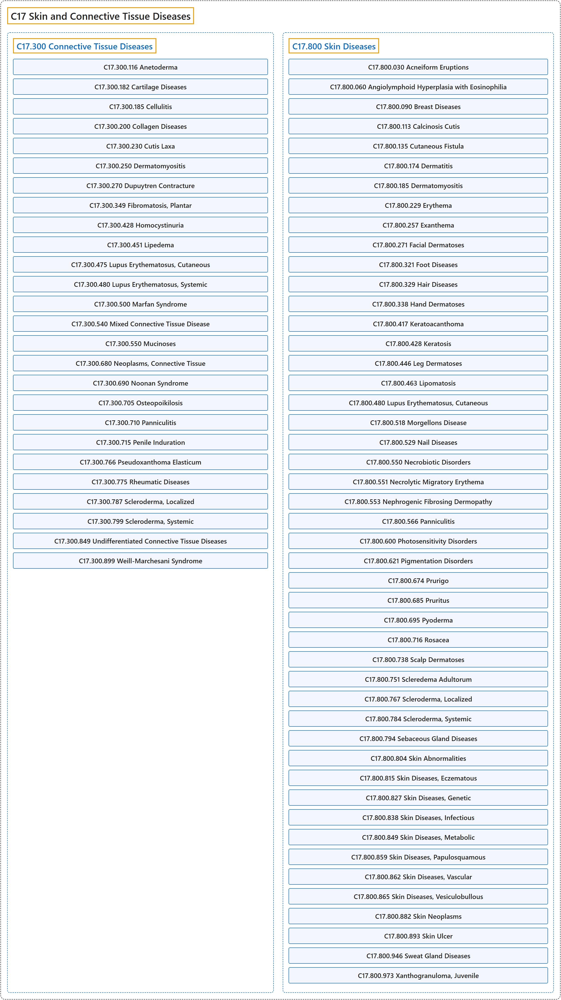

# C17 Skin and Connective Tissue Diseases

## Classification

## Glossary

| Term | Definition | 中文翻译 | Source |
|---|---|---|---|
| **C17 Skin and Connective Tissue Diseases** 皮肤和结缔组织疾病 | "A collective term for **diseases of the skin and its appendages and of connective tissue**." | 对**皮肤及其附属器以及结缔组织的疾病**的统称。 | [National Library of Medicine, 2026, "Skin and Connective Tissue Diseases" scope note](https://meshb.nlm.nih.gov/record/ui?ui=D017437) |
| **[C17.300 Connective Tissue Diseases](c17-300-connective-tissue-diseases.md)** 结缔组织疾病 | "A heterogeneous group of disorders, some hereditary, others acquired, characterized by **abnormal structure or function of one or more of the elements of connective tissue**, i.e., collagen, elastin, or the mucopolysaccharides." | 一组异质性疾病，有些为遗传性，另一些为获得性，其特征是**结缔组织一种或多种成分的结构或功能异常**，这些成分即胶原、弹性蛋白或黏多糖。 | [National Library of Medicine, 2026, "Connective Tissue Diseases" scope note](https://meshb.nlm.nih.gov/record/ui?ui=D003240) |
| **[C17.800 Skin Diseases](c17-800-skin-diseases/index.md)** 皮肤疾病 | "**Diseases involving the DERMIS or EPIDERMIS**." | **累及真皮**（DERMIS）**或表皮**（EPIDERMIS）**的疾病**。 | [National Library of Medicine, 2026, "Skin Diseases" scope note](https://meshb.nlm.nih.gov/record/ui?ui=D012871) |

## References

National Library of Medicine. (2026). *MeSH 2026 descriptor records* [Data set]. Retrieved October 28, 2026, from <https://www.nlm.nih.gov/databases/download/mesh.html>
