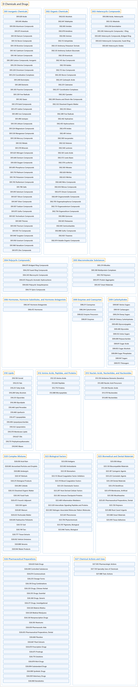

# D Chemicals and Drugs

## Classification

## Glossary

| Term | Definition | 中文翻译 | Source |
|---|---|---|---|
| **D Chemicals and Drugs** 化学品和药物 | (No definition) | （无定义） | [National Library of Medicine, 2026](https://meshb.nlm.nih.gov/treeView) |
| **[D01 Inorganic Chemicals](d01-inorganic-chemicals.md)** 无机化学品 | "A broad class of substances encompassing all those that **do not include carbon and its derivatives** as their principal elements. However, carbides, carbonates, cyanides, cyanates, and carbon disulfide are included in this class." | 一大类物质，涵盖所有**不以碳及其衍生物**为主要元素的物质。不过，碳化物、碳酸盐、氰化物、氰酸盐和二硫化碳也归入此类。 | [National Library of Medicine, 2026, "Inorganic Chemicals" scope note](https://meshb.nlm.nih.gov/record/ui?ui=D007287) |
| **[D02 Organic Chemicals](d02-organic-chemicals.md)** 有机化学品 | "A broad class of substances **containing carbon and its derivatives**. Many of these chemicals will frequently contain hydrogen with or without oxygen, nitrogen, sulfur, phosphorus, and other elements. They exist in either carbon chain or carbon ring form." | 一大类**含有碳及其衍生物**的物质。这些化学品常含氢，可含或不含氧、氮、硫、磷和其他元素。它们以碳链或碳环的形式存在。 | [National Library of Medicine, 2026, "Organic Chemicals" scope note](https://meshb.nlm.nih.gov/record/ui?ui=D009930) |
| **[D03 Heterocyclic Compounds](d03-heterocyclic-compounds.md)** 杂环化合物 | "Cyclic compounds that include **atoms other than carbon in their ring structure**." | **环结构中含有碳以外原子**的环状化合物。 | [National Library of Medicine, 2026, "Heterocyclic Compounds" scope note](https://meshb.nlm.nih.gov/record/ui?ui=D006571) |
| **[D04 Polycyclic Compounds](d04-polycyclic-compounds.md)** 多环化合物 | "Compounds which contain **two or more rings** in their structure." | 结构中含有**两个或更多环**的化合物。 | [National Library of Medicine, 2026, "Polycyclic Compounds" scope note](https://meshb.nlm.nih.gov/record/ui?ui=D011083) |
| **[D05 Macromolecular Substances](d05-macromolecular-substances.md)** 大分子物质 | "Compounds and molecular complexes that consist of **very large numbers of atoms** and are generally over 500 kDa in size. In biological systems macromolecular substances usually can be visualized using ELECTRON MICROSCOPY and are distinguished from ORGANELLES by the lack of a membrane structure." | 由**极多原子**组成的化合物和分子复合物，大小一般超过 500 kDa。在生物系统中，大分子物质通常可用电子显微镜（ELECTRON MICROSCOPY）观察，并因没有膜结构而与细胞器（ORGANELLES）相区别。 | [National Library of Medicine, 2026, "Macromolecular Substances" scope note](https://meshb.nlm.nih.gov/record/ui?ui=D046911) |
| **[D06 Hormones, Hormone Substitutes, and Hormone Antagonists](d06-hormones-hormone-substitutes-and-hormone-antagonists.md)** 激素、激素代用品和激素拮抗剂 | "A collective grouping for both naturally occurring and synthetic **hormones, substitutes, and antagonists**." | 天然和合成的**激素、代用品和拮抗剂**的统称。 | [National Library of Medicine, 2026, "Hormones, Hormone Substitutes, and Hormone Antagonists" scope note](https://meshb.nlm.nih.gov/record/ui?ui=D006730) |
| **[D08 Enzymes and Coenzymes](d08-enzymes-and-coenzymes.md)** 酶和辅酶 | "**Biological catalysts and their cofactors**." | **生物催化剂及其辅因子**。 | [National Library of Medicine, 2026, "Enzymes and Coenzymes" scope note](https://meshb.nlm.nih.gov/record/ui?ui=D045762) |
| **[D09 Carbohydrates](d09-carbohydrates.md)** 碳水化合物 | "A class of organic compounds composed of **carbon, hydrogen, and oxygen** in a ratio of Cn(H2O)n. The **largest class of organic compounds**, including STARCH; GLYCOGEN; CELLULOSE; POLYSACCHARIDES; and simple MONOSACCHARIDES." | 一类由**碳、氢和氧**按 Cn(H2O)n 比例组成的有机化合物。是**最大的一类有机化合物**，包括淀粉（STARCH）、糖原（GLYCOGEN）、纤维素（CELLULOSE）、多糖（POLYSACCHARIDES）和简单的单糖（MONOSACCHARIDES）。 | [National Library of Medicine, 2026, "Carbohydrates" scope note](https://meshb.nlm.nih.gov/record/ui?ui=D002241) |
| **[D10 Lipids](d10-lipids.md)** 脂质 | "A generic term for **fats and lipoids**, the alcohol-ether-soluble constituents of protoplasm, which are **insoluble in water**." | **脂肪和类脂**的总称，是原生质中可溶于醇和醚的成分，**不溶于水**。 | [National Library of Medicine, 2026, "Lipids" scope note](https://meshb.nlm.nih.gov/record/ui?ui=D008055) |
| **[D12 Amino Acids, Peptides, and Proteins](d12-amino-acids-peptides-and-proteins.md)** 氨基酸、肽和蛋白质 | "Amino acids and chains of amino acids **connected by peptide linkages**." | 氨基酸，以及**由肽键连接**的氨基酸链。 | [National Library of Medicine, 2026, "Amino Acids, Peptides, and Proteins" scope note](https://meshb.nlm.nih.gov/record/ui?ui=D000602) |
| **[D13 Nucleic Acids, Nucleotides, and Nucleosides](d13-nucleic-acids-nucleotides-and-nucleosides.md)** 核酸、核苷酸和核苷 | "Complex compounds of high molecular weight occurring in living cells. These are basically of two types, **ribonucleic (RNA) and deoxyribonucleic (DNA) acids**, both of which consist of nucleotides (nucleoside phosphates linked together by phosphate bridges)." | 存在于活细胞中的高分子量复杂化合物。基本上分为两类，**核糖核酸（RNA）和脱氧核糖核酸（DNA）**，两者都由核苷酸组成（核苷磷酸通过磷酸桥连接在一起）。 | [National Library of Medicine, 2026, "Nucleic Acids, Nucleotides, and Nucleosides" scope note](https://meshb.nlm.nih.gov/record/ui?ui=D009706) |
| **[D20 Complex Mixtures](d20-complex-mixtures.md)** 复杂混合物 | "**Mixtures of many components in inexact proportions**, usually natural, such as PLANT EXTRACTS; VENOMS; and MANURE. These are distinguished from DRUG COMBINATIONS which have only a few components in definite proportions." | **由多种成分按不确定比例组成的混合物**，通常来自天然，如植物提取物（PLANT EXTRACTS）、毒液（VENOMS）和粪肥（MANURE）。它们有别于药物组合（DRUG COMBINATIONS），后者只有少数成分且比例确定。 | [National Library of Medicine, 2026, "Complex Mixtures" scope note](https://meshb.nlm.nih.gov/record/ui?ui=D045424) |
| **[D23 Biological Factors](d23-biological-factors.md)** 生物因子 | "**Endogenously synthesized compounds** that influence biological processes not otherwise classified under ENZYMES; HORMONES or HORMONE ANTAGONISTS." | **内源合成的化合物**，影响生物过程，且未另归入酶（ENZYMES）、激素（HORMONES）或激素拮抗剂（HORMONE ANTAGONISTS）。 | [National Library of Medicine, 2026, "Biological Factors" scope note](https://meshb.nlm.nih.gov/record/ui?ui=D001685) |
| **[D25 Biomedical and Dental Materials](d25-biomedical-and-dental-materials.md)** 生物医学和牙科材料 | "Substances used in biomedicine or dentistry predominantly for their **physical, as opposed to chemical, properties**." | 在生物医学或牙科中使用的物质，主要利用其**物理性质而非化学性质**。 | [National Library of Medicine, 2026, "Biomedical and Dental Materials" scope note](https://meshb.nlm.nih.gov/record/ui?ui=D001697) |
| **[D26 Pharmaceutical Preparations](d26-pharmaceutical-preparations.md)** 药物制剂 | "Drugs intended for human or veterinary use, presented in their **finished dosage form**. Included here are materials used in the preparation and/or formulation of the finished dosage form." | 供人用或兽用的药物，以**最终剂型**呈现。也包括制备和/或配制最终剂型所用的材料。 | [National Library of Medicine, 2026, "Pharmaceutical Preparations" scope note](https://meshb.nlm.nih.gov/record/ui?ui=D004364) |
| **[D27 Chemical Actions and Uses](d27-chemical-actions-and-uses.md)** 化学作用和用途 | "A group of pharmacologic activities, effects on living systems and the environment, and modes of employment of drugs and chemicals. They are broken into **actions, which describe their effects**, and **uses, which describe how they are employed**." | 药物和化学品的一组药理活性、对生物系统和环境的影响以及使用方式。它们分为**作用，描述其效果**，和**用途，描述其使用方式**。 | [National Library of Medicine, 2026, "Chemical Actions and Uses" scope note](https://meshb.nlm.nih.gov/record/ui?ui=D020164) |

## References

National Library of Medicine. (2026). *MeSH 2026 descriptor records* [Data set]. Retrieved October 28, 2026, from <https://www.nlm.nih.gov/databases/download/mesh.html>
