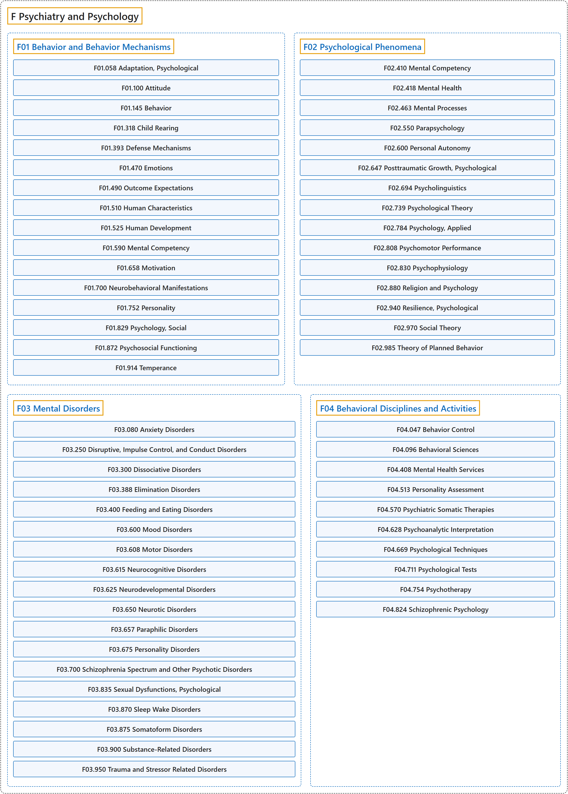

# F Psychiatry and Psychology

## Classification

## Glossary

| Term | Definition | 中文翻译 | Source |
|---|---|---|---|
| **F Psychiatry and Psychology** 精神病学和心理学 | (No definition) | （无定义） | [National Library of Medicine, 2026](https://meshb.nlm.nih.gov/treeView) |
| **[F01 Behavior and Behavior Mechanisms](f01-behavior-and-behavior-mechanisms.md)** 行为和行为机制 | "The **observable response made to a situation** and the unconscious processes underlying it." | **对情境做出的可观察反应**，以及其背后的无意识过程。 | [National Library of Medicine, 2026, "Behavior and Behavior Mechanisms" scope note](https://meshb.nlm.nih.gov/record/ui?ui=D001520) |
| **[F02 Psychological Phenomena](f02-psychological-phenomena.md)** 心理现象 | "Mechanisms and underlying **psychological principles of mental processes** and their applications." | **心理过程的**机制和基本**心理学原理**，以及它们的应用。 | [National Library of Medicine, 2026, "Psychological Phenomena" scope note](https://meshb.nlm.nih.gov/record/ui?ui=D011579) |
| **[F03 Mental Disorders](f03-mental-disorders.md)** 精神障碍 | "Psychiatric illness or diseases manifested by breakdowns in the adaptational process expressed primarily as **abnormalities of thought, feeling, and behavior** producing either distress or impairment of function." | 精神疾病，表现为适应过程的崩溃，主要表现为**思维、情感和行为的异常**，造成痛苦或功能损害。 | [National Library of Medicine, 2026, "Mental Disorders" scope note](https://meshb.nlm.nih.gov/record/ui?ui=D001523) |
| **[F04 Behavioral Disciplines and Activities](f04-behavioral-disciplines-and-activities.md)** 行为学科和活动 | "The **specialties in psychiatry and psychology**, their diagnostic techniques and tests, their therapeutic methods, and psychiatric and psychological services." | **精神病学和心理学的各专业**、它们的诊断技术和测验、治疗方法，以及精神科和心理服务。 | [National Library of Medicine, 2026, "Behavioral Disciplines and Activities" scope note](https://meshb.nlm.nih.gov/record/ui?ui=D004191) |

## References

National Library of Medicine. (2026). *MeSH 2026 descriptor records* [Data set]. Retrieved October 28, 2026, from <https://www.nlm.nih.gov/databases/download/mesh.html>
