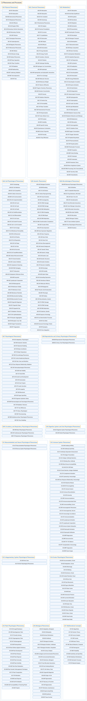

# G Phenomena and Processes

## Classification

## Glossary

| Term | Definition | 中文翻译 | Source |
|---|---|---|---|
| **G Phenomena and Processes** 现象和过程 | (No definition) | （无定义） | [National Library of Medicine, 2026](https://meshb.nlm.nih.gov/treeView) |
| **[G01 Physical Phenomena](g01-physical-phenomena.md)** 物理现象 | "The entities of **matter and energy**, and the processes, principles, properties, and relationships describing their nature and interactions." | **物质和能量**的实体，以及描述其本质和相互作用的过程、原理、性质和关系。 | [National Library of Medicine, 2026, "Physical Phenomena" scope note](https://meshb.nlm.nih.gov/record/ui?ui=D055585) |
| **[G02 Chemical Phenomena](g02-chemical-phenomena.md)** 化学现象 | "The composition, structure, conformation, and properties of **atoms and molecules**, and their reaction and interaction processes." | **原子和分子**的组成、结构、构象和性质，以及它们的反应和相互作用过程。 | [National Library of Medicine, 2026, "Chemical Phenomena" scope note](https://meshb.nlm.nih.gov/record/ui?ui=D055598) |
| **[G03 Metabolism](g03-metabolism.md)** 代谢 | "The **chemical reactions in living organisms** by which energy is provided for vital processes and activities and new material is assimilated." | **生物体内的化学反应**，通过这些反应为生命过程和活动提供能量并同化新物质。 | [National Library of Medicine, 2026, "Metabolism" scope note](https://meshb.nlm.nih.gov/record/ui?ui=D008660) |
| **[G04 Cell Physiological Phenomena](g04-cell-physiological-phenomena.md)** 细胞生理现象 | "**Cellular processes**, properties, and characteristics." | **细胞的过程**、性质和特征。 | [National Library of Medicine, 2026, "Cell Physiological Phenomena" scope note](https://meshb.nlm.nih.gov/record/ui?ui=D002468) |
| **[G05 Genetic Phenomena](g05-genetic-phenomena.md)** 遗传现象 | "The biological processes, properties, and objects that are involved in maintaining, expressing, and transmitting from one organism to another, **genetically encoded traits**." | 参与维持、表达以及在生物体之间传递**遗传编码性状**的生物过程、性质和对象。 | [National Library of Medicine, 2026, "Genetic Phenomena" scope note](https://meshb.nlm.nih.gov/record/ui?ui=D055614) |
| **[G06 Microbiological Phenomena](g06-microbiological-phenomena.md)** 微生物学现象 | "Physiological **processes and properties of microorganisms**, such as ARCHAEA; BACTERIA; RICKETTSIA; VIRUSES; and FUNGI." | **微生物的**生理**过程和性质**，如古菌（ARCHAEA）、细菌（BACTERIA）、立克次体（RICKETTSIA）、病毒（VIRUSES）和真菌（FUNGI）。 | [National Library of Medicine, 2026, "Microbiological Phenomena" scope note](https://meshb.nlm.nih.gov/record/ui?ui=D008827) |
| **[G07 Physiological Phenomena](g07-physiological-phenomena.md)** 生理现象 | "The **functions and properties of living organisms**, including both the physical and chemical factors and processes, supporting life in single- or multi-cell organisms from their origin through the progression of life." | **生物体的功能和性质**，包括在单细胞或多细胞生物中从起源到整个生命进程支持生命的物理和化学因素及过程。 | [National Library of Medicine, 2026, "Physiological Phenomena" scope note](https://meshb.nlm.nih.gov/record/ui?ui=D010829) |
| **[G08 Reproductive and Urinary Physiological Phenomena](g08-reproductive-and-urinary-physiological-phenomena.md)** 生殖和泌尿生理现象 | "Physiology of the human and animal body, male or female, in the processes and characteristics of **REPRODUCTION and the URINARY TRACT**." | 人体和动物身体（男性或女性）在**生殖（REPRODUCTION）和泌尿道**（URINARY TRACT）的过程和特征方面的生理学。 | [National Library of Medicine, 2026, "Reproductive and Urinary Physiological Phenomena" scope note](https://meshb.nlm.nih.gov/record/ui?ui=D012101) |
| **[G09 Circulatory and Respiratory Physiological Phenomena](g09-circulatory-and-respiratory-physiological-phenomena.md)** 循环和呼吸生理现象 | "Functional processes and properties characteristic of the **BLOOD; CARDIOVASCULAR SYSTEM; and RESPIRATORY SYSTEM**." | **血液（BLOOD）、心血管系统（CARDIOVASCULAR SYSTEM）和呼吸系统**（RESPIRATORY SYSTEM）特有的功能过程和性质。 | [National Library of Medicine, 2026, "Circulatory and Respiratory Physiological Phenomena" scope note](https://meshb.nlm.nih.gov/record/ui?ui=D002943) |
| **[G10 Digestive System and Oral Physiological Phenomena](g10-digestive-system-and-oral-physiological-phenomena.md)** 消化系统和口腔生理现象 | "Properties and processes of the **DIGESTIVE SYSTEM and DENTITION** as a whole or of any of its parts." | **消化系统（DIGESTIVE SYSTEM）和牙列**（DENTITION）整体或其任何部分的性质和过程。 | [National Library of Medicine, 2026, "Digestive System and Oral Physiological Phenomena" scope note](https://meshb.nlm.nih.gov/record/ui?ui=D055688) |
| **[G11 Musculoskeletal and Neural Physiological Phenomena](g11-musculoskeletal-and-neural-physiological-phenomena.md)** 肌肉骨骼和神经生理现象 | "Properties, and processes of the **MUSCULOSKELETAL SYSTEM and the NERVOUS SYSTEM** or their parts." | **肌肉骨骼系统（MUSCULOSKELETAL SYSTEM）和神经系统**（NERVOUS SYSTEM）或其各部分的性质和过程。 | [National Library of Medicine, 2026, "Musculoskeletal and Neural Physiological Phenomena" scope note](https://meshb.nlm.nih.gov/record/ui?ui=D055687) |
| **[G12 Immune System Phenomena](g12-immune-system-phenomena.md)** 免疫系统现象 | "The characteristic properties and processes involved in **IMMUNITY and an organism's immune response**." | **免疫（IMMUNITY）和生物体的免疫反应**所涉及的特征性质和过程。 | [National Library of Medicine, 2026, "Immune System Phenomena" scope note](https://meshb.nlm.nih.gov/record/ui?ui=D055633) |
| **[G13 Integumentary System Physiological Phenomena](g13-integumentary-system-physiological-phenomena.md)** 皮肤系统生理现象 | "The properties and relationships and biological processes that characterize the nature and function of the **SKIN and its appendages**." | 表征**皮肤（SKIN）及其附属器**本质和功能的性质、关系和生物过程。 | [National Library of Medicine, 2026, "Integumentary System Physiological Phenomena" scope note](https://meshb.nlm.nih.gov/record/ui?ui=D055827) |
| **[G14 Ocular Physiological Phenomena](g14-ocular-physiological-phenomena.md)** 眼生理现象 | "Processes and properties of the **EYE as a whole or of any of its parts**." | **眼（EYE）整体或其任何部分**的过程和性质。 | [National Library of Medicine, 2026, "Ocular Physiological Phenomena" scope note](https://meshb.nlm.nih.gov/record/ui?ui=D009799) |
| **[G15 Plant Physiological Phenomena](g15-plant-physiological-phenomena.md)** 植物生理现象 | "The physiological processes, properties, and states **characteristic of plants**." | **植物特有的**生理过程、性质和状态。 | [National Library of Medicine, 2026, "Plant Physiological Phenomena" scope note](https://meshb.nlm.nih.gov/record/ui?ui=D018521) |
| **[G16 Biological Phenomena](g16-biological-phenomena.md)** 生物现象 | "Biological processes, properties, and characteristics of the **whole organism** in human, animal, microorganisms, and plants, and of the **biosphere**." | 人类、动物、微生物和植物**整个生物体**的生物过程、性质和特征，以及**生物圈**的生物过程、性质和特征。 | [National Library of Medicine, 2026, "Biological Phenomena" scope note](https://meshb.nlm.nih.gov/record/ui?ui=D001686) |
| **[G17 Mathematical Concepts](g17-mathematical-concepts.md)** 数学概念 | "**Numeric or quantitative entities**, descriptions, properties, relationships, operations, and events." | **数值或定量的实体**、描述、性质、关系、运算和事件。 | [National Library of Medicine, 2026, "Mathematical Concepts" scope note](https://meshb.nlm.nih.gov/record/ui?ui=D055641) |

## References

National Library of Medicine. (2026). *MeSH 2026 descriptor records* [Data set]. Retrieved October 28, 2026, from <https://www.nlm.nih.gov/databases/download/mesh.html>
