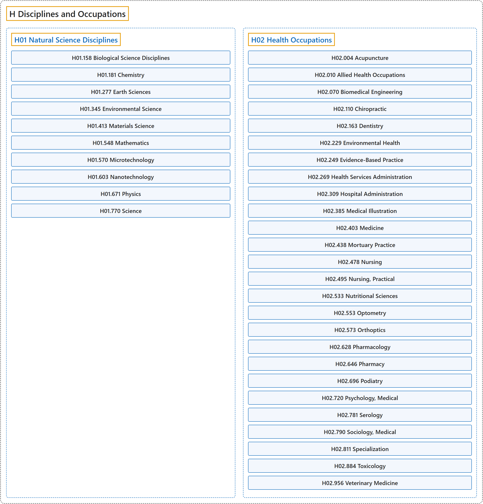

# H Disciplines and Occupations

## Classification

## Glossary

| Term | Definition | 中文翻译 | Source |
|---|---|---|---|
| **H Disciplines and Occupations** 学科和职业 | (No definition) | （无定义） | [National Library of Medicine, 2026](https://meshb.nlm.nih.gov/treeView) |
| **[H01 Natural Science Disciplines](h01-natural-science-disciplines.md)** 自然科学学科 | "The sciences dealing with **processes observable in nature**." | 研究**自然界中可观察过程**的科学。 | [National Library of Medicine, 2026, "Natural Science Disciplines" scope note](https://meshb.nlm.nih.gov/record/ui?ui=D010811) |
| **[H02 Health Occupations](h02-health-occupations.md)** 卫生职业 | "Professions or other business activities directed to the **cure and prevention of disease**. For occupations of medical personnel who are not physicians but who are working in the fields of medical technology, physical therapy, etc., ALLIED HEALTH OCCUPATIONS is available." | 以**疾病的治疗和预防**为目的的职业或其他业务活动。对于不是医生、而在医学技术、物理治疗等领域工作的医务人员的职业，可用 ALLIED HEALTH OCCUPATIONS（辅助卫生职业）。 | [National Library of Medicine, 2026, "Health Occupations" scope note](https://meshb.nlm.nih.gov/record/ui?ui=D006281) |

## References

National Library of Medicine. (2026). *MeSH 2026 descriptor records* [Data set]. Retrieved October 28, 2026, from <https://www.nlm.nih.gov/databases/download/mesh.html>
