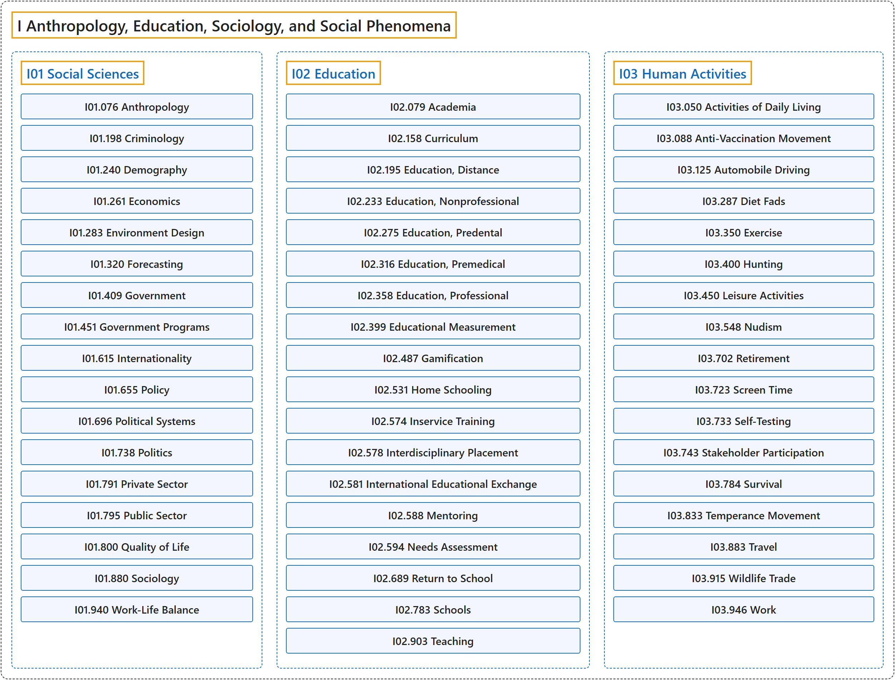

# I Anthropology, Education, Sociology, and Social Phenomena

## Classification

## Glossary

| Term | Definition | 中文翻译 | Source |
|---|---|---|---|
| **I Anthropology, Education, Sociology, and Social Phenomena** 人类学、教育、社会学和社会现象 | (No definition) | （无定义） | [National Library of Medicine, 2026](https://meshb.nlm.nih.gov/treeView) |
| **[I01 Social Sciences](i01-social-sciences.md)** 社会科学 | "Disciplines concerned with the **interrelationships of individuals in a social environment** including social organizations and institutions. Includes Sociology and Anthropology." | 研究**社会环境中个体之间相互关系**的学科，包括社会组织和机构。包括社会学和人类学。 | [National Library of Medicine, 2026, "Social Sciences" scope note](https://meshb.nlm.nih.gov/record/ui?ui=D012942) |
| **[I02 Education](i02-education.md)** 教育 | "**Acquisition of knowledge** as a result of instruction in a formal course of study." | 通过正式课程学习中的教学而**获得知识**。 | [National Library of Medicine, 2026, "Education" scope note](https://meshb.nlm.nih.gov/record/ui?ui=D004493) |
| **[I03 Human Activities](i03-human-activities.md)** 人类活动 | "**Activities performed by humans**." | **人类进行的活动**。 | [National Library of Medicine, 2026, "Human Activities" scope note](https://meshb.nlm.nih.gov/record/ui?ui=D006802) |

## References

National Library of Medicine. (2026). *MeSH 2026 descriptor records* [Data set]. Retrieved October 28, 2026, from <https://www.nlm.nih.gov/databases/download/mesh.html>
