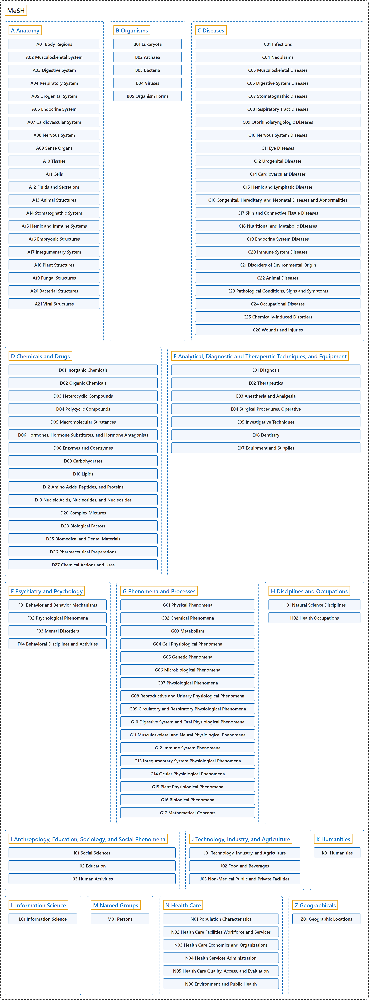

# MeSH

## Classification

## Glossary

| Term | Definition | 中文翻译 | Source |
|---|---|---|---|
| **MeSH** 医学主题词表（MeSH） | "The Medical Subject Headings (MeSH) thesaurus is a **controlled and hierarchically-organized vocabulary** produced by the National Library of Medicine. It is used for **indexing, cataloging, and searching** of biomedical and health-related information." | 医学主题词表（MeSH）叙词表是美国国家医学图书馆编制的一套**受控且分层组织的词表**。它用于对生物医学和健康相关信息进行**标引、编目和检索**。 | [National Library of Medicine, n.d., para. 1](https://www.nlm.nih.gov/mesh/meshhome.html#:~:text=The%20Medical%20Subject%20Headings%20%28MeSH%29%20thesaurus%20is%20a%20controlled) |
| **[A Anatomy](a-anatomy/index.md)** 解剖学 | (No definition) | （无定义） | [National Library of Medicine, 2026](https://meshb.nlm.nih.gov/treeView) |
| **[B Organisms](b-organisms/index.md)** 生物体 | (No definition) | （无定义） | [National Library of Medicine, 2026](https://meshb.nlm.nih.gov/treeView) |
| **[C Diseases](c-diseases/index.md)** 疾病 | (No definition) | （无定义） | [National Library of Medicine, 2026](https://meshb.nlm.nih.gov/treeView) |
| **[D Chemicals and Drugs](d-chemicals-and-drugs/index.md)** 化学品和药物 | (No definition) | （无定义） | [National Library of Medicine, 2026](https://meshb.nlm.nih.gov/treeView) |
| **[E Analytical, Diagnostic and Therapeutic Techniques, and Equipment](e-analytical-diagnostic-and-therapeutic-techniques-and-equip/index.md)** 分析、诊断和治疗技术及设备 | (No definition) | （无定义） | [National Library of Medicine, 2026](https://meshb.nlm.nih.gov/treeView) |
| **[F Psychiatry and Psychology](f-psychiatry-and-psychology/index.md)** 精神病学和心理学 | (No definition) | （无定义） | [National Library of Medicine, 2026](https://meshb.nlm.nih.gov/treeView) |
| **[G Phenomena and Processes](g-phenomena-and-processes/index.md)** 现象和过程 | (No definition) | （无定义） | [National Library of Medicine, 2026](https://meshb.nlm.nih.gov/treeView) |
| **[H Disciplines and Occupations](h-disciplines-and-occupations/index.md)** 学科和职业 | (No definition) | （无定义） | [National Library of Medicine, 2026](https://meshb.nlm.nih.gov/treeView) |
| **[I Anthropology, Education, Sociology, and Social Phenomena](i-anthropology-education-sociology-and-social-phenomena/index.md)** 人类学、教育、社会学和社会现象 | (No definition) | （无定义） | [National Library of Medicine, 2026](https://meshb.nlm.nih.gov/treeView) |
| **[J Technology, Industry, and Agriculture](j-technology-industry-and-agriculture/index.md)** 技术、工业和农业 | (No definition) | （无定义） | [National Library of Medicine, 2026](https://meshb.nlm.nih.gov/treeView) |
| **[K Humanities](k-humanities/index.md)** 人文学科 | (No definition) | （无定义） | [National Library of Medicine, 2026](https://meshb.nlm.nih.gov/treeView) |
| **[L Information Science](l-information-science/index.md)** 信息科学 | (No definition) | （无定义） | [National Library of Medicine, 2026](https://meshb.nlm.nih.gov/treeView) |
| **[M Named Groups](m-named-groups/index.md)** 命名群体 | (No definition) | （无定义） | [National Library of Medicine, 2026](https://meshb.nlm.nih.gov/treeView) |
| **[N Health Care](n-health-care/index.md)** 卫生保健 | (No definition) | （无定义） | [National Library of Medicine, 2026](https://meshb.nlm.nih.gov/treeView) |
| **[Z Geographicals](z-geographicals/index.md)** 地理区域 | (No definition) | （无定义） | [National Library of Medicine, 2026](https://meshb.nlm.nih.gov/treeView) |

## References

National Library of Medicine. (2026). *MeSH 2026 descriptor records* [Data set]. Retrieved October 28, 2026, from <https://www.nlm.nih.gov/databases/download/mesh.html>

National Library of Medicine. (n.d.). *Welcome to Medical Subject Headings*. Retrieved October 27, 2026, from <https://www.nlm.nih.gov/mesh/meshhome.html>
