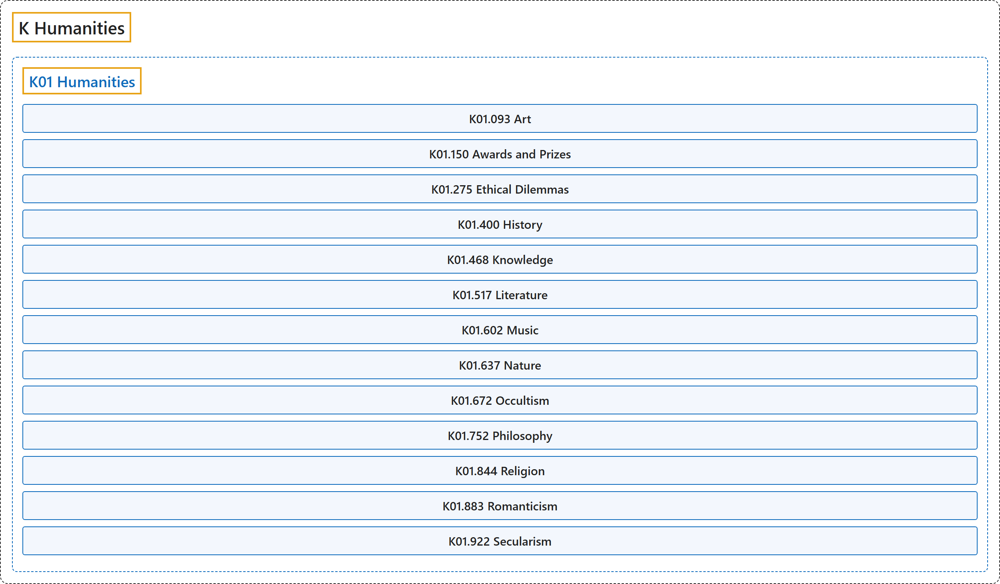

# K Humanities

## Classification

## Glossary

| Term | Definition | 中文翻译 | Source |
|---|---|---|---|
| **K Humanities** 人文学科 | (No definition) | （无定义） | [National Library of Medicine, 2026](https://meshb.nlm.nih.gov/treeView) |
| **[K01 Humanities](k01-humanities.md)** 人文学科 | "Fields of inquiry in **human constructs and concerns** as opposed to natural processes and social relations. These are traditionally the study of **literature, philosophy, and religion**." | 研究**人类建构和关切**的领域，与自然过程和社会关系相对。传统上是对**文学、哲学和宗教**的研究。 | [National Library of Medicine, 2026, "Humanities" scope note](https://meshb.nlm.nih.gov/record/ui?ui=D006809) |

## References

National Library of Medicine. (2026). *MeSH 2026 descriptor records* [Data set]. Retrieved October 28, 2026, from <https://www.nlm.nih.gov/databases/download/mesh.html>
